# How the paper plane folds itself

*A node-by-node walkthrough of Nodevember 2026 · Day 1 · Origami*

A sheet of washi paper on a stack folds itself into a classic dart paper plane, stands up on its keel and glides away.
The sheet underneath is already in place, so the 8-second loop never shows a seam. There is no simulation, no shape keys and no
modelled mesh. Everything is one Geometry Nodes tree that starts from a flat grid.

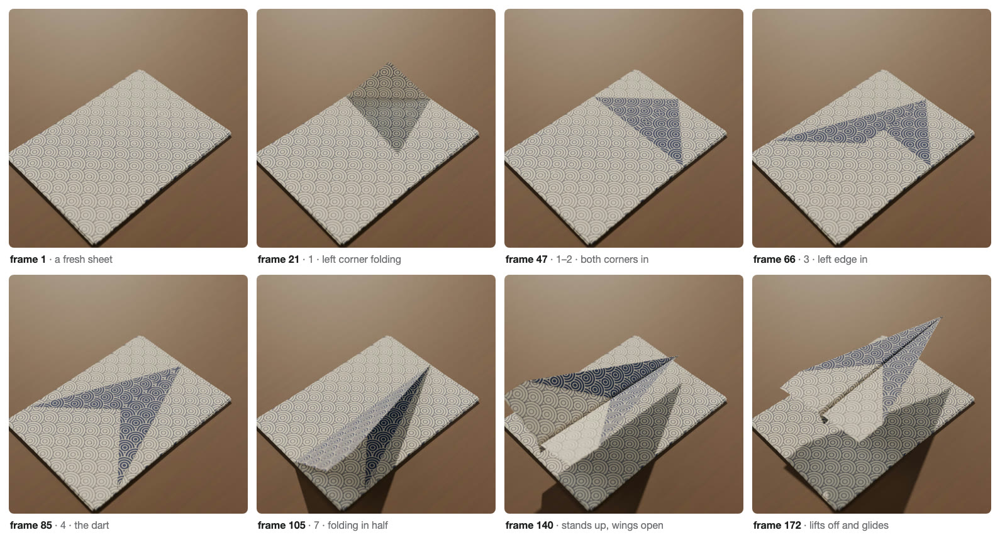

| File | What it is |
|---|---|
| [`../loop.mp4`](../loop.mp4) | the render, 1080 × 1080, 240 frames at 30 fps |
| [`../origami.blend`](../origami.blend) | the scene; select **PA_PaperPlane** and open its Geometry Nodes modifier |
| [`../build.py`](../build.py) | the script that builds the whole file (every node in this tutorial comes from it) |

---

## The one idea

> **A fold is a rotation.** Draw a line on the paper (the crease). Every point on one side of the line rotates around
> that line, and the points on the other side stay where they are.

Everything else in the tree is bookkeeping around that idea:

- **When** does each fold happen? That is the timeline.
- **Which** points move? The crease line plus a "side" vector decide that.
- **How high** is the hinge? The flap has to land *on top of* the paper, not inside it.
- What happens **after** the folding? The plane stands up, flies off, and a stack of paper sits underneath.

### How to read the screenshots

In `origami.blend` the trees are laid out exactly as in the map below: one coloured frame per section. The material and
`PA_Fold` are split into frames *a · b · c* in the same way.

The full tree is big, so each section below also shows a cut-out of just its own nodes.

- Wires that come from another section enter through a **Group Input** on the left. It is named after what it carries
  (for example `Phase`, `sheet` or `folded plane`).
- Wires that leave the section exit through a **Group Output** on the right.
- Node titles such as `A4 sheet` or `crisp facets` are the labels you will find in the `.blend` file.

Click any screenshot to see it at full size.

---

## 0 · The map

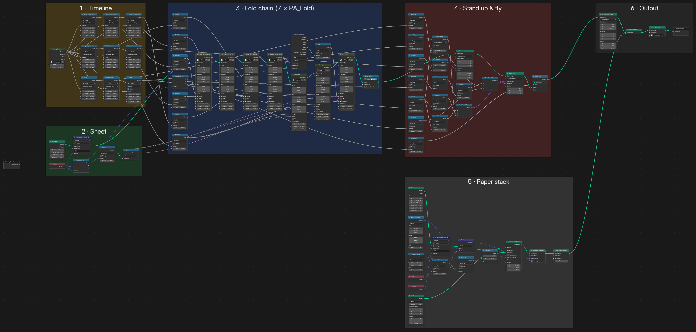

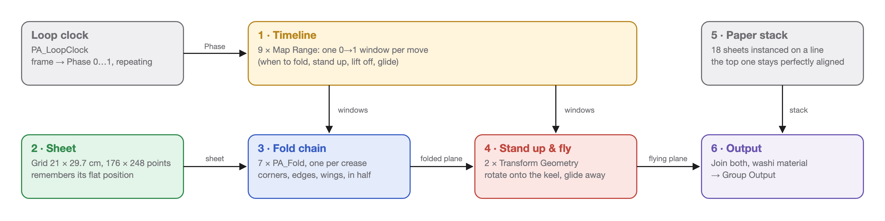

| # | Section | Nodes | Job |
|---|---|---|---|
| 1 | **Timeline** | 1 group + 9 Map Range | turns the frame number into nine 0 → 1 "progress" values, one per move |
| 2 | **Sheet** | Grid + 5 helpers | makes the A4 sheet and remembers where every point started |
| 3 | **Fold chain** | 7 × `PA_Fold` + helpers | the seven folds, one group node per crease |
| 4 | **Stand up & fly** | 2 × Transform Geometry + math | rotates the plane onto its keel and moves it along a flight path |
| 5 | **Paper stack** | Mesh Line + Cube instances | 18 sheets underneath, so the loop can close |
| 6 | **Output** | Join + Set Material | puts it all together and applies the washi paper material |

The lone **Group Input** at the far left is not connected to anything. The tree ignores the object's own mesh and builds
everything from nothing.

---

## 1 · Timeline: one clock, nine windows

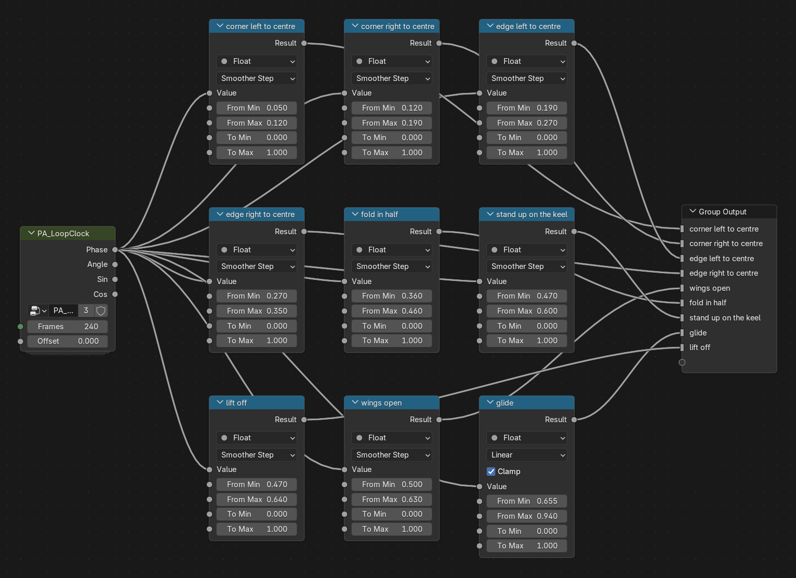

**`PA_LoopClock`** turns the current frame into **Phase**, a number that runs from 0 to 1 over the 240 frames and then
starts again at 0. Frame 241 gets exactly the same Phase as frame 1, which is why the loop is seamless. (Its inside is shown in
[the appendix](#appendix-a--pa_loopclock).)

Each **Map Range** node is a *time window*. Phase goes in; **From Min** and **From Max** say when the move starts and ends.
The output (`Result`) is:

- `0` before the window, so the move has not started;
- rising from `0` to `1` inside the window;
- `1` after it, so the move is finished and stays finished.

The interpolation is set to **Smoother Step**, so every move starts gently and settles gently instead of jerking.
The one exception is `glide`, which is **Linear**. The flight adds its own acceleration later.

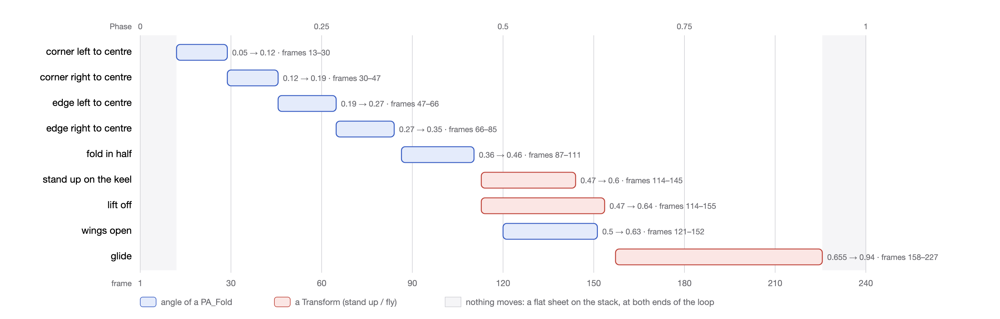

Notice the grey bands at both ends: nothing moves there. The loop starts and ends on a still, flat sheet.

> **Try it:** to retime the animation, change only these From Min / From Max numbers. Nothing else needs to know.

---

## 2 · The sheet

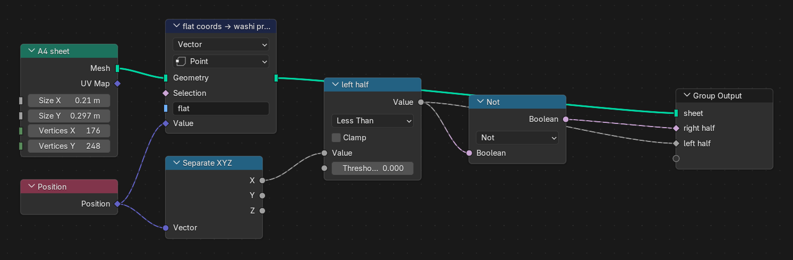

| Node | What it does |
|---|---|
| **`A4 sheet`** (Grid) | A flat 21 × 29.7 cm grid with 176 × 248 points, about one point every 1.2 mm. The nose of the plane will be the middle of the top edge, at y = +14.85 cm. |
| **`flat coords → washi print`** (Store Named Attribute) | Saves every point's *starting* position into an attribute called `flat`, **before anything moves**. The material reads `flat` to place the wave pattern, so the print stays glued to the paper while it folds. It works like a UV map you make yourself. |
| **Position → Separate XYZ → `left half`** (Less Than 0) | `true` for every point with x < 0: the left half of the sheet. |
| **`Not`** | The opposite: the right half. |

The two halves are **masks**. Later folds use them to move only one half, for example only the left wing.

---

## 3 · The fold chain

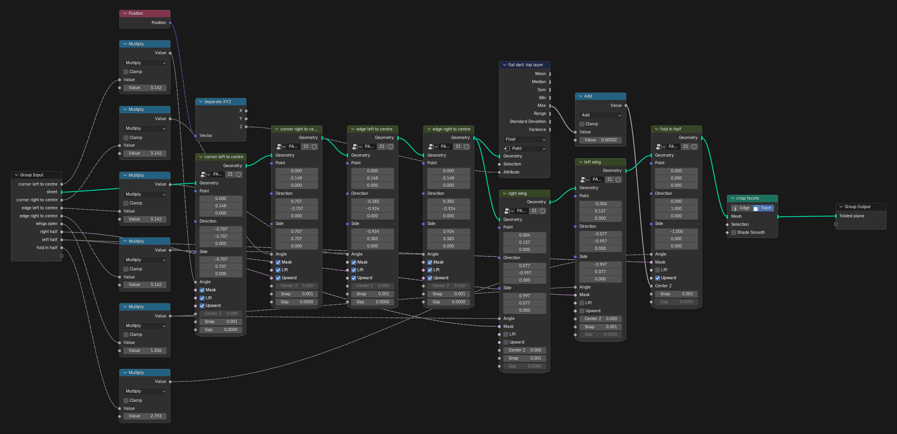

The sheet goes through **seven `PA_Fold` group nodes in a row**. Each one adds one crease to whatever the previous one produced.
`PA_Fold` is a custom node group. Here is what each copy is told:

| # | Node | Crease through | Moving side | Angle | Window |
|---|---|---|---|---|---|
| 1 | `corner left to centre` | the nose, 45° down-left | top-left corner | window × 180° | frames 13–30 |
| 2 | `corner right to centre` | the nose, 45° down-right | top-right corner | window × 180° | frames 30–47 |
| 3 | `edge left to centre` | the nose, 22.5° from vertical | left edge | window × 180° | frames 47–66 |
| 4 | `edge right to centre` | the nose, 22.5° from vertical | right edge | window × 180° | frames 66–85 |
| 5 | `right wing` | near the centre line, right | outer right part (*right half* mask) | window × 76.6° | frames 121–152 |
| 6 | `left wing` | mirror of 5 | outer left part (*left half* mask) | window × 76.6° | frames 121–152 |
| 7 | `fold in half` | the centre line | the whole left half | window × 160° | frames 87–111 |

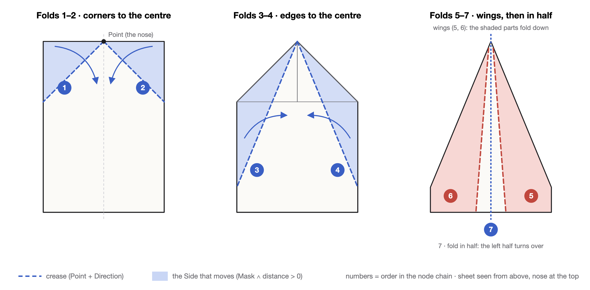

The **Multiply** nodes on the left turn each 0 → 1 window into an angle in radians: π (3.142) means folded completely flat.

### Trick 1 · creases are written on a flat sheet

When fold 3 is moving, folds 1 and 2 are already complete, so the paper is lying flat again. That means every crease can be
written in plain desk coordinates, a point and a direction on the table. Nothing has to track where a line ended up after
earlier folds. This only works because the windows never overlap while the paper is still flat.

### Trick 2 · chain order is not time order

The wings (5, 6) come **before** the fold in half (7) in the chain, but in time they open **after** it.

- The wing creases are easiest to describe on the flat dart, so the wing folds are applied first, to the flat dart.
- The fold in half then turns the whole left half over, and the left wing goes with it.

The chain order says *in which space a crease is defined*. The windows say *when it moves*. They don't have to agree.

### The other nodes in this section

- **`flat dart: top layer`** (Attribute Statistic, Max of Z) measures the height of the flat dart after folds 1–4.
  **Add** puts half a paper gap on top of that. The result becomes the hinge height (`Center Z`) for the fold in half,
  so the left half turns over the top of the paper layers instead of through them.
- **Wing angle 76.6°**, which is 90° − 10° − 3.4°. The wings fold *down* (`Upward` off) around a hinge at desk level (`Center Z` 0).
  After the plane stands up (section 4) they end up almost level, with a 3.4° upward tilt (dihedral).
- **Fold in half 160°**, not 180°. The halves stay 20° apart, so the fuselage is a V instead of a flat sandwich.
- **`crisp facets`** (Set Shade Smooth off) uses flat shading, so the creases read as sharp lines.

---

## 3a–c · Inside `PA_Fold`

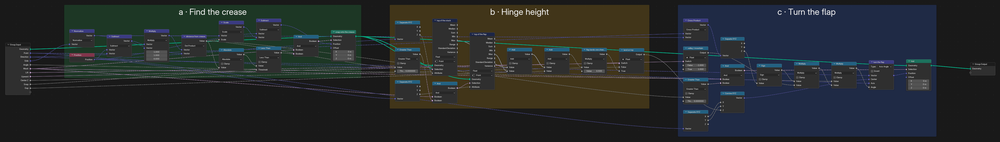

One group, used seven times. Its inputs:

| Input | Meaning |
|---|---|
| **Geometry** | the paper so far |
| **Point**, **Direction** | the crease: a point on it and the direction it runs |
| **Side** | an arrow pointing to the side that moves |
| **Angle** | how far to fold right now, in radians |
| **Mask** | an extra selection, for example "left half only" (default: everything) |
| **Lift** | on: work out the hinge height automatically so the flap lands on top (default on) |
| **Upward** | on: the flap first lifts *up* off the table (valley fold); off: it swings *down* |
| **Center Z** | hinge height to use when Lift is off |
| **Snap** | how close to the crease a point must be to get pulled onto it (0.9 mm, ¾ of a grid cell) |
| **Gap** | a tiny space between paper layers (0.05 mm) |

### a · Find the crease and snap onto it

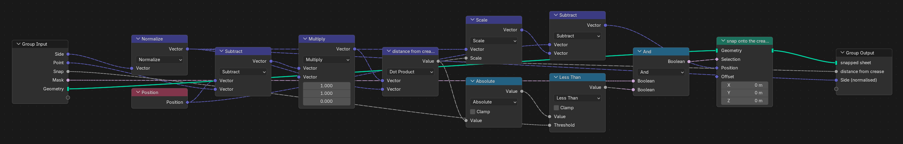

1. **Subtract** (Position − Point), then **Multiply** by (1, 1, 0). This gives the offset of each point from the crease,
   ignoring height.
2. **`distance from crease`** (Dot Product with the normalised Side) gives a signed distance: positive on the side that moves,
   negative on the side that stays, zero on the line.
3. **Absolute → Less Than Snap**, **And** Mask: the points that are almost on the crease.
4. **Scale** the Side by the distance and **Subtract** it from the position. Those points slide sideways exactly onto the line.
   **`snap onto the crease`** (Set Position) applies it.

Why snap? The grid's points don't lie on a diagonal line. Without snapping, a 45° fold would leave a staircase edge.
With it, every fold edge is a straight line.

### b · How high is the hinge?

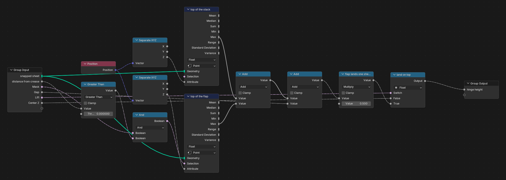

If the hinge sat at table height, a flap folded 180° would end up *below* the table, inside the paper. So the hinge is
lifted:

- **`top of the stack`**: the highest point of the whole paper (Attribute Statistic, Max of Z).
- **`top of the flap`**: the highest point of the part that moves (same node, with the moving selection).
- **Add, Add, Multiply 0.5**, labelled **`flap lands one sheet above the stack`**: hinge height = (top of stack + top of flap + Gap) ÷ 2.

Why that formula? Turning something 180° around a hinge at height *h* sends height *z* to 2*h* − *z*. Put in the
numbers and the flap's highest layer lands exactly one Gap above the highest layer of the paper. It also arrives upside down,
with its layer order reversed, just like real paper.

**`land on top`** (Switch) uses this height when **Lift** is on. Otherwise it uses **Center Z**, which the wings and the fold
in half set themselves.

### c · Turn the flap

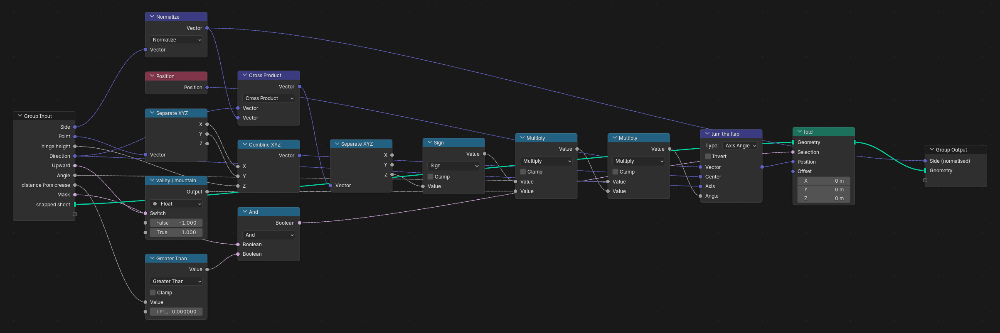

1. **Cross Product** (Direction × Side) → **Separate XYZ** Z → **Sign**. A rotation's direction depends on which way the
   crease runs. This sign flips the angle so that a positive Angle always lifts the flap *up*.
2. **`valley / mountain`** (Switch on **Upward**): × 1 or × −1, so the flap can swing down instead.
3. **Combine XYZ** builds the hinge's pivot: the crease Point at the hinge height.
4. **`turn the flap`** (Vector Rotate, Axis Angle) rotates every position around that pivot, about the crease Direction.
5. **`fold`** (Set Position) applies it only where **Mask is on and the distance is > 0**: strictly the moving side.
   Points sitting on the crease stay put, so the paper never tears.

---

## 4 · Stand up and fly

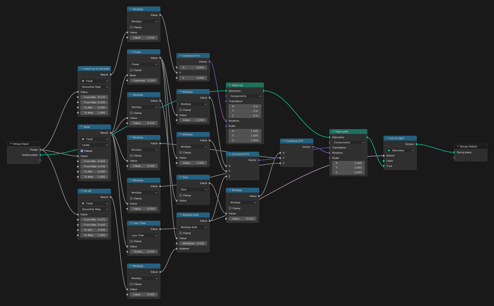

After the fold in half the plane is lying on its side. Two **Transform Geometry** nodes take over.

**`stand up`** rotates around the Y axis (the keel, the fold line) by `stand up on the keel` × −80°, that is −(90° − 10°).
The two halves of the V end up pointing up, the keel at the bottom, and the folded-down wings come out level.

**`flight path`** moves and turns the plane:

| | Formula | Feels like |
|---|---|---|
| progress *e* | `glide` window, Linear, frames 158–227 | 0 → 1 |
| ease | **Power** *e*^2.1 | a slow start, then speeding up |
| Translation X | *e*^2.1 × −0.35 m | drifts left |
| Translation Y | *e*^2.1 × 1.9 m | flies forward; the nose points to +Y |
| Translation Z | *e*^2.1 × 0.42 m + `lift off` × 0.03 m | climbs; a 3 cm hop as it stands up |
| Rotation X | sin(π *e*) × 0.16 | the nose pitches up, then back down |
| Rotation Y | *e* × −0.45 | banks into the turn |
| Rotation Z | *e* × 0.35 | yaws into the turn |

**Less Than 0.999 → `out of sight`** (Switch): once the plane has left the frame (*e* ≈ 1), the switch outputs nothing,
so the plane is simply gone until Phase wraps back to 0.

---

## 5 · The paper stack, and the output

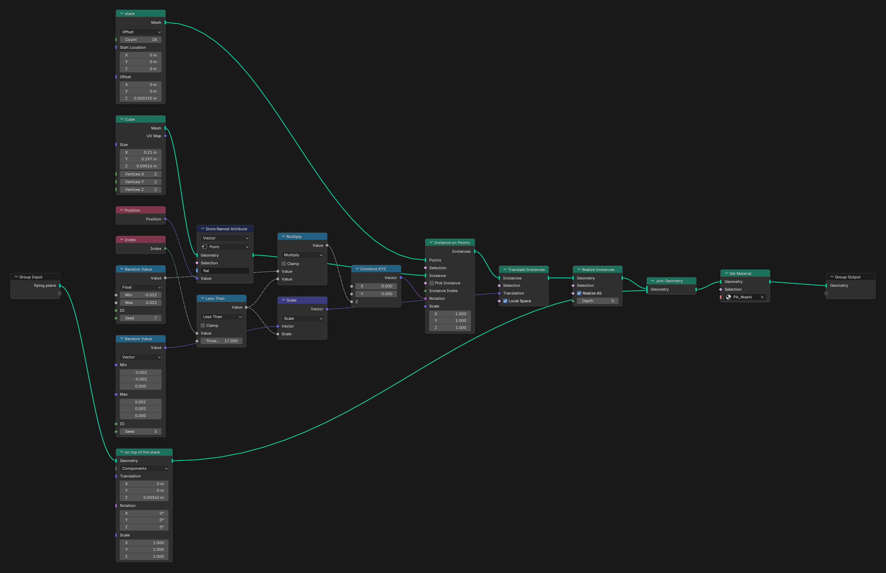

- **`stack`** (Mesh Line): 18 points, one above the other, 0.19 mm apart.
- **Cube**: one sheet, 21 × 29.7 cm × 0.16 mm. **Store Named Attribute** gives it the `flat` coordinates too, so it gets the
  same wave print.
- **Instance on Points**: a sheet on every point. Each one is rotated a little (**Random Value** ±0.022 rad) and shifted a
  little (**Random Value** ±2 mm via **Translate Instances**) so the stack looks loose and handmade.
- **Index → Less Than 17**, labelled *loose*, multiplies both jitters. The **top sheet (index 17) gets no jitter**: it lines up
  perfectly with the sheet that folds.
- **`on top of the stack`** (Transform) lifts the folding sheet 3.42 mm, to just above the stack.
- **Realize Instances → Join Geometry → Set Material** (washi) → Group Output.

**Why the loop never shows a seam.** At frame 1 a flat sheet sits on top of the stack. At frame 240 the plane has flown
away, and you see the stack's top sheet: same size, same position, same print, 0.08 mm lower. At this size nobody can tell
them apart, so frame 240 → frame 1 looks like nothing happened.

---

## Appendix A · `PA_LoopClock`

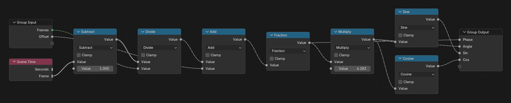

**Scene Time** Frame → **Subtract** 1 → **Divide** by Frames (240) → **Add** Offset → **Fraction** gives
**Phase**: 0 at frame 1, 0.5 at frame 121, and back to 0 at frame 241.
**Multiply** by 2π gives **Angle**; **Sine** and **Cosine** give smooth back-and-forth values for circular motion.
Any motion driven only by Phase repeats perfectly every 240 frames.

## Appendix B · the washi material

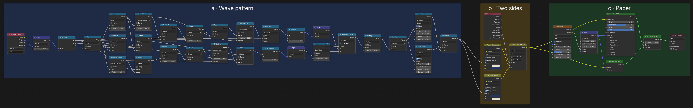

- **a · Wave pattern.** The **Attribute** node reads `flat`, the position each point had on the flat sheet. That value is
  divided into 1.6 cm cells, and each row of cells holds a fan of four concentric rings, with every other row shifted by
  half a fan. Where two rows overlap, the lower row covers the one behind it. This is *seigaiha* (青海波), the traditional
  Japanese wave pattern. Two Map Range nodes turn the rings into thin lines (`wave lines`).
- **b · Two sides.** Real paper has a front and a back. **Geometry → Backfacing** chooses between *indigo lines on cream*
  (front) and *cream lines on indigo* (back). So when a flap turns over, you see the other colour.
- **c · Paper.** A fine **Noise Texture** (scale 700) drives a faint **Bump** for the fibres. **Principled BSDF** (roughness
  0.72, a little sheen) is mixed 12 % with **Translucent BSDF**, so light glows through the thin paper.

---

## Try it yourself

1. Open `origami.blend`, select **PA_PaperPlane** and scrub the timeline. Watch the modifier's node tree while you do.
2. In the timeline section, drag a window's **From Min / From Max** and see that move shift in time.
3. Change the `fold in half` Multiply from 2.793 (160°) to 3.142 (180°). The fuselage closes flat.
4. Open a `PA_Fold` node (Tab) and turn **Snap** to 0. The fold edges become staircases.
5. Rebuild everything from scratch:
   `Blender -b --factory-startup --python build.py`. In `build.py`, `ALPHA` sets the V opening, `FRAMES` the loop
   length, and the `folds` list the creases. The tidy layout and frames come back from `nodes_layout.json`. Nodes you
   add that are not in that file keep the plain automatic layout.

*Made with Blender 5.2 Geometry Nodes for [Nodevember](https://nodevember.io) 2026, Day 1 · Origami.*
