# A day in the corner, node by node

*A walkthrough of Nodevember 2026 · Day 2 · Furniture (v3)*

A reading corner on a seamless limewash set: a bouclé barrel chair with a chunky-knit pillow, a turned walnut side table,
a travertine lamp with a pleated linen shade, a wool rug and a glazed vase of pampas grass. Nothing in the room moves
except the light. One window, out of frame on the left, is the only sun, and over a 10-second loop a whole day crosses
the corner. The lamp switches on at blue hour, the moon comes through the same window, and the morning comes back.

There are no image textures, no modelled meshes and no keyframes. Every object is built in Geometry Nodes, every surface
is shader nodes, and every light is a driver: a small formula of the frame number.

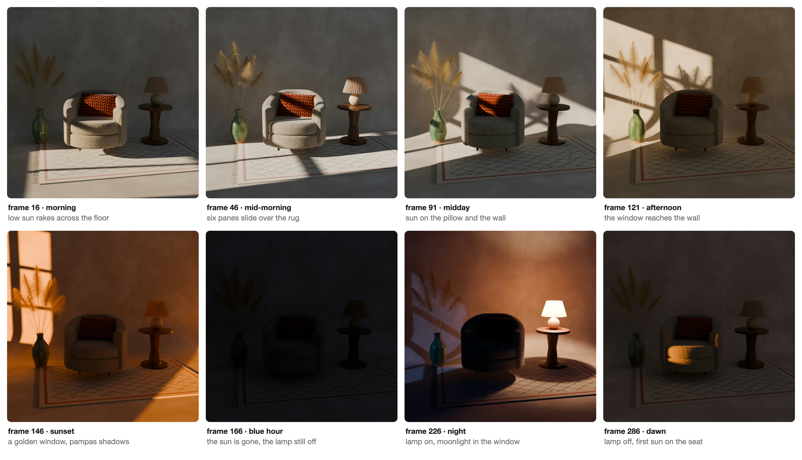

| File | What it is |
|---|---|
| [`../loop.mp4`](../loop.mp4) | the render, 1080 × 1080, 300 frames at 30 fps, Cycles 96 samples |
| [`../corner.blend`](../corner.blend) | the scene. Select **PA_Corner** and open its Geometry Nodes modifier, or scrub the timeline |
| [`../build.py`](../build.py) | the script that builds the whole file. Every node in this tutorial comes from it |
| [`../nodes_layout.json`](../nodes_layout.json) | the tidy node layout with frames, which `build.py` restores |

---

## The one idea

> **Materials only show when light moves across them.** So the furniture stands still and the light does the moving.

A bouclé chair under flat light is a beige blob. Under raking light every loop of yarn throws a tiny shadow. The same
goes for walnut grain, the pleats of a shade, the pile of a rug and the drips in a glaze. So the piece is a day. It has
low morning sun, hard noon light, a golden window at sunset, warm lamp light and cold moonlight, and each material gets
its moment.

That splits the work into three parts:

- **Shapes** (sections 1–8): one Geometry Nodes tree builds the room and the furniture. Three smaller trees build the
  pampas, the rug fringe and the window wall.
- **Materials** (section 9): eight shader trees. Each object stores its own coordinates in an attribute, so the pattern
  sticks to the object.
- **The day** (section 10): drivers on the sun, the moon, the lamp, the sky and the camera, all functions of the frame.

### How to read the screenshots

In `corner.blend` the main tree is laid out exactly as in the map below, with one coloured frame per section. The
screenshots of each section are crops of that same tree, so a few long wires cross them on their way to other sections.
Node titles such as `stuffing` or `rows of Vs` are the labels you will find in the file. Click any screenshot to see it
at full size.

---

## 0 · The map

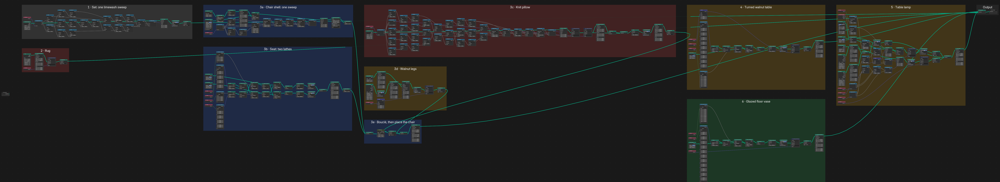

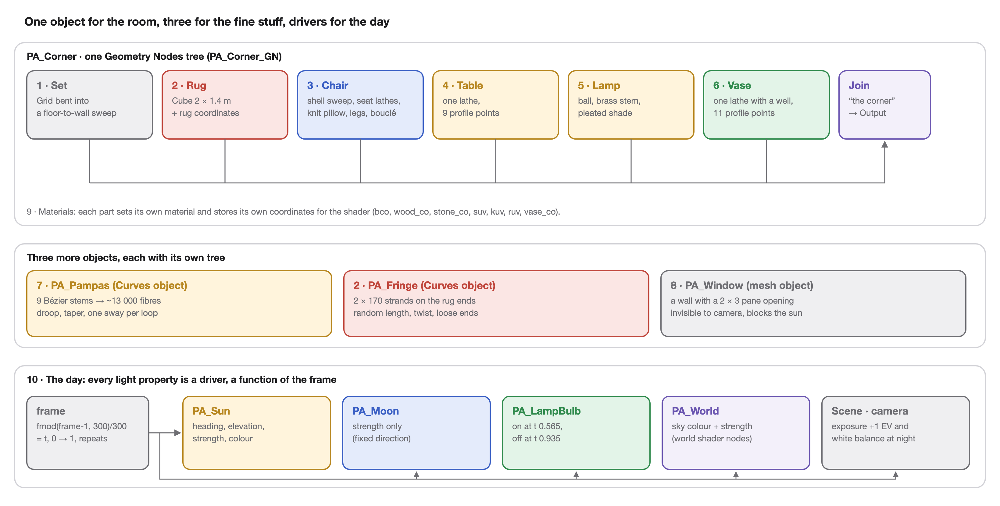

| # | Section | Nodes | Job |
|---|---|---|---|
| 1 | **Set** | 24 | one grid bent into a floor that curves up into the wall |
| 2 | **Rug** | 5 | a 2 × 1.4 m slab (the pattern is all shader) |
| 3a | **Chair shell** | 20 | a rounded section swept 250° around the back, arms lowered |
| 3b | **Seat** | 29 | two lathes: the upholstered deck and the cushion |
| 3c | **Knit pillow** | 48 | a grid inflated into a pillow, stockinette stitches pushed out of it |
| 3d | **Legs** | 11 | four tapered walnut cones |
| 3e | **Bouclé** | 5 | the `PA_Boucle` group, then the chair is placed in the room |
| 4 | **Table** | 17 | one lathe from 9 profile points |
| 5 | **Lamp** | 40 | a travertine ball, a brass stem, a pleated shade |
| 6 | **Vase** | 16 | one lathe from 11 profile points, with a well inside |
| | **Output** | 2 | `the corner` (Join Geometry) → Group Output |

The lone **Group Input** on the far left is not connected. The tree ignores the object's own mesh and builds everything
from nothing. The pampas (section 7), the fringe (section 2) and the window wall (section 8) are separate objects with
their own trees.

---

## 1 · The set: one sweep, no horizon

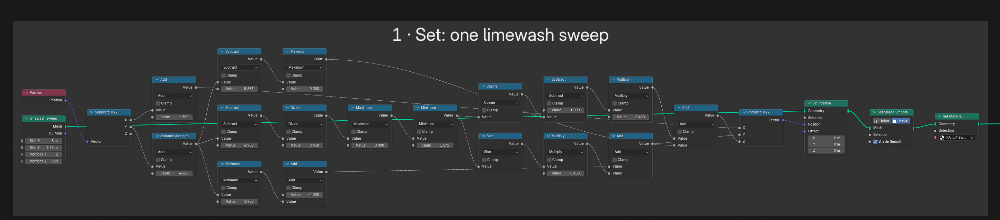

A photo studio hides the corner between floor and wall with a curved sweep, so there is no horizon line. This is the
same idea in nodes.

- **`limewash sweep`** (Grid): 8 m wide and *L* = 9.26 m long, with 2 × 320 vertices. It only needs vertices along its
  length, because it bends in one direction.
- **`distance along the sweep`**: *s* = y + L/2, which runs from 0 at the front edge to *L* at the top of the wall.
- The floor is flat for the first *S0* = 4.95 m. Then it bends up around a cove of radius *R* = 0.45 m, and the rest goes
  straight up:

  | | formula |
  |---|---|
  | bend angle | `clamp((s − S0) / R, 0, π/2)` |
  | new y | `−4 + min(s, S0) + sin(bend) · R` |
  | new z | `(1 − cos(bend)) · R + max(s − S0 − πR/2, 0)` |
  | new x | `x + (−2.7 + 4)`, so the left edge of the sweep sits at the window wall |

- **Set Shade Smooth** and **Set Material** (limewash) finish it.

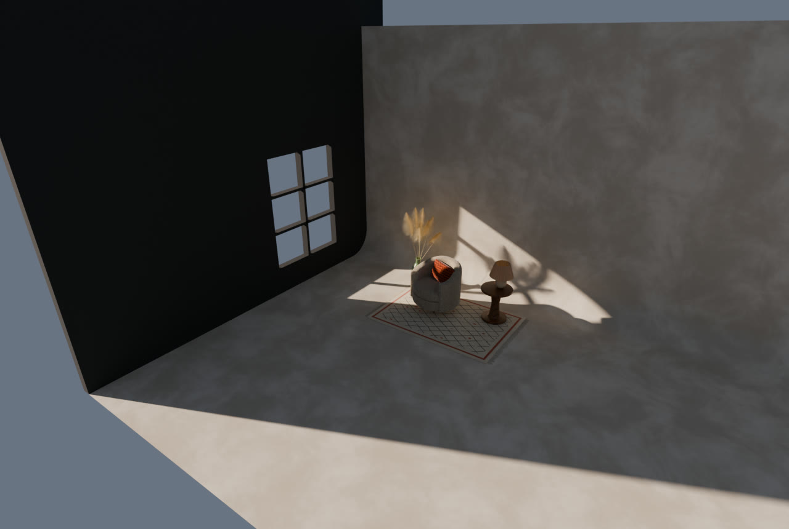

*Behind the scenes, frame 91.* For this shot only, the window wall (section 8) is made visible to the camera: a black
slab with a 2 × 3 pane opening. In the real render the camera never sees it, but the sun still has to pass through it.

---

## 2 · Rug and fringe

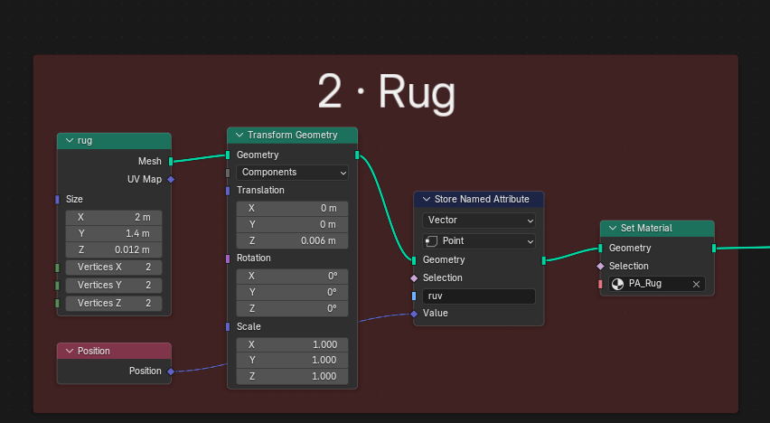

The rug is a **Cube** of 2 × 1.4 × 0.012 m lifted onto the floor. **Store Named Attribute `ruv`** saves each point's
position, and the rug shader draws the whole pattern from `ruv` (see [9f](#9f--wool-rug)).

The fringe is a separate **Curves object**, `PA_Fringe`:

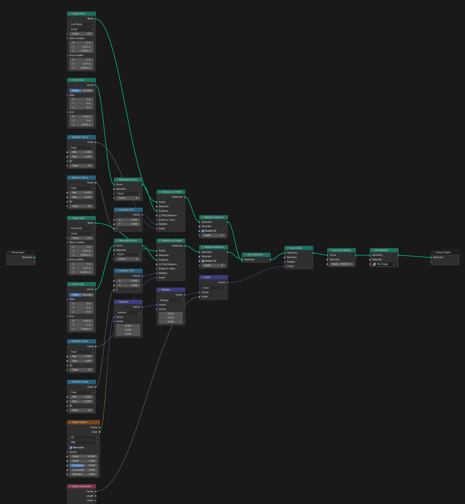

- **`fringe roots`** (Mesh Line, End Points): 170 roots along each short end of the rug.
- A 6 cm **Curve Line** pointing outward, resampled to 6 points, is the strand.
- **Instance on Points** gives every root a strand, scaled by **Random Value** 0.75–1.2 and turned by ±0.22 rad about z.
- **`loose ends`** (Set Position): Noise moves each point up to 6 mm sideways, multiplied by the **Spline Parameter**
  factor, so the roots stay put and the tips wander.
- **Set Curve Radius** 1.1 mm gives the threads their thickness.

> **Why a Curves object?** Cycles does not render Geometry Nodes curves that come out of a *mesh* object's modifier. It
> renders them from a **Curves** (hair) object. `build.py` creates one with `bpy.data.hair_curves.new()` and puts the
> node tree on it.

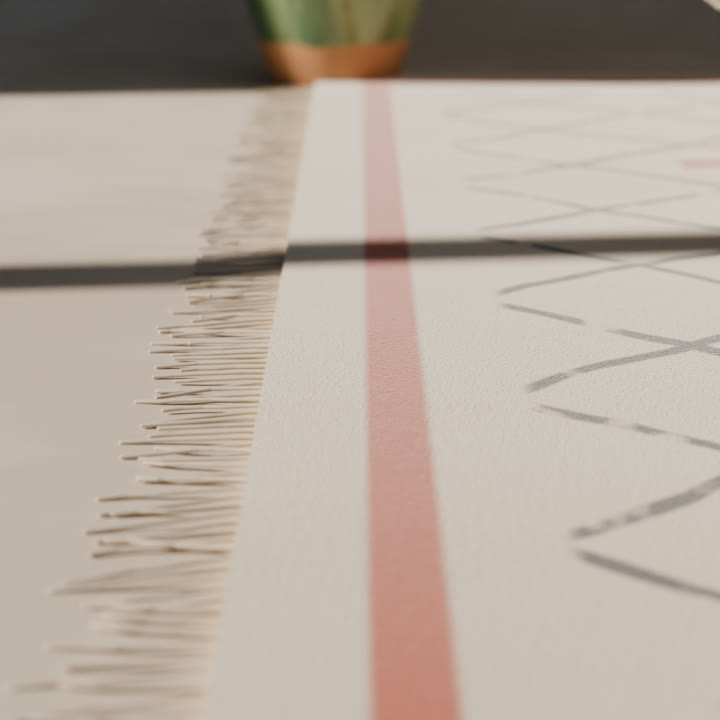

---

## 3 · The chair

### 3a · The shell: one sweep, then lower the arms

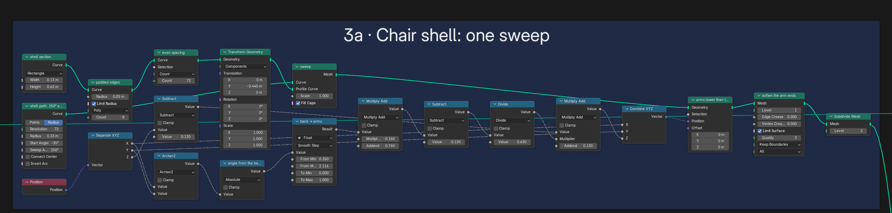

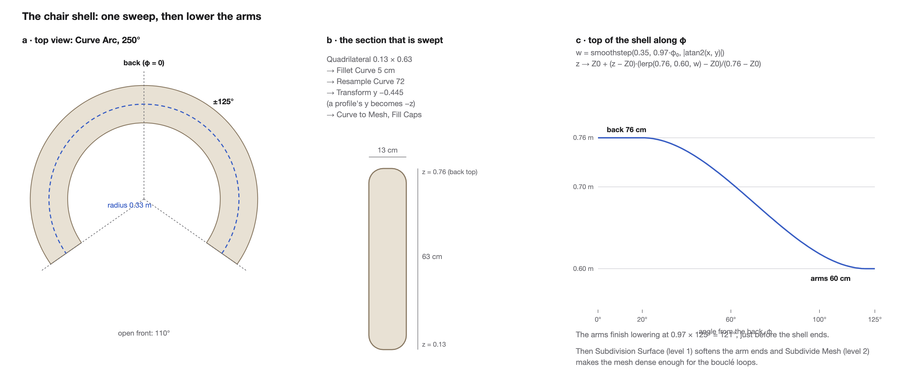

A barrel chair's shell is one shape swept around a circle.

1. **`shell path: 250° around the back`** (Curve Arc): radius 0.33 m and 72 segments. It starts at 90° − 125° and
   sweeps 250°, leaving the front 110° open.
2. **`shell section`** (Quadrilateral): 13 cm thick and 63 cm tall. **`padded edges`** (Fillet Curve, 5 cm) rounds it,
   and **`even spacing`** (Resample Curve, 72) spreads its points evenly.
3. **Transform** moves the section down by 0.445 m. In Curve to Mesh a profile's *y* becomes *−z*, so without this the
   shell is built under the floor.
4. **`sweep`** (Curve to Mesh, Fill Caps) gives a shell that is 76 cm tall all the way round.
5. **`angle from the back`**: φ = |atan2(x, y)|, which is 0 at the back and 125° at the arm ends.
   **`back → arms`** (Map Range, Smooth Step) turns that into *w*, which is 0 up to 20° and 1 at 121°.
6. **`arms lower than the back`** (Set Position) scales every point's height above the bottom (z = 0.13) so that the top
   goes from 0.76 m at the back to 0.60 m at the arms. Because it scales instead of cutting, the padded top edge keeps
   its shape all the way round.
7. **`soften the arm ends`** (Subdivision Surface, level 1) rounds the open ends. **Subdivide Mesh** (level 2) makes
   the mesh dense enough for the bouclé loops.

### 3b · The seat: two lathes

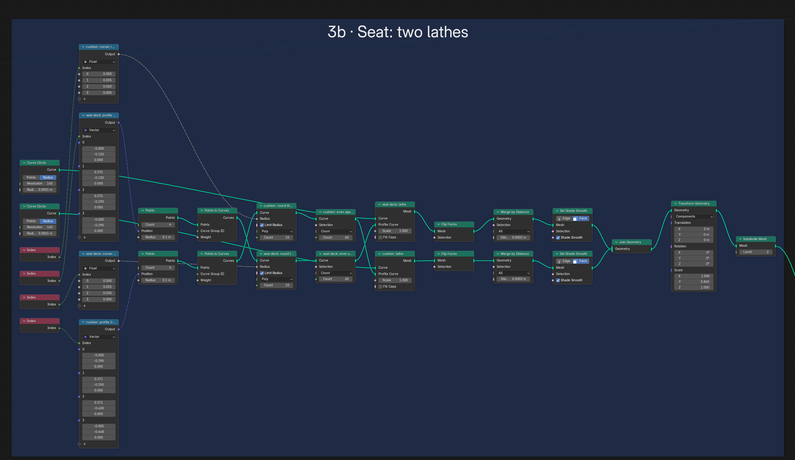

The seat deck and the cushion are **lathes**, the same recipe as the table and the vase, explained in
[section 4](#4--the-table-what-a-lathe-is). The deck is a disc 37.5 cm in radius from z = 0.13 to 0.29. The cushion
sits on it up to 0.43, with a 1.8 cm crown in the middle and a 6 cm round-over at its top edge. Both are joined,
**Transform** squashes them to 86 % front to back so they tuck into the shell, and **Subdivide Mesh** (level 2) makes
them dense.

### 3c · The knit pillow

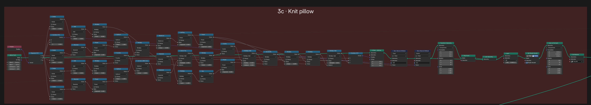

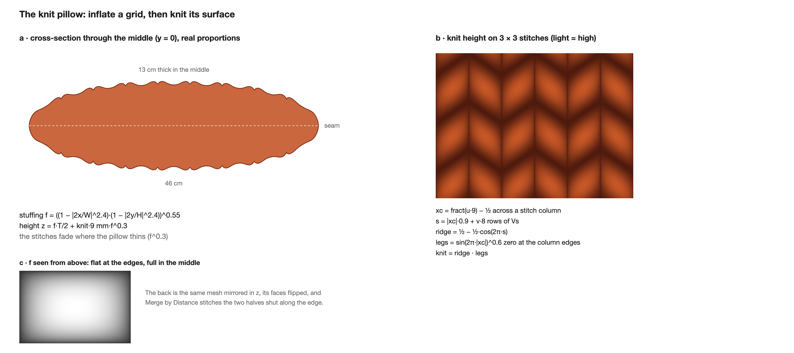

The pillow starts as a flat **Grid** of 46 × 30 cm (150 × 100 points), the front face only.

- **`stuffing`**: *f* = ((1 − |2x/W|^2.4) · (1 − |2y/H|^2.4))^0.55. It is 1 in the middle and falls to 0 at the
  edges. The exponent 2.4 keeps the middle full and drops steeply near the edge, which is how a stuffed pillow sags.
- **The stockinette** (`across a stitch column`, `rows of Vs`, `stockinette`):
  - `xc = fract(u · 9) − ½` is the position across one of 9 stitch columns (−½ … ½).
  - `s = |xc| · 0.9 + v · 8` is the row coordinate. Adding |xc| bends each row into a V.
  - `ridge = ½ − ½ · cos(2π s)` makes one bump per row.
  - `legs = sin(2π |xc|)^0.6` is 0 at the column edges, which splits each V into two legs.
  - `knit = ridge · legs`.
- **`inflate + stitches`** (Set Position): z = *f* · 6.5 cm + knit · 9 mm · *f*^0.3. The stitches fade out where the
  pillow thins at the seam.
- Two **Store Named Attribute** nodes save `knit` (the stitch height) and `kuv` (flat coordinates) for the shader.
- The back is the front mirrored: **Transform** with scale z = −1, then **Flip Faces** so its normals point out.
  **`seam`** (Merge by Distance) welds the two halves along the edge.
- **`lean on the back`** (Transform) props it against the chair back at 72°.

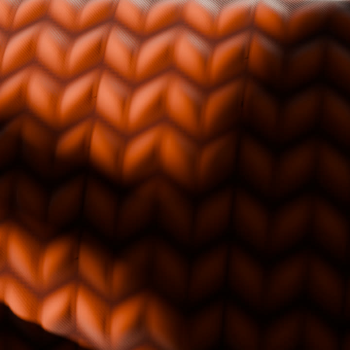

### 3d · Walnut legs

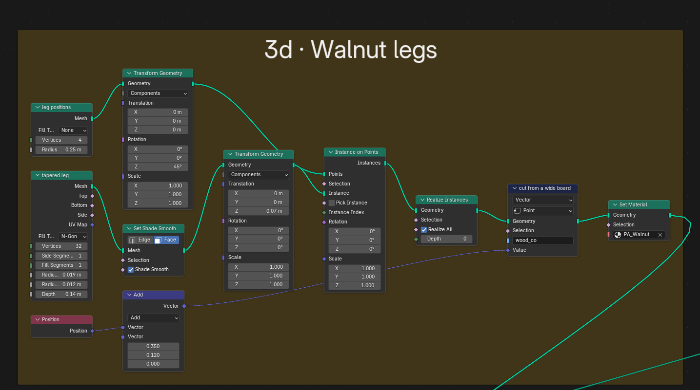

**`leg positions`** (Mesh Circle, 4 vertices, radius 25 cm, turned 45°) puts a point under each corner. A **`tapered
leg`** (Cone, 1.9 → 1.2 cm, 14 cm tall) is instanced on each one and realized. **`cut from a wide board`** stores
`wood_co` = position + (0.35, 0.12, 0). That moves the centre of the tree rings far away from the legs, so the legs show
straight grain instead of rings.

### 3e · Bouclé, then place the chair

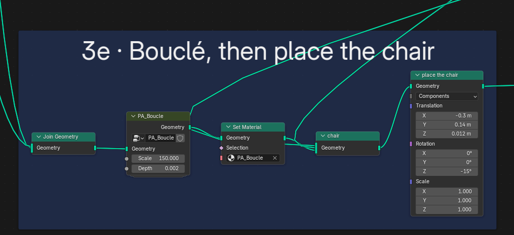

The shell and the seat are joined and passed through one group node, **`PA_Boucle`**. This is where the yarn loops come
from:

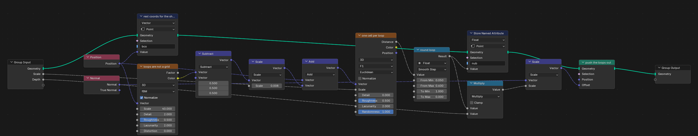

1. **`rest coords for the shader`** stores `bco`, the position *before* anything moves, so the shader's pattern lines up
   with the geometry.
2. **`loops are not a grid`** (Noise, scale 40) shifts the lookup position by up to 4 mm. **`one cell per loop`**
   (Voronoi, scale 150) then gives one cell about every 7 mm. The shift breaks up the cells so they don't look like a
   pattern.
3. **`round loop`** (Map Range, Smooth Step, distance 0.05 → 0.6 mapped to 1 → 0) is 1 at a cell's centre and 0 at its
   rim. This is one round bump per cell. It is stored as `nub`.
4. **`push the loops out`** (Set Position) moves every point along its normal by nub × 2.2 mm.

After Subdivide, the chair has about 629 000 faces, which is enough for every loop to be real geometry that casts its own
tiny shadow in low sun.

Then the chair gets the bouclé material. The legs and the pillow join it, and **`place the chair`** (Transform) moves it to
(−0.30, 0.14) and turns it −15° toward the camera.

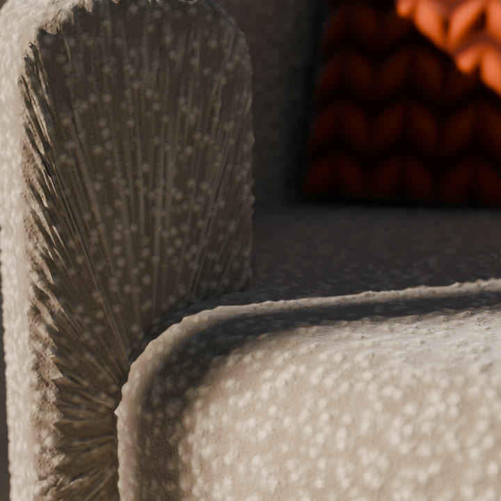

> **A flaw you can see here.** The flat cap at the end of the arm comes from Fill Caps. It is one n-gon, and Subdivision
> Surface turns it into a fan of long, thin faces. The loops stretch along those faces into radial streaks. At full frame
> the arm end is too small to notice. To fix it, cap the shell with a proper grid, or round the ends off before the
> sweep.

---

## 4 · The table: what a lathe is

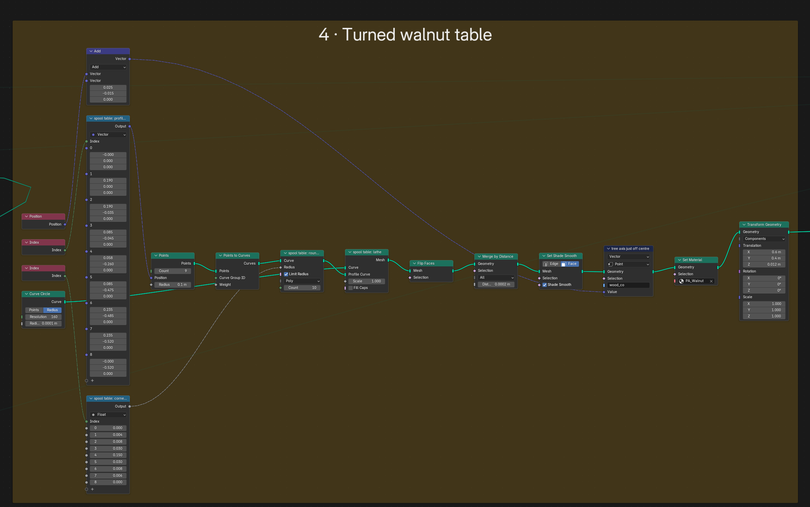

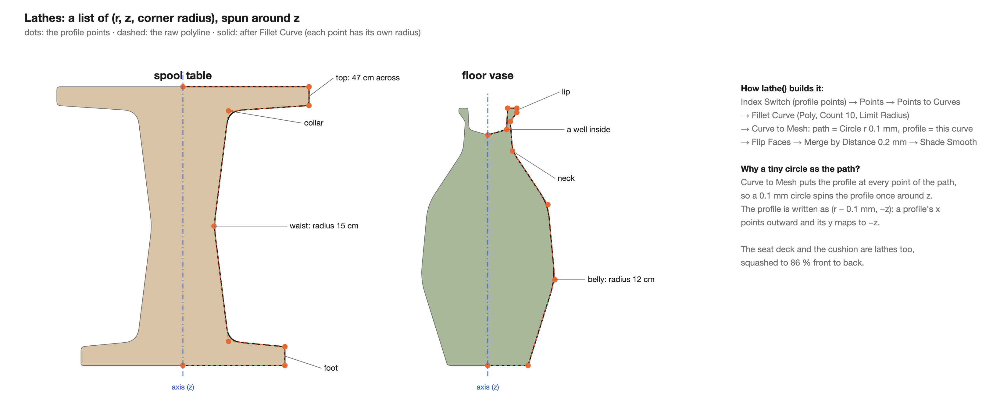

A lathe turns a 2D outline around an axis. `build.py` writes each outline as a list of `(r, z, corner radius)`, from
the axis out and back to the axis. The table is:

```python
[(0, 0, 0), (0.19, 0, 0.004), (0.19, 0.035, 0.008), (0.085, 0.045, 0.03), (0.058, 0.26, 0.15),
 (0.085, 0.475, 0.03), (0.235, 0.485, 0.008), (0.235, 0.52, 0.006), (0, 0.52, 0)]
```

In nodes:

1. **`… profile (r, z)`** (Index Switch, Vector) holds the points, and **`… corner radii`** (Index Switch, Float)
   holds one radius per point. **Points** with Position = the switch, then **Points to Curves**, turns them into a
   poly line.
2. **`… round the corners`** (Fillet Curve, Poly, Count 10, Limit Radius) rounds every corner by its own radius. One
   list gives a 4 mm edge on the foot and a gentle 15 cm curve at the waist.
3. **`… lathe`** (Curve to Mesh) sweeps the outline around a **Curve Circle** of radius 0.1 mm. Curve to Mesh copies
   the profile to every point of the path, so a tiny circle spins it once around z. The points are written as
   (r − 0.1 mm, −z), because a profile's x points outward from the path and its y maps to −z.
4. **Flip Faces** (a lathe made this way faces inward), **Merge by Distance** 0.2 mm (closes the axis) and
   **Set Shade Smooth**.

**`tree axis just off centre`** stores `wood_co` = position + (0.025, −0.015, 0) for the walnut shader. The rings are
centred on a vertical axis a little off the middle of the table, the way a real log is never cut exactly at its heart.

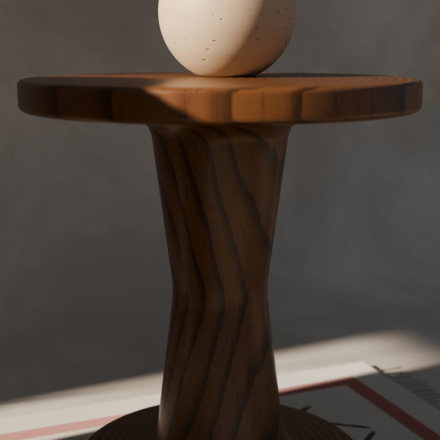

---

## 5 · The lamp

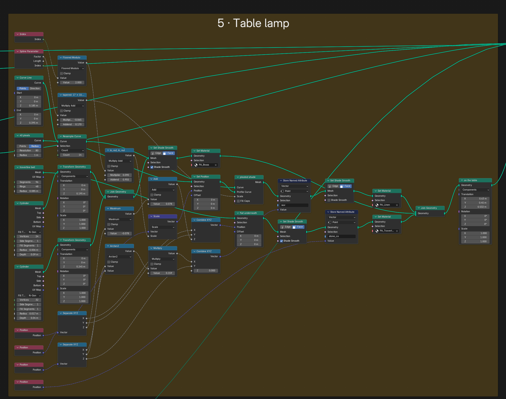

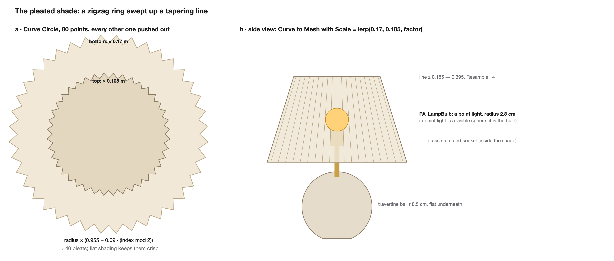

- **`travertine ball`** (UV Sphere, radius 8.5 cm). **`flat underneath`** sets z = max(z, −0.078) + 0.078, which
  slices the bottom flat and stands the ball on the table. It stores `stone_co` for the shader.
- The **brass** stem (Cylinder, radius 6 mm) and socket (radius 1.7 cm) use the brass preset from `proc_blender`.
- **The pleated shade** is one more sweep:
  - **`40 pleats`** (Curve Circle, 80 points). **`in, out, in, out`** multiplies each point's radius by
    0.955 + 0.09 · (index mod 2), so every other point sticks out and the ring becomes a zigzag.
  - The path is a vertical **Curve Line** from z = 0.185 to 0.395, resampled to 14 points.
  - **`tapered: 17 → 10.5 cm`**: Spline Parameter → `0.17 − 0.065 · factor`, fed into **Curve to Mesh**'s **Scale**
    input. Since Blender 5.x Curve to Mesh no longer reads the curve radius; without this the first shade came out 2 m
    wide.
  - It stores `suv` = (angle / 2π, z) as the linen's weave coordinates, and **Set Shade Smooth** is turned *off* so
    every pleat has a crisp edge.
- **`on the table`** moves the lamp to (0.63, 0.45, 0.532).

There is no bulb mesh. The bulb is **PA_LampBulb**, a point light with a 2.8 cm radius 29 cm above the table top. A
point light in Cycles shows up to the camera as a glowing sphere, so it *is* the bulb. A mesh bulb around it would block
all of its light.

| day (frame 46) | night (frame 226) |
|---|---|
| 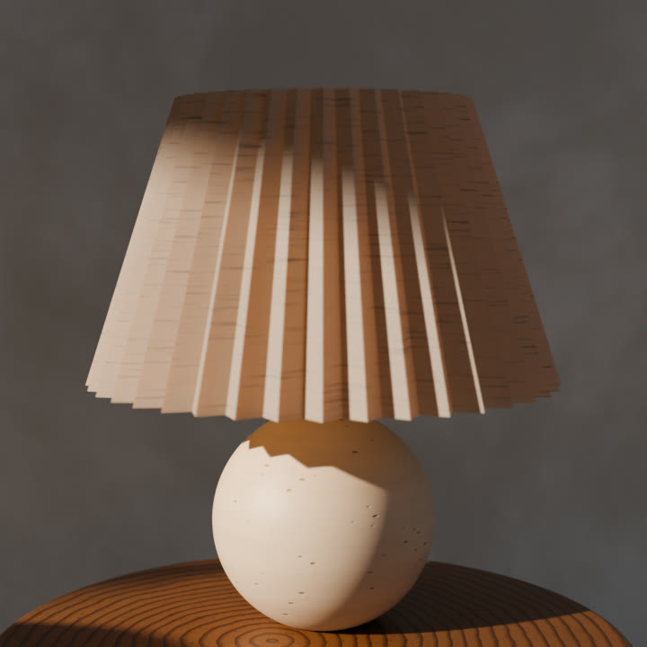 | 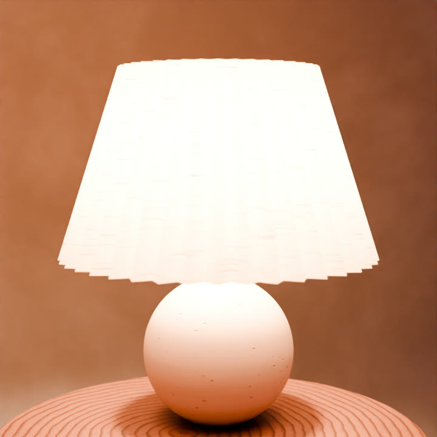 |

---

## 6 · The vase

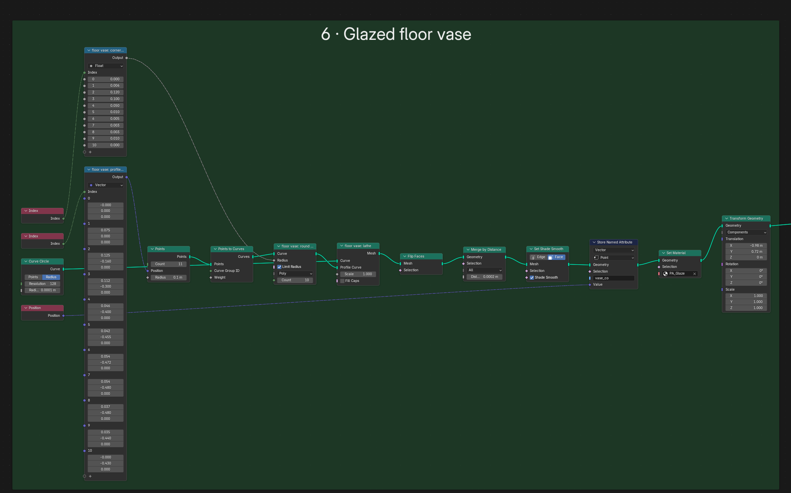

The vase is another lathe, with 11 points. It rises from the foot to a 12 cm belly, narrows into a neck, turns out
at the lip, and then goes back *down* inside to z = 0.43. That makes a real well that the pampas stems stand in. It stores
`vase_co`, and the glaze uses its height for the bare clay foot ([9g](#9g--sage-glaze)).

---

## 7 · Pampas grass

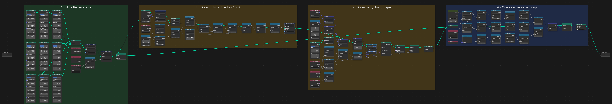

The pampas is a Curves object too: about 13 000 fibres on nine stems.

**1 · Nine Bézier stems**

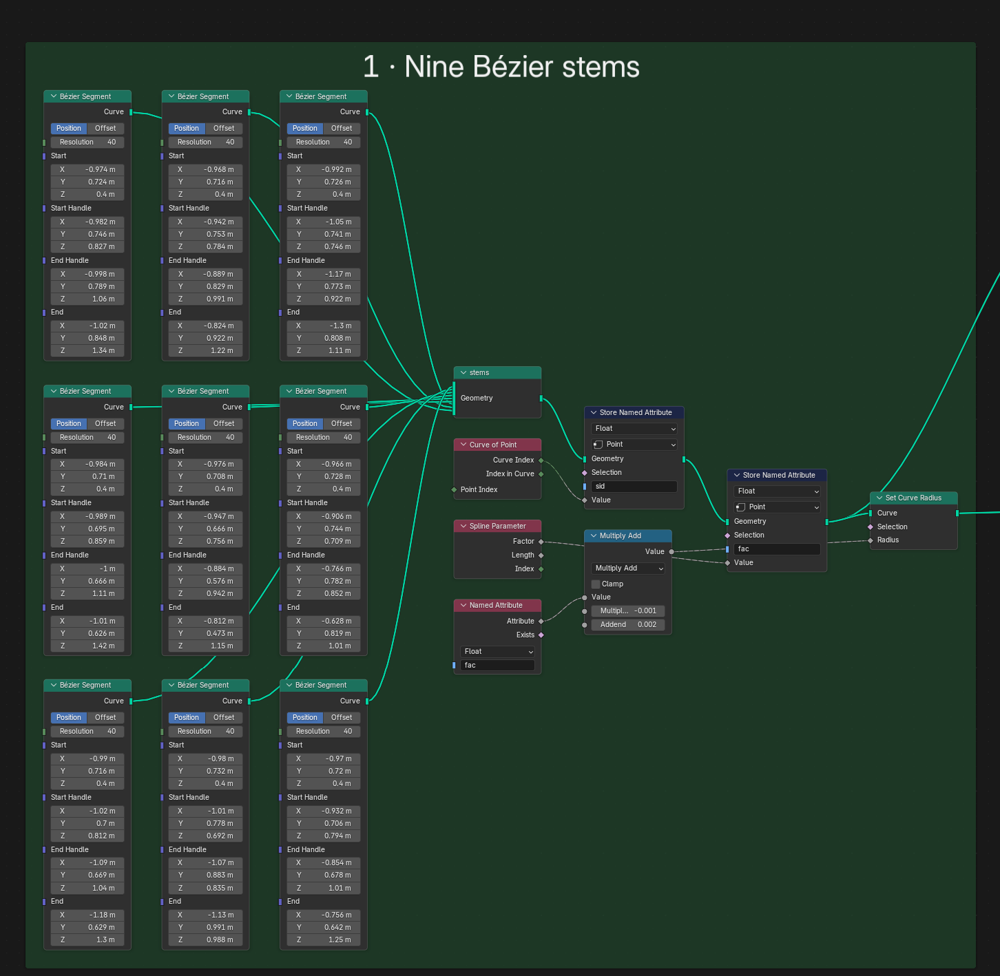

Each stem is a **Bézier Segment** computed in `build.py` from a lean angle, a direction and a length. It starts 8 cm
down inside the vase. The first handle points almost straight up and the second one bends back toward the vase, so each
stem rises, then arcs over. Two **Store Named Attribute** nodes save `sid` (which stem, from **Curve of Point**) and
`fac` (how far along the stem, from **Spline Parameter**). Every fibre will carry these values with it. The stems
themselves taper from 2.4 to 1.2 mm.

**2 · Fibre roots on the top 45 %**

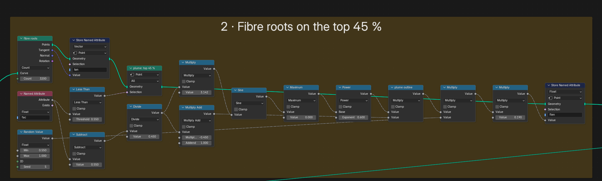

- **`fibre roots`** (Curve to Points, Count 3200 per stem) stores each point's **Tangent** as `tan`.
- **`plume: top 45 %`** (Delete Geometry) removes every point with `fac` < 0.55.
- **`plume outline`**: with *x* = (fac − 0.55)/0.45 (0 at the bottom of the plume, 1 at the tip), the outline is
  sin(π*x*)^0.6 · (1 − 0.45*x*). It is fattest a little below the middle and thinner at the tip.
- `flen` = outline × Random Value 0.55–1 × 19 cm is each fibre's length.

**3 · Fibres: aim, droop, taper**

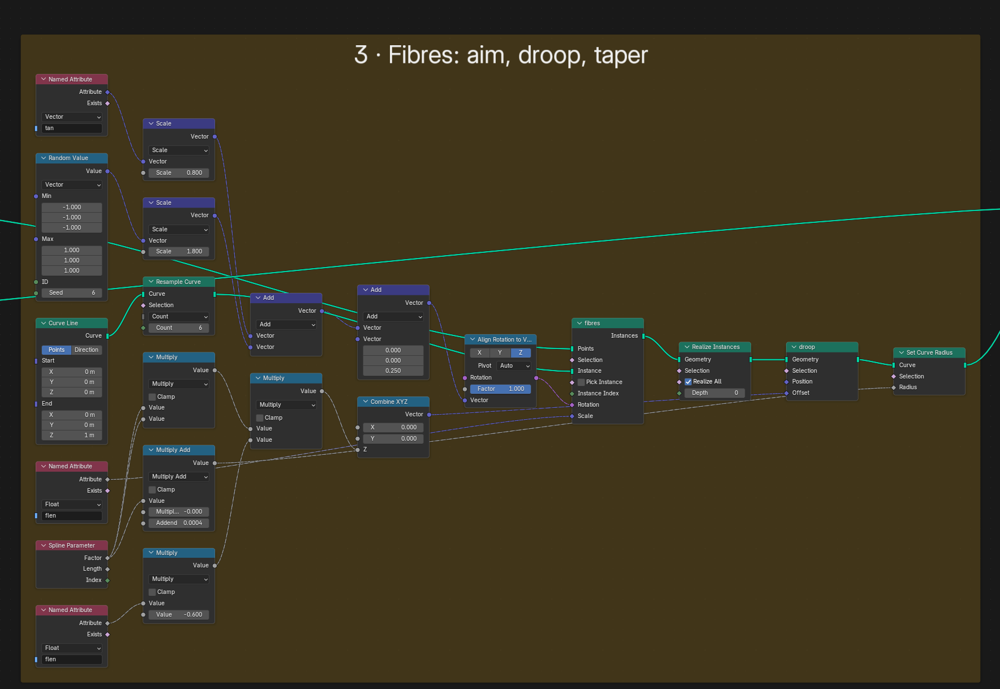

- The direction is 0.8 · `tan` + 1.8 · a random vector + (0, 0, 0.25). The fibres point every which way, slightly
  along the stem and slightly upward. **Align Rotation to Vector** (Z) aims each one.
- **`fibres`** (Instance on Points) places a 1 m **Curve Line** with 6 points on each root, scaled by `flen`, then
  **Realize Instances**.
- **`droop`** (Set Position): z −= 0.6 · flen · factor², so every fibre bends down toward its tip.
- **Set Curve Radius**: 0.45 mm at the root down to 0.15 mm at the tip.

**4 · One slow sway per loop**

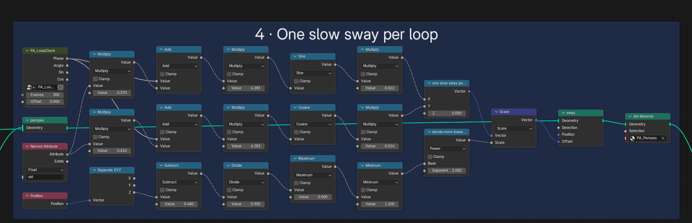

- **`PA_LoopClock`** gives Phase, which runs from 0 to 1 over the 300 frames (see the
  [Day 1 tutorial](../../day01-origami-v2-plane/tutorial/README.md#appendix-a--pa_loopclock)).
- **`bends more toward the tip`**: weight = (clamp((z − mouth) / 0.9, 0, 1.2))². The base stays still and the plumes
  move.
- The offset is (2.2 cm · sin 2π(Phase + 0.37 · sid), 1.4 cm · cos 2π(Phase + 0.61 · sid), 0) × weight. Each stem gets
  its own offset through `sid`, so they do not move in step. Phase repeats exactly, so the sway loops with the day.

The material is a **Principled Hair BSDF** (melanin 0.16, redness 0.8), which gives the warm straw colour. EEVEE renders
this BSDF black, which is one of the reasons this piece renders in Cycles.

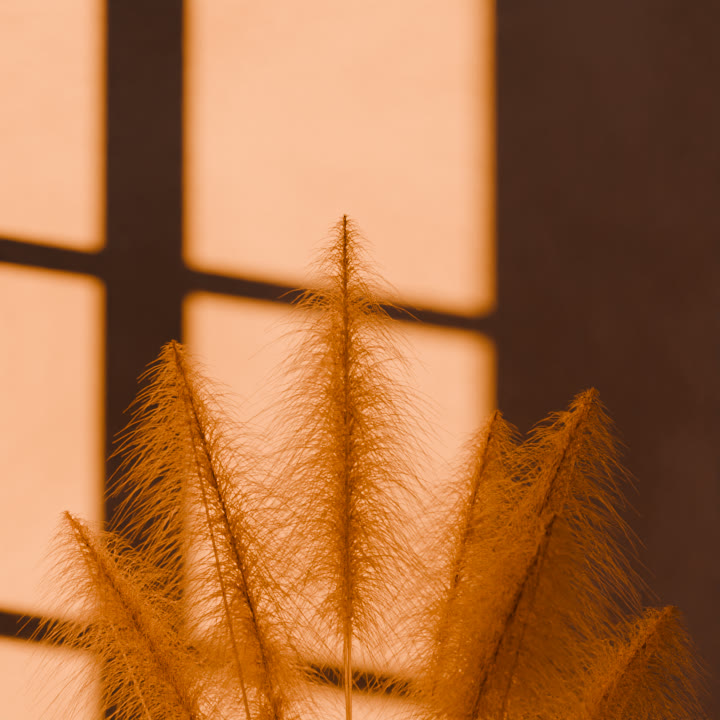

---

## 8 · The window: the light comes through a hole

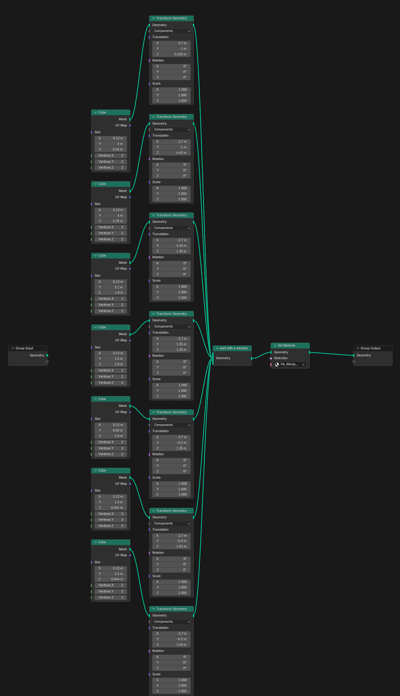

A sun lamp lights the whole scene from one direction. To get a *window* of light, something has to block the rest.
**`PA_Window`** is a 12 cm wall at x = −2.7 m made of eight **Cubes**: the wall below, above, left and right of the
opening, plus one mullion and two transoms. That leaves a 2 × 3 pane window from y −0.9 to 0.5 and z 0.45 to 2.25.

Two object settings make it work:

- `visible_camera = False`: the camera looks straight through it.
- `visible_glossy = False`: it doesn't show up in reflections either, for example in the vase glaze.

It still blocks the sun and the sky, so the only direct sunlight in the room is the six panes. The sun only changes its
direction (section 10), and the window turns that into a moving patch.

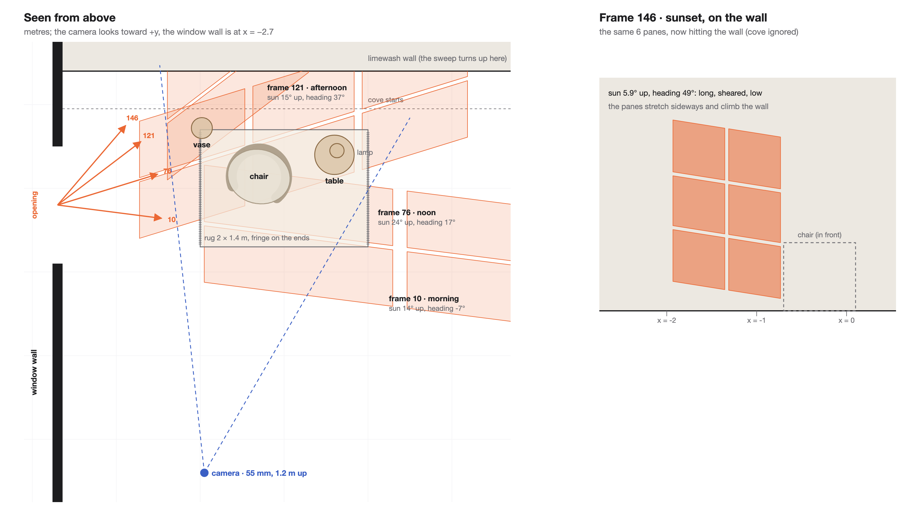

- **Morning** (heading −7°, elevation 14°): the panes stretch far across the floor and the front of the rug.
- **Noon** (17°, 24°): the patch is shortest and falls across the rug and the chair.
- **Afternoon** (37°, 15°): it turns toward the back and climbs the wall.
- **Sunset** (49°, 6°): the panes hit the wall long, low and sheared, behind the vase and the chair, with pampas
  shadows inside them.

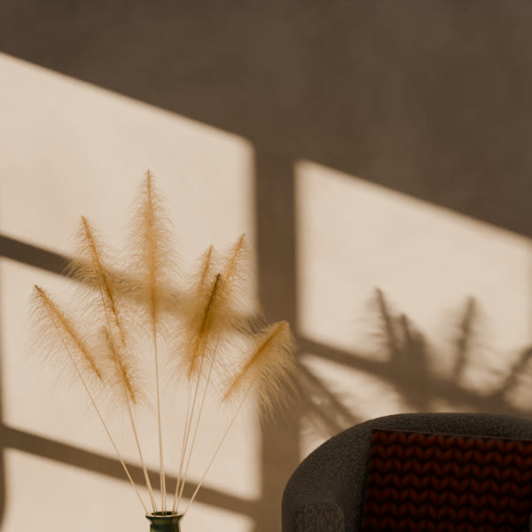

---

## 9 · Materials

Every material reads a coordinate attribute that its object stored in the geometry tree. Coordinates that belong to the
object keep the pattern in place, so the grain cannot slide when an object is moved or deformed.

| Material | Reads | Stored by |
|---|---|---|
| `PA_Boucle` | `bco`, `nub` | `PA_Boucle` group |
| `PA_Knit` | `knit`, `kuv` | 3c pillow |
| `PA_Walnut` | `wood_co` | 3d legs, 4 table (each with its own offset) |
| `PA_Travertine` | `stone_co` | 5 lamp ball |
| `PA_Linen` | `suv` | 5 shade |
| `PA_Rug` | `ruv` | 2 rug |
| `PA_Glaze` | `vase_co` | 6 vase |
| `PA_Limewash` | Texture Coordinate · Object | — |

### 9a · Bouclé

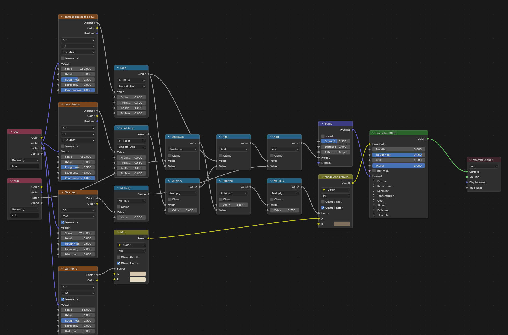

- **`same loops as the geometry`**: a Voronoi at scale 150 on `bco`. It uses the same scale as the geometry, but without
  the jitter, and it feeds the bump.
- **`small loops`** (Voronoi, scale 430) and **`fibre fuzz`** (Noise, scale 3200) add finer bumps on top.
- **`shadowed between loops`**: the colour darkens by (1 − max(nub, loop)) × 0.75. The crevices between loops, where
  light can't reach, are darker even in flat light.
- **`yarn tone`** (Noise, scale 55) mixes two creams.
- Principled: roughness 0.95, **sheen 0.9**. Sheen is the soft bright rim that fabric shows at grazing angles.

### 9b · Chunky knit

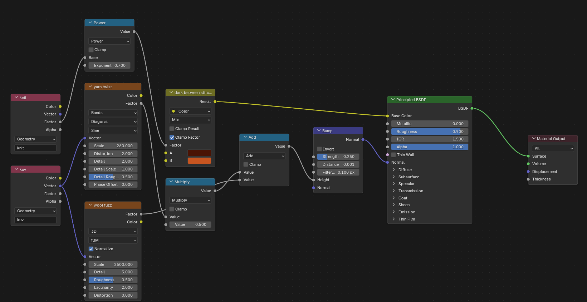

The colour comes straight from the geometry. **`dark between stitches`** mixes dark rust to rust by `knit`^0.7, so the
gaps between stitches are dark even when no shadow falls there. **`yarn twist`** (Wave, diagonal bands, scale 260) and
**`wool fuzz`** (Noise, scale 2500) make the bump, and sheen 0.8 adds the wool shine.

### 9c · Walnut

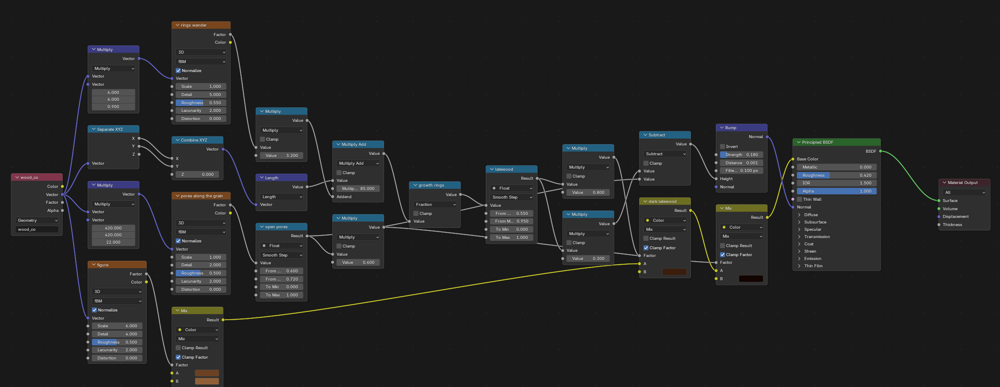

- **`growth rings`**: *r* = the distance of `wood_co` from the vertical axis, and rings = fract(*r* · 85 + warp · 3.2).
  That gives a ring every 1.2 cm. **`rings wander`** (Noise on `wood_co` × (6, 6, 0.9)) makes them wobble, slowly up
  the trunk.
- On the table **top** *r* changes across the surface, so you see concentric rings (end grain). On the turned
  **column** *r* barely changes as you go up, so the rings show as long straight stripes (side grain). One formula gives
  both, just like a real turned piece.
- **`latewood`** (Smooth Step 0.55–0.95 of each ring) darkens part of every ring. **`pores along the grain`** (Noise on
  `wood_co` × (420, 420, 22)) adds fine dark streaks, and **`figure`** (Noise, scale 6) mixes two browns.
- Roughness 0.42 with a **coat** of 0.35 (roughness 0.22): an oiled satin finish.

### 9d · Travertine

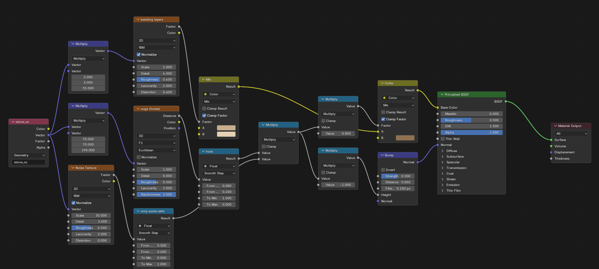

- **`bedding layers`**: Noise on `stone_co` × (3, 3, 55), squashed hard in z into thin horizontal layers.
- **`vugs (holes)`**: Voronoi on `stone_co` × (70, 70, 190), so the cells are flattened. **`hole`** (distance < 0.08 …
  0.2) times **`only some cells`** (Noise, scale 30, Smooth Step 0.5–0.6) keeps holes in a few patches only. They are
  darker and pushed in by the bump.
- Roughness 0.5: honed, not polished.

### 9e · Pleated linen

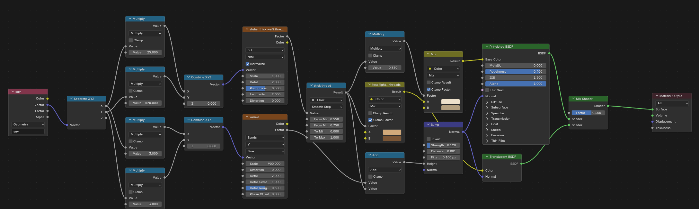

- **`slubs: thick weft threads`**: Noise on (u · 25, v · 520). That is long around the shade and thin in height, so it
  draws thicker threads that run around the shade.
- **`weave`** (Wave, bands, scale 900) and the slubs make the bump.
- The surface is **40 % Principled** (roughness 0.9, a little sheen) and **60 % Translucent**. In daylight the outside
  looks like matte fabric. At night the bulb lights it from inside and the whole shade glows.
  **`less light through thick threads`** darkens the translucent colour along the slubs, so the threads show as darker
  lines against the light.

### 9f · Wool rug

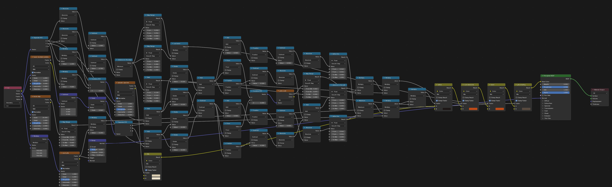

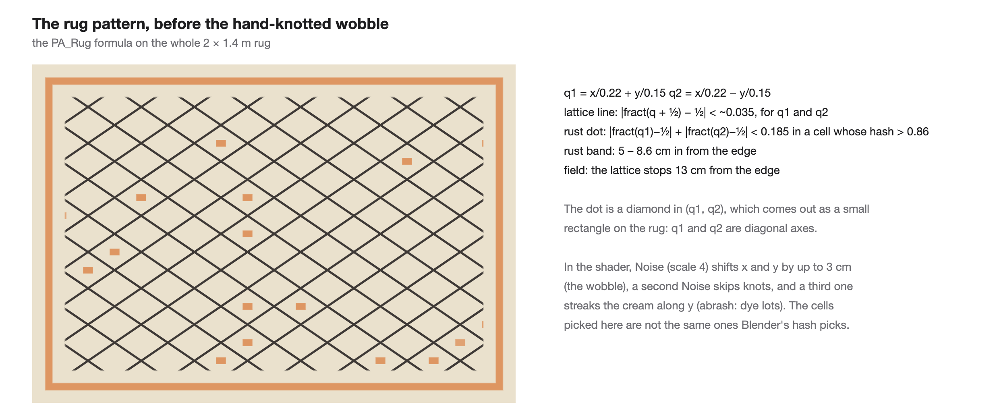

A Beni Ourain-style rug: cream wool with a thin dark diamond lattice, a few rust accents and a rust band.

- **`distance to the edge`**: e = min(1.0 − |x|, 0.7 − |y|). **`rust band`** keeps the strip 5–8.6 cm in from the edge,
  and **`field`** stops the lattice 13 cm from the edge.
- **The lattice.** q1 = x/0.22 + y/0.15 and q2 = x/0.22 − y/0.15 are two diagonal coordinates.
  **`lattice line`** (Smooth Step on |fract(q + ½) − ½|, 0.045 → 0.026) draws a line at every whole number of each,
  and together they make the diamonds.
- **`hand-knotted wobble`** (Noise, scale 4) shifts x and y by up to 3 cm before all of this, so the lines wander like
  hand-knotted ones. **`knots skip`** (Noise, scale 26) breaks the lines in places.
- **`pick a cell`** (White Noise on (floor q1, floor q2)) gives each diamond a random number. Where it is above 0.86,
  **`diamond in the cell`** puts a rust dot in the middle. The test is |fract(q1) − ½| + |fract(q2) − ½| < 0.185, a
  diamond in (q1, q2). Because q1 and q2 are diagonal axes, it comes out as a small *rectangle* on the rug.
- **`abrash: dye lots`** (Noise on (1.2x, 9y)) streaks the cream, like wool dyed in different batches. **`wool pile`**
  (Noise, scale 700) darkens and bumps the surface. Sheen 0.7 adds the shine.

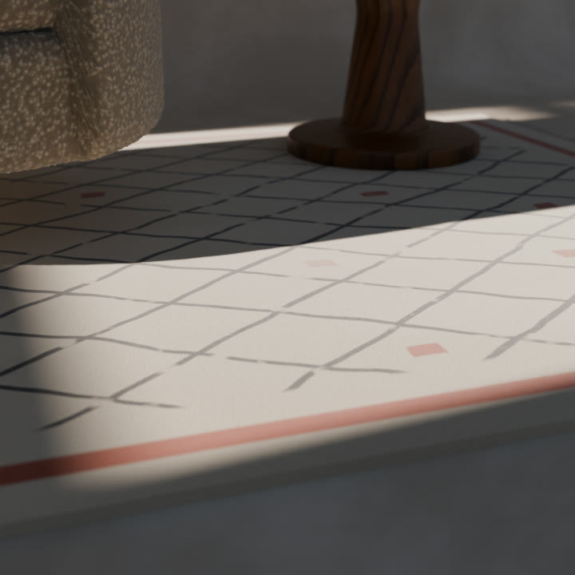

### 9g · Sage glaze

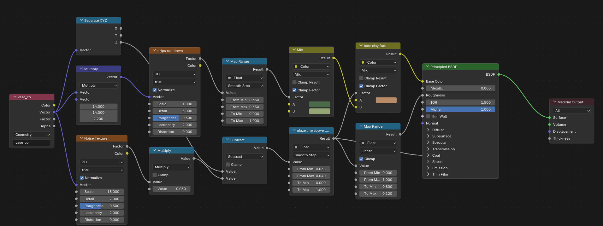

- **`drips run down`**: Noise on `vase_co` × (14, 14, 2.2), stretched up and down so it reads as runs. It mixes a deep
  and a pale sage.
- **`glaze line above the foot`**: Smooth Step (0.035 → 0.04) on z − 0.03 · noise. Below about 5 cm the vase is bare
  terracotta, and the line wobbles the way dipped glaze does.
- That same mask drives the **roughness** (0.8 on clay, 0.12 on glaze) and the **coat weight**, so only the glazed part
  is glossy.

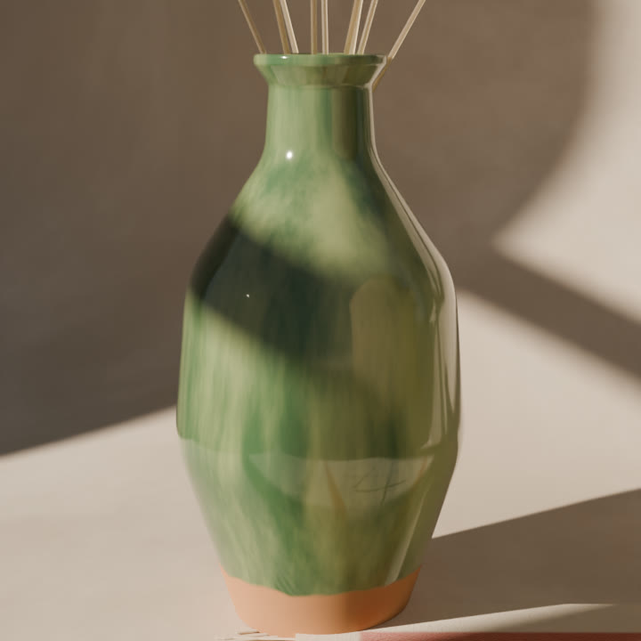

### 9h · Limewash

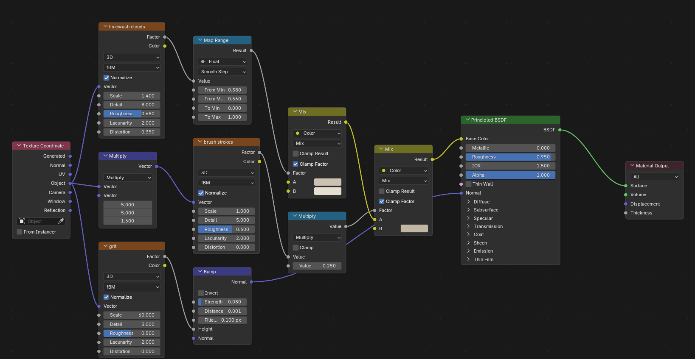

**`limewash clouds`** (Noise, scale 1.4, detail 8) mixes two warm whites. **`brush strokes`** (Noise stretched in z)
darkens it by up to a quarter, and **`grit`** (Noise, scale 60) adds a faint bump. Under flat light it is almost plain.
Under raking light the strokes and the grit come out, as in the close-up in section 8.

---

## 10 · The day: functions of the frame

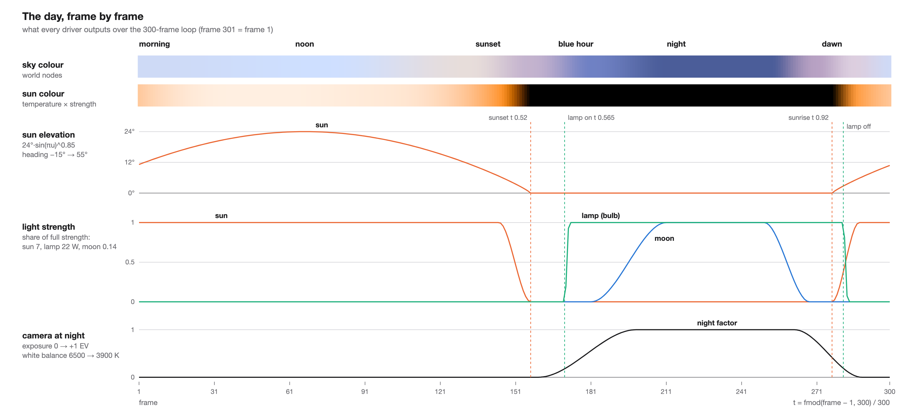

None of the lights are keyframed. Each animated property has a **driver** whose expression is a formula of `frame`.
Open the **Drivers** editor in `corner.blend` to see them, or scrub the timeline and watch the values change.

The formulas use three values:

| Name | Expression | Meaning |
|---|---|---|
| `t` | `fmod(frame-1,300)/300` | time of day, 0 → 1 over the loop. Frame 301 gives the same `t` as frame 1 |
| `u` | `min(fmod((frame-1)/300+0.08,1)/0.60,1)` | the sun's progress: 0 at sunrise (t = 0.92), 1 at sunset (t = 0.52), and 1 all night |
| `night` | `smoothstep(0.53,0.66,t) - smoothstep(0.87,0.96,t)` | 0 by day, 1 at night |

A driver can't use another driver's result, so in the file each expression has `t`, `u` and `night` written out in
full. With those values, the drivers are:

| Property | Driver | What it does |
|---|---|---|
| PA_Sun · rotation Y | `-(pi/2 - EL)` with `EL = radians(24)*pow(sin(pi*u),0.85)` | the sun rises to 24° at midday (frame 67) and sets |
| PA_Sun · rotation Z | `radians(lerp(-15,55,pow(u,1.3)))` | the heading swings from −15° to 55°, faster in the afternoon |
| PA_Sun · strength | `7*smoothstep(0,0.06,u)*smoothstep(1,0.93,u)` | full strength all day, fading at the horizon |
| PA_Sun · temperature | `lerp(1900,5600,smoothstep(0,radians(22),EL)) - 350*smoothstep(0.45,0.7,u)` | red at the horizon, white high up, and warmer in the evening |
| PA_Moon · strength | `0.14*smoothstep(0.6,0.7,t)*(1-smoothstep(0.83,0.89,t))` | a faint 9000 K sun with a fixed direction through the same window |
| PA_LampBulb · power | `22*(smoothstep(0.565,0.571,t) - smoothstep(0.935,0.941,t))` | clicks on at frame 171 and off at frame 282, each over two frames |
| Scene · exposure | `1*night` | the camera opens up by 1 EV at night |
| Scene · white balance | `lerp(6500,3900,night)` | and re-balances for the warm lamp, like a phone camera |
| World · `time of day` Value node | `t` | feeds the sky nodes below |

**Simple expressions.** Every expression uses only what Blender calls a *simple expression*: arithmetic, `fmod`,
`pow`, `sin`, `smoothstep`, `lerp`, `clamp`, `min`/`max`, `radians` and constants. Blender evaluates these without
Python, so `Blender -b corner.blend -a` renders them with Python auto-run switched off. `build.py` checks
`driver.is_simple_expression` on every driver. Two traps: `**` is *not* allowed (use `pow`), and an expression may be
at most 256 characters long.

### The sky is shader nodes

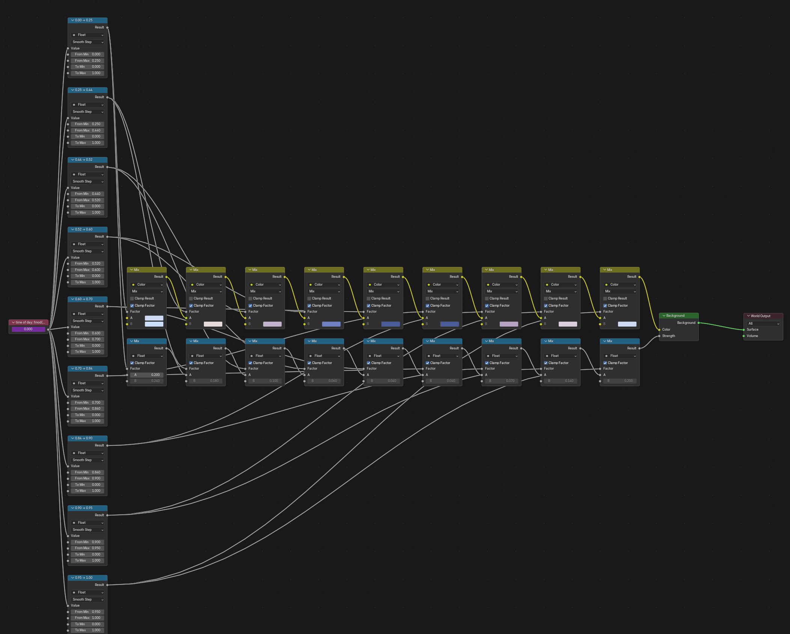

The sky colour has ten keys (pale blue morning, warm afternoon, mauve sunset, deep blue night, lilac dawn). That curve
won't fit in one 256-character expression, so it is built in the world's shader tree:

- One **Value** node, `time of day: fmod(frame-1, 300)/300`, is driven by `t`.
- For each stretch between two keys, a **Map Range** (Smooth Step, From Min/Max = the two key times) gives 0 → 1 across
  that stretch.
- Two chains of **Mix** nodes (one colour, one float) step from key to key. Each Mix takes the previous result as A and
  the next key as B. At any moment the earlier stretches are finished (factor 1) and the later ones have not started
  (factor 0), so the chain gives exactly the curve between the current two keys.
- Colour and strength go into the **Background**. The strength is only 0.04–0.24, because the window and the sun do the
  real lighting.

### Why the loop is seamless

Everything that changes is a function of `t` or of the loop clock's Phase, and both repeat every 300 frames. Frame 301
is identical to frame 1, so the video can loop forever. In the render, the step from frame 300 to frame 1 measures
30.2 dB PSNR, the same as a normal step between neighbouring frames (299 → 300: 30.0 dB).

---

## Blender 5.2 notes from building this

- **Cycles renders Geometry Nodes curves only from a Curves object.** On a mesh object the pampas and fringe were
  invisible. Use `bpy.data.hair_curves.new()` and put the modifier on that object.
- **Curve to Mesh has a Scale input and ignores the curve radius.** To taper a sweep, feed the taper into Scale.
- **A profile's y maps to −z** in Curve to Mesh (x points outward from the path). Plan the profile's position with
  that in mind.
- **A lathe swept around a tiny circle faces inward.** Add Flip Faces.
- **A point light is visible to the camera** as a sphere of its radius. Use it as the bulb, and don't wrap a mesh
  around it.
- **EEVEE is faster but renders the Principled Hair BSDF black** and loses most of the bounced light at night. This
  piece is Cycles only: 96 samples, about 15–20 s per frame with Metal on a Mac.

---

## Try it yourself

1. Open `corner.blend` and scrub the timeline. Everything updates live, because the light is all drivers.
2. In the Drivers editor, change the lamp's `0.565` to `0.45` and the lamp comes on before sunset.
3. In the world tree, change the night keys' colour (the `0.60 → 0.70` and `0.84 → 0.90` Mix nodes) to a teal and
   watch the night change.
4. In `PA_Boucle`, set **Depth** to 0.006 for a shaggy chair, or **Scale** to 60 for big loops.
5. In `3c · Knit pillow`, change the `9` in `fract(u · 9)` to 14 for a finer knit.
6. Rebuild everything from scratch with `Blender -b --factory-startup --python build.py`. In `build.py`, the constants
   at the top place every object. `T_RISE` / `T_SET`, `AZ0` / `AZ1` and `EL_MAX` shape the day, and `SKY` holds the
   sky keys. The tidy layout comes back from `nodes_layout.json`. Nodes you add that are not in that file keep the
   plain automatic layout.

*Made with Blender 5.2 Geometry Nodes for [Nodevember](https://nodevember.com) 2026, Day 2 · Furniture.*
