# How the tea bowl mends itself

*A node-by-node walkthrough of Nodevember 2026 · Day 3 · Stitch*

An old cream tea bowl turns slowly on a grey sweep, already veined with gold. It breaks along exactly those veins. The gold
puffs off as dust, the shards hang apart showing raw clay, and then they come home one by one. Before each shard lands, a
line of black urushi lacquer is brushed onto its broken edge. When it presses home, the lacquer squeezes out of the seam.
Last, gold flows down every seam from the rim to the foot, and the bowl is whole and golden again. The 8-second loop has no
seam: frame 241 is frame 1. There is no simulation, no shape keys, no cell fracture add-on and no modelled mesh.
Everything is one Geometry Nodes tree that starts from a cylinder grid.

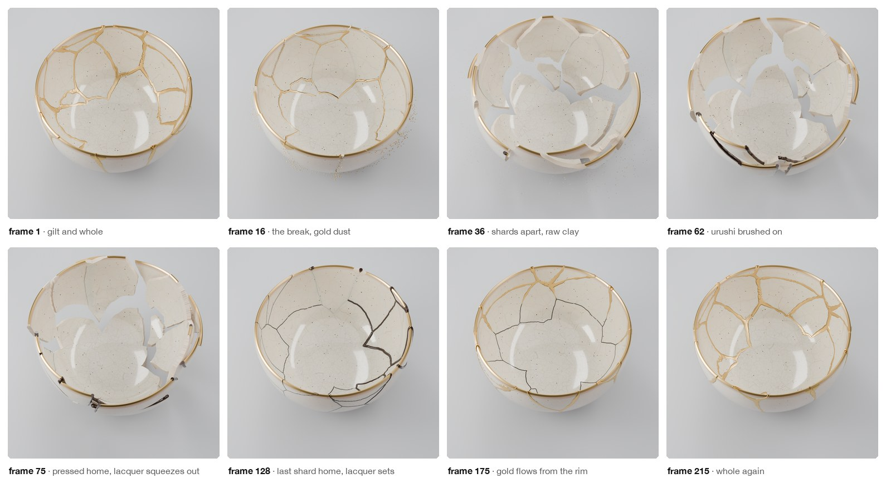

| File | What it is |
|---|---|
| [`../loop.mp4`](../loop.mp4) | the render, 1080 × 1080, 240 frames at 30 fps, Cycles |
| [`../kintsugi.blend`](../kintsugi.blend) | the scene; select **PA_Bowl** and open its Geometry Nodes modifier (**PA_Bowl_GN**) |
| [`../build.py`](../build.py) | the script that builds the whole file (every node in this tutorial comes from it) |
| [`../nodes_layout.json`](../nodes_layout.json) | the tidy node layout and frames you see in the screenshots |

---

## The one idea

> **Every face of a grid knows which shard it belongs to.** Paint a shard id onto every face of a smooth bowl, and you
> can do two different things with the *same* numbers: cut the grid apart where the id changes (the shards), or keep only
> the edges where the id changes (the seams). The shards and the gold lines come from one pattern, so they always fit.

Everything else is about making that honest:

- **Smooth cracks.** Faces are little squares, so a shard cut along faces has a staircase edge. The crack points are
  snapped onto the true, curved cell boundary. Both sides snap onto the *same* curve, so the edges still meet.
- **A real bowl.** The shards are cut on a flat (u, s) sheet, then wrapped onto a tea-bowl profile with a wall thickness,
  a round lip and a foot ring.
- **When** does each piece move? Each shard gets its own turn from where it sits around the bowl. Its glue, its
  squeeze-out and the gold on its seams all read the same turn.
- **What does kintsugi look like?** Real kintsugi glues the shards with urushi lacquer and then dusts gold onto a last
  thin lacquer line. So the gold here is a flat ribbon lying on the glaze, not a round wire.

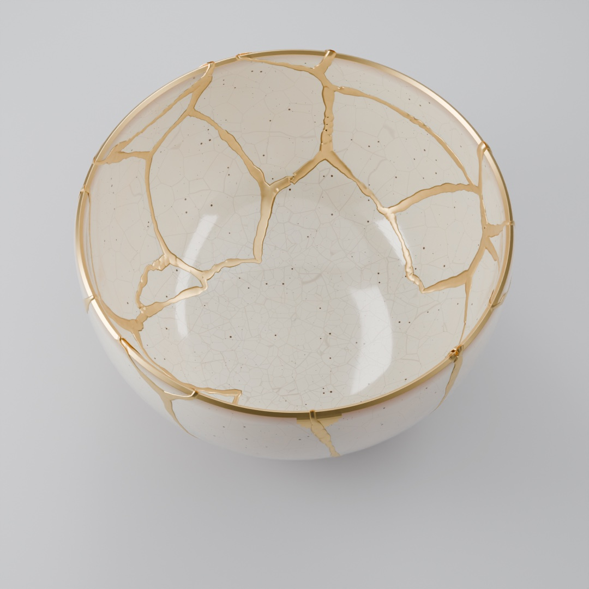

### How to read the screenshots

In `kintsugi.blend` the main tree is laid out exactly as in the map below: twelve coloured frames, one per section. The
helper groups `PA_Chawan` and `PA_ShardMotion` and the glaze material are split into frames *a · b · c …* in the same way.

The full tree is big, so each section below also shows a cut-out of just its own nodes.

- Wires that come from another section enter through a **Group Input** on the left. It is named after what it carries
  (for example `Phase`, `gold width` or `site per point (walls inherit it)`).
- Wires that leave the section exit through a **Group Output** on the right.
- Node titles such as `break into shards` or `gold lies flat` are the labels you will find in the `.blend` file.
- Small "plumbing" nodes are collapsed to one line: **Named Attribute** nodes show only the attribute name in quotes
  (`"us"`, `"shard"`, `"lock"`), and **Position**, **Separate XYZ**, **Index**, **Spline Parameter** and similar are
  folded shut.

The bowl is modelled at a radius of 1 m, so the lengths in this tutorial are the file's own metres: a "5.5 cm" wall
is the value 0.055 in the nodes.

Click any screenshot to see it at full size.

---

## 0 · The map

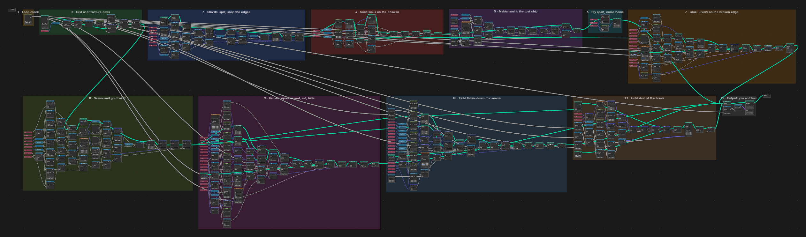

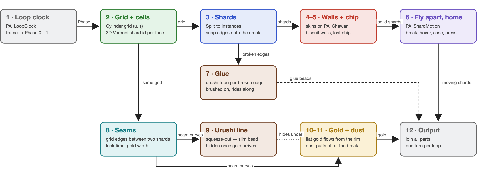

| # | Section | Nodes | Job |
|---|---|---|---|
| 1 | **Loop clock** | 1 group | frame → `Phase`, 0 … 1 once per loop |
| 2 | **Grid and fracture cells** | 11 | a 360 × 150 cylinder grid; a shard id and a cell site painted on every face |
| 3 | **Shards: split, snap the edges** | 35 | cut the grid into shards, then pull the crack edges onto the smooth cell boundary |
| 4 | **Solid walls on the chawan** | 24 | wrap each shard onto the bowl, give it a wall thickness, raw clay on the broken faces |
| 5 | **Makienaoshi: the lost chip** | 23 | one piece of the lip is missing, filled with gold once the gold has flowed |
| 6 | **Fly apart, come home** | 6 | the whole motion of every shard, through `PA_ShardMotion` |
| 7 | **Glue** | 43 | a lacquer bead brushed along each broken edge, riding with its shard |
| 8 | **Seams and gold width** | 60 | the seams as curves, when each one closes, and how wide its gold will be |
| 9 | **Urushi** | 73 | lacquer squeezes out of the closing seam, settles to a slim line, hides under the gold |
| 10 | **Gold flows down the seams** | 62 | flat gold ribbons that arrive from the rim down |
| 11 | **Gold dust at the break** | 37 | the gold that was on the seams puffs off as dust |
| 12 | **Output: join and turn** | 4 | everything together, one turn per loop |

The lone **Group Input** at the far left is not connected to anything. The object's own mesh is empty; the tree builds
everything from nothing.

### The timeline

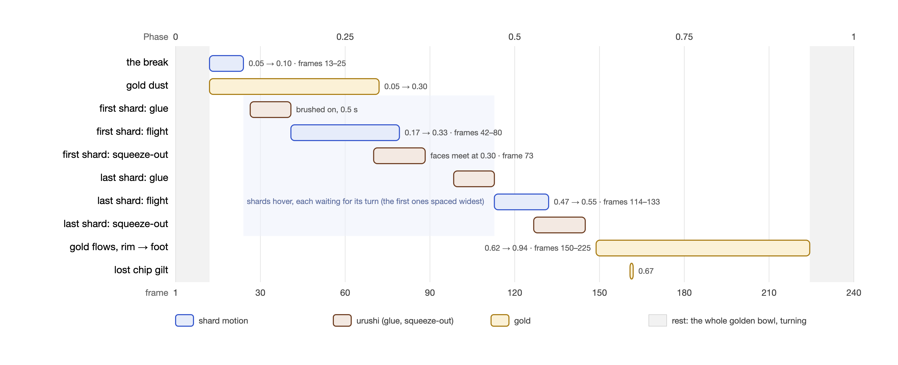

Every moving thing reads the one `Phase` from the loop clock. The *first* shard and the *last* shard are drawn above; the
others fill in between, each a little later than the one before, all around the bowl.

| Phase | Frames | What happens |
|---|---|---|
| 0 → 0.05 | 1 → 13 | the whole golden bowl turns (the end of the previous loop) |
| 0.05 → 0.10 | 13 → 25 | **the break**: shards burst apart; the gold on the seams fades out by 0.075 and puffs off as dust |
| 0.10 → 0.47 | 25 → 114 | shards hover and tumble; each one, in turn, gets lacquer brushed on and flies home |
| 0.17 → 0.55 | 42 → 133 | the flights: the first takes 0.16 of the loop (38 frames), the last only 0.08 (19 frames) |
| at 80 % of each flight | | the faces meet, the shard presses in 4 % too far and settles, lacquer squeezes out |
| 0.62 → 0.94 | 150 → 225 | **gold flows** down the seams from the rim to the foot; the squeezed lacquer disappears under it |
| 0.94 → 1 | 225 → 241 | rest: the bowl is whole and golden, exactly as at frame 1 |

---

## 1 · Loop clock

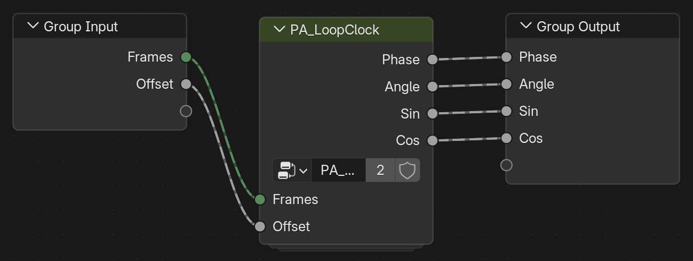

One **`PA_LoopClock`** group node (see [Appendix A](#appendix-a--pa_loopclock)) turns the frame number into `Phase`,
which runs from 0 to 1 once per 240 frames. It is the only clock in the file. Everything else is a function of `Phase`, so
the loop closes by itself: at frame 241 every value is back to what it was at frame 1.

---

## 2 · Grid and fracture cells

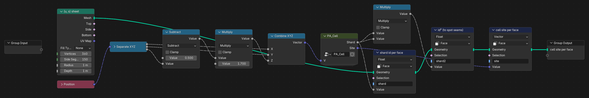

| Node | What it does |
|---|---|
| **`(u, s) sheet`** (Cylinder, no caps) | 360 vertices around × 150 rows, radius 1, height 1. It is not the bowl yet: it is a flat sheet rolled into a tube. Around the tube is **u** (0 … 1), and down the tube is **s**: 0 at the rim, 1 at the centre of the base. |
| **embed** (Position → Separate XYZ → Combine) | (x, y, (0.5 − z) × 1.7). The tube is stretched to roughly the length of the real bowl profile, so cells are about as tall as they are wide once the sheet is wrapped onto the bowl. |
| **`PA_Cell`** | a 3D **Voronoi** in a gently warped space (see [Appendix C](#appendix-c--the-fracture-helpers)). Returns the **Site** of the nearest cell and a **Shard** id. Cells whose site lies in the lower half (s > 0.5) all get id 0: they become one big *foot piece* that never moves. |
| **`shard id per face`** | stores the id on the **Face** domain. |
| **`id² (to spot seams)`** | stores id × id on the faces too. It looks pointless here; section 8 uses it to find the seams. |
| **`cell site per face`** | stores the cell's site position. A shard's site is its fingerprint: it decides when and how it moves. |

### Trick · cells in 3D, not on the sheet

The Voronoi is evaluated with the 3D position of the rolled-up tube, not with (u, s). So the cells wrap around the bowl
with no seam at u = 0 / u = 1, and nothing has to be done about the place where the sheet's two edges meet.

---

## 3 · Shards: split, snap the edges

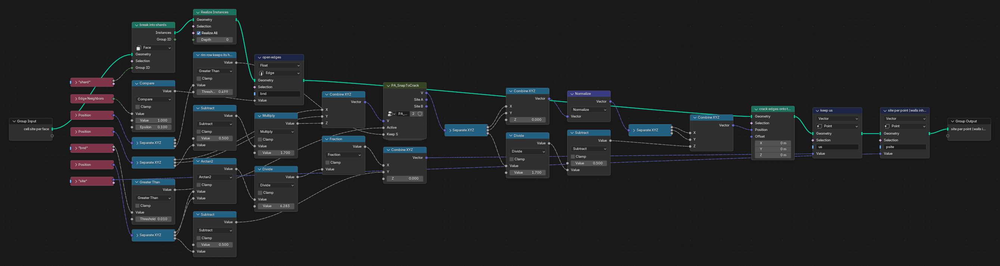

1. **`break into shards`** (**Split to Instances**, Face domain, Group ID = `"shard"`) cuts the grid into one instance per
   id. **Realize Instances** turns them back into one mesh, now with open edges along every crack.
2. **`open edges`**: **Edge Neighbors** → Face Count = 1. These are the crack edges (and the rim). The flag is stored as
   `bnd`.
3. **`PA_SnapToCrack`** moves every point on an open edge onto the *bisector* of its two nearest cells: the true, smooth
   cell boundary. **`rim row keeps its height`** stops the top row from sliding down off the lip.
4. **`crack edges onto the bisector`** (Set Position) un-embeds the result back onto the tube.
5. **`keep us`** stores each point's (u, s) *after* snapping, and **`site per point (walls inherit it)`** copies the
   cell site from the faces to the points.

### Trick 1 · snap the staircase

Faces are square, so a shard cut along faces has a jagged staircase edge. A point that sits on a crack is close to the
plane halfway between its two nearest Voronoi sites, s₁ and s₂. That plane is

  q · (s₂ − s₁) = (|s₂|² − |s₁|²) / 2

so the signed distance of a point q from it is one dot product. Move the point by minus that distance, along s₂ − s₁, and
it lands on the boundary. Both shards that share a crack snap onto the *same* plane, so after snapping their edges still
match perfectly.

### Trick 2 · three Newton steps

The cells live in a *warped* space (that is what makes the cracks wiggle). The bisector is a plane in the warped space,
but a curved surface on the bowl. One step only gets close, so `PA_SnapToCrack` repeats the step three times, re-warping
the point each time: a small Newton iteration. Points farther than 0.05 from a bisector are left alone, so the inside of a
shard never moves.

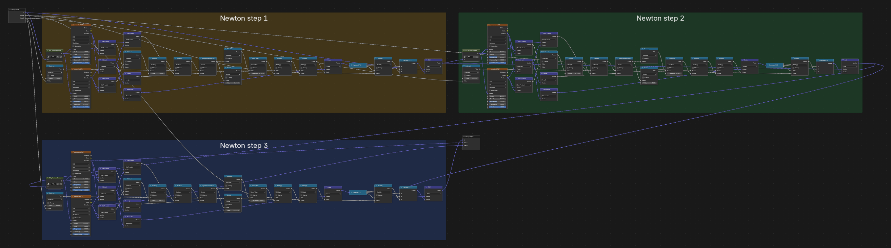

---

## 4 · Solid walls on the chawan

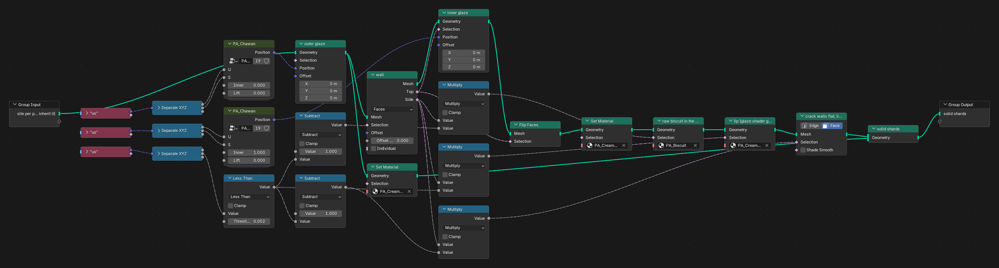

Now the flat shards become thick pieces of a tea bowl (*chawan*).

| Node | What it does |
|---|---|
| **`outer glaze`** (Set Position) | reads `"us"` and asks **`PA_Chawan`** for the point on the *outer* skin (Inner = 0). See [Appendix B](#appendix-b--pa_chawan-the-bowl-profile). |
| **`wall`** (Extrude Mesh, Faces, **Offset Scale 0**) | copies every face, with side faces joining the copy to the original. Nothing moves yet. |
| **`inner glaze`** (Set Position on **Top**) | moves the copies to the *inner* skin (Inner = 1). The side faces stretch across the wall thickness: these are the broken faces of the crack. |
| **Flip Faces** (Top) | the inner skin faces inward. |
| **`raw biscuit in the cracks`** | the side faces get the **Biscuit** material: fired clay with no glaze. |
| **`lip (glaze shader gilds it)`** | except the side faces on the very top row (s < 0.002). They are the lip, and stay glazed. |
| **`crack walls flat, lip rounded`** | flat shading on the broken faces only, so they look sharp. |
| **`solid shards`** (Join) | outer skin + walls and inner skin. |

### Trick · extrude by zero

**Extrude Mesh** with offset 0 is the cheapest way to get a closed shell with matching topology: the outer face, its copy
and the side faces that join them. Then you place the two copies with any rule you like. Here the rule is the bowl
profile, and every shard gets clean crack walls for free.

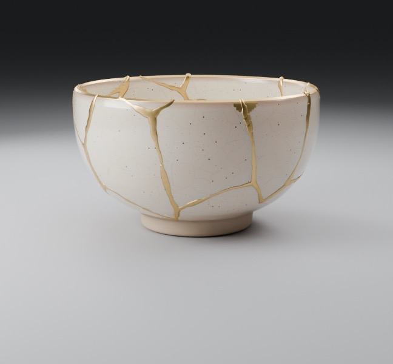

---

## 5 · Makienaoshi: the lost chip

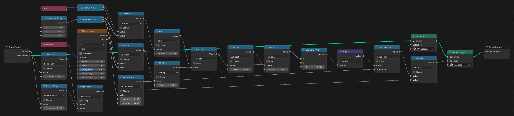

Real repaired bowls often miss a small piece. The gap is filled with lacquer and gold (*makienaoshi*, 蒔絵直し).

- **`chip centre (u, s)`** is one point on the rim. `build.py` places it after a first evaluation: on the lip, where a gold
  seam meets it, on the side that faces the camera at frame 1.
- The distance from that centre is measured in (u, s), with u wrapped around (Fraction, ± 0.5) and scaled so the chip is
  round on the bowl.
- **`the lost chip`**: distance < 4 cm + a noise × 10 cm, so the edge is ragged.
- The chip shows **Biscuit** while the bowl is broken and switches to **`filled with gold`** when `Phase` < 0.075 (before
  the break) or > 0.67 (once the gold has flowed past the rim).

---

## 6 · Fly apart, come home

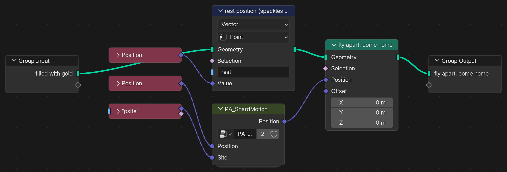

Only two nodes do all the motion:

- **`rest position (speckles stick)`** stores where each point sits on the whole bowl. The glaze shader reads `rest` for
  every pattern, so speckles and crazing stay glued to the shard while it flies.
- **`fly apart, come home`** (Set Position) calls **`PA_ShardMotion`** with the point's position and its shard's site.
  The site is the same for every point of a shard, so every point gets the same rigid motion: the shard moves as one
  piece.

### Inside `PA_ShardMotion`

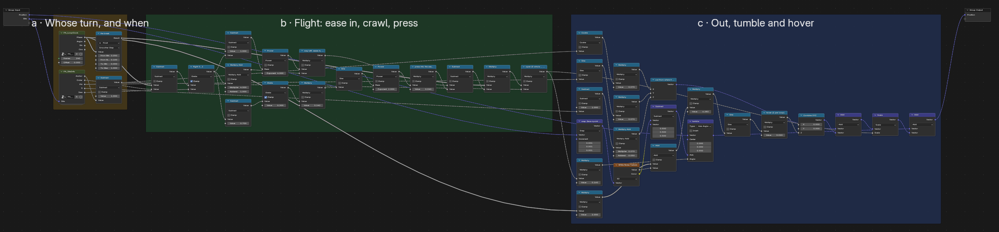

**a · Whose turn, and when.**

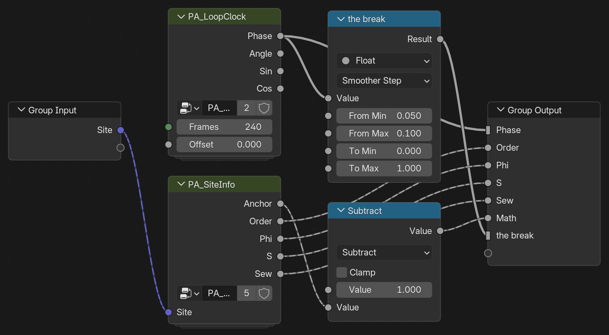

**`PA_SiteInfo`** (see [Appendix C](#appendix-c--the-fracture-helpers)) turns the site into the shard's angle around the
bowl, its height, whether it is the foot piece, its **Order** (when it starts flying home) and its **Sew** (how long the
flight takes). **`the break`** is a Smootherstep Map Range from `Phase` 0.05 to 0.10.

**b · Flight: ease in, crawl, press.**

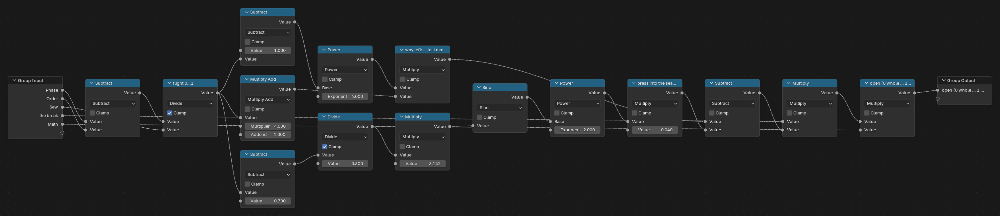

| Value | Formula | Feels like |
|---|---|---|
| **`flight 0…1`** *x* | (`Phase` − Order) / Sew, clamped | the shard's own clock for its trip home |
| **`way left`** | (1 − *x*)⁴ × (1 + 4*x*) | 1 → 0; no jerk at the start, a slow crawl over the last millimetres |
| **`press into the seam, settle`** | sin²(π × (*x* − 0.7) / 0.3) × 0.04 | a small bump around *x* = 0.8, when the faces meet |
| **`open`** | the break × (way left − press) × moving | 0 = home, 1 = fully apart, below 0 = pressed in |

The curve (1 − *x*)⁴(1 + 4*x*) has a slope of −20*x*(1 − *x*)³: zero at both ends. The shard leaves the hover gently and
arrives gently, so it looks *placed* rather than thrown. The press makes the open amount dip a little below zero and come
back, like a hand pushing a shard into wet lacquer.

**c · Out, tumble and hover.**

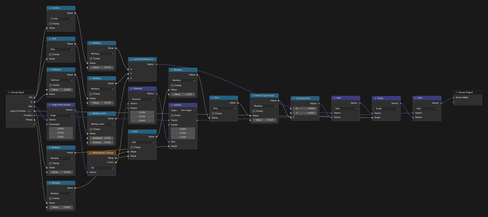

- **`out from where it was, and up`**: 7 cm outward along the shard's angle, plus 5–12 cm up (shards near the rim rise
  most).
- **`tumble`** (Vector Rotate, axis-angle): a random axis per shard from **White Noise** on the site, an angle of
  open × 0.16 rad, around a point in the middle of the bowl.
- **`hover (2 per loop)`**: a 2 cm bob, sin(2π(2 × `Phase` + random)). Two full bobs per loop, so it still loops.
- Everything is multiplied by **open**, so it all goes to exactly 0 when the shard is home.

**Why the site is snapped.** The site comes from the faces, and moving it onto the points averages a few identical
numbers, which can leave a 1-ulp difference. White Noise is so sensitive that this would give two halves of one shard two
different tumble axes. **`snap`** (Vector Math, Snap to 0.001) makes them identical again.

---

## 7 · Glue: urushi on the broken edge

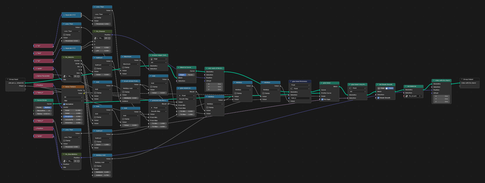

Before a shard flies home, a bead of black urushi is brushed along its broken edge.

1. **`broken edges (not the lip)`** (Delete Geometry, Edge): from the snapped shards of section 3, keep only the open edges
   below the lip. **Mesh to Curve** turns them into curves.
2. **`mid-wall of the broken face`**: Set Position with `PA_Chawan` at Inner = 0.5, halfway between the two skins.
3. **`brush stroke from one end of the edge to the other`**: each point's start time is
   Order − 0.06 + Spline Parameter × 0.045. The bead appears along the edge like a brush stroke.
4. **`glue wiped on`** (0 → 1 over 0.015) × **`pressed into the seam`** (1 → 0 just after the flight ends) × not the foot
   piece × a wobble noise (0.7 … 1.3) = the bead thickness.
5. **`glue bead`**: the *tube* helper (below), radius 2.2 cm × thickness, 8-sided.
6. **`rides with its shard`**: Set Position through the *same* `PA_ShardMotion` with the same site. The bead moves exactly
   like its shard, so it stays stuck to the edge in flight.

### Trick · the tube helper

Several parts of the tree are beads on curves: glue, lacquer and gold. They all use the same three nodes:

- **Store** the thickness as `tube_k` on the curve points.
- **Curve to Mesh** with a **Curve Circle** profile and **Scale** = `"tube_k"`. In Blender 5.2, Curve to Mesh ignores
  the curve's *radius*, so the thickness has to go through Scale.
- **`drop the empty parts`** (Delete Geometry, `tube_k` < 0.0001). A bead with zero thickness would still render as a
  black line of collapsed faces, so it is removed.

---

## 8 · Seams and gold width

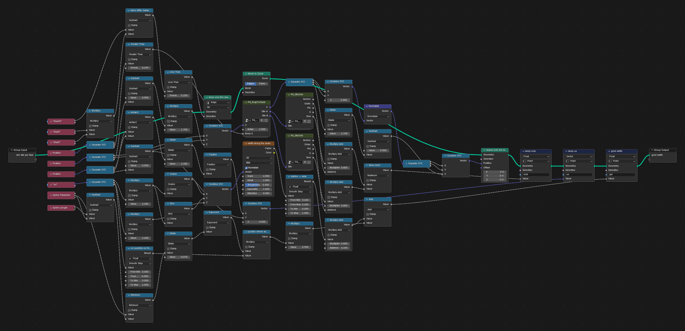

The seams come from the *unbroken* grid of section 2, the same grid the shards were cut from.

### Trick · a seam is where the id has a variance

Read a face attribute on the **Edge** domain and Blender averages the faces on either side. An edge inside a shard
averages two equal ids. An edge on a crack averages two *different* ids. So:

  **`faces differ (variance of id)`** = mean(id²) − mean(id)²

is 0 inside a shard and at least 0.25 on a crack (for two ids that differ by 1, and much more for most). That is why
section 2 stored `shard2`. **`keep only the seams`** deletes every edge with variance < 0.25, and **Mesh to Curve** turns
the rest into seam curves.

Then:

- **`seams onto the bisector`**: the same `PA_SnapToCrack`, now for every point (Active = 1). The seam lands on the same
  smooth boundary as the shard edges.
- **`faces meet`** (`lock`): `PA_SnapToCrack` also returns the two sites, **Site A** and **Site B**. For each, the time the
  shard's faces meet is Order + 0.8 × Sew. The seam closes when the *later* of its two shards arrives: Maximum.
- **`gold width`** (`gw`): **`width along the seam`** (a Noise in (cos u, sin u, 1.6 s), so it wraps around) →
  **`hairline → wide`** (Smoothstep 0.44 … 0.60). Plus **`puddle where seams meet`**: exp(−distance to the curve end /
  7 cm), so the gold pools at every junction, but **`no puddles on the lip`**. Together:
  `gw` = 0.6 + 0.8 × swell + 0.9 × puddle.

The two helpers used by sections 9 and 10 live here too:

- **bead** places a seam on the outer skin and again on the inner skin (both sides of the bowl get a line), stores the
  surface normal `sn` (from `PA_Chawan` with Lift 0.01 minus Lift 0), and stores **`bead centre`** `c0` on the curve
  points.
- **flatten** squashes a round bead along `sn`: for each vertex, h = (position − `c0`) · `sn` is its height above the bead
  centre, and the offset `sn` × h × (k − 1) makes that height k × h. With k = 0.1 the bead becomes a ribbon a tenth as
  tall as it is wide.

---

## 9 · Urushi: squeeze-out, set, hide

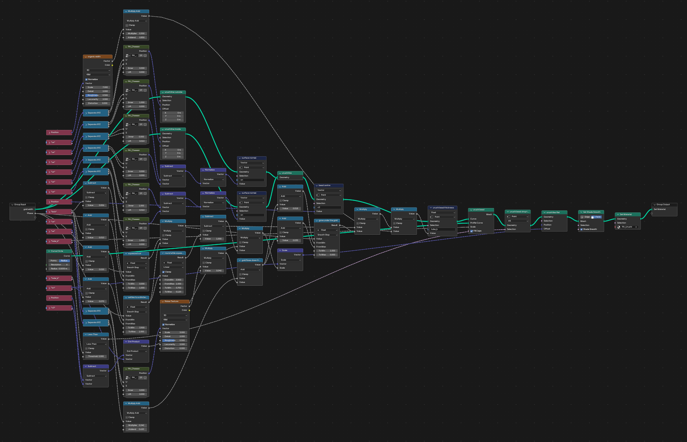

When a shard presses home, the glue on its edge disappears into the seam (section 7), and at the same moment a line of
lacquer squeezes out of the seam on both faces of the bowl.

| Node | Range | Effect |
|---|---|---|
| **`squeezed out`** | `lock` − 0.006 → `lock` + 0.010 | 0 → 1: the line pops out as the faces meet |
| **`settles to a slim bead`** | `lock` + 0.02 → `lock` + 0.07 | × 3.5 → × 1: a fat squeeze-out shrinks back to a slim line |
| **`gone under the gold`** | gold arrival + 0.0175 → + 0.035 | 1 → 0: hidden once the gold covers it |
| **`organic width`** | Noise on position | × 0.85 … 1.15 |
| **`round while squeezed out, flat once set`** | settle 3.5 → 1 | flatten k from 0.7 to 0.12 |

The urushi bead has a radius of 5.5 mm × all of the above, then **`urushi lies flat`** and the **Urushi** material
(nearly black, glossy coat).

### Trick · the lacquer must be gone *before* the gold is too thin to hide it

Gold arrives at each point over a short ramp. If the lacquer stayed until the end of that ramp, a black edge would show
around a thin new gold line. So the lacquer starts to fade at half the ramp and is gone when the gold is fully there, and
the gold is always wider (the 0.6 minimum in `gw`) than the slim lacquer line.

---

## 10 · Gold flows down the seams

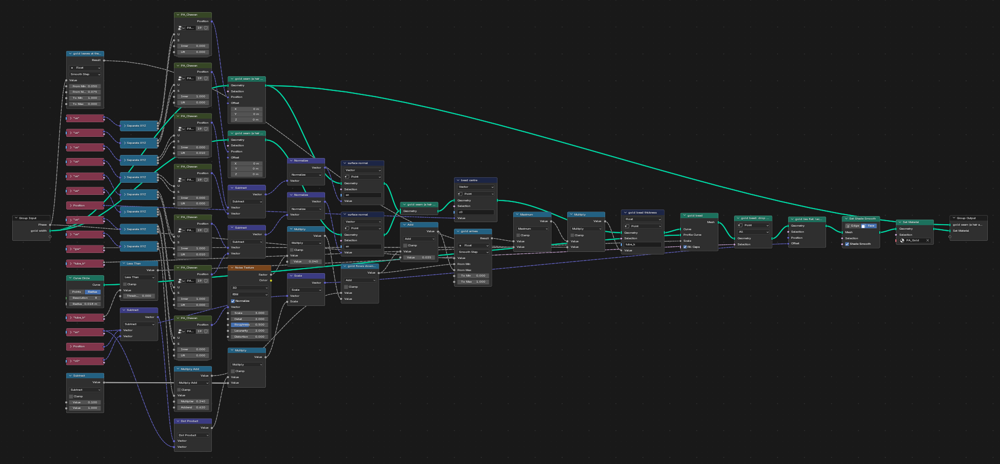

- **`gold flows down from the rim`**: each point's gold time is 0.62 + s × 0.24 + a noise × 0.04. The rim (s = 0)
  gets gold first and the foot last, with a slightly uneven front, like liquid running down.
- **`gold arrives`**: a Smoothstep from that time to 0.035 later.
- **`gold leaves at the break`** (`carry`): 1 → 0 between `Phase` 0.05 and 0.075. The gold is already there at the start
  of the loop and vanishes when the bowl breaks.
- thickness = max(arrives, carry) × `gw`; radius 1.8 cm × thickness.
- **`gold seam (a hair above the glaze)`**: the bead helper with Lift 0.4 mm, so the ribbon never sinks into the glaze.
- **`gold lies flat: lacquer + powder, nearly flush`**: flatten with k = 0.10.

### Trick · flat, not fat

The first version used round gold tubes. They looked like gold wire laid on the bowl. Real kintsugi gold is powder on a
thin lacquer line, almost flush with the glaze. Flattening the tube along the surface normal keeps its outline (and its
nice rounded edges in the highlights) but takes away the height.

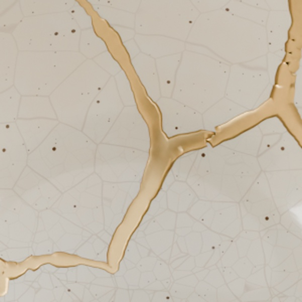

---

## 11 · Gold dust at the break

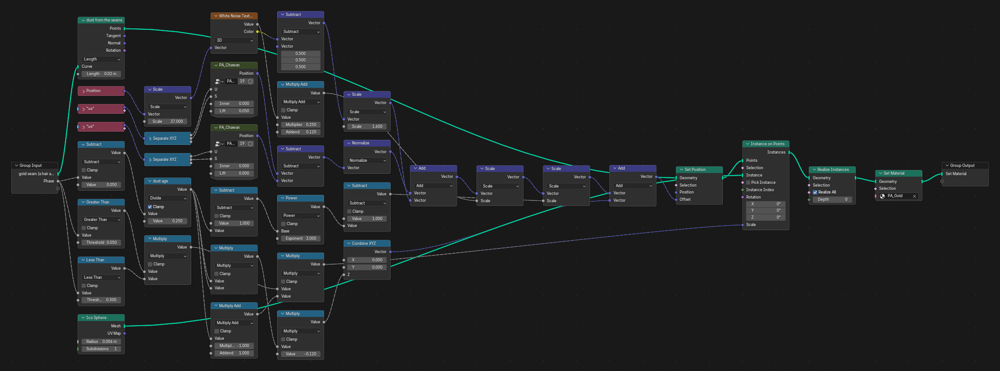

The gold that vanishes at the break should go somewhere.

- **`dust from the seams`** (Curve to Points, every 2 cm along the outer gold seam).
- A random velocity per speck: the surface normal + a random vector × 1.6, scaled by a random 0.12 … 0.37.
- **`dust age`**: (`Phase` − 0.05) / 0.25, clamped.
- Position: velocity × an ease-out (1 − (1 − age)³), minus 12 cm × age² for gravity.
- Icospheres of 6 mm, scaled by (1 − age) and only while alive, with the **Gold** material.

---

## 12 · Output: join and turn

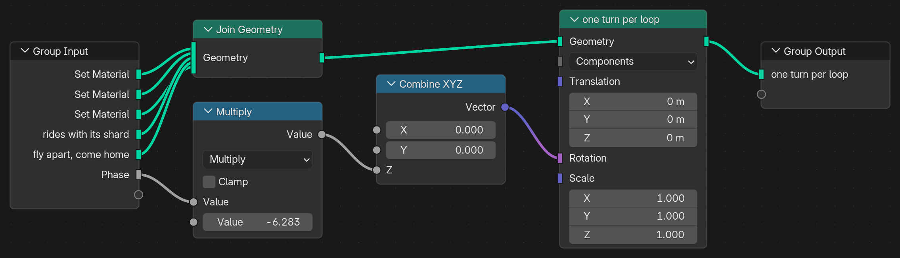

**Join Geometry** collects the moving shards, the glue beads, the lacquer, the gold and the dust. **`one turn per loop`**
(Transform Geometry) rotates everything by −2π × `Phase` around the vertical axis: a full turn in 8 seconds. Because the
camera is still and only the bowl turns, the lighting slides across the glaze as it would on a potter's wheel.

**Why the loop never shows a seam.** At `Phase` 0 the bowl is whole: every shard is home (open = 0), the gold is there
(`carry` = 1), the lacquer is hidden, the chip is gilt and the dust is not alive yet. At `Phase` 0.94 … 1 the same is true
again, because the gold has finished flowing and every shard is home. The turn is a full 2π. So frame 240 → frame 1 shows
nothing happening.

---

## Appendix A · `PA_LoopClock`

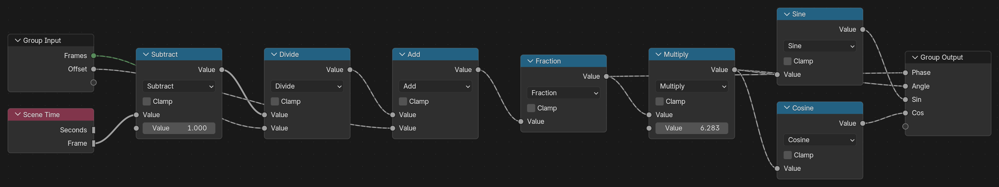

**Scene Time** Frame → **Subtract** 1 → **Divide** by Frames (240) → **Add** Offset → **Fraction** gives
**Phase**: 0 at frame 1, 0.5 at frame 121, and back to 0 at frame 241.
**Multiply** by 2π gives **Angle**; **Sine** and **Cosine** give smooth back-and-forth values for circular motion.
Any motion driven only by Phase repeats perfectly every 240 frames.

## Appendix B · `PA_Chawan`, the bowl profile

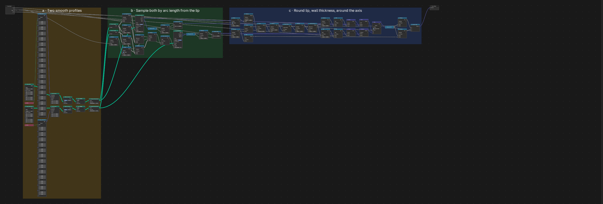

Input (u, s, Inner, Lift) → output a point on the bowl.

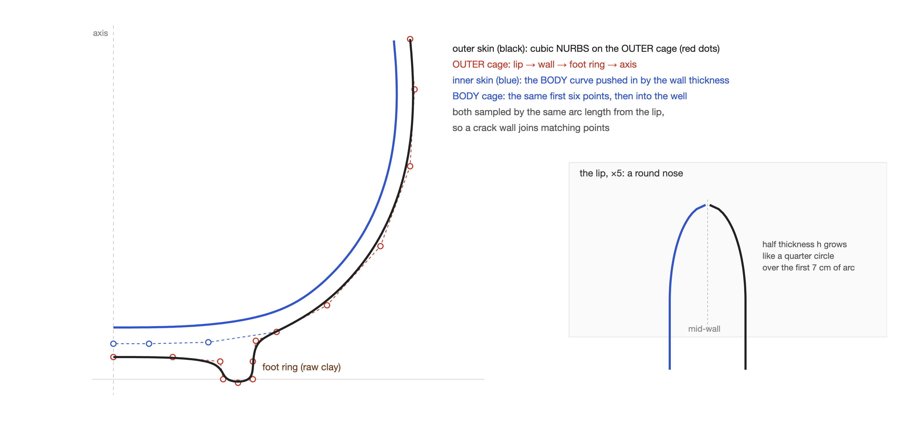

**a · Two smooth profiles.**

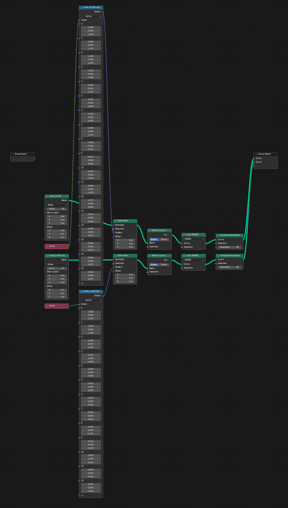

Each profile is a list of (r, z) control points in an **Index Switch** (`outer profile cage (r, z)`). A **Mesh Line** with
that many points is moved onto the cage, turned into a curve, and set to **`cubic NURBS`**. The first and last points are
listed three times, so the curve starts and ends exactly on them. A NURBS curve has no corners: the earlier version used
straight segments and fillets, and the bowl had visible bends.

- **OUTER**: from the lip, down the wall, round the foot ring, to the axis.
- **BODY**: the same first six points, then it turns into the well instead of going round the foot. The inside of a tea
  bowl does not follow the foot ring.

**b · Sample both by arc length from the lip.**

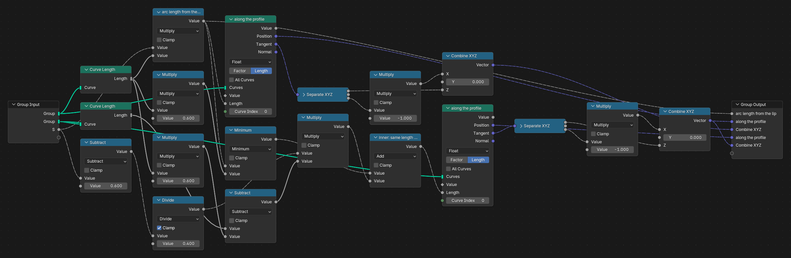

`s` × the outer curve's length is the **`arc length from the lip`**. **Sample Curve** (Length mode) gives the point and
the tangent; the tangent turned by 90° is the outward normal. The inner skin samples the body curve *at the same arc
length* down to s = 0.6 (`inner: same length above S_SPLIT, then stretched to reach the axis`), so the two skins match
point for point where the cracks run, and a crack wall always joins two points that face each other.

**c · Round lip, wall thickness, around the axis.**

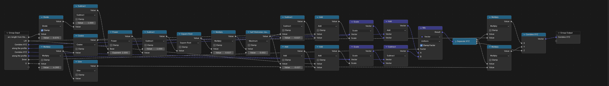

- **`half thickness: round nose at the lip`**: h = √(1 − (1 − q)²) × 2.75 cm, with q = arc length / 7 cm. It grows like
  a quarter circle over the first 7 cm, so the two skins meet in a round nose instead of a flat cut.
- Outer point = profile point + normal × (Lift + h − 2.75 cm). Inner point = body point − normal × (Lift + h + 2.75 cm).
  The wall is 5.5 cm thick.
- A **Mix** chooses between them with **Inner** (0 outer, 1 inner, 0.5 mid-wall for the glue).
- Finally r and z are turned around the axis: (r cos 2πu, r sin 2πu, z).

## Appendix C · the fracture helpers

**`PA_FractureSpace`**: the space the cells live in.

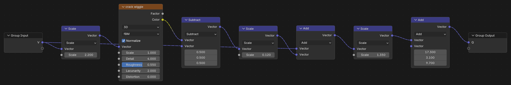

(V + (noise − 0.5) × 0.12) × 1.35 + seed. A 3D **Noise** (scale 2.2) shifts every point by up to 6 cm, so the cell
walls, which are flat planes in this space, become wiggly cracks on the bowl. 1.35 sets the cell size. The seed vector
(17.3, 3.1, 9.7) just moves to a different part of the infinite Voronoi pattern: change it and you get a different break.

**`PA_Cell`**: which shard am I?

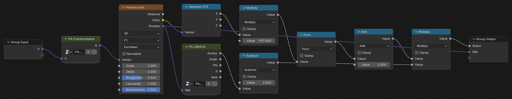

**Voronoi Texture** (3D, F1) in the fracture space. **Position** is the nearest site. Its **Color** is random per cell,
so floor(red × 997) + 1 is a stable id per cell. Multiplied by (1 − Anchor), every cell in the lower half becomes id 0,
one foot piece.

**`PA_SiteInfo`**: what does this shard do?

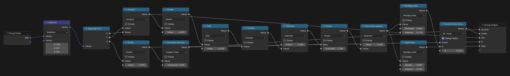

- **Phi** = atan2(y, x) of the site: where the shard sits around the bowl. **S** = its height, as s.
- **`low cells: the foot piece`**: S > 0.5.
- turn = fraction(Phi / 2π + 0.15): shards come home in order around the bowl, starting at a chosen angle.
- **`first ones spaced widest`**: 1 − (1 − turn)^1.7. The first few shards get more time between them, the last ones
  come in quick succession. The repair starts slow and careful and speeds up.
- **`home in turn, around the bowl (foot piece first)`** Order = 0.17 + that × 0.30, or 0.12 for the foot piece.
- **`flight time`** Sew = 0.16 → 0.08 along the same curve.

**`PA_SnapToCrack`**: three Newton steps (shown in section 3). Each step: **Voronoi F1** and **F2** give the two nearest
sites; **`signed distance to the bisector`** = (q · (s₂ − s₁) − (|s₂|² − |s₁|²)/2) / |s₂ − s₁|; if that is under 0.05
and the point is active, step by −distance / 1.35 along the normalised s₂ − s₁ (the 1.35 undoes the fracture-space
scale); with **Keep S** on, the step has no s part.

## Appendix D · materials

### Aged cream glaze (`PA_CreamGlaze`)

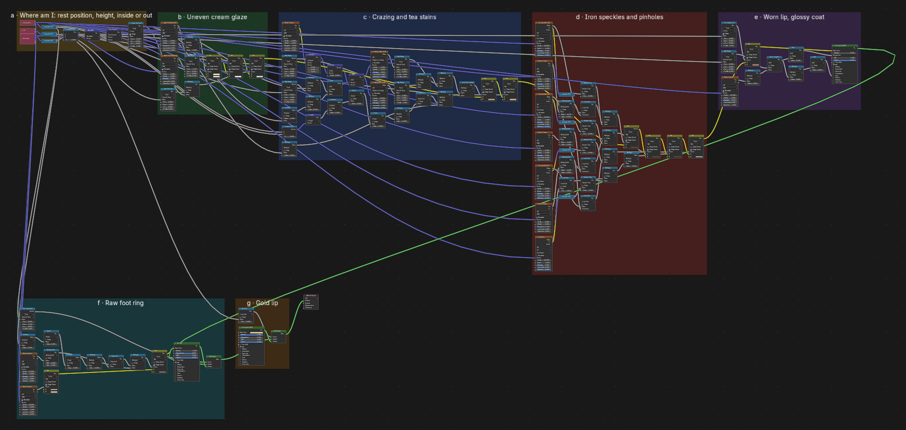

Every pattern reads `rest`, the position on the whole bowl, so the glaze sticks to the shards while they fly.

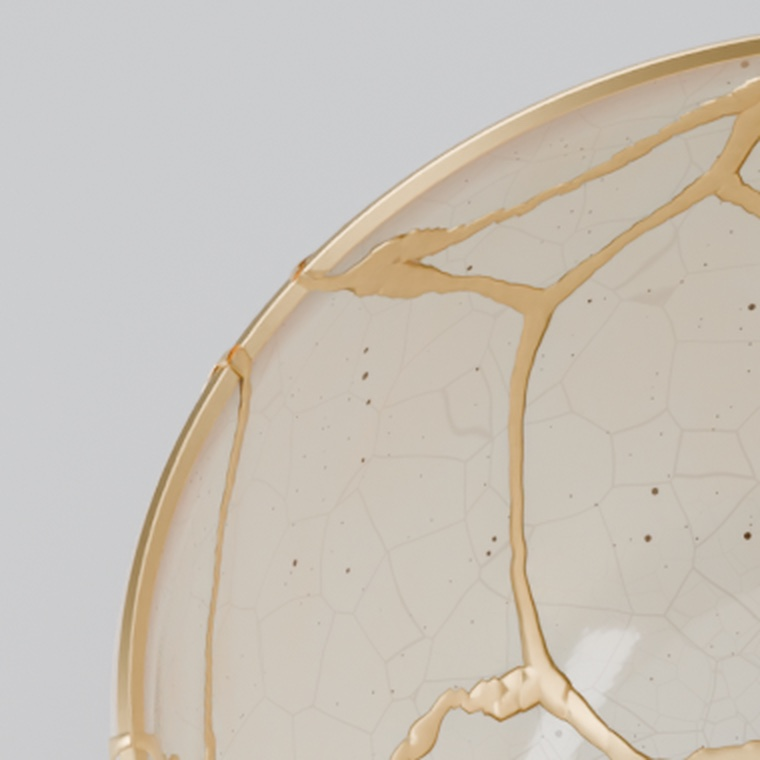

- **a · Where am I.** `rest`, `us` (for s, the distance from the lip) and **`inside the bowl`**: the shading normal
  against the outward radial direction. Inside and outside age differently.

  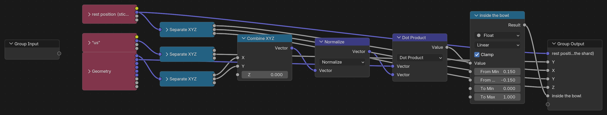

- **b · Uneven cream glaze.** **`glaze thickness drift`** mixes two creams; **`warm / cool mottling`** adds pale grey
  patches; **`grey-blue pools toward the well`**, where glaze runs thick inside a real bowl.

  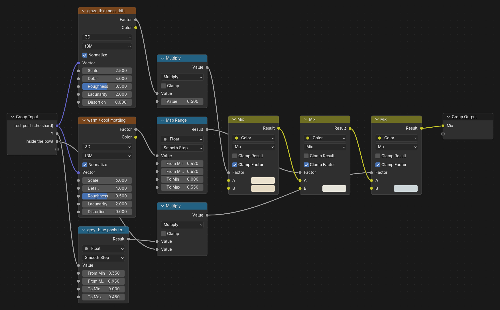

- **c · Crazing and tea stains.** *Kannyu* (貫入) is the net of hairline cracks in an old glaze. Two **Voronoi** layers
  in **Distance to Edge** mode (scale 7 and 19, warped a little by noise) give large and fine cells; the fine ones appear
  only lower in the bowl. **`tea in the crazing`** stains the lines brown, more strongly inside and toward the well. A
  very soft **tea ring** sits in the well at r = 0.36.

  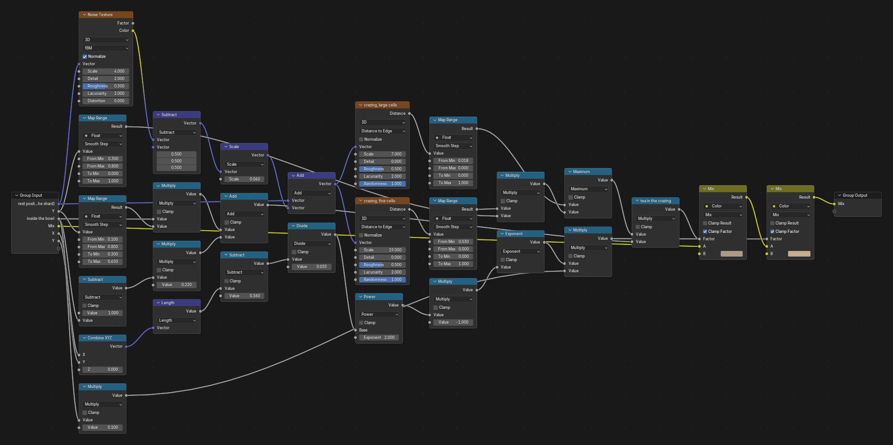

- **d · Iron speckles and pinholes.** Three **Voronoi** layers (scale 22, 60 and 8) put dark iron dots in a random
  30 %, 22 % and 6 % of their cells, with noisy sizes. **`pinholes`**: tiny grey dots in 7 % of a fine Voronoi.

  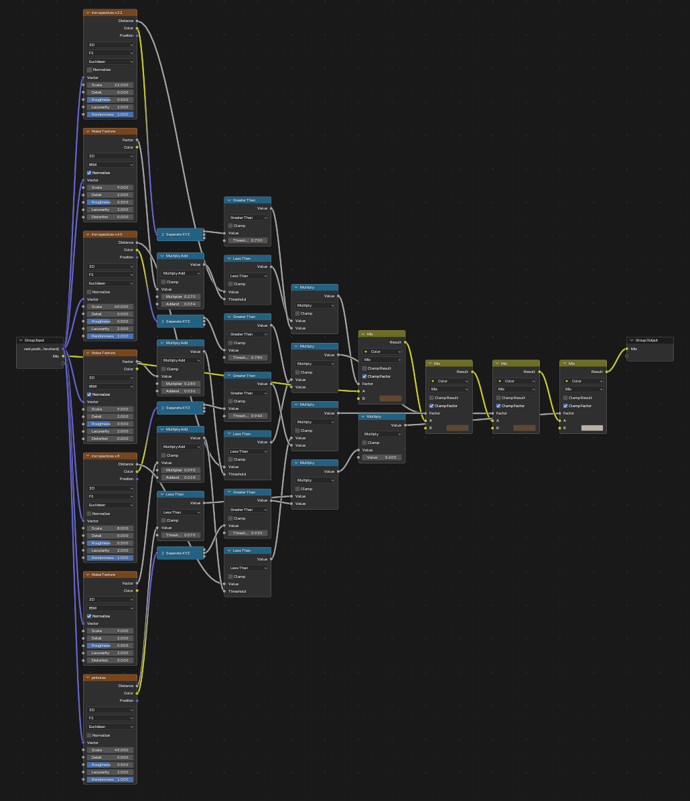

- **e · Worn lip, glossy coat.** **`iron edge at the lip`**: the glaze thins to brown right at the rim.
  **`worn: rougher at the lip`** raises the roughness there. **Principled BSDF** with **Coat** 1.0 (IOR 1.52) for the
  glassy glaze layer and a little subsurface.

  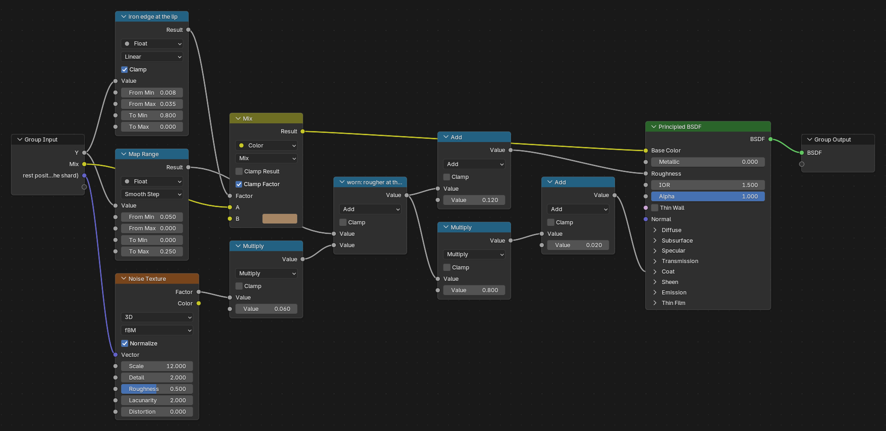

- **f · Raw foot ring.** **`foot ring (unglazed)`** below z = 0.15: raw clay (two browns by noise), with darker grime
  where the foot meets the body, roughness 0.85.

  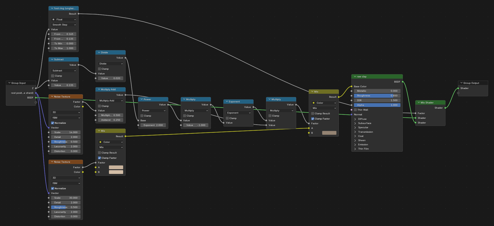

- **g · Gold lip.** s < 0.008: the rounded rim is gilt, as on many repaired bowls.

  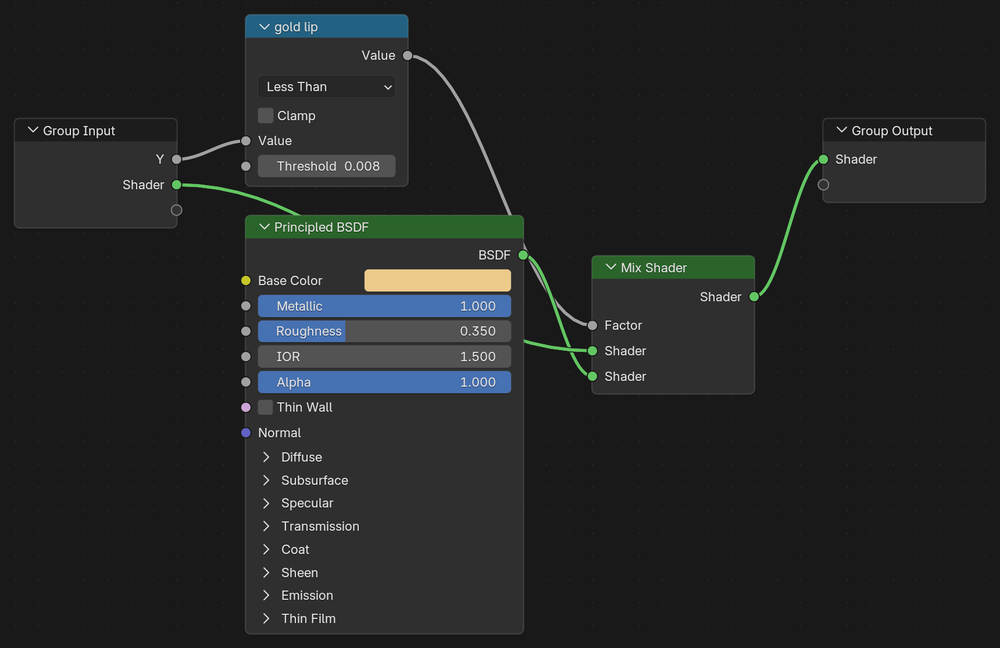

### Gold (`PA_Gold`)

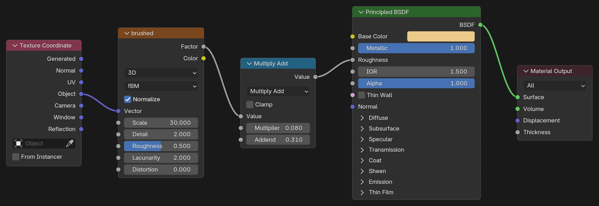

Base colour (0.85, 0.60, 0.26), Metallic 1. A fine **`brushed`** noise varies the roughness between 0.31 and 0.39. A
muted, satin, slightly aged gold: a bright polished gold looked like brass plating on the cream glaze.

### Urushi (`PA_Urushi`) and Biscuit

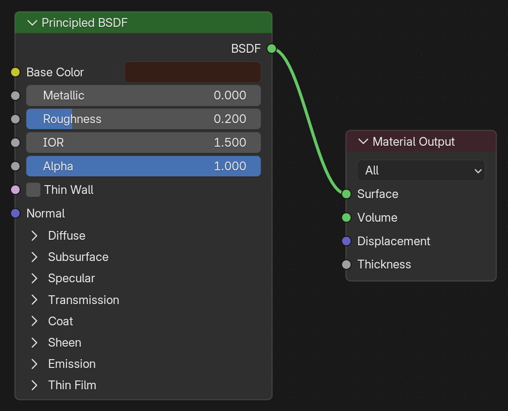

- **Urushi**: almost black red-brown (0.035, 0.014, 0.008), roughness 0.2, with a clear coat: wet lacquer.
- **Biscuit**: fired clay with no glaze, (0.74, 0.62, 0.49), roughness 0.85. It is only seen on the broken faces and in
  the lost chip.

### Light and camera

A grey sweep (0.5) under a soft sky disc, a large side key for the gradient on the outer wall, and two thin cards that put
long highlight bands into the glaze. 85 mm lens from 60° above. Cycles, 96 samples, exposure −1.5.

---

## Try it yourself

1. Open `kintsugi.blend`, select **PA_Bowl** and scrub the timeline. Frames 13–25 (the break), 70–80 (the first squeeze-out)
   and 150–225 (gold) are the best moments to watch the tree.
2. Change the seed vector (17.3, 3.1, 9.7) to anything else, in **both** places it appears: the last **Add** in
   **`PA_FractureSpace`** and the first **Subtract** in **`PA_SiteInfo`**. You get a completely different break, with
   matching gold seams. (The lost chip stays where it was; `build.py` moves it to a seam when you rebuild.)
3. In section 10, find the **Subtract** (0.1 − 1) that feeds **`gold lies flat: lacquer + powder, nearly flush`** and
   change 0.1 to 1. The gold becomes round wire, the look we dropped.
4. In section 3, set **Active** on `PA_SnapToCrack` to 0. The crack edges turn into grid staircases.
5. In `PA_SiteInfo`, change the power 1.7 in **`first ones spaced widest`** to 1. The shards come home at an even pace.
6. Rebuild everything from scratch:
   `Blender -b --factory-startup --python build.py` (add `-- --preview 1,60,120,180` for quick low-sample stills, or
   `-- --clay` for a white clay-model copy to check the motion). In `build.py`, `SEEDV` and `KV` set the break, `OUTER`
   and `BODY` the bowl, the *timeline* constants the choreography, and `GOLD` and `GOLD_K` the gold. The tidy layout
   and frames come back from `nodes_layout.json`. Nodes you add that are not in that file keep the plain automatic
   layout.

*Made with Blender 5.2 Geometry Nodes for [Nodevember](https://nodevember.com) 2026, Day 3 · Stitch.*
