# How the sand finds the nodal lines

*A node-by-node walkthrough of Nodevember 2026 · Day 4 · Brass*

A square brass plate sits on the shaft of a vibrator in a black void, covered in fine white sand. It sings four rising
tones, two seconds each. At every new tone the brass reflection blurs where the plate shakes, the sand leaps off those parts and settles on the lines
that stand still: four arcs, then a rounded square round a ring, then a ring of loops, then dense lace. Then the first tone
comes back. These are Chladni figures. The 8-second loop has no seam: frame 241 is frame 1. There is no simulation, no
particle system, no keyframes and no image texture. Everything is Geometry Nodes, starting from a scatter of points.

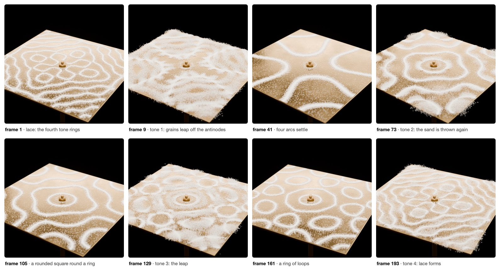

| File | What it is |
|---|---|
| [`../loop.mp4`](../loop.mp4) | the render, 1080 × 1080, 240 frames at 30 fps, Cycles 128 samples |
| [`../chladni.blend`](../chladni.blend) | the scene; select **PA_Sand** and open its Geometry Nodes modifier (**PA_Sand_GN**) |
| [`../build.py`](../build.py) | the script that builds the whole file (every node in this tutorial comes from it) |
| [`../nodes_layout.json`](../nodes_layout.json) | the tidy node layout and frames you see in the screenshots |

---

## The one idea

> **Sand ends up where the plate does not move.** A vibrating plate is a standing wave: some lines on it stay still (the
> *nodal lines*) and everything between them shakes. Write the wave as a number f at every point of the plate. Then
> every grain only has to do one thing: walk to the nearest point where f = 0.

Everything else in the tree is about doing that well:

- **Which wave?** One formula for all four tones, a standing wave on a square:
  f = cos(nπu)·cos(mπv) + cos(mπu)·cos(nπv). Only the two whole numbers n and m change from tone to tone.
- **How does a grain find f = 0?** Newton's method, 24 small steps in a **Repeat Zone**. Each step moves the grain
  straight downhill on |f| by just the right amount.
- **When and how far does it jump?** The new tone shakes each grain by how much the plate moves under it, |f|. Grains on
  an antinode fly longest and bounce highest. Grains already next to a new line barely move.
- **Why does it look like sand and not like a diagram?** A real plate is not perfect, and neither is real sand. The lines
  are bent a little, their width follows the slope of the wave, a quarter of the grains spread wider, and a few never
  move at all.

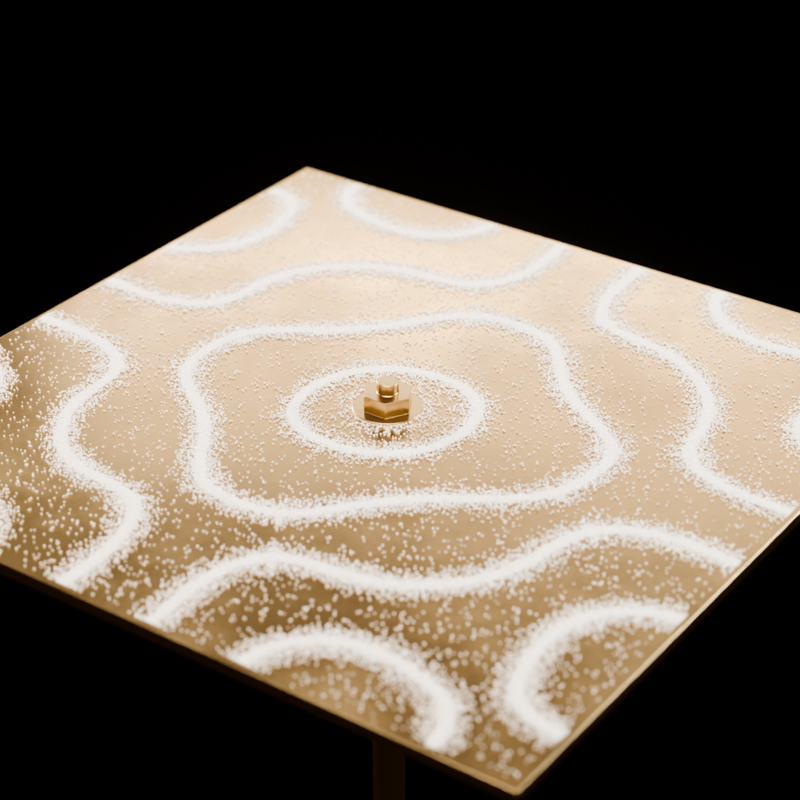

### How to read the screenshots

In `chladni.blend` the main tree is laid out exactly as in the map below: seven coloured frames, one per section. The
helper groups `PA_ToNodalLines` and `PA_PlateMode` and the plate's tree are split into frames *a · b · c* in the same way.

The full tree is big, so each section below also shows a cut-out of just its own nodes.

- Wires that come from another section enter through a **Group Input** on the left. It is named after what it carries
  (for example `flight 0 → 1` or `|f| where the grain starts`).
- Wires that leave the section exit through a **Group Output** on the right.
- Node titles such as `spot on tone 1` or `bounces: 1 near a node … 5 at an antinode` are the labels you will find in the
  `.blend` file.
- Small "plumbing" nodes are collapsed to one line: **Position**, **Separate XYZ** and **Index** are folded shut.

The plate is 2 units wide, from −1 to +1 in x and y, so the lengths in this tutorial are the file's own units. If you
think of the plate as 30 cm across, a grain is 0.5–0.9 mm: real fine sand.

Click any screenshot to see it at full size.

---

## 0 · The map

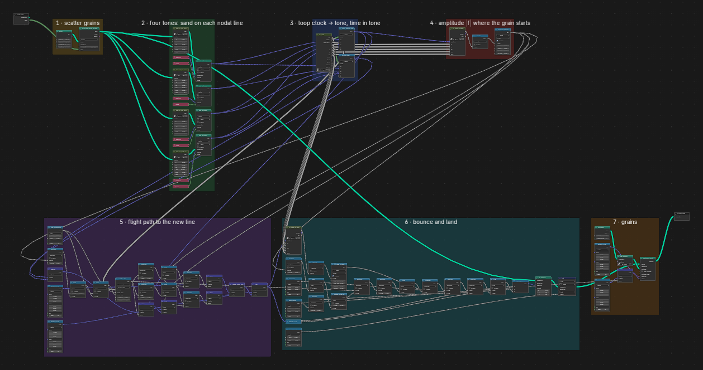

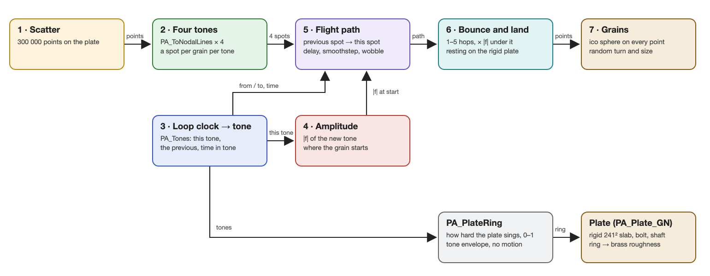

| # | Section | Nodes | Job |
|---|---|---|---|
| 1 | **Scatter** | Grid + Distribute Points on Faces | 300 000 points, evenly at random over the plate |
| 2 | **Four tones** | 4 × `PA_ToNodalLines` + 4 × Sample Index | where every grain would sit on each of the four tones |
| 3 | **Loop clock → tone** | `PA_Tones` + 2 Index Switch | which tone is sounding, which one came before, and how far into it we are |
| 4 | **Amplitude** | `PA_PlateMode` + Map Range | how hard the new tone shakes the grain where it starts |
| 5 | **Flight path** | random delay, smoothstep, random walk | the grain's way from its old spot to its new one |
| 6 | **Bounce and land** | `PA_PlateMode`, sine | its hops and its size |
| 7 | **Grains** | Ico Sphere + Instance on Points | a small, irregular grain on every point |

The plate itself is a second object with its own small tree (**PA_Plate_GN**, [below](#the-plate)).

### The four tones

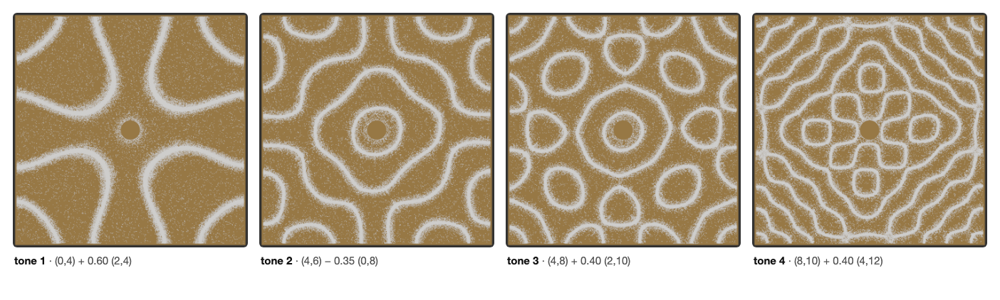

| Tone | Frames | Mode | Mix | Looks like |
|---|---|---|---|---|
| 1 | 1–60 | (0, 4) | + 0.60 × (2, 4) | four arcs bowing in towards the bolt |
| 2 | 61–120 | (4, 6) | − 0.35 × (0, 8) | a rounded square round a ring |
| 3 | 121–180 | (4, 8) | + 0.40 × (2, 10) | a ring of loops |
| 4 | 181–240 | (8, 10) | + 0.40 × (4, 12) | dense nested lace |

These views are Workbench renders of the real scene from straight above (frames 41, 105, 165 and 233), late in each
tone, after the sand has settled.
Higher numbers mean a higher tone and more, closer lines. That is also how a real plate behaves.

### The timeline of one tone

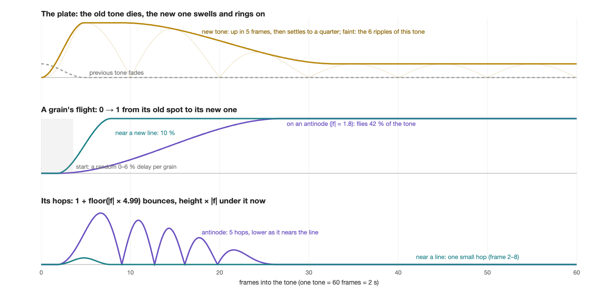

Every tone runs the same script. The plate starts ringing in the new shape within 5 frames. Each grain waits a random
0–6 % of the tone, then flies. A grain on an antinode takes 42 % of the tone (25 frames) and bounces five times. A grain
next to a new line takes 10 % (6 frames) and hops once. By frame 30 of each tone everything is still, and the plate
keeps ringing quietly until the next tone.

(The hop curves are drawn for a typical grain; the real height also depends on |f| along its own path.)

---

## 1 · Scatter

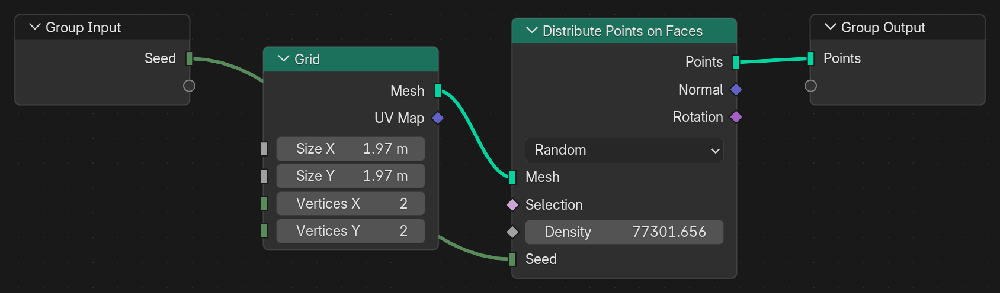

A **Grid** of 1.97 × 1.97 units with just 2 × 2 vertices: one square, a little smaller than the plate so no grain sits on
the very edge. **Distribute Points on Faces** (Random) scatters points over it. The density is 300 000 ÷ 1.97², so there
are 300 000 points. The **Seed** is a modifier input: change it and you get a different sand, with the same figures.

These points are never thrown away or recreated. Every later section moves **these same points**. That matters: because
point 12 345 is always point 12 345, a grain can remember where it was on the previous tone and fly from there.

---

## 2 · Four tones: sand on each nodal line

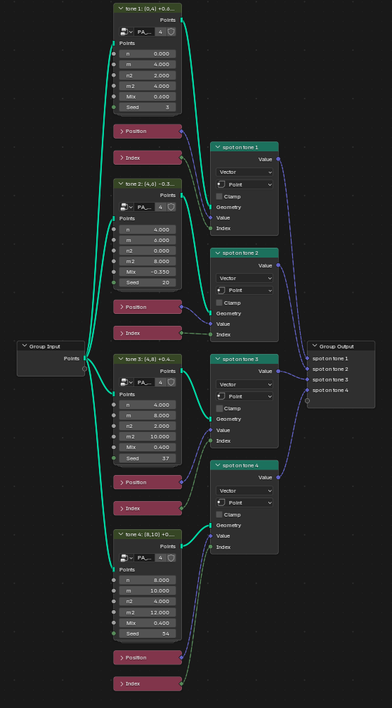

The points go into **four `PA_ToNodalLines` group nodes**, one per tone. Each one is given that tone's five numbers
(n, m, n2, m2, Mix) and its own Seed (3, 20, 37, 54). It returns the same points, pulled onto that tone's nodal lines and
spread into a sand line. How it does that is in [`PA_ToNodalLines`](#inside-pa_tonodallines).

Then **Sample Index** (Vector, Point, Index → Index) reads back each projected point's position, **as a field on the
original points**. The result is four vector fields, `spot on tone 1` … `spot on tone 4`: for every grain, the place it
will settle on each tone.

### Trick · positions as fields, not as four copies

There is only one set of points. The four outcomes ride along as four vectors per point, and section 3 picks two of them.
Nothing is joined, instanced or deleted, so the grain count never changes and the motion between tones is just a blend
between two of those vectors.

The price: all four projections (4 × 24 Newton steps on 300 000 points) are evaluated on every frame. It is still fast
enough: about 10 s a frame in Cycles on an RTX 4060, including the render.

---

## 3 · Loop clock → tone, time in tone

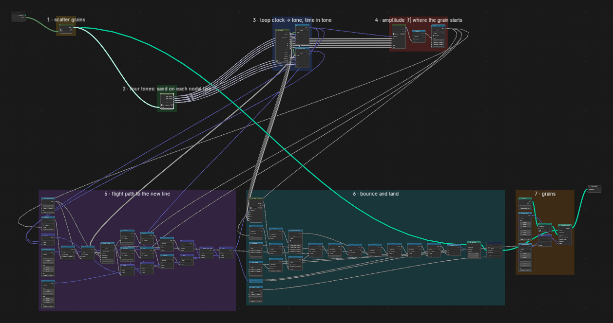

**`PA_Tones`** turns the loop clock into the tone that is sounding now (`Tone` 0–3), the one before it (`Previous`), and
`Time in tone`, which runs 0 → 1 over each 60-frame tone. It also hands out each tone's five mode numbers, for now and for
the previous tone ([Appendix B](#appendix-b--pa_tones)).

Two **Index Switch** (Vector) nodes pick from the four spots of section 2:

- **`from: previous tone`**, indexed by `Previous`: where the grain is lying when this tone starts.
- **`to: this tone`**, indexed by `Tone`: where it has to go.

At frame 1 the tone is 0 and the previous tone is 3, so the loop starts with the grains on the lace of tone 4. That is
exactly where frame 240 left them.

---

## 4 · Amplitude where the grain starts

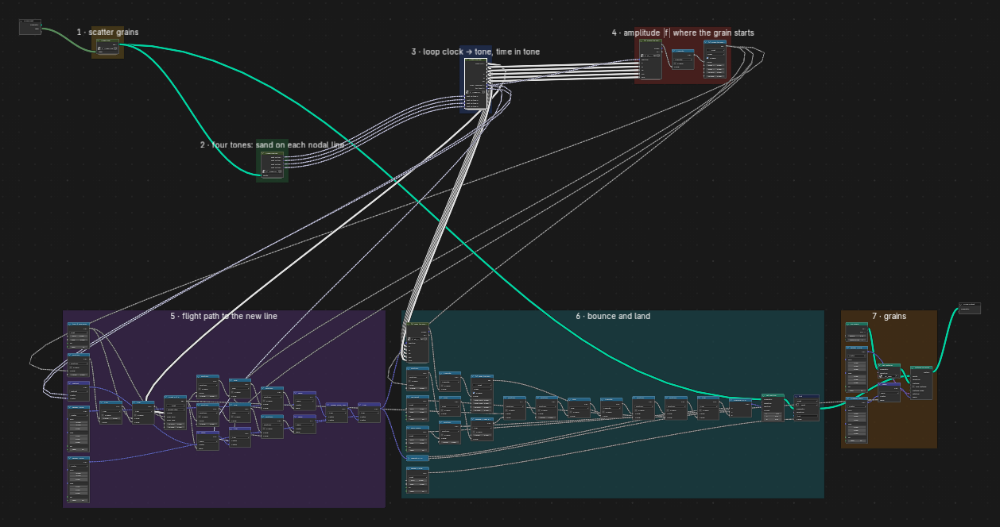

How hard is the grain shaken? A **`PA_PlateMode`** node evaluates the **new** tone's wave at the grain's **old** spot.
**Absolute** gives |f|, the plate's amplitude there. **Map Range** (0 → 1.8 maps to 0 → 1, clamped) turns it into a 0–1
number, `|f| where the grain starts`. Call it *e0*.

- *e0* = 0: the grain already lies on a line of the new tone. Real sand there barely moves.
- *e0* = 1: the grain is on an antinode of the new tone, where the plate moves most. It gets thrown.

A single mode peaks at |f| = 2. Anything above 1.8 counts as a full antinode, so all the true antinodes are "fully thrown".

---

## 5 · Flight path to the new line

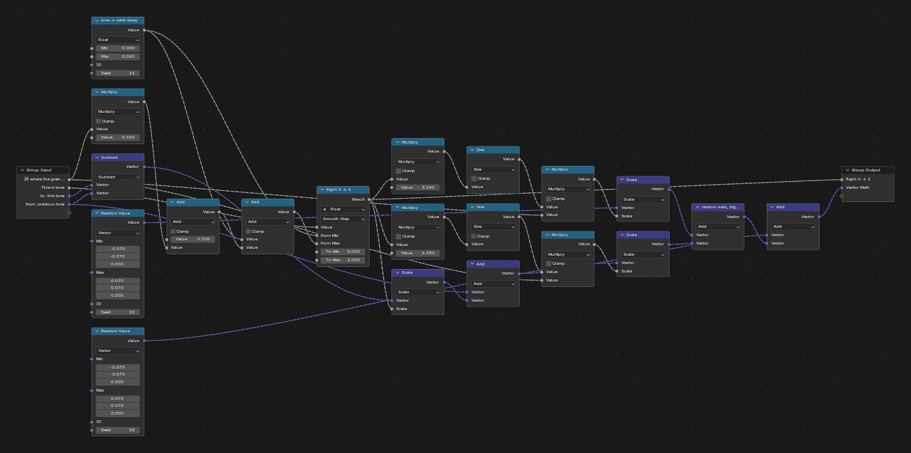

| Node | Formula | Why |
|---|---|---|
| **`tone → sand delay`** (Random Value) | 0 … 0.06 of a tone, per grain | not every grain starts in the same frame |
| flight time (Add, Multiply) | 0.10 + *e0* × 0.32 | a long flight from an antinode, a short shuffle from near a line |
| **`flight 0 → 1`** (Map Range, Smooth Step) | `Time in tone` from *delay* to *delay + flight* | each grain's own progress *s*, gentle at both ends |
| blend (Subtract, Scale, Add) | from + (to − from) × *s* | the straight way from the old spot to the new one |
| arc, zig (Sine, Multiply) | sin(π*s*) × *e0*, sin(2π*s*) × *e0* | two bumps that are 0 at the start and at the end |
| **`random walk, bigger at antinodes`** | two random vectors (±0.07 in x and y) × arc and × zig | the grain skitters sideways on the way |

### Trick · a random walk that always lands

sin(π*s*) and sin(2π*s*) are both exactly 0 at *s* = 0 and *s* = 1. So however wild the sideways wobble gets in mid-flight,
the grain starts exactly on its old spot and lands exactly on its new one. Two random directions, one weighted by each
sine, make the path an S-curve rather than an arc, and every grain gets a different one.

Both are multiplied by *e0*, so grains near a line walk almost straight.

---

## 6 · Bounce and land

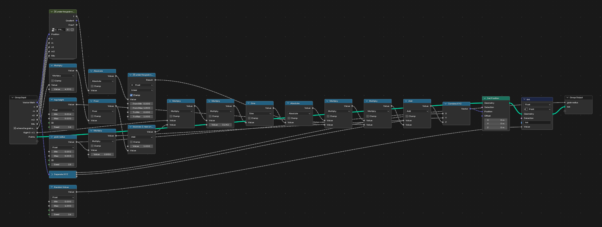

1. **`|f| under the grain now`**: the same `PA_PlateMode` + Map Range as section 4, but at the grain's **current** place on
   its walk. Call it *e*. It falls to almost 0 as the grain reaches its line.
2. **`bounces: 1 near a node … 5 at an antinode`**: 1 + floor(*e0* × 4.99).
3. **Multiply, Sine, Absolute**: |sin(*s* × bounces × π)|, a row of hops that is 0 at the start and at the end of the flight.
4. **`hop height`**: × *e* × a random 0.0165 … 0.030 per grain. Because *e* fades towards the line, the last hops are lower,
   the way a grain settles into a line of sand.
5. **`grain radius`** (Random Value, 0.0016 … 0.0030): each grain's size. The grain rests at 0.85 × its radius, so it sits
   a little *into* the surface, as sand does on its neighbours.
6. **Combine XYZ → Set Position**: x and y from the walk, z = radius × 0.85 + hop.
7. **`tint`** (Store Named Attribute, Float, Point): a random 0–1 per grain, for the material.

The radius is needed twice: here for the height and in section 7 for the size. Both are wired from the same
**Random Value** node, so they agree.

---

## 7 · Grains

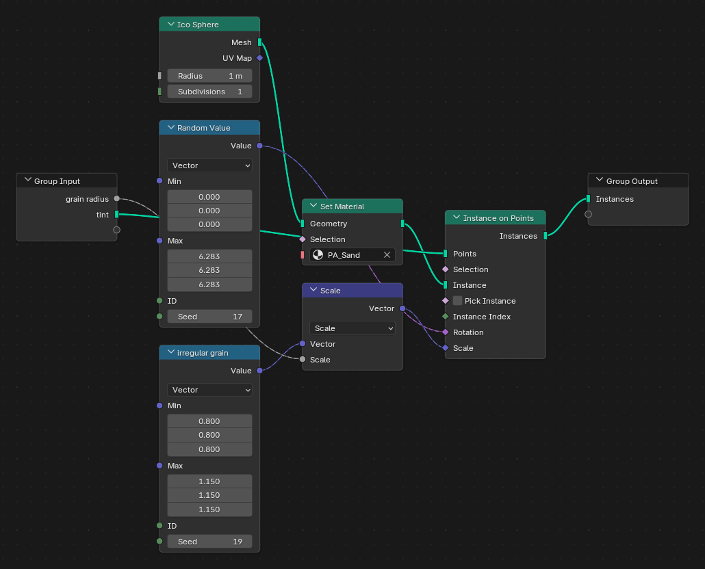

- **Ico Sphere**, radius 1, **1 subdivision** (an icosahedron, 20 faces). At this size a smoother sphere costs memory and shows nothing.
  **Set Material** gives it `PA_Sand`.
- **Instance on Points**: one grain on every point.
  - Rotation: a random vector, 0 … 2π on all three axes.
  - Scale: a random vector, 0.8 … 1.15 on each axis separately (`irregular grain`), × the grain radius. Unequal axes make
    each grain a slightly lumpy pebble instead of a perfect ball.

The instances are never realized. Cycles renders 300 000 instances of one tiny mesh with almost no memory.

An earlier version used grains twice as large and squashed flat. On camera they looked like rice. Half the radius,
no squash and twice as many grains made them read as sand.

---

## The plate

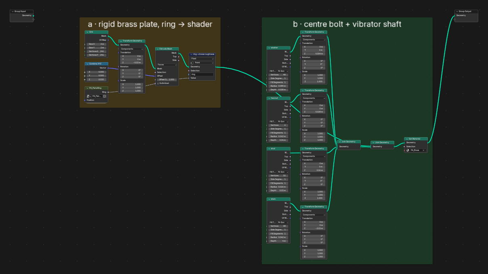

### a · A rigid brass plate

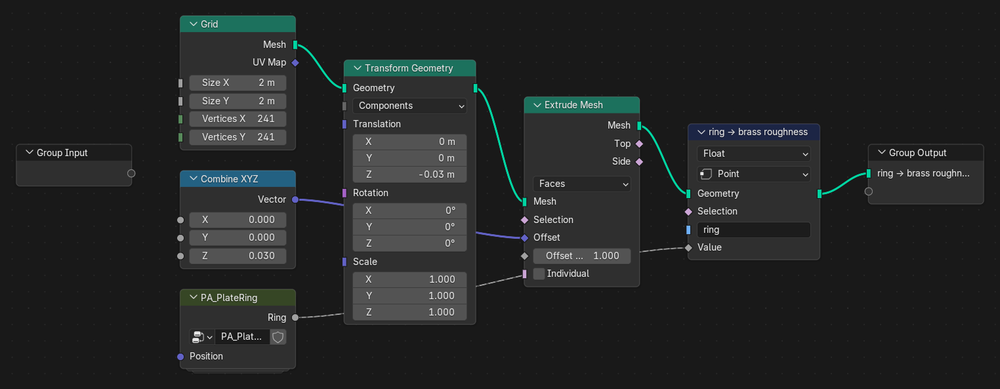

- **Grid** 2 × 2 units with **241 × 241** vertices. That many, because the `ring` attribute below draws each tone's shape,
  down to the dense lace, and the shader interpolates it between vertices.
- **Transform** down by 0.03, then **Extrude Mesh** (Faces, not individual) by an **Offset** vector (0, 0, 0.03): a solid
  slab 0.03 thick whose top is at z = 0. The offset is *linked* from a Combine XYZ: it is a field input, and setting its
  default value from the build script had no effect.
- **`ring → brass roughness`** (Store Named Attribute, Float, Point, name `ring`): `PA_PlateRing` at each point, 0 on the
  nodal lines and 1 on a full antinode. The plate is **not** moved. A real Chladni plate moves a few microns hundreds of
  times a second, so the eye sees a rigid plate. What it does see is the reflection smearing where the metal shakes.
  `PA_Brass` reads `ring` with an Attribute node and adds up to 0.16 to its roughness, so the reflection stays sharp on the
  lines and goes soft on the antinodes while the tone sings.

  An earlier version bent the plate by 0.0016 × f at 3 swings a second. That slow bending made the brass look like jelly:
  a plate that visibly bends is soft, and brass is not.

### b · Centre bolt and vibrator shaft

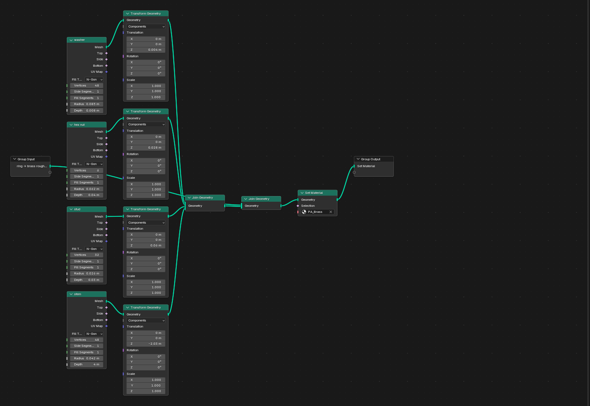

| Part | Mesh Cylinder | Where |
|---|---|---|
| washer | 48 sides, r 0.085, 0.008 high | on the plate |
| hex nut | **6 sides**, r 0.062, 0.040 high | on the washer |
| stud | 32 sides, r 0.026, 0.030 high | sticking out of the nut |
| stem | 48 sides, r 0.042, 4 long | the vibrator's shaft, down into the void |

**Join Geometry** puts them together, and everything gets `PA_Brass`. The bolt does not move either, for the same reason
as the plate.

---

## Inside `PA_ToNodalLines`

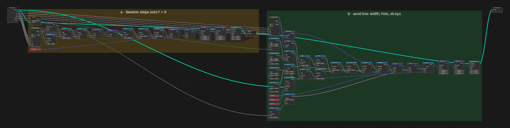

The heart of the piece. Its inputs are the points, a tone's five mode numbers and a seed. It returns the points on that
tone's nodal lines.

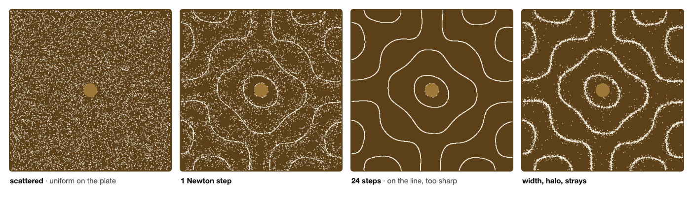

*(Illustration with numpy, using the same formula as the nodes on 9 000 points; the warp here is a stand-in for the
Noise Texture.)*

### a · Newton steps onto f = 0

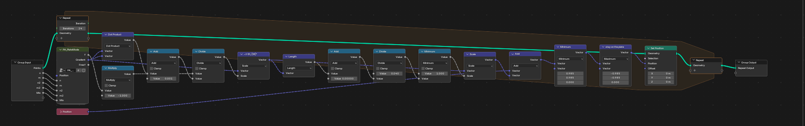

You want the nearest point where f = 0. Near a grain, f changes almost linearly: moving by a small vector **d** changes f
by about ∇f · **d**. The smallest **d** that brings f to zero points straight along the gradient:

```
d = −f · ∇f / |∇f|²
```

That is one Newton step. Inside a **Repeat Zone** (24 iterations) each grain:

1. evaluates **`PA_PlateMode`** at its current position: f and ∇f;
2. computes **`−f·∇f / |∇f|²`** (Dot Product for |∇f|², plus 0.001 so a flat spot doesn't divide by zero);
3. **clamps the step** to at most 0.04 (Length, Divide, Minimum 1): near an antinode ∇f is almost zero, and an
   unclamped step would throw the grain across the plate onto some far line;
4. **`stay on the plate`**: Minimum / Maximum keeps x and y inside ±0.985;
5. **Set Position**.

One step already puts most grains close to a line (the second panel). 24 steps make sure the stragglers from antinodes
arrive too. Because the gradient points to the *nearest* side, each grain ends on the line closest to it, so the sand on
a line comes from both sides, as on a real plate.

### b · Sand line: width, halo, strays

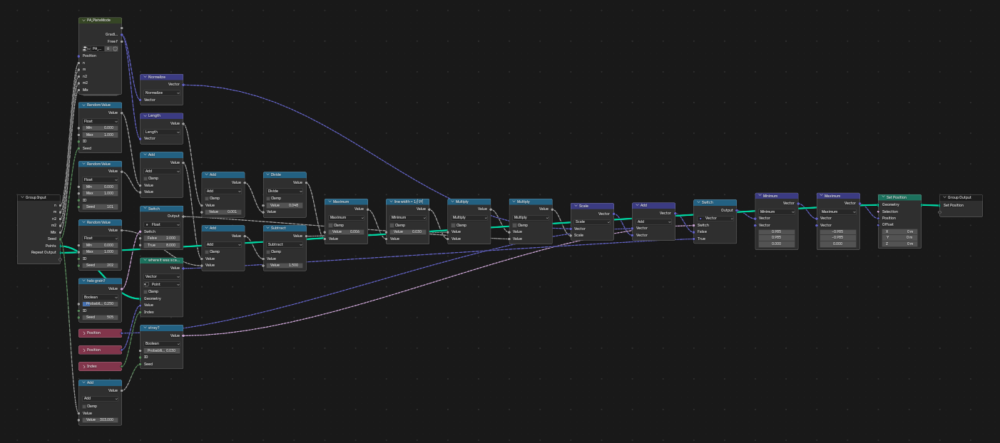

After 24 steps every grain is exactly on the line: a mathematically thin, sharp curve (third panel). Real sand lines are
not like that. This frame spreads them back out across the line:

| Node | What it does |
|---|---|
| **`line width ∝ 1/|∇f|`** | half-width = 0.048 / |∇f|, clamped to 0.006 … 0.030. Where the wave is steep, the plate moves a lot just off the line and the sand line is sharp. Where it is gentle, the sand has room and the line is wide. |
| three **Random Value** − 1.5 | the sum of three uniform randoms: a bell curve between −1.5 and +1.5, without a Gaussian node |
| **`halo grain?`** (Random Value, Boolean, 25 %) | **Switch**: 2 for most grains, 8 for a quarter of them. Those form a soft, wide fringe around the line. |
| Normalize ∇f, Scale, Add | move the grain *across* the line (along ∇f) by bell × width × 2 (or × 8) |
| **`where it was scattered`** (Sample Index on the input points) | each point's original scattered position |
| **`stray?`** (Random Value, Boolean, 3 %) | **Switch**: these grains go back to where they were scattered. Real plates always keep a few grains that stuck. |
| Minimum / Maximum, Set Position | stay on the plate, apply |

The seed for the bell and the strays comes from the group's **Seed** input, so each tone spreads its grains differently.

---

## Inside `PA_PlateMode`

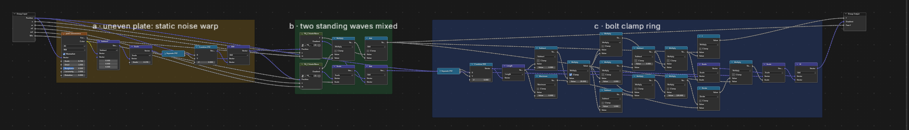

One tone of the plate. Inputs: a position and five numbers (n, m, n2, m2, Mix). Outputs: **f**, its **Gradient** ∇f, and
**Free f** (the wave before the clamp, which drives the plate's own motion).

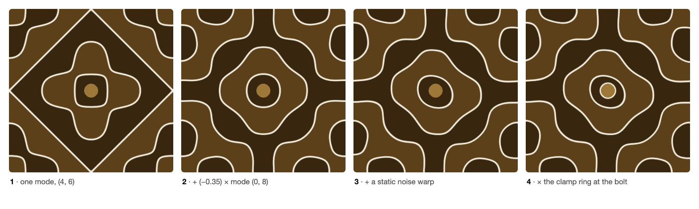

### a · Uneven plate: a static noise warp

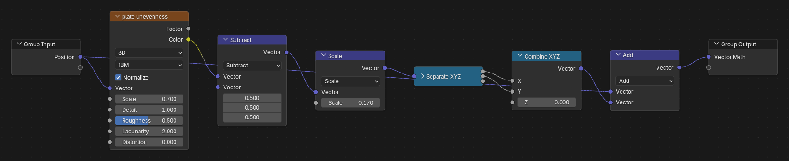

A real plate is never perfectly even in thickness and stiffness, so its lines are never perfectly symmetric. **`plate
unevenness`** (Noise Texture, scale 0.7, detail 1) at the position, minus 0.5, × 0.17, x and y only, is added to the
position before the wave is evaluated. The noise does not depend on time, so it is the *same* unevenness for all four
tones, just as it would be for one real plate.

An earlier version used 0.30. The lines bent so much that the four-fold symmetry was lost and the figures no longer looked
like one plate. 0.17 keeps them recognisable and stops them looking machine-made (panel 3).

The gradient is not corrected for the warp. Newton's method only needs a direction that points roughly downhill, and the
step clamp keeps it stable.

### b · Two standing waves mixed

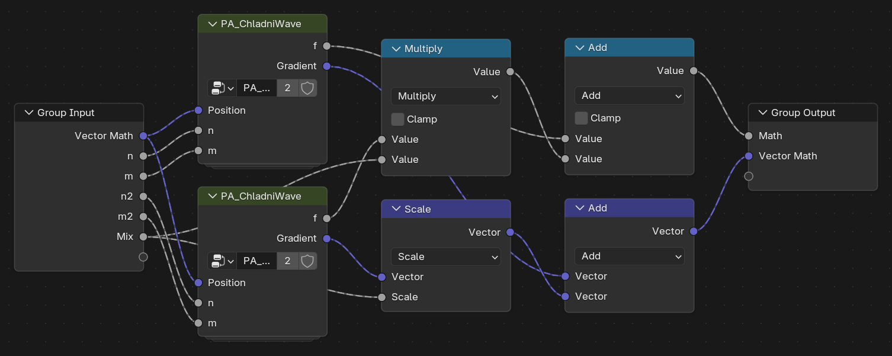

Two **`PA_ChladniWave`** nodes, one with (n, m) and one with (n2, m2), at the warped position. f = f1 + Mix × f2, and the
gradient the same way (a sum of waves has the sum of their gradients).

A single mode makes straight lines and perfect diamonds (panel 1 above). The modes of a real plate are mixtures of
neighbouring ones, which is why real Chladni figures are made of curves. Mixing in a second mode of the same symmetry,
with a weight between −0.35 and 0.60, turns the diamond into a rounded square (panel 2).

### c · Bolt clamp ring

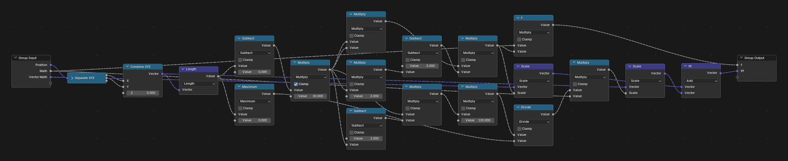

The bolt holds the centre of the plate. Around the washer, sand collects in a ring. This frame makes that happen:

- *t* = (r − 0.085) / 0.05, clamped to 0 … 1, where r is the distance from the centre (Length);
- w = *t*² (3 − 2*t*): 0 under the washer, 1 from r = 0.135 outwards;
- **f** = f × w, and by the product rule **∇f** = ∇f × w + f × ∇w, where ∇w = 6*t*(1 − *t*) / 0.05 × (x, y) / r.

Close to the washer, f × w goes to zero, so Newton's method pulls nearby grains onto the washer's edge (panel 4).
The `Free f` output skips this, because the plate itself is not still there: the bolt drives it.

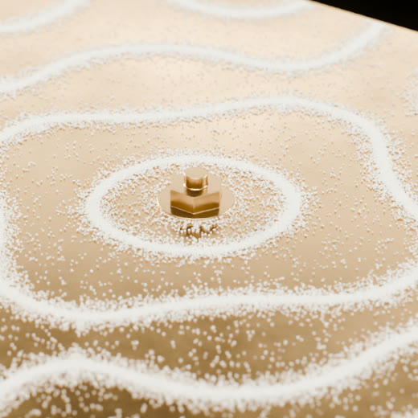

### Why only even numbers

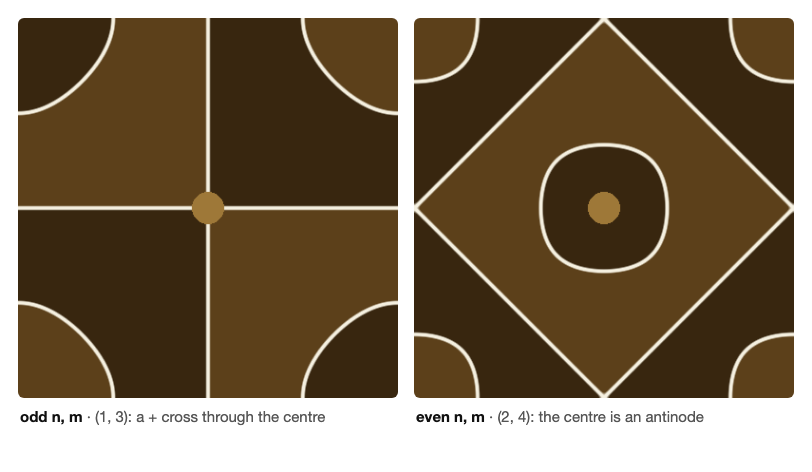

The first version used odd modes and a violin bow on the edge. Every mode with odd n and m has a straight + cross
through the centre: cos(nπu) is zero at u = ½ for every odd n. On a plate driven at the centre, the centre is where the
plate moves most, so there can't be a nodal line through it. With **even** n and m, cos(nπ/2) = ±1 and the centre is an
antinode. All four tones use even numbers, and the bow was replaced by the vibrator under the bolt.

---

## Appendix A · `PA_ChladniWave`

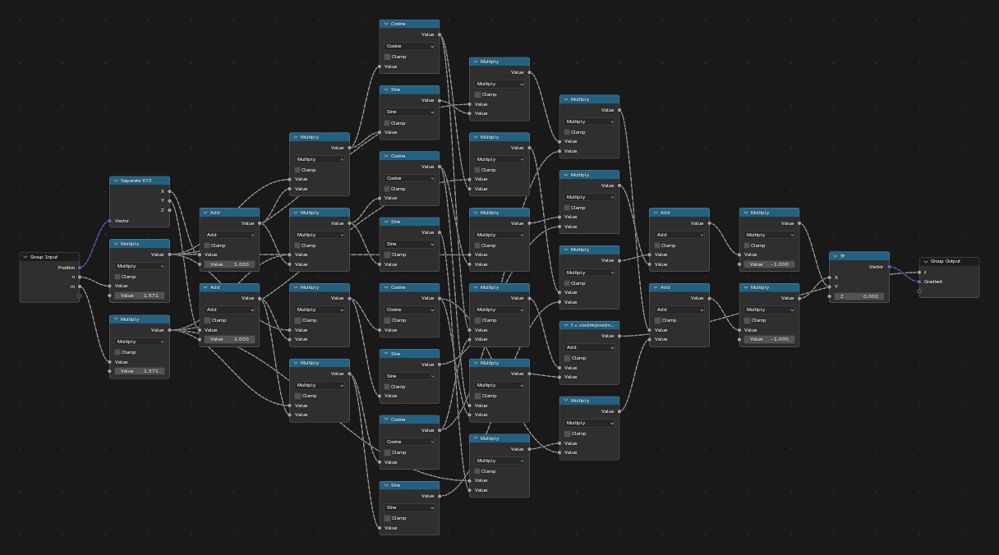

The formula and its exact derivative, in Math nodes:

```
a = nπ/2, b = mπ/2, X = x + 1, Y = y + 1            (so aX = nπu)
f  = cos(aX)·cos(bY) + cos(bX)·cos(aY)
∂f/∂x = −( a·sin(aX)·cos(bY) + b·sin(bX)·cos(aY) )
∂f/∂y = −( b·cos(aX)·sin(bY) + a·cos(bX)·sin(aY) )
```

The second term is the first with n and m swapped. That makes f the same along both diagonals of the square, as on a
real square plate, whose x and y directions are interchangeable. The **Position** input defaults to the point's own
position, so the group can be dropped anywhere as a field.

## Appendix B · `PA_Tones`

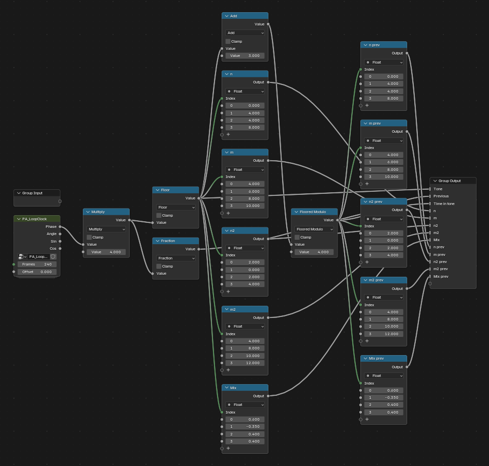

Phase × 4: **Floor** is the tone (0–3), **Fraction** is `Time in tone`. `Previous` = (tone + 3) mod 4 (**Floored
Modulo**, so 0 wraps to 3). Ten **Index Switch** nodes hold the table of the four tones: n, m, n2, m2 and Mix, each picked
once by `Tone` and once by `Previous`. To change the music, change the `TONES` list in `build.py`.

## Appendix C · `PA_PlateRing`

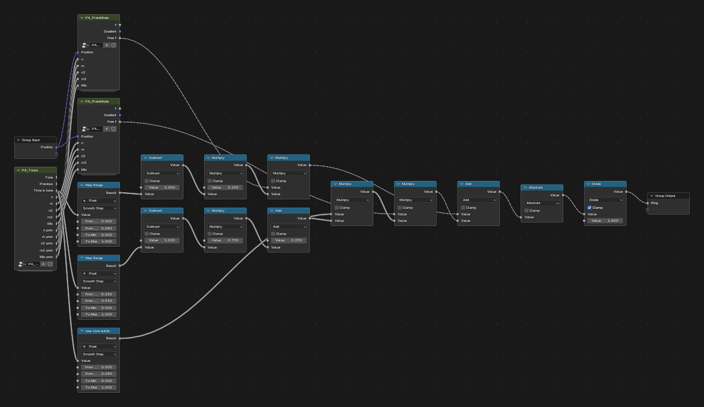

How hard the plate sings at a point, 0 to 1 (it feeds the brass roughness, not the plate's position):

- the previous tone's shape (`Free f`) × 0.25 × (1 − smoothstep from 0 to 0.08): it was ringing quietly and dies in
  5 frames;
- this tone's shape × smoothstep from 0 to 0.08 (`new tone builds`) × (0.25 + 0.75 × (1 − smoothstep from 0.15 to
  0.55)): it builds fast, rings hard while the sand flies, then settles to a quarter;
- |sum| ÷ 1.8 (the |f| of a full antinode), clamped to 0 … 1.

There is no oscillation in it. A plate ringing at hundreds of Hz would only alias at 30 fps, so what is drawn is the
envelope: how much the reflection blurs. At the end of a tone the new shape rings at 0.25, and at the start of the next one the old shape starts at 0.25 too, so there is no jump between tones, or
between frame 240 and frame 1.

## Appendix D · `PA_LoopClock`

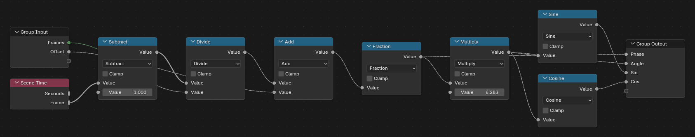

**Scene Time** Frame → **Subtract** 1 → **Divide** by Frames (240) → **Add** Offset → **Fraction** gives
**Phase**: 0 at frame 1, 0.5 at frame 121, and back to 0 at frame 241.
**Multiply** by 2π gives **Angle**; **Sine** and **Cosine** give smooth back-and-forth values for circular motion.
Any motion driven only by Phase repeats perfectly every 240 frames.

## Appendix E · Brass, sand, light

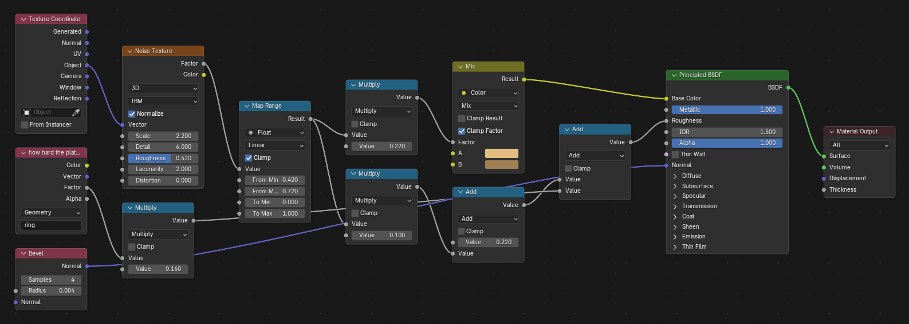

**`PA_Brass`.** A large **Noise Texture** (scale 2.2, detail 6) in object space, **Map Range** 0.42 … 0.72, becomes
`tarnish`. It mixes 22 % of a dark brown (0.36, 0.22, 0.09) into the brass colour (0.78, 0.52, 0.22) and adds 0.10 to the
roughness (base 0.22). An **Attribute** node reads `ring` from the plate and adds `ring` × 0.16 more, so the antinodes
blur while a tone sings. **Principled BSDF**, Metallic 1, **Anisotropic 0.55**: the highlight stretches into a brushed
streak. A **Bevel** node (radius 0.004) feeds the normal, so the plate's sharp edges catch a thin line of light without
any rounded geometry.

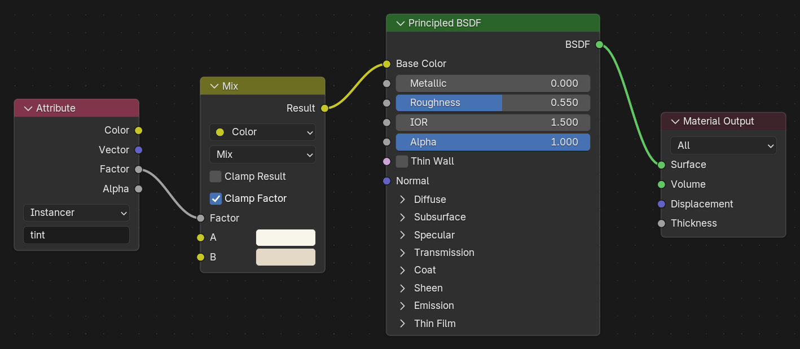

**`PA_Sand`.** An **Attribute** node reads `tint` from the **instancer** (the point that carries the grain), and mixes
between pale (0.95, 0.92, 0.84) and darker (0.78, 0.70, 0.58) sand. Roughness 0.55.

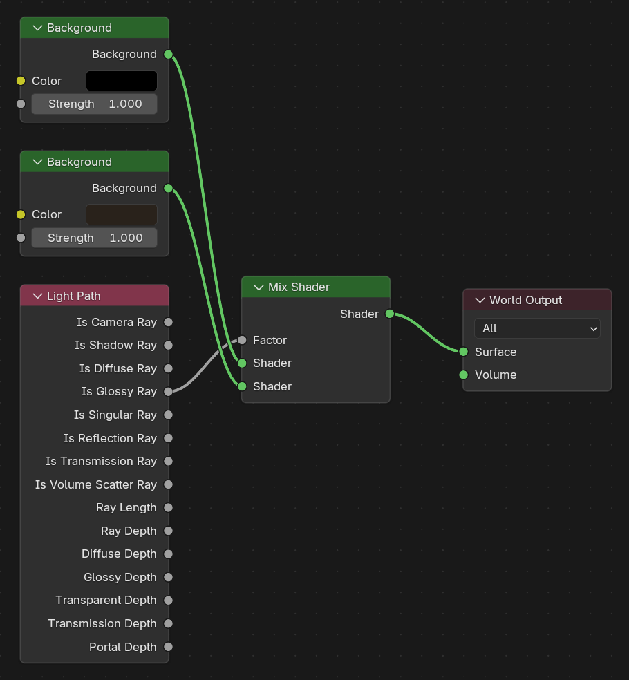

**The world: black to the camera, a dim room in the brass.** Polished brass has almost no colour of its own: it shows
what it reflects. Against pure black it looks like black glass. **Light Path → Is Glossy Ray** mixes two Backgrounds:
camera rays see black (the void), and only reflections see a dim warm room (0.022, 0.016, 0.011). The plate reads as
brass, and the background stays black.

| Light (area, invisible to the camera) | Size | Power | Job |
|---|---|---|---|
| `PA_Softbox` | 6 × 0.7 | 110 W | where the camera sees it mirrored: one long, soft highlight across the brass |
| `PA_Rake` | 1.2 × 2.4 | 1100 W | low from the left, almost along the surface: every grain casts a long shadow |
| `PA_Rim` | 2 × 0.6 | 500 W | cool, from behind on the right: a rim on the far edge |
| `PA_Top` | 3 × 3 | 700 W | from above: lights the sand; its reflection falls off the plate |

In an earlier version the plate burned out to white and the white sand on it disappeared. The fix was the glossy-only
room above and a dimmer, offset softbox; most of the light now rakes.

**Camera.** 100 mm lens, f/1.4, 30° above the plate, 32° round from the front, 5.3 units away, focused just beyond
the bolt. The far edge and the nearest corner melt out of focus. `pb.turntable("swing", 12)` adds a slow ±6° sway, one
period per loop, as a driver (no keyframes). In post, a little bloom (0.08, threshold 2) only on the brightest glints.

---

## How it was rendered

1. **Clay first.** `build.py -- --clay` saves `clay/chladni_clay.blend`, a Workbench copy (white sand, grey plate) that
   renders the whole loop in minutes. The motion was approved on that before any Cycles frame.
2. **Cycles on a second machine.** The final 240 frames (1080², 128 samples) were rendered over the LAN on a Windows PC with
   an RTX 4060 (OptiX) through [Flamenco](https://flamenco.blender.org). The first frame takes about 80 s (the OptiX kernels
   compile), then about 10 s a frame; the whole loop took 51 minutes.
3. **ffmpeg** joins the PNG frames into `loop.mp4` (H.264, crf 16).

---

## Try it yourself

1. Open `chladni.blend`, select **PA_Sand** and scrub the timeline. Watch a grain on an antinode, then one near a line.
2. In section 2, change one `PA_ToNodalLines` node's **n** and **m** to two odd numbers, for example 1 and 3. The + cross
   appears on that tone.
3. Open `PA_ToNodalLines` (Tab) and set the Repeat Zone's **Iterations** to 1, then to 0. The lines blur, then vanish.
4. In `PA_ToNodalLines`, frame *b*, set the halo probability to 0 and the stray probability to 0. The sand looks like a
   drawing.
5. In `PA_PlateMode`, frame *a*, set the warp Scale (0.17) to 0, then to 0.4.
6. Change the modifier's **Seed**: a different sand, the same figures.
7. Rebuild everything from scratch:
   `Blender -b --factory-startup --python build.py`. In `build.py`, `TONES` sets the four tones, `NGRAINS` the
   amount of sand, `WARP` the unevenness and `LINE_W`, `HALO_P`, `STRAY_P` the look of the lines. The tidy layout and
   frames come back from `nodes_layout.json`. Nodes you add that are not in that file keep the plain automatic layout.

*Made with Blender 5.2 Geometry Nodes for [Nodevember](https://nodevember.com) 2026, Day 4 · Brass.*
