# How the music box plays a year

*A node-by-node walkthrough of Nodevember 2026 · Day 5 · Clockwork*

A round wind-up music box under a glass cloche. Its stage makes one turn per loop, and that turn is one year. The tree on the
stage goes from deep winter through blossom, leaf, fruit and leaf-fall, then back to snow. A brass index at the front points
to the season emblem passing under it. Inside, behind a wall of translucent enamel, a Swiss-style movement plays the tune
you hear: the pinned cylinder plucks a steel comb, the air brake spins, and the butterfly key slowly unwinds.

The loop is 12 seconds long and frame 361 is frame 1, picture and sound, so it never shows a seam. There is no simulation,
no keyframe and no modelled mesh. Every part, from the comb teeth to the falling leaves, is a function of one number:
the loop's **Phase**.

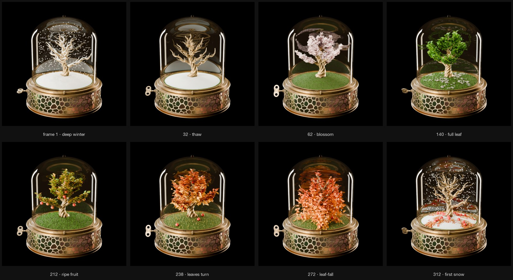

| File | What it is |
|---|---|
| [`../loop_sound.mp4`](../loop_sound.mp4) | the render with its tune, 1080 × 1080, 360 frames at 30 fps, 48 kHz stereo |
| [`../loop.mp4`](../loop.mp4) | the same render without sound |
| [`../musicbox.blend`](../musicbox.blend) | the scene. Select **PA_MusicBox** and open its Geometry Nodes modifier. The cloche is **PA_Dome**. |
| [`../musicbox.wav`](../musicbox.wav) | the tune: 12 s, made by `build.py -- --sound` from the same score as the pins |
| [`../build.py`](../build.py) | the script that builds the whole file. Every node in this tutorial comes from it. |

---

## The one idea

> **One turn of the stage is one year.** A loop clock gives Phase, 0 → 1 over 360 frames. The stage turns by
> τ·Phase, the cylinder turns once, and the season time `u = 4 × Phase` runs from deep winter (0) back to deep winter (4).

Everything else is bookkeeping around that idea:

- **When** does each thing happen? Each change is a window in season time: snow melts at u = 0.15–0.5, leaves turn at
  u ≈ 2.05–2.7. Every window sits inside (0, 4), so at u = 0 and u = 4 everything is in the same winter state.
- **Where** is the season? The emblem for each season is placed on the stage so that it passes the index at its own time.
- **What plays?** Each note of the tune is one pin on the cylinder. The pin is placed so it lets go of its tooth at the
  note's beat.
- **What runs?** Every wheel turns at a fixed ratio of Phase, so every wheel is back where it started after 360 frames.

### How to read the screenshots

In `musicbox.blend` every group is laid out the same way as the pictures below, with one coloured frame per section. The
main tree is small and calls four groups: `PA_MB_Stage`, `PA_MB_Drum`, `PA_MB_Movement` and, inside the stage,
`PA_MB_Tree`. Each group is split into sections *a · b · c …*.

The groups are big, so each section below also shows a cut-out of just its own nodes.

- Wires that come from another section enter through a **Group Input** on the left. Each input is named after what it
  carries, for example `Season`, `Phase`, `cell` or `leaf anchors`.
- Wires that leave the section exit through a **Group Output** on the right. `Brass parts` means "geometry that has just
  had the brass material set".
- Node titles in `code` style, such as `cylinder: one turn per loop`, are the labels you will find in the `.blend` file.

Lengths are in Blender units. The drum is 2.07 units across, so 0.01 is about half a percent of the box.
Click any screenshot to see it at full size.

---

## 0 · The map

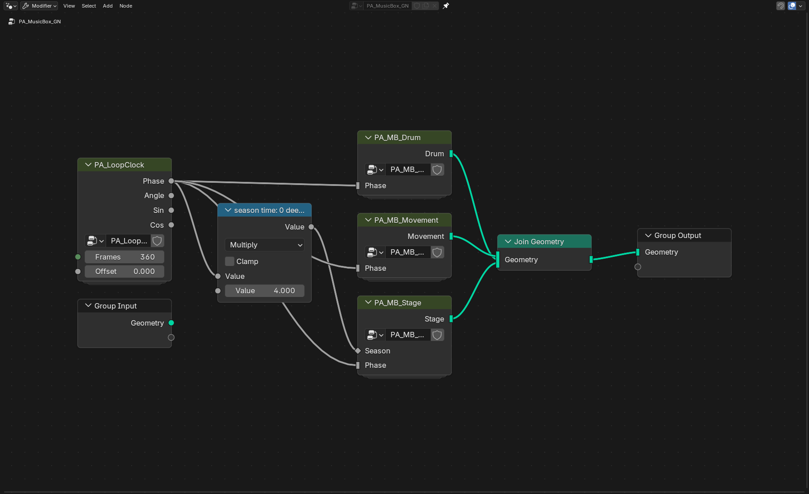

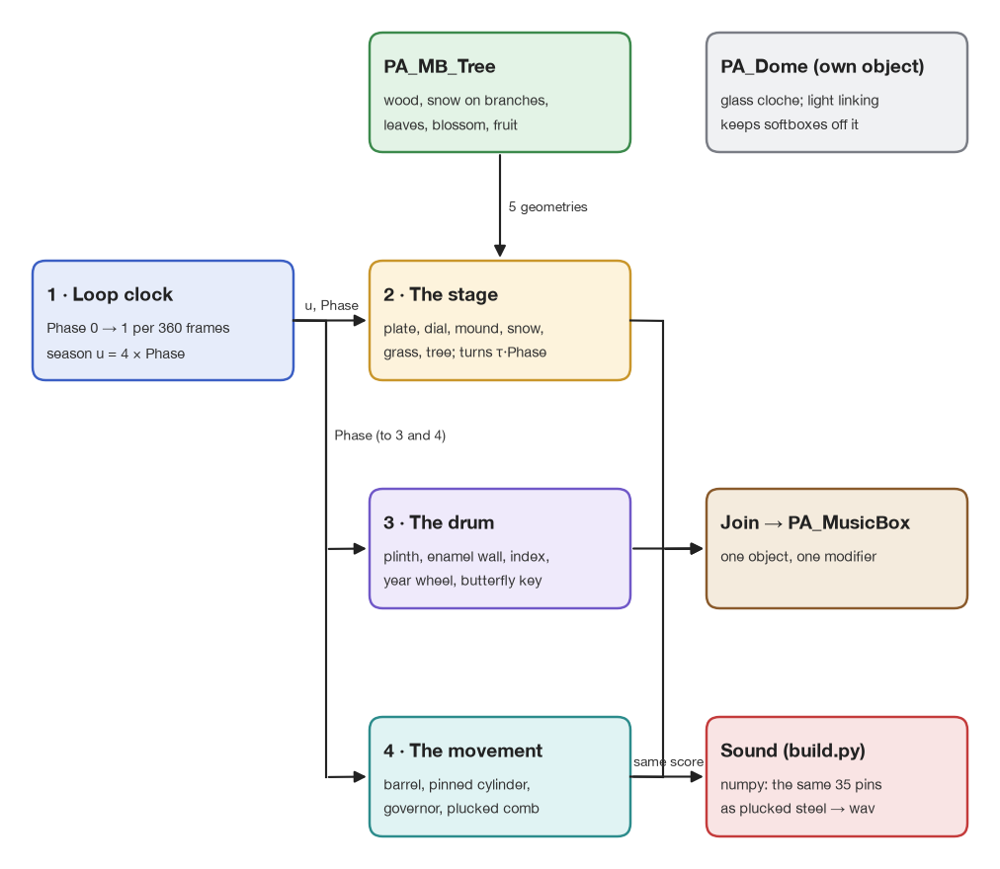

| # | Section | Nodes | Job |
|---|---|---|---|
| 1 | **Loop clock** | `PA_LoopClock` + Multiply | Phase 0 → 1 per 360 frames, season time `u = 4 × Phase` |
| 2 | **The stage** (`PA_MB_Stage`) | 310 | plate and season dial, mound, snow, grass, the tree, snowfall; turns once a year |
| 3 | **The drum** (`PA_MB_Drum`) | 192 | walnut plinth, enamel wall, season index, year wheel, winding key |
| 4 | **The movement** (`PA_MB_Movement`) | 216 | bedplate, spring barrel, pinned cylinder, governor, plucked comb |
| – | **The tree** (`PA_MB_Tree`) | 552 | trunk, branches, twigs, snow on the branches, leaves, blossom, fruit |
| – | **One limb** (`PA_MB_Limb`) | 64 | the point at a fraction along a branch or twig: heading, sag and lift, crooks |
| – | **The cloche** (`PA_Dome`) | 43 | its own object, so light linking can treat the glass apart |

The main tree's own **Group Input** is not connected to anything. The tree ignores the object's mesh and builds
everything from nothing.

### The year in frames

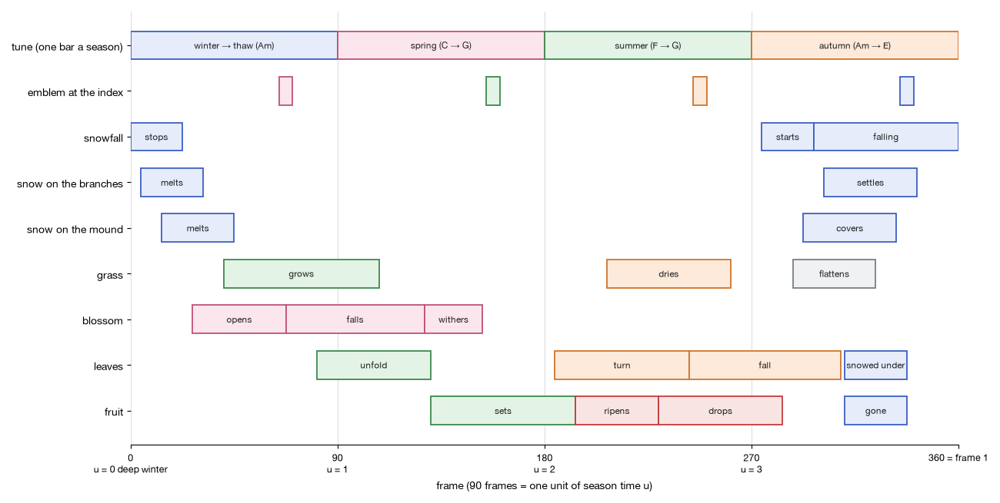

One unit of season time is 90 frames (3 s). Most windows start a little later for some leaves or flowers than for
others: a random number per leaf shifts its window by up to 0.2–0.55 units. The bars above show the average leaf.

---

## 1 · Loop clock

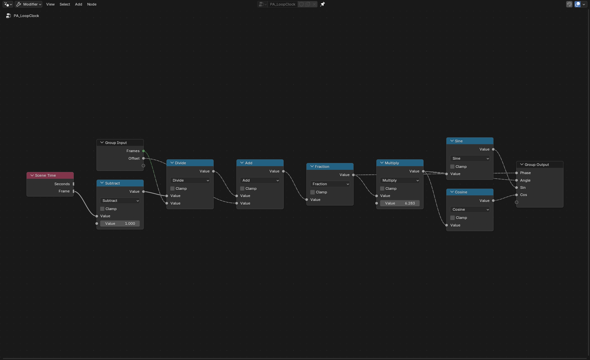

`PA_LoopClock` reads **Scene Time → Frame** and gives `Phase = fract((frame − 1) / 360)`. Frame 1 gives 0 and frame 361
would give 0 again. In the main tree, one **Multiply** by 4 makes `season time: 0 deep winter … 4 deep winter`. The
stage and the tree get both values; the drum and the movement only need Phase.

### Trick · something that leaves and comes back

Snow is the hard case: it is there at the start, it goes, and it has to be back by the end. Every quantity like that is
written as **1 − ease(out) + ease(in)**, with two smoothstep **Map Range** nodes:

```
snow depth = 1 − ease(u, 0.15, 0.5) + ease(u, 3.25, 3.7)
```

At u = 0 it is 1 − 0 + 0 = 1. At u = 4 it is 1 − 1 + 1 = 1. In between it falls to 0 and climbs back. The same shape
drives the snowfall and the snow on the branches.

> **Try it:** in `PA_MB_Stage`, find `snow depth: melts in spring, falls late in autumn` and change the second Map Range's
> From Min / From Max from 3.25 / 3.7 to 2.5 / 3.0. Snow now covers the mound while the last leaves are still falling.

---

## 2 · The stage

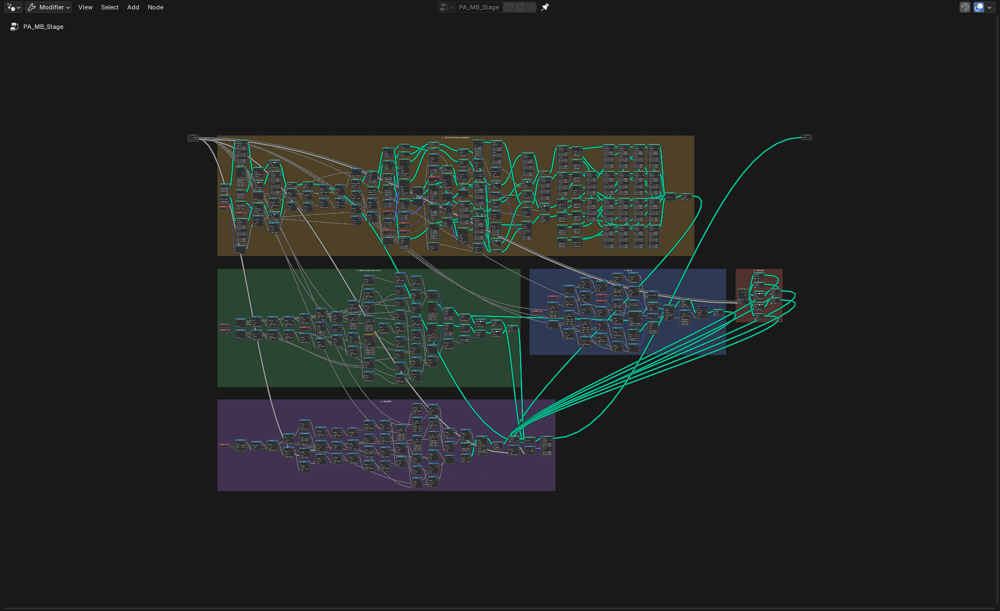

The stage is built standing still, in stage coordinates. At the very end, one **Transform Geometry**
(`the stage turns once a year`) rotates everything by τ·Phase about Z. Every part of the stage is built from Season and
Phase.

### a · Plate and season emblems

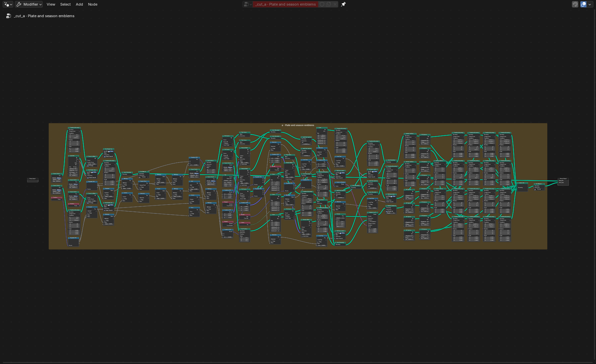

The plate is a cylinder of radius 0.95 from 0.585 to 0.64, with two thin tube beads on top. Around its rim sit the four
season emblems. Each one is a flat shape from a curve:

| Emblem | Curve |
|---|---|
| spring | a five-petal blossom: polar curve r = 0.3 + 0.7·\|cos 2.5θ\|^0.6 |
| summer | a sun: **Star** curve with 12 points, plus a disc 0.6 × the thickness higher |
| autumn | a leaf: a circle squeezed by width 0.5·√((1 − x)/2), pointed at one end, plus a stalk |
| winter | a snowflake: one arm with two side twigs, instanced on six points 60° apart |

**Where they sit is the point.** An emblem that should be at the front when the season time is `us` is placed at angle
`−π/2 − τ·us/4`. The stage then turns by `τ·u/4`. When u = us, the two cancel and the emblem is at −π/2, the front, right
under the index. The emblems sit at u = 0.75, 1.75, 2.75 and 3.75 (late spring, late summer, late autumn, late winter), with
twelve gold dots between them.

### b · Mound and snow cover

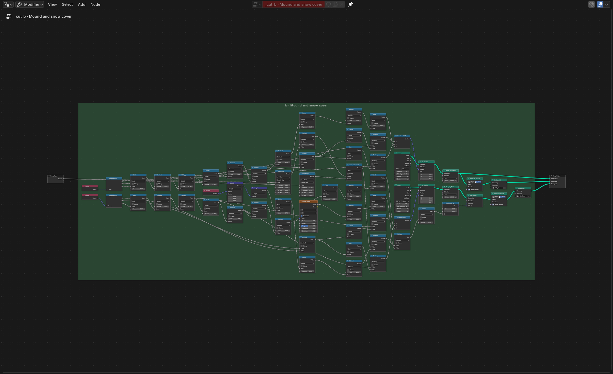

The mound is a lathe: a profile turned around Z. Its height at radius r is

```
ground_z(r) = 0.64 + 0.12 · (1 − (r / 0.78)²)^1.4
```

The snow is a second copy of the same dome, 0.012 smaller, moved up by

```
depth = snow depth · (1 − (r / 0.78)^8) · (0.025 + 0.03 · noise) − 0.004
```

The edge term thins the snow to nothing at the rim. The noise (scale 5) makes drifts.

### Trick · snow that hides instead of vanishing

When `snow depth` is 0, `depth` is −0.004: the snow dome sits 0.004 *below* the moss and the moss covers it. So the snow
never has to be deleted or scaled to zero. It just sinks under the grass in spring and rises out of it in late autumn,
thin at first, like real snow.

### c · Grass

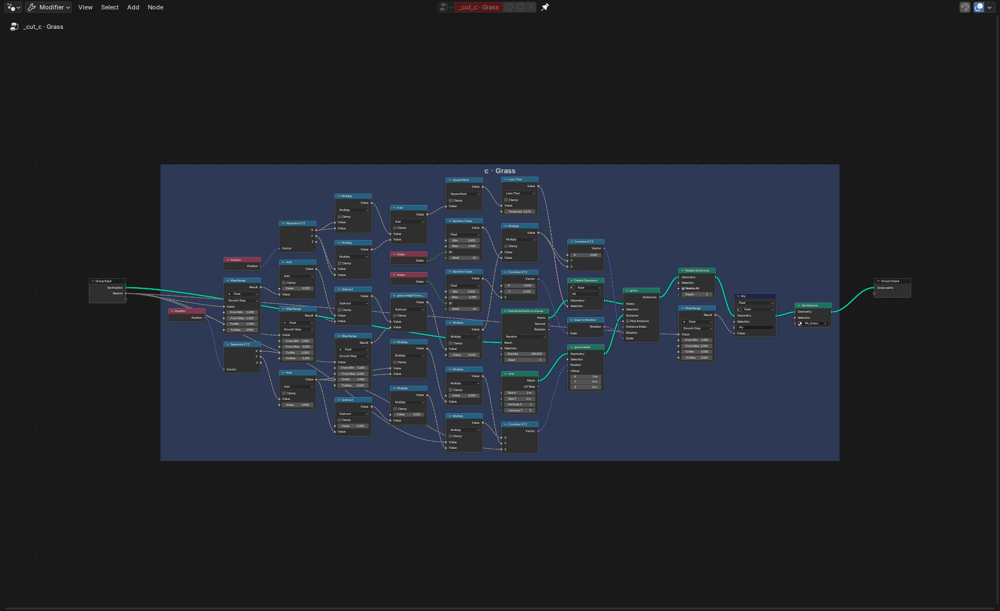

**Distribute Points on Faces** scatters grass on the mound at density 650, leaving a clear circle of radius 0.07 for the
trunk. Each blade is a 2 × 5 grid, tapered to a point and curved over (`y = 0.3 t²`). Its height is

```
grass height = 0.15 + 0.85·ease(0.45, 1.2) − 0.25·ease(2.4, 3.0) − 0.6·ease(3.2, 3.6)
```

times 0.042 and a random 0.6–1.4 per blade. So the grass grows in spring, sags a little as it dries, and is pressed
flat under the snow. A stored attribute `dry` (ease 2.3 → 2.9) turns the grass material from green to straw.

### d · The tree

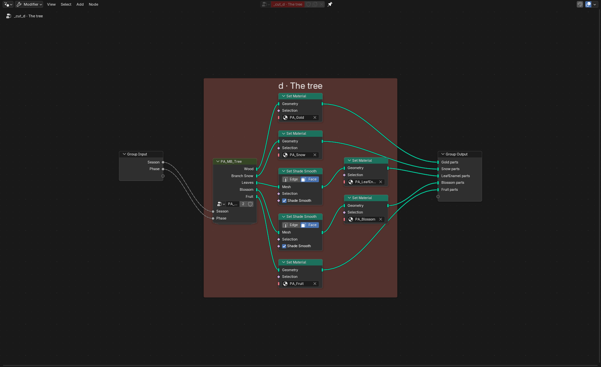

One group node, `PA_MB_Tree`, makes the whole tree from Season and Phase. Its five outputs get five materials: gold wood,
snow, enamel leaves, pearl blossom and fruit. See [Inside `PA_MB_Tree`](#inside-pa_mb_tree).

### e · Snowfall

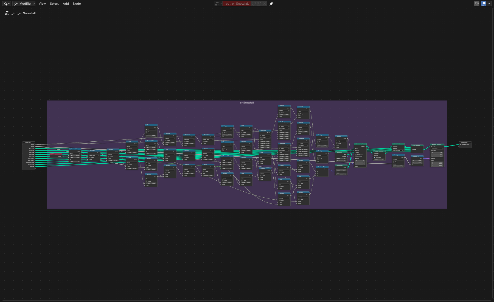

420 points, each with three random numbers. The fall itself is periodic:

- `fall = fract(r3 + 10 × Phase)`: each flake falls ten times per loop, once every 36 frames, each starting at a
  different moment.
- It starts high under the cloche (a dome of points, z = 1.69 + 0.6·√(1 − (r/0.86)²), just under the top of the wall) and ends on the mound
  (`ground_z(r)`).
- Its radius is √r1 · 0.72 (√ spreads the flakes evenly over the disc), and it swirls by 0.25·sin(2τ·fall).
- Its size is `snowfall × 0.008`, faded in over the first 5 % of the fall and out over the last 5 %.

The envelope `snowfall = 1 − ease(0, 0.25) + ease(3.05, 3.3)` is the "leaves and comes back" shape again. Flakes don't
pile up anywhere. The mound's snow cover (section b) does that job.

> **Try it:** change the `10.0` in `fract(r3 + 10 × Phase)` to 4. The snow falls slowly, like large wet flakes. It has to
> stay a whole number, or the flakes jump at the loop seam.

---

## 3 · The drum

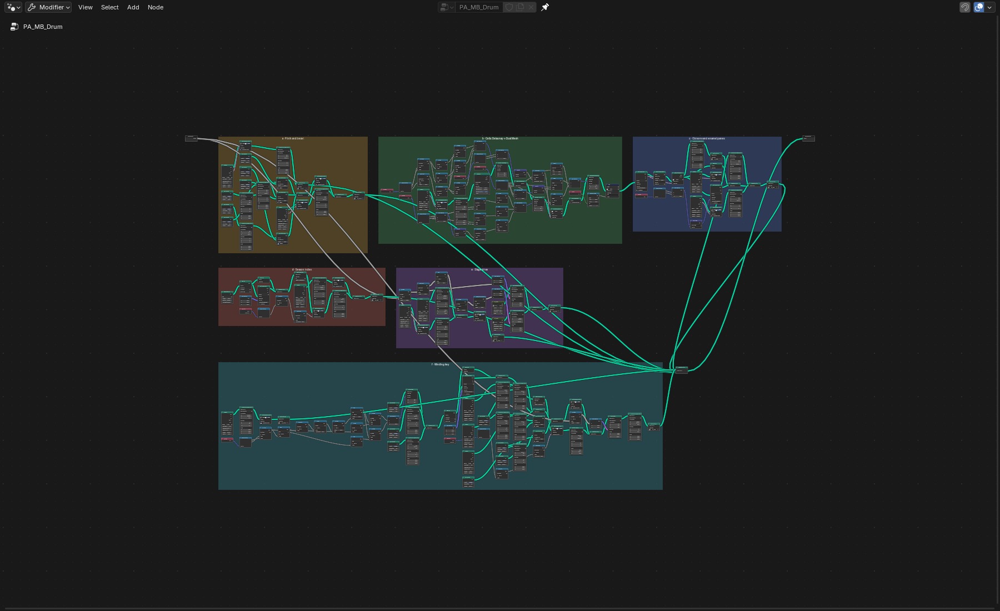

The drum is the box itself: a walnut plinth, a brass bezel, and between them a wall of *plique-à-jour*, enamel with no
backing, set in a brass cell lattice like a stained-glass window. A warm lamp inside lights it from behind. The drum
stands still; only its stage drive and the key turn.

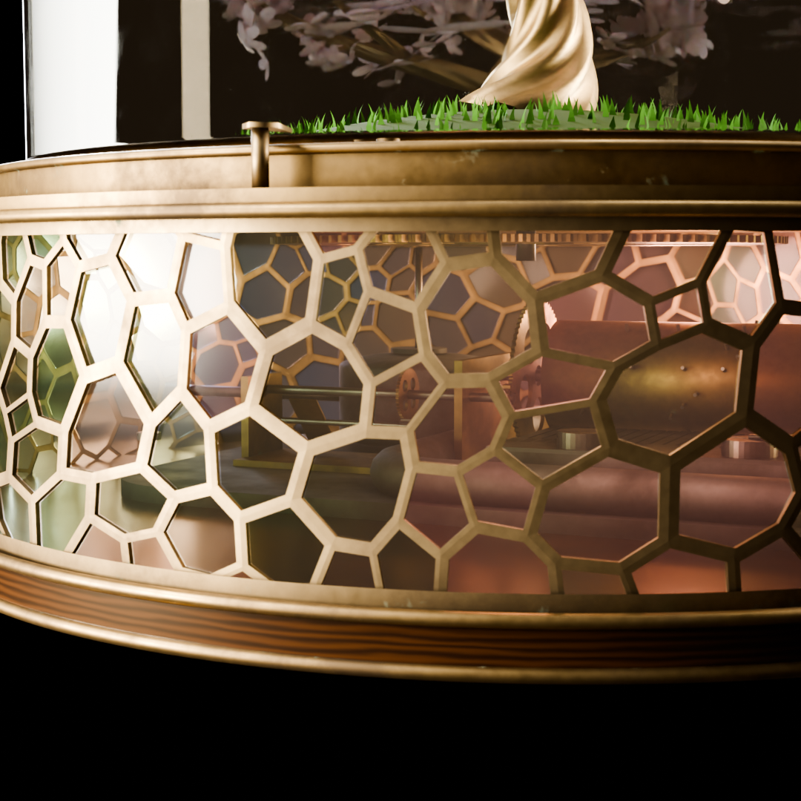

### a · Plinth and bezel

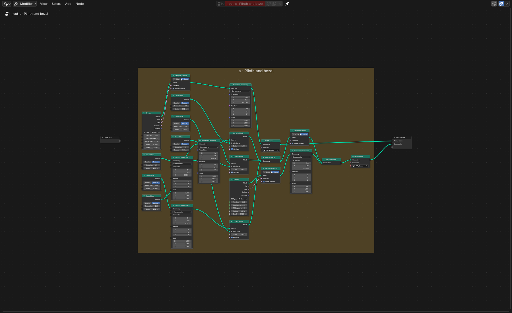

A walnut cylinder (radius 1.035, 0.07 high), three tube beads and a brass band from 0.56 up to the stage. The walnut's
turned grain is in the material.

### b · Cells: Delaunay → Dual Mesh

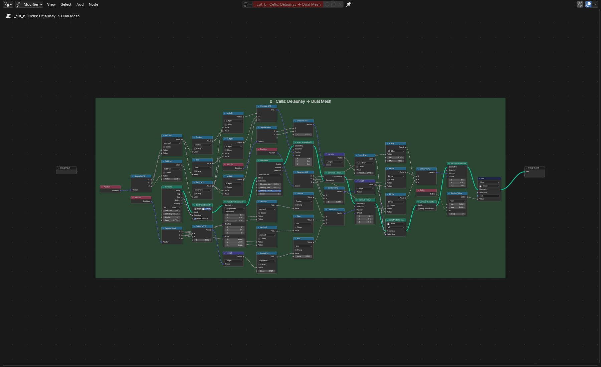

The lattice needs cells of irregular, natural size with straight edges, real geometry that catches light. A Voronoi
*texture* would only be a pattern in the shader. Geometry Nodes has no Voronoi mesh node, but it has **Convex Hull** and
**Dual Mesh**, and those two are enough.

| Step | Node(s) | What it does |
|---|---|---|
| 1 | `cell seeds` | **Distribute Points on Faces** (Poisson, min distance 0.05, density 130) on an open cylinder that reaches 0.15 past both rails |
| 2 | `drum → annulus, lifted onto a paraboloid` | each seed (θ, z) goes to radius r = e^(z − z_mid) at angle θ, then up to height r² |
| 3 | `lower hull = Delaunay` | **Convex Hull** of the lifted points |
| 4 | `annulus → drum` | back again: angle = atan2, z = ln r + z_mid, on the unit cylinder |
| 5 | `drop the hull's caps` | delete faces whose centre is closer than 0.99 to the axis |
| 6 | `Voronoi-like cells` | **Dual Mesh**: one polygon per seed |
| 7 | `back onto the drum` | push the cell corners out to radius 1 and clamp z just past the rails |
| 8 | `cell` | store a random number per face, for the enamel colour |

### Trick · Delaunay from a convex hull

Lift points in a plane onto the paraboloid z = x² + y². The *lower* half of their convex hull, projected back down, is
exactly the Delaunay triangulation of the points. This is a classic result from computational geometry.

The drum is a cylinder, not a plane, so step 2 first unrolls it with the map (θ, z) → e^(z − z_mid)·(cos θ, sin θ). That is
the complex exponential: it keeps angles (small circles stay circles), so a Delaunay triangulation in the annulus is a
good one on the drum. The annulus also closes around the axis on its own, so the cells have no seam at θ = ±π.

The hull has an upper half too. After step 4 its faces are big triangles that cut through the inside of the drum, and
their centres are far from the wall, which is how step 5 finds them. The **Dual Mesh** of the remaining triangles puts a
corner at each triangle's centre and a cell around each seed: a Voronoi diagram, good enough to look hand-pierced.

### c · Cloisons and enamel panes

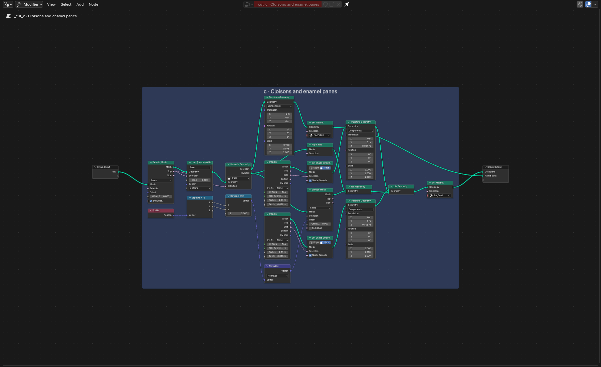

**Extrude Mesh** (individual faces, offset 0) followed by **Scale Elements** on the extruded tops (`inset (cloison width)`,
0.86) is an inset: every cell gets a smaller copy of itself. **Separate Geometry** splits the copies (the panes, enamel)
from the rings around them (the cloisons, gold). The rings are extruded 0.007 outward along the drum's radius so they stand
proud of the enamel, and two open cylinders make the top and bottom rails. They are open (`fill="NONE"` in the script) so
they don't put a lid over the movement.

### d · Season index

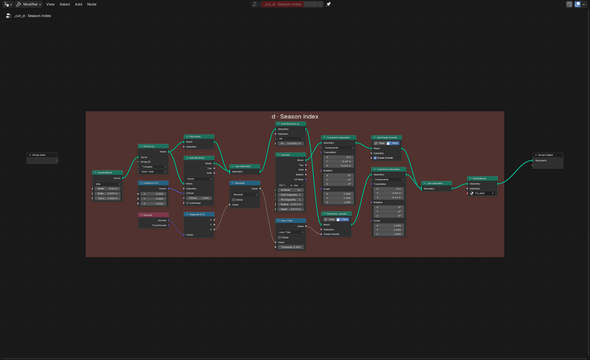

A post at the front (y = −0.99) and a **Quadrilateral** curve in Kite mode, made flat by the same `flat_shape` helper as the
key (see the trick in f).

### e · Stage drive

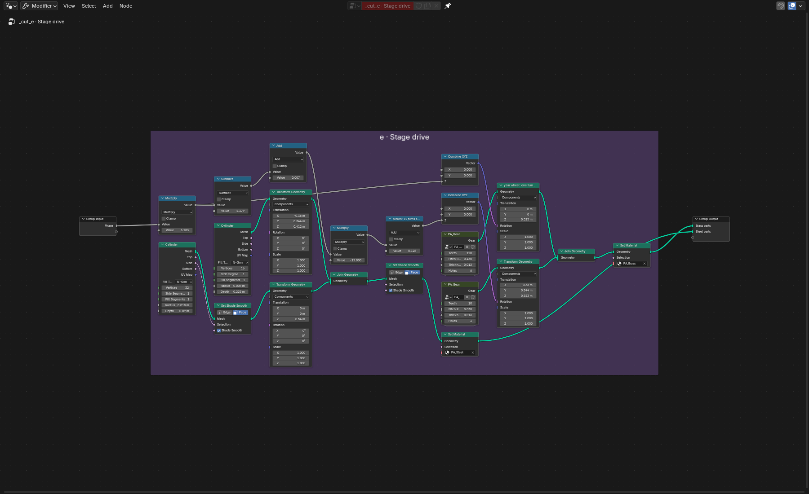

A real music box turns its stage from the spring barrel. Here a `PA_Gear` with 120 teeth (`year wheel: one turn a year`,
pitch radius 0.46) hangs under the stage on the centre shaft and turns by τ·Phase. Its pinion has 10 teeth
(`pinion: 12 turns a year`) and sits on top of the spring barrel's arbor, at the back left. The pinion's angle comes from
`mesh_phase` (see [Appendix A](#appendix-a--pa_gear-and-meshing)), so a tooth always sits in a gap.

### f · Winding key

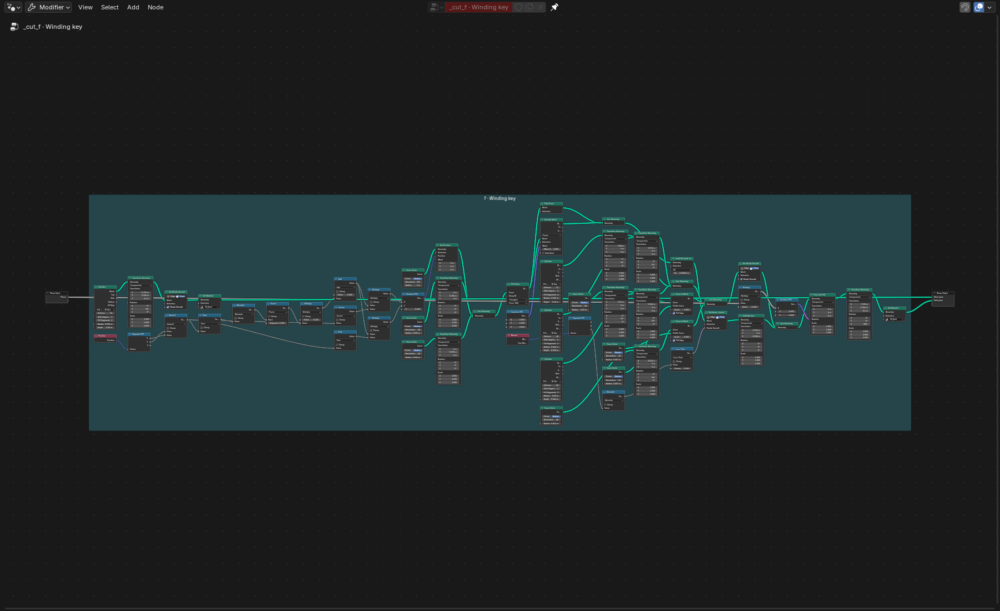

A steel stem runs from the barrel out through the wall to x = −1.06. On it sits a classic butterfly key:

- The bow is the polar curve r = 0.062 + 0.115·|sin θ|^2.6, which has two round wings. Two circles of radius 0.036 at
  ±0.105 are the pierced eyes.
- The shank is three cylinders and two tube beads.
- `key unwinds` turns the key by −τ·Phase about its stem: one turn per loop, the opposite way to winding.

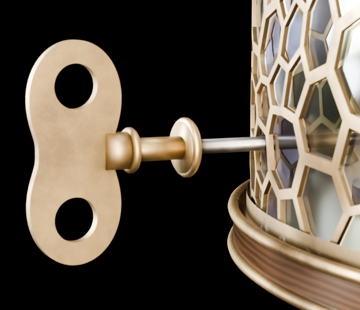

### Trick · flat shapes with crisp faces and round edges

`flat_shape` turns any closed curve into a plate: **Fill Curve**, **Extrude Mesh** by the thickness, and a flipped copy of
the fill for the back. If the curve contains other curves (the key's eyes, a gear's holes), **Fill Curve** cuts them out.
Two details make it look machined:

- `weld the back on` (**Merge by Distance**) joins the back to the walls, so the edges are one closed surface.
- `flat faces, smooth walls` (**Set Shade Smooth** on faces) smooths only faces whose normal is mostly sideways
  (|n_z| < 0.5). The flat front and back stay flat. Without this, smooth shading bends the light across the whole face
  and one side of the key looks domed.

> **Try it:** in the bow's polar curve, change the power 2.6 to 1.0. The wings become fat and heart-shaped.

---

## 4 · The movement

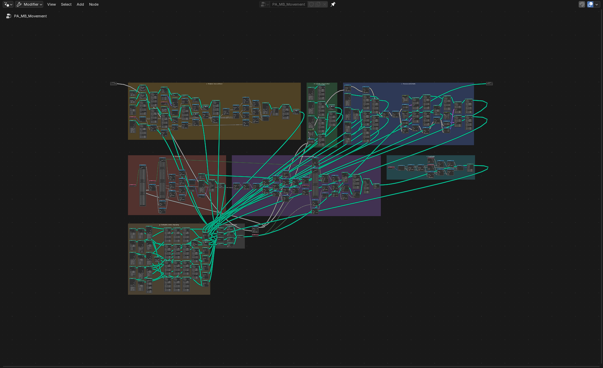

The movement follows the layout of a Swiss cylinder movement: a die-cast zamak bedplate with a raised frame, the spring
barrel at the back left, the pinned brass cylinder at the back right with its great wheel, a gear train ending in a
spinning air brake at the front left, and the steel comb screwed down in front of the cylinder.

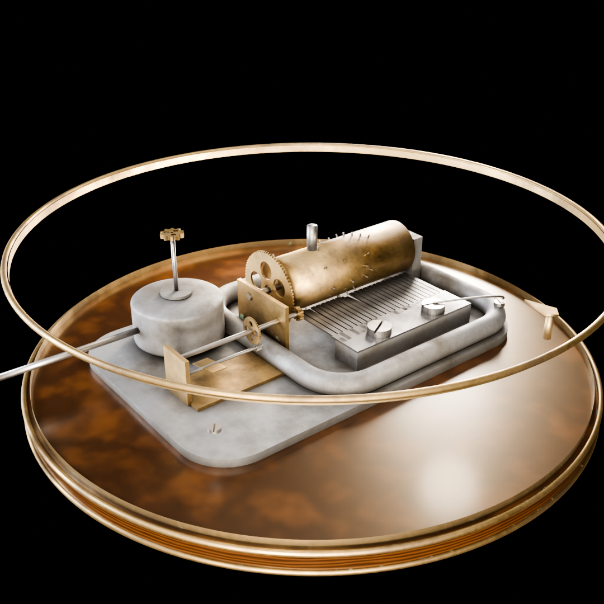

### a · Bedplate, frame and barrel

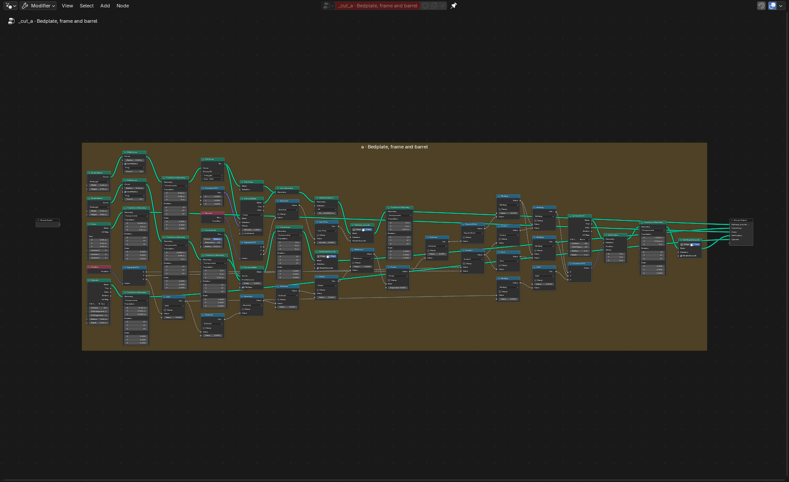

The bedplate is a rounded rectangle (a **Quadrilateral** through **Fillet Curve**, radius 0.18), made 0.03 thick with
`flat_shape`. The `frame loop` is a tube of radius 0.04 along a smaller rounded rectangle. The `spring barrel` is a lathe:
radius 0.17 and 0.20 high, with a profile that rounds off its top and bottom edges.

### b · Cylinder and great wheel

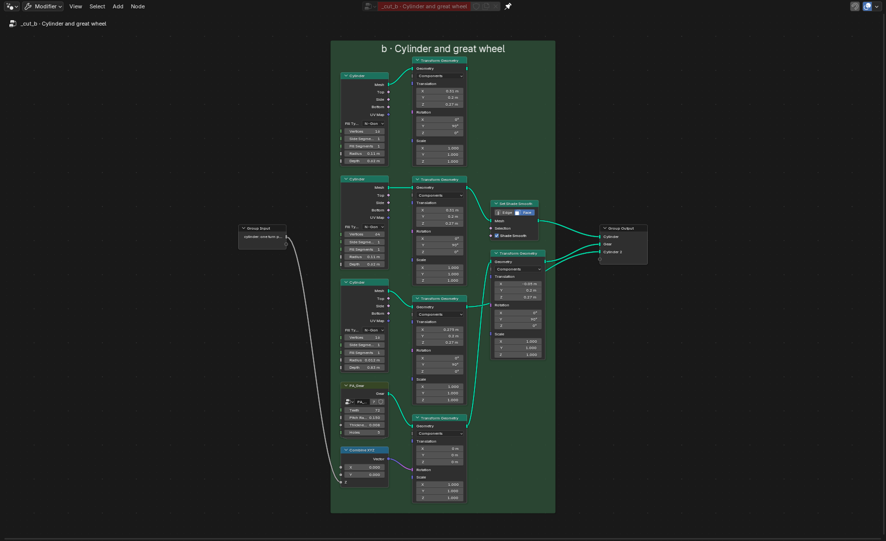

The cylinder (radius 0.11, length 0.62) lies along X. `cylinder: one turn per loop` is ψ = τ·Phase. The great wheel at its
left end has 72 teeth (pitch radius 0.15) and turns with it.

### c · Governor and air brake

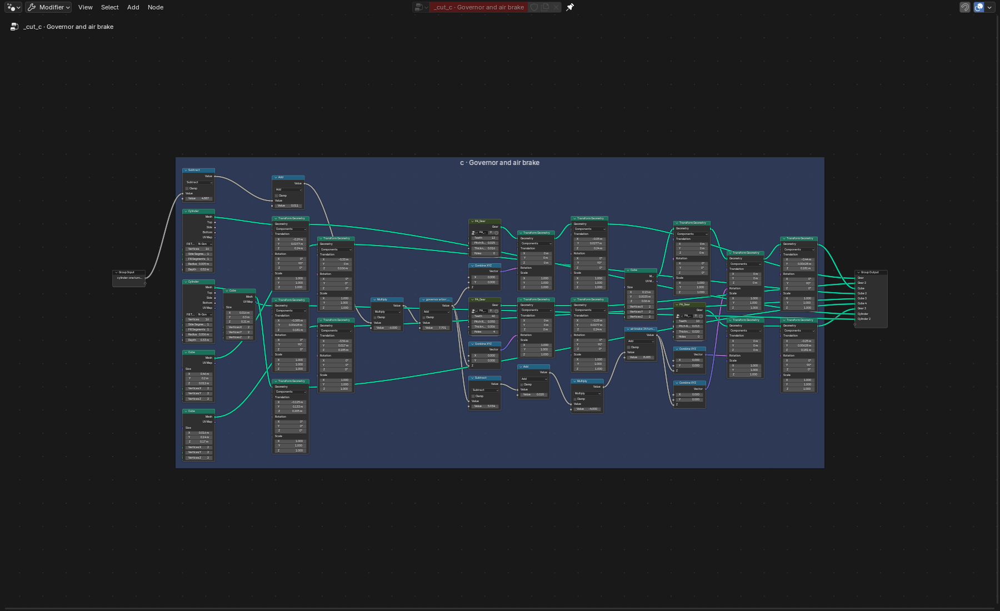

A music box needs a governor, or the spring would run down in a second. The air brake is a small vane that spins fast
and pushes against the air. The train is:

| Stage | Teeth | Ratio | Turns per loop |
|---|---|---|---|
| great wheel → pinion (`governor arbor: 6 turns a loop`) | 72 : 12 | × 6 | 6 |
| wheel on that arbor → pinion (`air brake: 24 turns a loop`) | 40 : 10 | × 4 | 24 |

24 turns in 12 s is two turns a second: fast enough to read as a blur, slow enough to see.

Gears in this movement stand on arbors along X. The helper `on_x` builds each part flat in XY, turns it by its angle about
Z, then stands it up with a quarter turn about Y. The position of each arbor is given as an angle in the Y–Z plane from the
wheel it meshes with (190° and 250°).

### d · Score pins

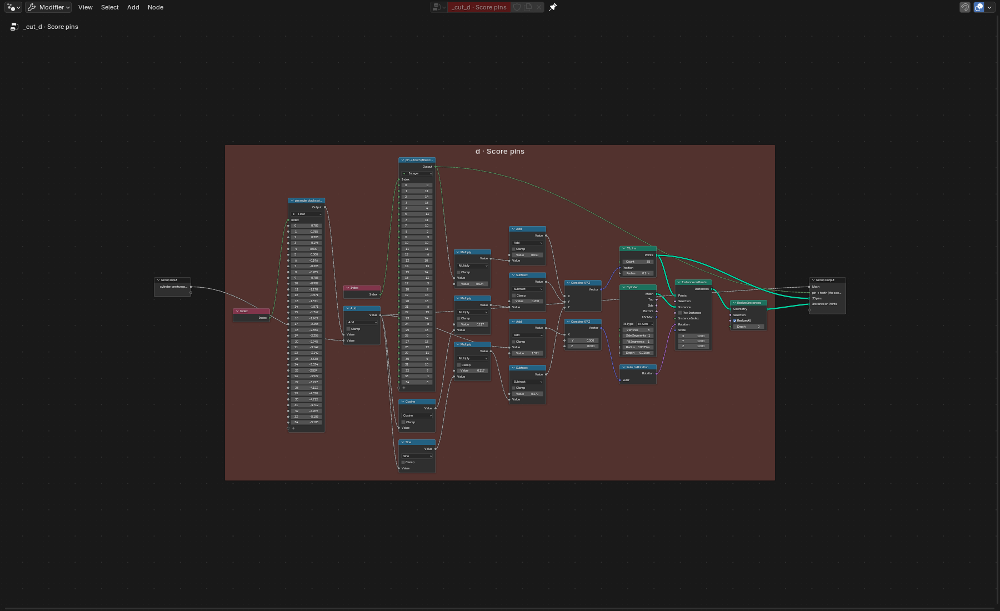

This is the score. There is one point per note, 35 in all, and two **Index Switch** nodes turn its index into:

- `pin → tooth (the score)`: which tooth it plucks (0 = A3, the longest, at the left; 23 = C7).
- `pin angle: plucks at its beat`: φ = α − τ·(beat / 16), where α = 45° is where the pins meet the comb tips.

At time Phase, the pin is at angle φ + ψ = α + τ·(Phase − beat/16). It reaches the comb (angle α) exactly when
Phase = beat/16. So the tune is written straight into the pin positions, and the cylinder plays it by turning.

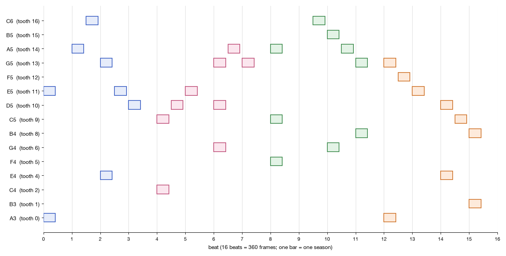

The tune is original: four bars of 4/4 at 80 bpm, one bar per season. Winter (A minor) is sparse and high. Spring
(C → G) rises. Summer (F → G) is the fullest, in thirds. Autumn (A minor → E) falls and ends on B, which leads back into
winter's opening E.

### e · Pluck, summed per tooth

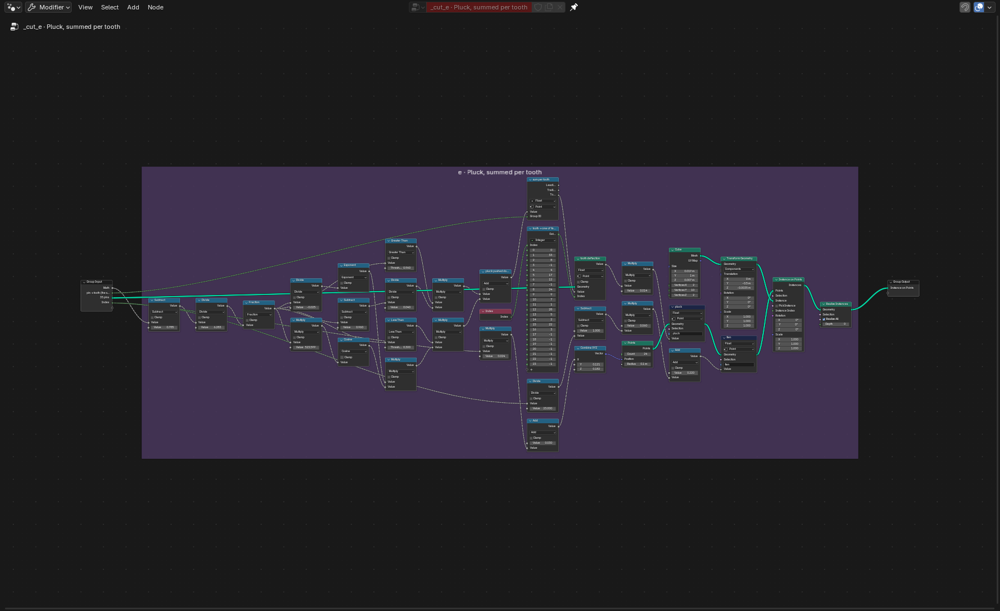

For each pin, `x = fract((angle − α) / τ)` is where it is in its turn: 0 just after it lets go of the tooth.

```
pluck = push + ring
push  = (x − 0.96) / 0.04      for x > 0.96   (the pin presses the tooth down for 14 frames)
ring  = e^(−x / 0.025) · cos(τ·x / 0.012)   for x < 0.3   (the tooth springs back and rings)
```

The ring dies with a time constant of 9 frames and swings every 4.3 frames. A real tooth rings at hundreds of hertz, far
too fast to see, so this is the slowest swing that still reads as a vibration.

A tooth can have several pins (E5 has four). `sum per tooth` is an **Accumulate Field** with **Group ID** = the tooth
number: its *Total* is the same sum on every pin of that tooth. `tooth → one of its pins` (an Index Switch with 24
entries) names one pin per tooth, and **Sample Index** reads that total onto the 24 comb teeth as `tooth deflection`.
Teeth with no pin get index −1, which Sample Index turns into 0.

### Trick · a per-group sum without a loop

"For each tooth, add up all its pins" sounds like a loop. **Accumulate Field** with a Group ID does it in one node, for
every group at once. **Sample Index** at one member of each group then moves the result to another geometry. Use it
whenever many things feed one thing: notes into teeth, leaves into branches, votes into cells.

### f · Comb teeth

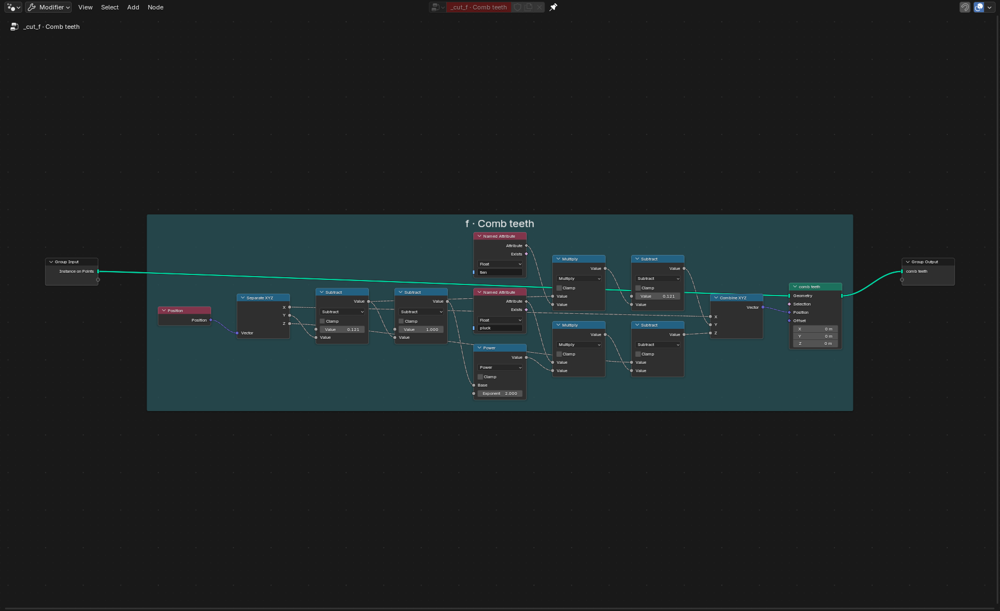

Each tooth starts as a unit cube, 10 segments long, instanced on its point. The stored `tlen` stretches it to its length:
0.22 + 0.06·(1 − i/23), so the bass teeth on the left are longest, as on a real comb. The stored `pluck` (deflection ×
0.014) bends it down by `pluck · (1 − s)²`, where s runs from 0 at the tip to 1 at the root. That is the shape of a
cantilever: the root is clamped, the tip moves most.

### g · Comb plate, screws, stop spring

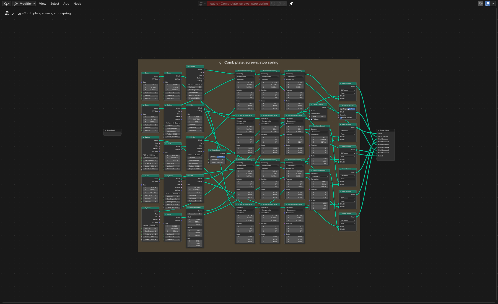

The comb plate sits on a zamak block, held by two big slotted screws (radius 0.045). Four smaller screws hold the bedplate.
Each slot is a box cut out of the screw head with **Mesh Boolean**. The stop spring is a **Quadratic Bézier** curve made
into a tube of radius 0.0045.

### h · Materials and output

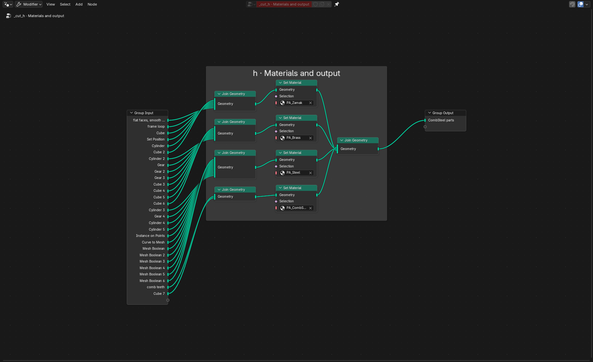

All the parts were collected in four lists while the sections ran: zamak, brass, steel and comb steel. One **Join** and one
**Set Material** per list, then one final Join.

> **Try it:** in `pin angle: plucks at its beat`, change one entry. That pin now plucks its tooth at a different moment,
> and you can see it happen. The sound file will not follow until you change the same note in `SCORE` and run `--sound`.

---

## Inside `PA_MB_Tree`

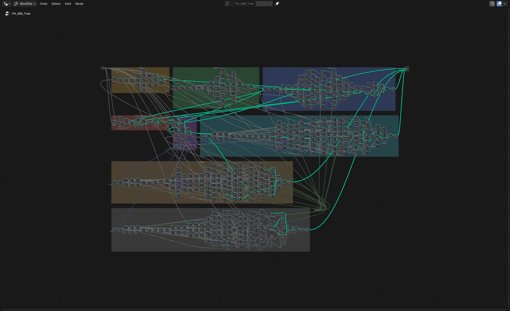

The tree is a gold wire sculpture. Every limb is a curve made from points whose positions are computed directly: no
growth algorithm, no randomness that changes over time. One constant, `TREE_S = 1.15`, scales the whole tree about its
foot: heights, lengths, thicknesses, leaves, flowers and fruit. Change it and the tree grows or shrinks without changing
its shape.

### a · Trunk

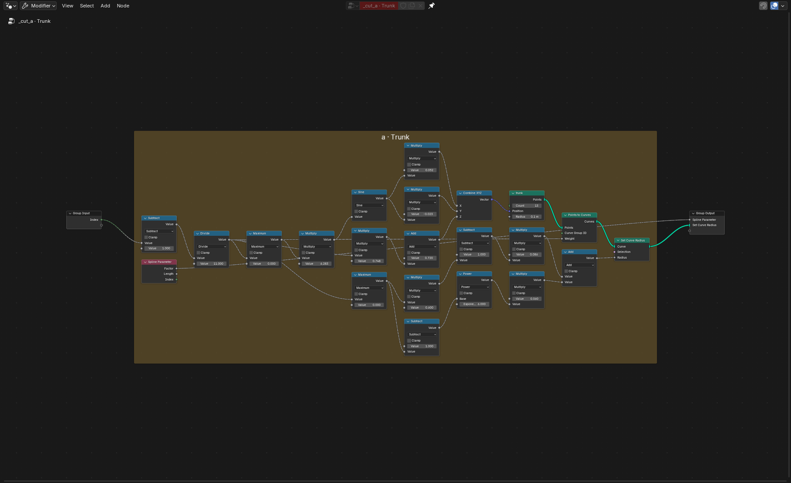

Thirteen points at t = −1/11 … 1 make a gentle S that comes back over its roots, so the crown sits balanced:
x = 0.045·`TREE_S`·sin τt⁺, y = −0.02·`TREE_S`·sin τt⁺ and height = (mound top − 0.04) + 0.65·`TREE_S`·t, with
t⁺ = max(t, 0). The radius is
`TREE_S × (0.075·(1 − 0.6t⁺) + 0.052·(1 − t⁺)^6)`, which flares at the root.

Why the extra point below the ground? The S leans about 25° where it leaves the mound, and **Curve to Mesh** cuts the
end of a tube square to the curve. A tilted cut lifts one side of the trunk off the grass. With t⁺ the curve
goes straight down below t = 0, so the cut end is buried and only the lean shows.

### b · Branches

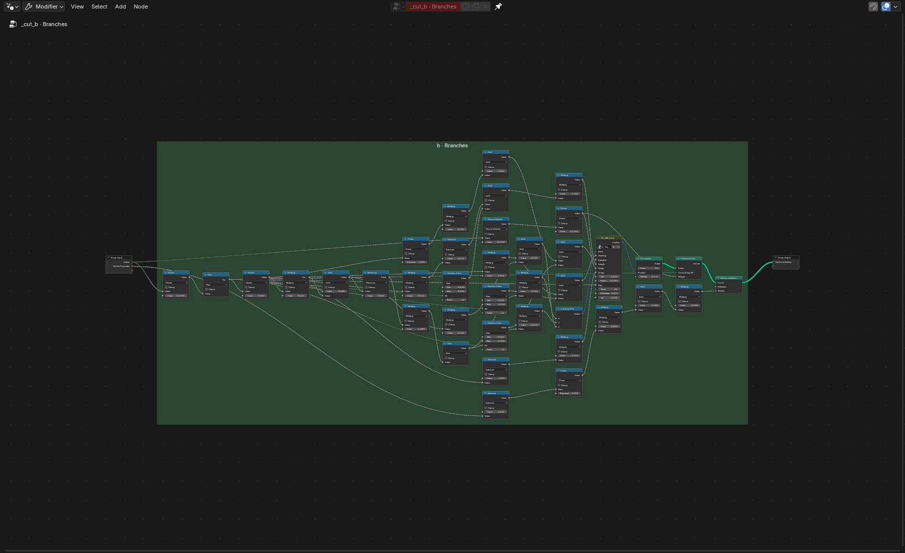

Eight branches of 12 points each. One `PA_MB_Limb` node ([below](#inside-pa_mb_limb)) gives the point at fraction f along
branch b:

| Input | Value | Why |
|---|---|---|
| Base | on the trunk, at 0.38 → 1.0 of its height | low branches first |
| Heading | b × 3/8 of a turn, ± 0.2 rad | 3 and 8 share no factor, so the eight branches cover all eight directions |
| Elevation | 0.38 + 0.72·(b/7)^1.3, ± 0.06 | low branches near level, top ones steep |
| Length | `TREE_S` × (0.676 − 0.312·b/7 ± 0.03), so 0.78 → 0.42 | low branches long, top ones short |
| Droop, Lift | 0.16·(1 − b/7), 0.26 | sag by droop·f², then the tip lifts by 0.26·f³ |
| Crooks | 11 segments, sideways 0.07, up 0.05 | the natural bends; see `PA_MB_Limb` b |

That sag-then-lift is what makes a branch look like it carries weight and still reaches for light.

The radius is `0.033 × TREE_S × taper(0.18, 0.9)`, with `taper(tip, k) = tip + (1 − tip)·(1 − f)^k`. It stays thick
for most of the branch and thins faster near the end, to 18 % of the base. A straight `1 − 0.72f` would leave a blunt,
cut-off end; a taper to 0 would end in a spike.

### c · Twigs

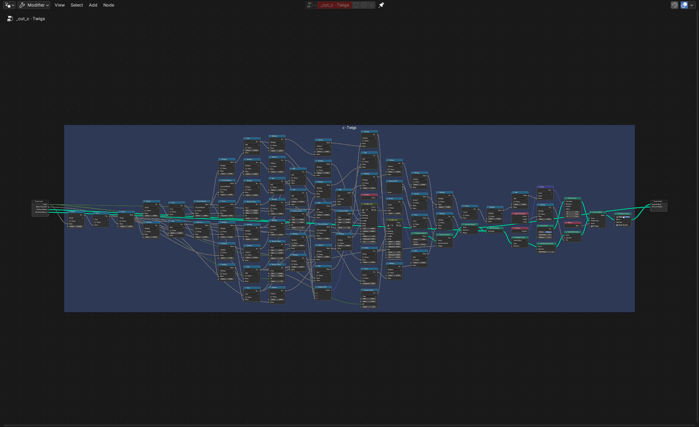

Seven twigs per branch, 6 points each, on alternating sides. A twig's base is its branch's own `PA_MB_Limb` at
f0 = 0.25 + j·0.5/6 (j = 0 … 6), so the twigs sit between 25 % and 75 % of the branch. A second `PA_MB_Limb` draws the
twig from there:

- heading: the branch's ± 0.5–1.0 rad; elevation 0.05–0.5
- length: `TREE_S` × 0.12–0.22 × (1.25 − 0.9·f0), so twigs get shorter towards the tip
- crooks: 5 segments, sideways 0.08, up 0.05
- radius: `0.0165 × TREE_S × (1 − 0.72·f0) × taper(0.25, 0.9)`, about half the branch's thickness where it leaves it

Then all the curves become one mesh:

- Catmull-Rom splines, resolution 4
- `twisted like drawn wire`: tilt = length × 9
- `fluted section`: a circle with seven shallow grooves (r = 1 + 0.12·cos 7θ)

The twist turns the grooves into a spiral along each limb, like twisted gold wire.

### Trick · the branch stays the leader

The last quarter of every branch has no twigs, and every twig is shorter and thinner than the branch near the tip.
So the eye follows the branch to its end. If a twig grew from the very tip and was longer or thicker than it, the
branch would look cut short with the twig carrying on.

### d · Snow on the branches

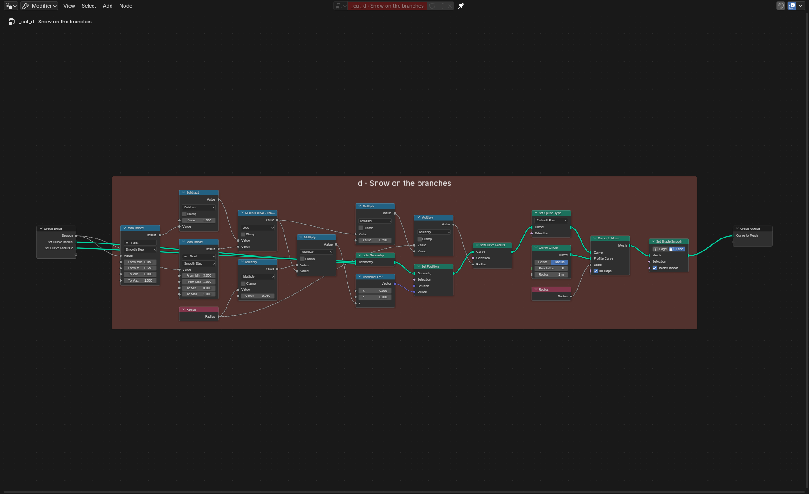

The snow is the same branch and twig curves again, moved up by 0.75 × their radius and given 0.9 × their radius, both
times `branch snow: melts in early spring, settles late in winter`. So it lies along the top of each limb, thins to
nothing when it melts, and tapers with the wood towards each tip.

### e · Anchors

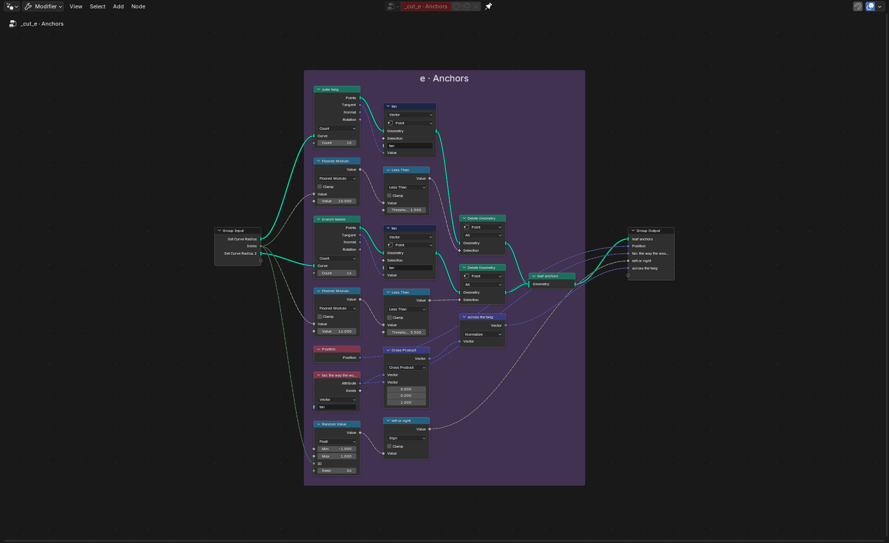

Leaves and flowers must grow *from* the wood, so their anchors are points on the curves themselves. **Curve to Points**
(Count mode) puts 10 points on every twig (`outer twig`) and 16 on every branch (`branch leader`). The first 2 of each
twig and the first 6 of each branch are deleted, which keeps every twig from 22 % of its length on and the last 60 % of
every branch, including the tip past its last twig. That is 8 × 7 × 8 + 8 × 10 = 528 `leaf anchors`.

Each anchor also keeps the curve's **Tangent**, stored as `tan`: the direction the wood runs at that point. From it,
`across the twig` = normalize(tan × Z) points sideways, and `left or right` is a random ±1 per leaf.

### f · Leaves

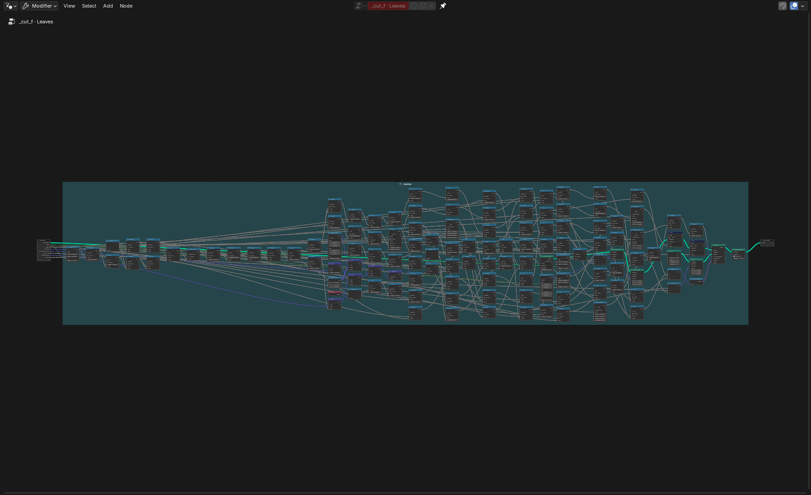

Each anchor is duplicated 5 times, each copy moved by up to 0.03 × `TREE_S` (less than a leaf's own length), so there
are 2640 leaves and every one still touches its twig. Each leaf has a random number r that shifts its windows:

| Window | Season time | What happens |
|---|---|---|
| `leaves unfold` | 0.9 + 0.2r → 1.25 + 0.2r | scale 0 → 0.084 × `TREE_S` |
| `leaves turn` | 2.05 + 0.3r → 2.4 + 0.3r | stored as `turn`: the material goes green → amber or red |
| `leaf fall` | starts 2.5 + 0.55r, lasts 0.38 | drops to the mound |
| `under the snow` | 3.45 → 3.75 | scale → 0 while the snow covers it |

While a leaf hangs, it flutters (0.12·sin, 14 times per loop). While it falls, it tumbles.

### Trick · leaves face away from their twig

A leaf's direction is

```
d = normalize(0.55·tan + 1.0·side·across + 0.4·Z + a random wobble of ± 0.3)
yaw = atan2(d.y, d.x) − 90°      pitch = asin(d.z)
```

so it leaves the twig to its side, leans towards the twig's tip and tilts a little up, toward the light. The leaf
mesh has its stalk at the origin and its tip along +Y, so yaw and pitch put the tip along d. If every leaf just faced
away from the trunk instead, all the leaves on one branch would point the same way and the branch would look like a
feather.

### Trick · a fall is a mix, not a simulation

`fall()` returns a position for "let go at time td, land after dur":

- the landing spot is the starting spot pushed out from the trunk by a random factor, kept inside the mound
  (radius 0.71) and placed on it with `ground_z`
- across, it moves with smoothstep; down, with p^1.3, so it speeds up
- a side sway of 0.06·sin(πp) times a sine and a cosine, which is 0 at both ends, so the leaf leaves its twig and lands
  exactly where it should

Because the position is a formula of season time, a leaf can be checked at any frame, and lies still on the mound for as
long as needed. While it falls, its turn from the twig mixes back to flat, so it lands lying down.

### g · Blossom

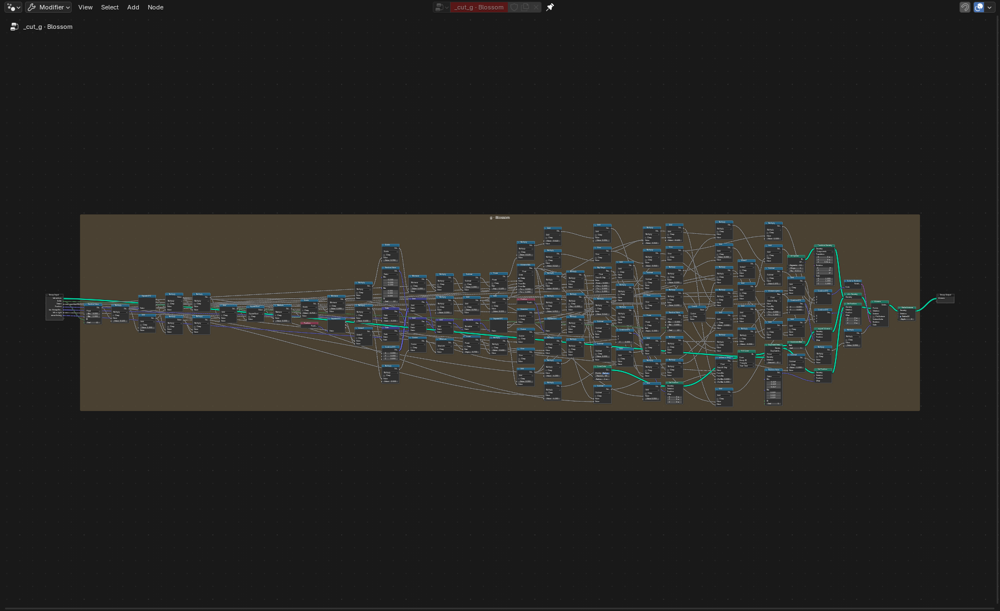

Two per anchor (1056), moved by up to 0.025 × `TREE_S`. Each one faces `normalize(0.2·tan + 0.6·side·across + 0.8·Z ±
0.3)`, so it opens upward and out to its side of the twig. Its face (+Z) is turned there by a yaw and a tilt of
−acos(d.z). `blossom opens` at 0.3 + 0.2r → 0.55 + 0.2r, `blossom falls` from 0.75 + 0.35r over 0.32, then
`withers in the grass`. The flower is a five-petal curve, filled, subdivided, cupped up by 0.35·d², with a small sphere
heart.

### h · Fruit

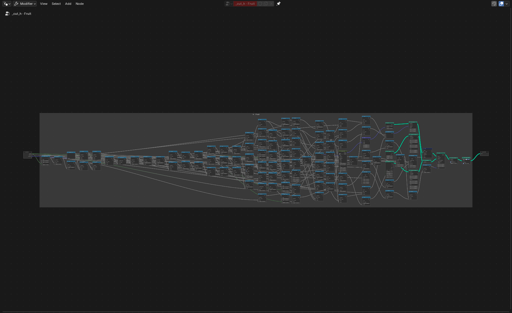

Three per branch (24), at f = 0.45, 0.65 and 0.85 of the branch (its own `PA_MB_Limb`, so they follow the crooks),
hanging 0.058 × `TREE_S` under it. `fruit sets` at 1.45 + 0.2r → 1.95 + 0.2r, ripens (stored `ripe`, green → red) by
2.35 + 0.2r, and `fruit drops` from 2.45 + 0.6r in only 0.1 units (9 frames): fruit falls fast, leaves drift. The apple
is a squashed sphere and a six-sided stalk.

> **Try it:** in section b, change 3/8 of a turn to 1/2. The branches stack in two flat rows, like an espalier.

---

## Inside `PA_MB_Limb`

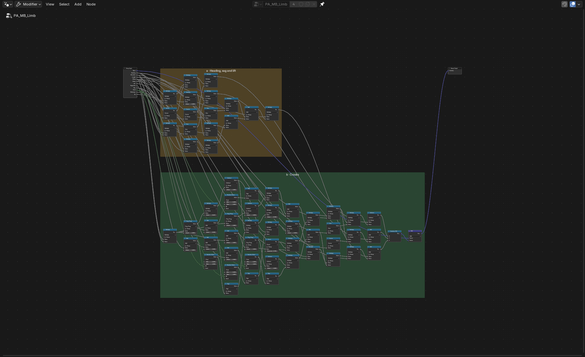

Branches, twigs and fruit all need "the point at fraction f along a limb", and a twig needs it twice: once for its
branch, to find where it starts, and once for itself. So the formula is a node group, and each caller is one node.
Its inputs are Base, Heading, Elevation, Length, Along (f), Droop, Lift, and five for the crooks: Segments, Key, Seed,
Sideways, Up.

### a · Heading, sag and lift

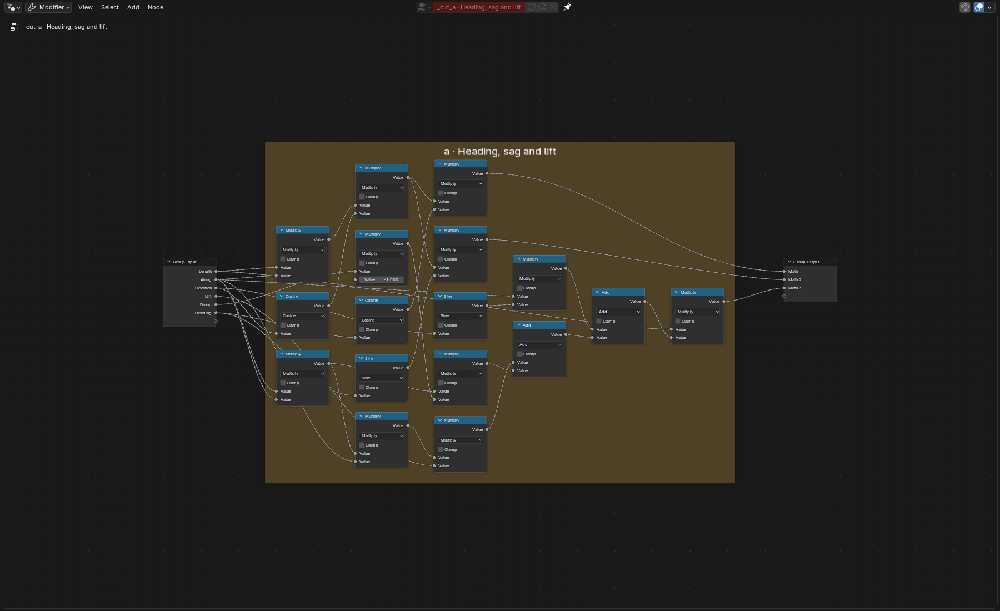

```
reach  = L · f · cos(elevation)          x = reach · cos(heading)   y = reach · sin(heading)
height = L · (f · sin(elevation) − droop · f² + lift · f³)
```

A straight limb at the given elevation, pulled down by droop·f² (more towards the tip) and lifted again by lift·f³
(even more at the very tip).

### b · Crooks

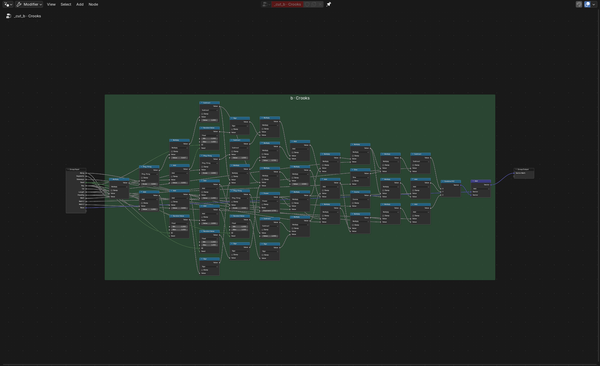

Real branches don't curve smoothly. They grow a little, change direction, grow again. The crooks add that:

```
x  = f · Segments
t2 = pingpong(x, 2) − 1                 corners every 2 segments
t3 = pingpong(x, 3) · 2/3 − 1           corners every 3 segments
t2b = pingpong(x + 1, 2) − 1            like t2, shifted by one segment
sideways = f^0.7 · Sideways · (±t2 ± 0.7·t3) · L
up       = f^0.7 · Up       · (±t2b ± 0.5·t3) · L
```

The signs come from **Random Value** (ID = Key, Seed = Seed + 0 … 3) through **Sign**, so every limb bends its own way.
Sideways moves the point across the heading, `(−sin heading, cos heading)`, and Up adds to its height. f^0.7 is 0 at
the base, so the limb still starts exactly where it should.

### Trick · corners on the control points

Segments is the number of gaps between the limb's points (11 for a branch, 5 for a twig), so x is a whole number at
every point. Both triangle waves turn their corners only at whole numbers. The corners land on the points the curve passes
through, and between them the formula is nearly straight. So the Catmull-Rom curve the wood is made from stays close to
the formula everywhere. That matters for twigs: their base is the formula, not the mesh, and it still lands on the wood.

Two periods (2 and 3) with random signs give corners at irregular intervals and of irregular sizes. One wave alone
would zigzag like a spring.

> **Try it:** in section b of `PA_MB_Tree`, set the `PA_MB_Limb` node's Sideways to 0.2 and Up to 0.15. The branches
> become wild and wind-bent. Set both to 0 for the smooth, swept branches of a topiary tree.

---

## Appendix A · `PA_Gear` and meshing

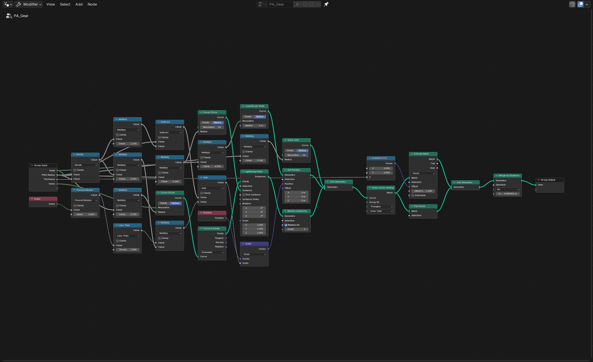

Every gear here is one group with four inputs: Teeth, Pitch Radius, Thickness, Holes.

- `4 points per tooth`: a circle with 4·T points. Index mod 4 picks two points at pitch radius + 1.15 module (the tip)
  and two at pitch radius − 1.15 module (the root), with module = pitch radius / T. The result is a trapezoid tooth.
- `arbor hole` and `lightening holes`: smaller circles. `holes cut by nesting`: **Fill Curve** treats curves inside
  curves as holes.
- Extrude by Thickness, add the flipped back, merge.

**Meshing.** Two gears mesh only if a tooth of one sits in a gap of the other. The script's `mesh_phase` gives gear 2's
angle from gear 1's: it turns the other way, T1/T2 times as fast, with a fixed offset so a tooth of 1 meets a gap of 2 at the
line between their centres. The offset depends on where `PA_Gear` puts its teeth (centred at π/(4T)) and its gaps
(5π/(4T)).

## Appendix B · the cloche

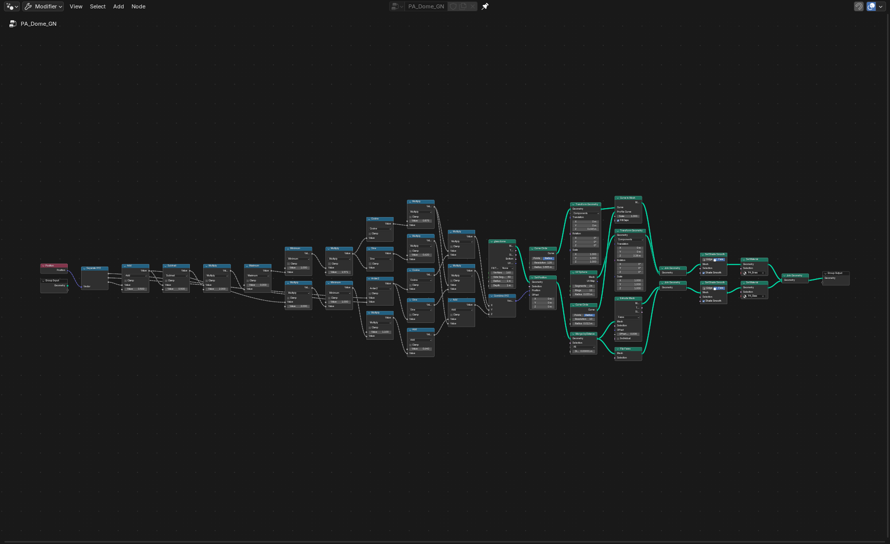

The glass is a lathe: a straight wall `DOME_H` = 1.10 high, then a quarter ellipse 0.62 high, radius 0.875, made 0.008
thick. The tree is tall, so the wall is tall: the crown has room under the cap and the snow has room to fall. It is
its own object, **PA_Dome**, so the lights can treat it apart (Appendix D).

## Appendix C · materials

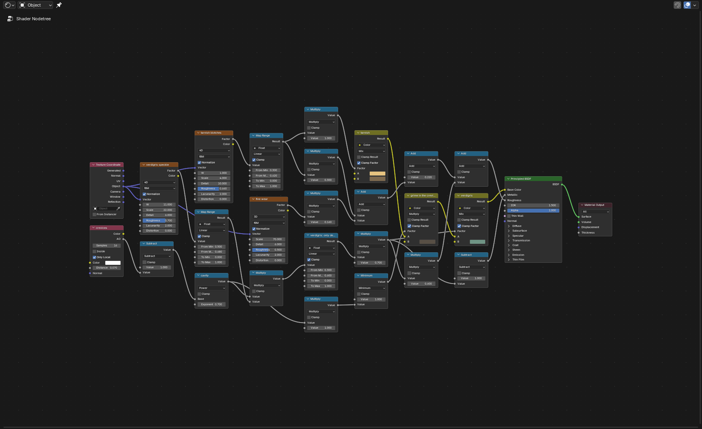

**`age()`** puts a century on every metal. It adds four layers on top of the base metal:

| Layer | Node | What it does |
|---|---|---|
| `tarnish blotches` | Noise, scale 4 | dark-brown oxide in soft patches (brown, not grey: the dark colour is warmer than the base) |
| `crevices` | **Ambient Occlusion**, local only, distance 0.07 | finds corners; `grime in the crevices` darkens them |
| `verdigris speckle` | Noise, scale 22, × the cavity | green-blue crust only deep in corners, in patches, not metallic |
| `fine wear` | Noise, scale 70 | roughness wanders by up to 0.16, so reflections break up |

Brass gets tarnish 1.0 and verdigris 0.7; gold 0.9 and 0.4; steel, zamak and comb steel get no verdigris.

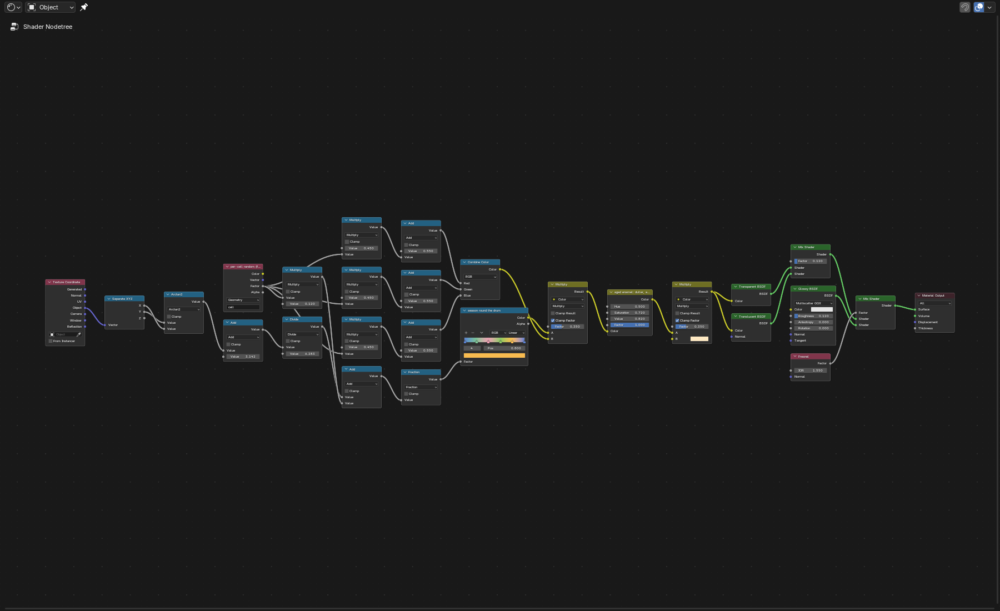

**The enamel** reads the `cell` attribute stored in Drum section b. The colour comes from a ramp around the drum (blue at
the back for winter, green and rose for spring, leaf green, amber for autumn), shifted by up to 0.12 per cell so
neighbours differ. Each cell's brightness also varies by `cell`. `aged enamel: duller, a touch amber` lowers saturation
and value and warms it. The body is 88 % Transparent and 12 % Translucent BSDF, so the movement shows through and the
enamel still glows. A Fresnel (IOR 1.55) mixes in a slightly hazy gloss.

**The rest.** The walnut grain is a Wave texture in bands along Z under an old, warm lacquer coat. The leaves mix green
and autumn colours by the stored `turn` and `hue`. Fruit and grass mix two colours by `ripe` and `dry`. The glass is
faintly yellow, with `dust and haze` roughness up to 0.05.

## Appendix D · light

The scene is lit for an antique in a dark room:

- **Key** (900 W, warm) from front left, **top** (160 W), **two low strips** (420 W and 200 W) at drum height so the
  enamel catches light, and **two tall rims** (1200 W and 900 W) behind.
- **A 45 W point lamp inside the drum**, behind the movement, so the enamel glows like stained glass and the movement reads
  as a silhouette. A 10 W fill in front of it.
- **Light linking.** The key, top, low and rim lights don't reach the cloche (receiver collection `PA_NoDome`, dome excluded), so there are
  no large softbox reflections across the tree. Two dimmer twins of the rims (25 %, `PA_RimL_Glass` and `PA_RimR_Glass`)
  light *only* the glass (collection `PA_DomeOnly`), which draws its thin edge lines. The dome also does not block any
  light (blocker collection), since real thin glass barely dims it.
- **World.** Black to the camera. For glossy rays only (**Light Path → Is Glossy Ray**) it is a dim warm "room", so the
  metal has something to reflect.

Camera: 85 mm, 7.9 units away, 15° above, f/8. View transform AgX Medium High Contrast, exposure −0.3.

## Appendix E · the sound

The sound comes from the same `SCORE` list as the pins. `build.py -- --sound` writes `musicbox.wav` with numpy:

- **Each pluck rings like a cantilevered steel tooth.** The fundamental is the note's frequency. Two overtones sit at
  6.267 and 17.55 times it, the first bending modes of a clamped bar, and they die much faster than the fundamental.
  Low notes ring longer: decay = 2.4·√(220/f) s, kept between 0.45 and 3 s.
- **A click** of noise at the start (1.5 ms) is the pin letting go.
- **Pan** by the tooth's place on the comb: bass on the left, treble on the right.
- **Tails wrap around.** A note near the end rings on into the start of the file (index mod n).
- **Circular reverb.** The reverb (1.6 s of decaying noise) is applied by FFT multiplication, which convolves *around* the
  loop. So the room's echo also wraps, and the sound loops as seamlessly as the picture.

---

## How it was rendered

1. **Clay first.** `build.py -- --clay` saves `clay/musicbox_clay.blend`, a white Workbench copy without the glass. It
   renders the whole loop in minutes. The motion was approved on that before any Cycles frame.
2. **Cycles, split over two machines.** 1080², 128 samples (adaptive threshold 0.02), 12 bounces, because light passes
   the glass, the enamel and the glass again. Frames 1–160 were rendered on a Mac (Metal, about 19 s a frame). Frames
   161–360 were rendered over the LAN on a PC with an RTX 4060 (OptiX) through [Flamenco](https://flamenco.blender.org),
   at about 15 s a frame.
3. **ffmpeg** joins the PNG frames into `loop.mp4` (H.264, crf 16) and adds `musicbox.wav` for `loop_sound.mp4`.

---

## Try it yourself

1. Open `musicbox.blend`, select **PA_MusicBox** and scrub the timeline. Watch the comb in the movement while the stage
   turns: each tooth dips just before the note you hear.
2. In the main tree, change the Multiply after the loop clock from 4 to 8. The whole year now plays in the first half-turn
   and the second half is one long winter, so the emblems no longer match the index. The loop still has no seam: every
   window ends before u = 4, and after that everything is in its winter state.
3. Open `PA_MB_Drum` and change `inset (cloison width)` from 0.86 to 0.7. The brass lattice gets heavy and the enamel
   panes become small windows.
4. In `PA_MB_Drum` section b, change the Poisson **Distance Min** of `cell seeds` from 0.05 to 0.1. The cells get larger
   and more even, like a honeycomb.
5. Write your own tune: edit `SCORE` in `build.py` (beat, note), up to 16 beats, notes from A3 to C7. Then rebuild:
   `Blender -b --factory-startup --python build.py -- --sound`. The pins move, and `musicbox.wav` plays the new tune.
   `--bare` hides the wall, stage and dome so you can watch the movement.

*Made with Blender 5.2 Geometry Nodes for [Nodevember](https://nodevember.com) 2026, Day 5 · Clockwork.*
