# How to walk forever down a Gothic nave

*A node-by-node walkthrough of Nodevember 2026 · Day 6 · Vault*

You lie on the floor of the nave of Rouen Cathedral and look up and along it. The four storeys of the elevation climb
into a quadripartite rib vault: pointed arches, moulded ribs, a rosette boss in every bay, and ochre stones laid course by
course in each cell. The camera drifts forward one bay (6.3 m) in 10 seconds. The rose window of the west end stays at
the same distance ahead the whole time. Frame 301 is frame 1, so the walk never ends and the loop never shows a seam.

Nothing is modelled, simulated, keyframed or textured with an image. One Geometry Nodes object builds every stone from
about twenty numbers at the top of `build.py`, and the procedural audit reports no issues.

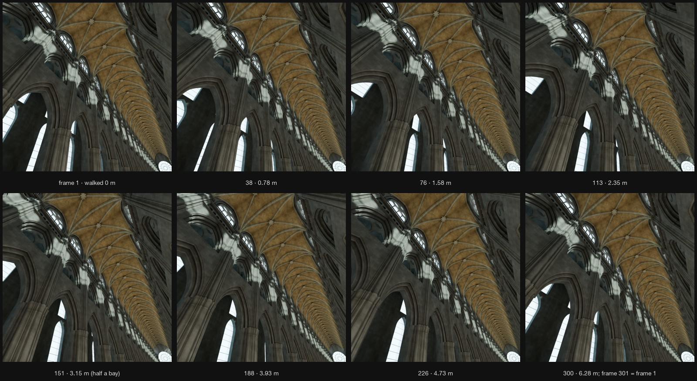

| File | What it is |
|---|---|
| [`../color/loop.mp4`](../color/loop.mp4) | the final loop: 1080 × 1080, 300 frames at 30 fps (10 s), Cycles, 256 samples |
| [`../eevee/loop.mp4`](../eevee/loop.mp4) | the same walk rendered in EEVEE, looking 10° higher: 128 samples, about half the render time (see *The EEVEE version*) |
| [`../rouen.blend`](../rouen.blend) | the scene. Select **PA_Rouen** and open its Geometry Nodes modifier (`PA_Rouen_GN`). |
| [`../color/rouen_color.blend`](../color/rouen_color.blend) | the render copy: the same tree split into a moving nave and a still west end (see *How it was rendered*) |
| [`../clay/rouen_clay.blend`](../clay/rouen_clay.blend), [`../clay/loop_masonry_v4.mp4`](../clay/loop_masonry_v4.mp4) | the white model and its loop |
| [`../build.py`](../build.py) | the script that builds the whole file. Every node in this tutorial comes from it. |

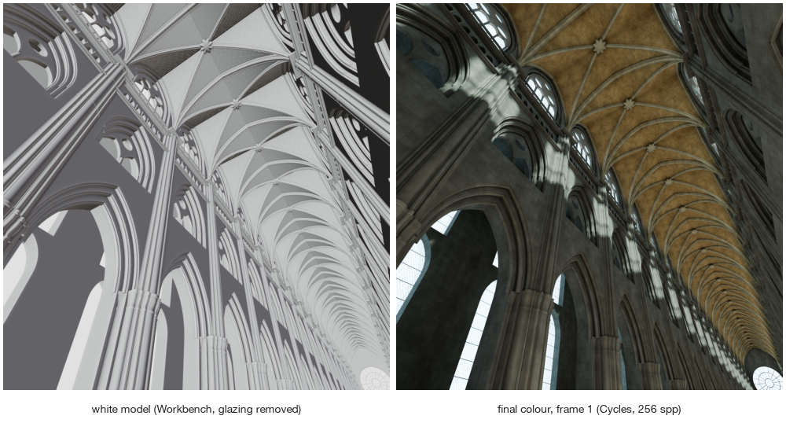

---

## The one idea

> **A bay of a rib vault is two pointed barrels that cross, and the soffit is the higher of the two:
> `z = Zs + P(min(u, v))`.** Here u = |x| / (W/2) is how far you are across the nave and v = |y| / (B/2) is how far
> you are along the bay. Both run from 0 at the crown to 1 at the springing. `P` is one pointed-arch profile.

`P` falls as its argument grows, so `min(u, v)` picks whichever barrel is higher at that point. Where the two barrels are
equal, `u = v`, the surface has a crease. In plan that crease is the diagonal of the bay, and it is exactly where a
Gothic builder puts the diagonal rib. Everything in the vault comes from this one formula:

- **The ribs** are `P` drawn along three lines: across the nave (transverse arch), along the wall (wall rib) and along
  the diagonal (diagonal rib). They all reach the same crown, because they all use the same `P`.
- **The cells** are the four triangles between the diagonals. In each one, one of the two barrels wins, so the cell is a
  plain barrel and can be paved like one: courses along its axis, each course one step around its curved section.
- **The walk** works because the nave is periodic with period B. Move it back by B · Phase and frame 301 looks
  exactly like frame 1.

The rest of the tree builds the walls the vault stands on, and the stone that covers them.

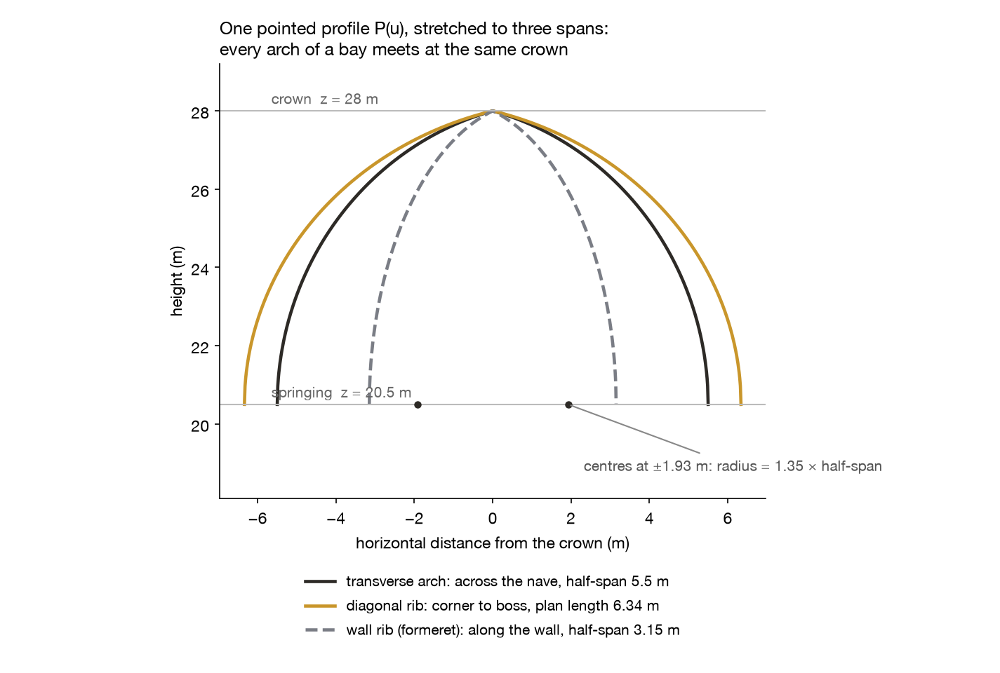

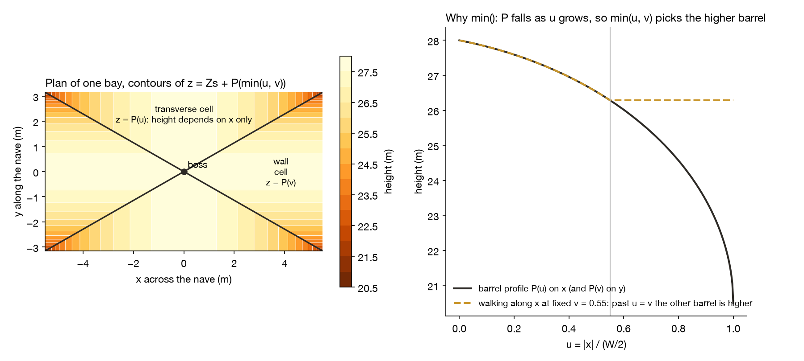

### How to read the screenshots

Every recipe that is used more than once is a **node group**, and so are the two big assemblies. The main tree,
`PA_Rouen_GN`, is only 99 nodes in four coloured frames. Most of what it calls lives in groups. This tutorial follows
the main tree section by section, and opens each group (*Inside `PA_…`*) where it first appears. Press **Tab** on a
group node in the `.blend` to go inside it.

- A big group is split into frames *a · b · c …*, and each frame has its own cut-out. In a cut-out, wires from
  another frame enter through a **Group Input** on the left and leave through a **Group Output** on the right. They are
  named after what they carry: `Wall parts` means "geometry that has just had the wall material set".
- Node titles in `code` style, such as `omit slivers fully covered by the diagonal rib`, are labels you will find in
  the `.blend` file. A group node's title says what that call does, for example `wall ribs (formerets)`.
- Small nodes titled like `132 section points (x, y)` are **Index Switch** nodes holding a fixed list of points: the
  cross-section of a moulding, a rib or the pier. Their value sockets are hidden. Select one and press **Ctrl+H** to
  see the numbers.

Lengths are in metres. The nave is 11 m wide wall to wall, a bay is 6.3 m long, and the vault's crown is 28 m above the
floor, as at Rouen. Click any screenshot to see it at full size.

---

## 0 · The map

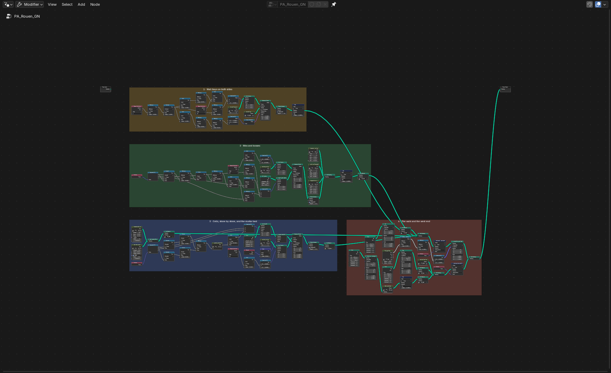

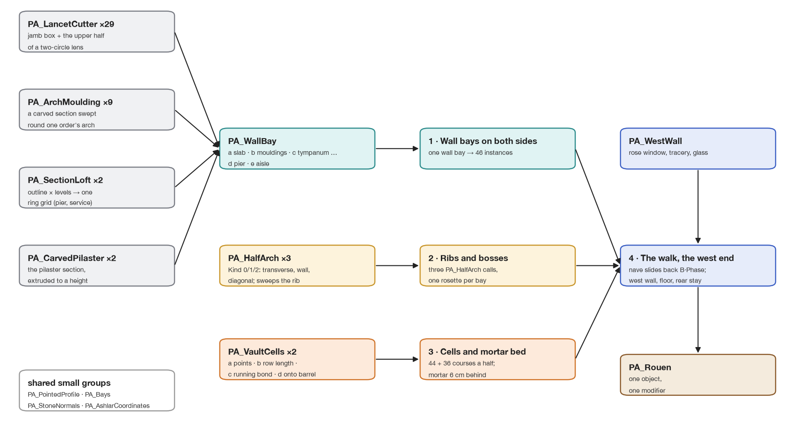

| # | Section of `PA_Rouen_GN` | Nodes | Job |
|---|---|---|---|
| 1 | **Wall bays on both sides** | 20 | one `PA_WallBay`, instanced 46 times |
| 2 | **Ribs and bosses** | 26 | three `PA_HalfArch` calls (transverse, wall, diagonal) and one rosette boss per bay |
| 3 | **Cells, stone by stone, and the mortar bed** | 27 | two `PA_VaultCells` calls (44 and 36 courses), and the mortar behind the joints |
| 4 | **The walk and the west end** | 24 | loop clock, the nave slides back one bay per loop; `PA_WestWall`, floor and rear closure stay still |

The groups, in the order this tutorial opens them:

| Group | Nodes | Used | What it makes |
|---|---|---|---|
| `PA_Bays` | 12 | 5 × | one point per copy per bay, with the bay's start `y0` and the copy index `j` |
| `PA_WallBay` | 224 | once | one bay of wall: slab and openings, mouldings, tympanum and tracery, pier, aisle |
| `PA_LancetCutter` | 30 | 29 × | the cutter for one pointed opening |
| `PA_ArchMoulding` | 99 | 9 × | the carved roll round one order of an arch, and its jamb relief |
| `PA_StoneNormals` | 6 | 4 × | smooth shading with crisp carved edges |
| `PA_SectionLoft` | 44 | 2 × | a ring-grid loft through a list of levels: the pier |
| `PA_CarvedPilaster` | 15 | 2 × | a slice of the pilaster section, at any height |
| `PA_AshlarCoordinates` | 24 | 4 × | 2D coordinates for the ashlar shader |
| `PA_HalfArch` | 62 | 3 × | springing-to-crown half-arches: transverse, wall or diagonal |
| `PA_PointedProfile` | 8 | 2 × | `P(u)`, the pointed profile |
| `PA_VaultCells` | 189 | 2 × | every stone of one family of cells |
| `PA_LoopClock` | 10 | once | Phase 0 → 1 over 300 frames |
| `PA_WestWall` | 66 | once | the west wall and its rose window |
| `PA_LimestoneNoise` | 15 | 15 × (shaders) | stone noise that rides on the stone and loops every bay |

### The building in numbers

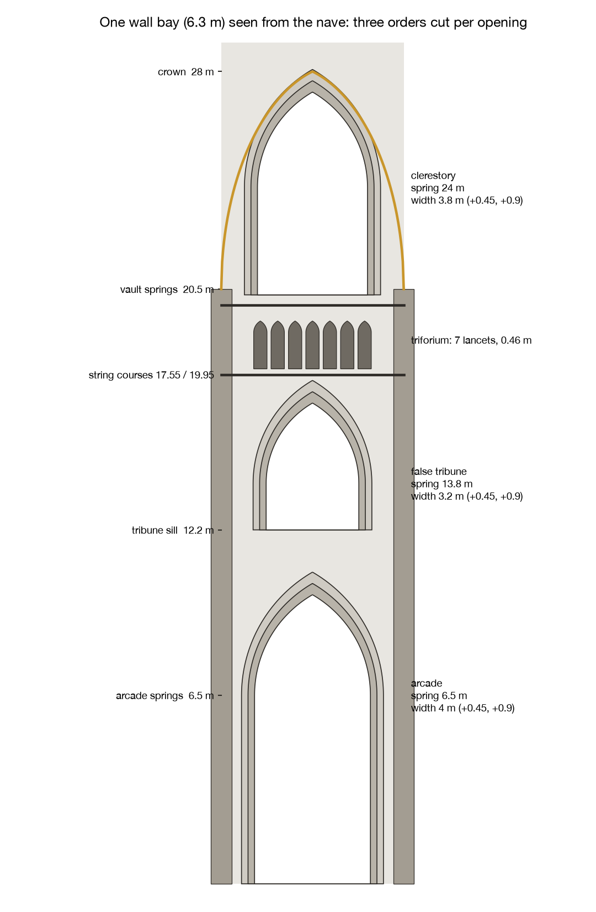

| Constant | Value | What it is |
|---|---|---|
| `B` | 6.3 | bay length; also the distance walked per loop |
| `W` | 11.0 | nave width, wall face to wall face |
| `ZS`, `H` | 20.5, 7.5 | springing of the high vault and its rise; crown at 28 m |
| `RHO` | 1.35 | arch radius as a multiple of the half-span: 1 would be round, larger is more pointed |
| `K0`, `K1` | −3, 19 | the bays built: 23 of them, 145 m of nave |
| `T` | 1.6 | wall thickness |
| `NT`, `NL` | 44, 36 | stone courses per half of a transverse cell and of a wall cell |
| `BRICK`, `JOINT` | 0.78, 0.008 | target stone length and joint width |
| `WEST` | 17.3 × B ≈ 109 m | the west wall, fixed ahead of the camera |

The groups read these constants when `build.py` runs. A value that changes from call to call, such as an opening's
width or a rib's section, is a group input instead, and you can change it in the node editor.

---

## 1 · Wall bays on both sides

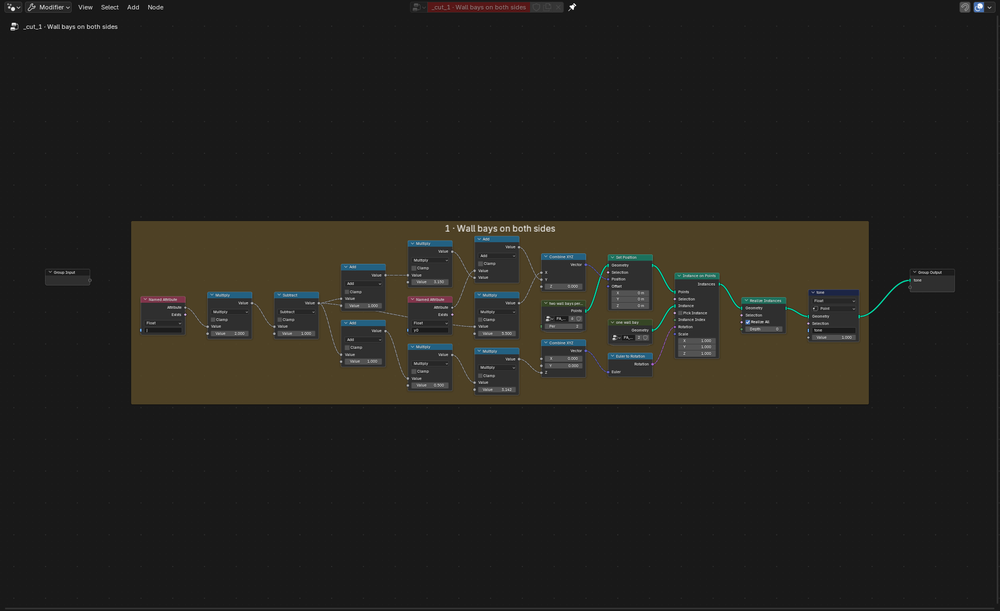

`one wall bay` is a `PA_WallBay` group node. Inside it, one bay of wall is built standing alone, with its inner face
at x = 0 and the bay running from y = 0 to y = 6.3. Section 1 copies it along both sides.

`two wall bays per bay` is a `PA_Bays` call with Per = 2. It makes 46 points (23 bays × 2 sides) and stores two fields
on them: `y0`, the start of the point's bay, and `j`, which copy it is. For a wall, `side = 2j − 1` is −1 (left) or +1
(right):

- position `(side × W/2, y0 + (side + 1) × B/2, 0)`
- rotation about z: `(side + 1)/2 × π`

The left copy sits at x = −5.5 facing +x. The right copy is turned 180° so it faces −x. Because the turn also reverses
its y direction, it starts at the far end of its bay, `y0 + B`. Both then cover the same 6.3 m.

The section ends with **Realize Instances** and stores `tone` = 1 on all the wall stone. The vault stones get their own
`tone` in section 3.

> **Try it:** change `K1` from 19 to 5. The nave now ends about 38 m ahead of the camera, and you see sky between the
> last bay and the west wall, which stays at `WEST`. The loop also breaks: the nave's open end slides 6.3 m during the
> loop and jumps back at the seam. That is why the nave runs on 17 bays past the west wall.

### Inside `PA_Bays`

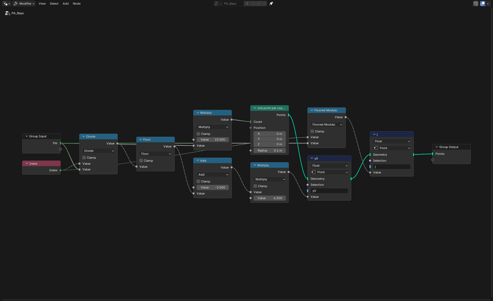

This 12-node group is the backbone of the whole building. With Per copies per bay, point number `index` belongs to bay
`K0 + ⌊index / Per⌋` and is copy `index mod Per`. The group stores `y0 = bay × B` and `j`. Every periodic thing in
the nave starts here: wall bays, half-arches, bosses, courses of stone, mortar beds.

---

## Inside `PA_WallBay`

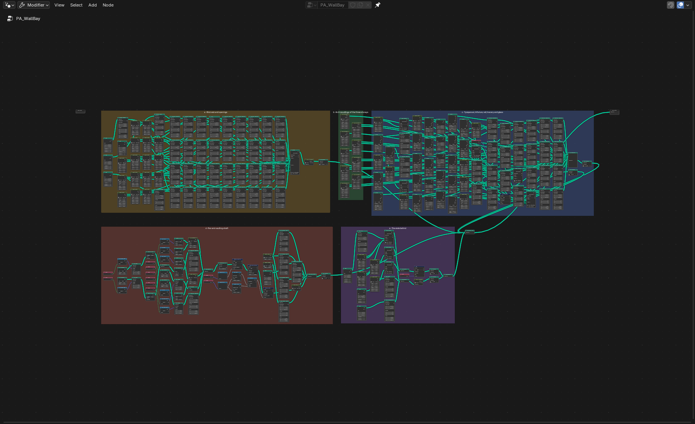

### a · Wall slab and openings

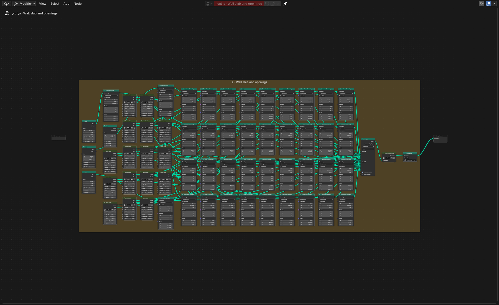

The wall is a box, `wall`: 1.6 m thick, one bay long and 29 m tall (`TOP`, a metre above the crown). Every opening is
cut out of it by a single **Mesh Boolean** (`openings`, Difference, Exact solver). The cutters are:

| Opening | Cutters | Numbers |
|---|---|---|
| arcade | three orders of an equilateral lancet | 4.0 m wide (+0.45, +0.9 for the outer orders), springs at 6.5 m |
| false tribune | three orders | 3.2 m wide, sill 12.2 m, springs at 13.8 m |
| triforium | `triforium passage`, seven small lancets, `triforium recess` | lancets 0.46 m wide every 0.6 m, sill 17.75 m |
| clerestory | three orders, `clerestory passage` | 3.8 m wide, sill 20.3 m, springs at 24 m |

**Why three orders?** A Gothic opening is not one hole. It steps in two or three times, each "order" a little narrower
and deeper than the one in front. Here `ORDERS = ((0.9, 0.0), (0.45, -0.28), (0.0, -0.62))`. The outermost order is
0.9 m wider than the opening and cut 0.28 m into the wall. The middle one is 0.45 m wider and goes 0.62 m in. The inner
one is the opening itself and goes right through. From below, the steps catch light and shadow, and the wall stops
looking like cardboard.

The false tribune is the Rouen oddity. It looks like a gallery, but it has no floor behind it: it opens straight into the
tall aisle (frame e).

After the boolean, `ashlar coordinates` (a `PA_AshlarCoordinates` call) stores a 2D coordinate per face corner for the
stone-block shader. Each face is projected onto the plane it faces most: faces whose normal is mostly along x use
(y, z), faces mostly along y use (x, z), and the rest (sills, soffits) use (x, y). The courses therefore stay level on
every reveal.

### Trick · one wire per cutter

The cutters are not joined first. Each `lancet cutter` has two outputs, `Jamb` and `Head`, and each one is linked into
the boolean's multi-input socket on its own, with **Self Intersection** on. When the overlapping cutters were joined
into one mesh before the boolean, the solver kept half-cylinders standing inside the nave.

> **Try it:** in `build.py`, set every extra width in `ORDERS` to 0: `((0.0, 0.0), (0.0, -0.28), (0.0, -0.62))`. The
> three cuts are now the same width, so every opening becomes one straight-sided hole through 1.6 m of wall. The three
> mouldings of frame b still sit at their three depths, but now they line a plain reveal, and the wall goes flat.

### Inside `PA_LancetCutter`

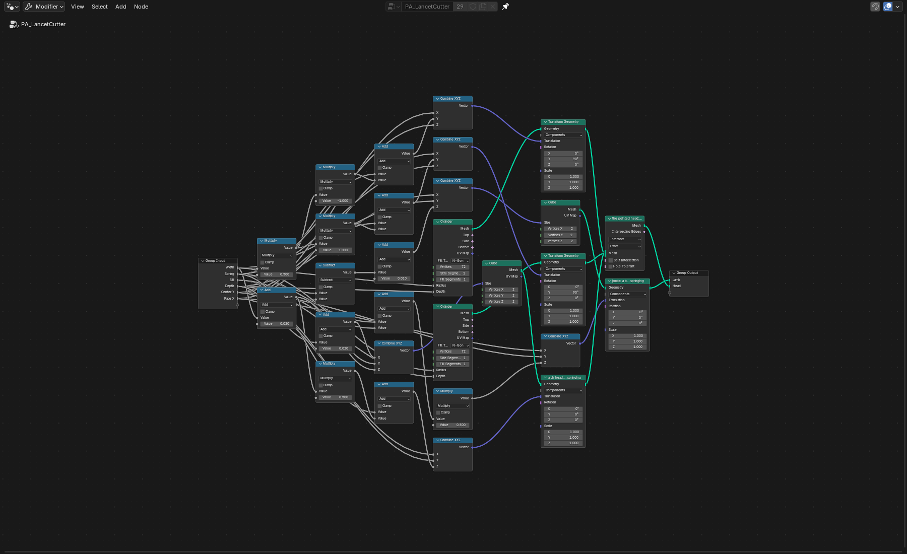

An equilateral pointed arch is the overlap of two circles. Each circle has a radius equal to the opening width and is
centred on the opposite jamb. The group builds `jambs: a box up to the springing` and
`the pointed head: two circles overlap`, an Intersect boolean of two 72-sided cylinders.

**Trick · a lens that stops at its springing.** The overlap of two circles is symmetric. It reaches as far *below* the
springing as above it, and under a high sill its lower tip cut an upside-down arch into the plain wall. So the
intersection has a third member, `arch head: clip lens above springing`, a box that keeps only the upper half.

### b · Arch mouldings of the three storeys

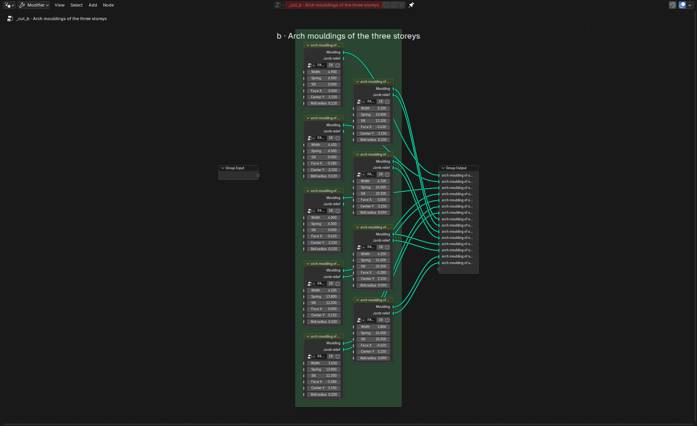

Nine calls of `PA_ArchMoulding`, one per order: three storeys × three orders. Each call gets the order's width
(opening + 0.9, + 0.45 or + 0), its springing and sill, the x of its arris (0, −0.28 or −0.62) and a roll radius:
0.12 m at the arcade, 0.10 at the tribune and 0.09 at the clerestory. The tribune and clerestory also use the
`Jamb relief` output. The arcade doesn't, because its orders land on the pier capital.

### Inside `PA_ArchMoulding`

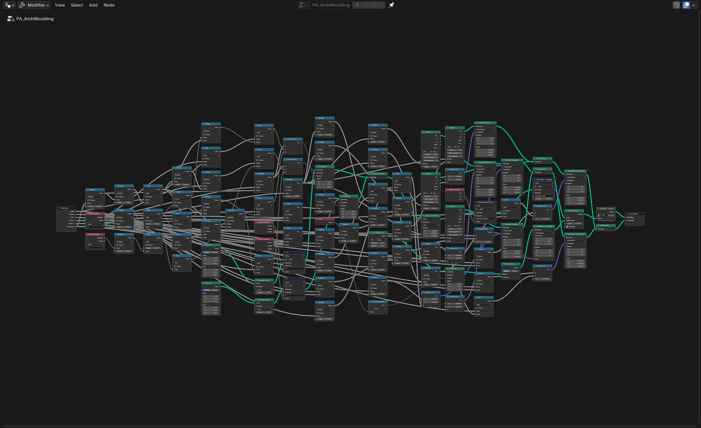

1. `the order's pointed arch, set back into the arris`: two circular arcs of 40 points each, set back from the arris by
   0.6 × the roll radius;
2. `section square to the wall`: **Set Curve Normal**, *Free*, (1, 0, 0), so the profile stays square to the wall all
   round the arch;
3. `distance along the laid stone` stores the curve length for the shader's block joints;
4. `moulding section, scaled by the roll radius`: a fillet, a small roll, a concave hollow, a larger roll and a
   chamfered shoulder, written for a roll of radius 1 and scaled to the call's `Roll radius`;
5. **Curve to Mesh**, then `crisp fillets, smooth arch curvature` (`PA_StoneNormals`).

`jamb relief: recessed behind order face` is a thin shaft and a small necking, flattened to 45 % depth and pushed back
behind the order's face, on each side of the opening.

### Trick · a moulding as a list of points

A carved section is a list of (x, y) points: arcs of a roll sampled as `sqrt(1 − (2t − 1)²)`, hollows as `sin(πt)`,
straight fillets between them. `polygon_section()` turns that list into geometry. It makes a **Mesh Circle** with one
vertex per point, moves each vertex to its point with an Index Switch on the vertex index, and converts the mesh to a
curve (`one continuous moulding section`). The same helper builds the rib section and the pilaster.

### Inside `PA_StoneNormals`

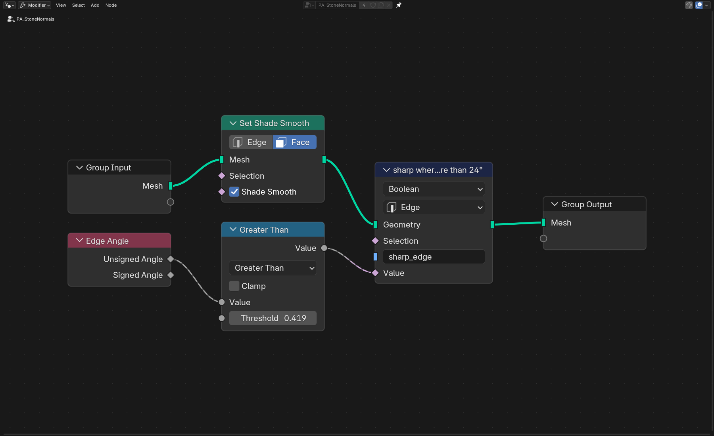

Shading a moulding smooth would round off its fillets. Shading it flat would show every one of the 80 segments of the
arch. This group shades everything smooth, then stores `sharp_edge` on edges whose **Edge Angle** is above 24°
(`sharp where the faces meet at more than 24°`). The carving's corners stay crisp, and the arch's gentle bend stays
smooth.

> **Try it:** in `_stone_normals()`, change `math.radians(24)` to `math.radians(1)`. Each step along a 40-point arc bends
> by about 1.5°, so now every step is "sharp", and the arches and ribs show their facets like cut polygons.

### c · Tympanum, triforium, rail, tracery and glass

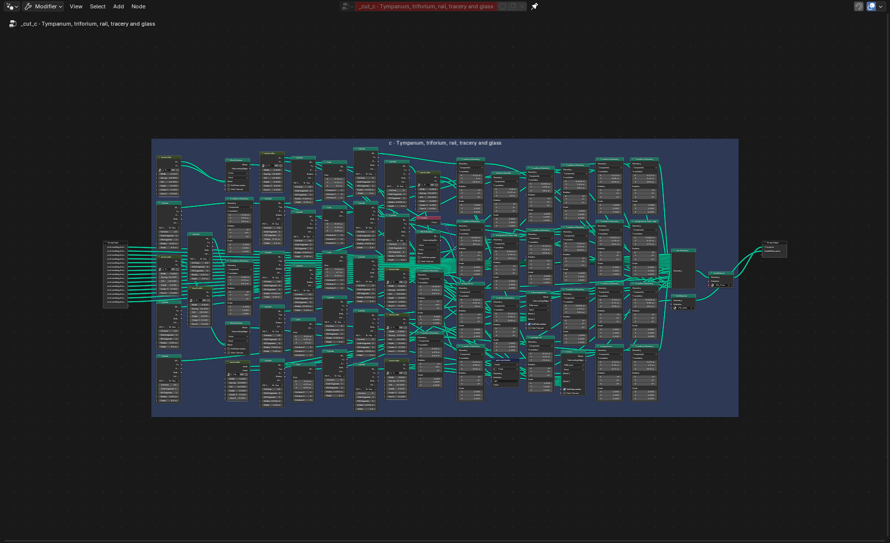

The small parts of the wall bay, in the order the eye meets them going up:

| Label | What it is | Numbers |
|---|---|---|
| `tribune tympanum` | a stone plate 0.22 m thick, 0.95 m inside the tribune, minus two sub-arches and an oculus | sub-arches 1.4 m wide at ±0.82 m, oculus r 0.45 m |
| `tribune colonnette` | the shaft under the tympanum's centre | r 0.11 m |
| triforium colonnettes | six shafts between the seven lancets | r 0.045 m |
| `string course`, `string course: lower step` | a stepped corbel at 17.55 m and at 19.95 m | 0.24 + 0.13 m deep |
| `passage rail` | the clerestory passage's parapet on nine posts | rail 1.05 m above the sill |
| `tracery` | the clerestory window: a plate 0.18 m thick, minus four lights, two oculi and a crowning circle | lights 0.8 m wide |
| `pane coordinates` | the glass, 0.62 m behind the wall face, with its position stored as `guv` | |

**Why are the glass and tracery so far forward?** A real clerestory window sits near the outside of a thick wall.
From the floor, at about 75° elevation, the reveal hides it completely. Here the tracery is 0.48 m and the glass 0.62 m
behind the inner face, so the windows read from below. The string courses are stepped corbels, not a round roll: from
28 m away, a free roll under a ledge reads as a pipe.

> **Try it:** in `wall_bay()`, delete the line `trim.append(tracery(g, yc, -0.48))`. The clerestory becomes one wide
> pointed light, glazed only with the glass's own diamond quarries. It now looks far too big for the wall.

### d · Pier and vaulting shaft

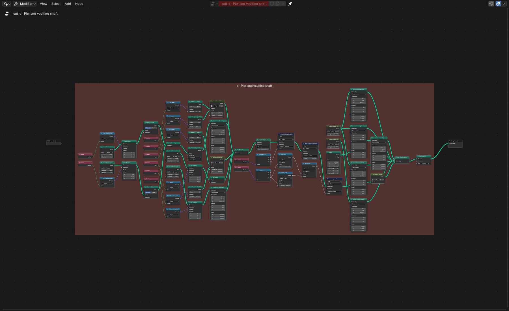

At Rouen, each pier is a round drum with shafts bundled round it. The front shafts carry on up the wall as a pilaster,
all the way to the springing of the vault. Here that whole run is **one closed surface**, not a stack of cylinders
glued with booleans.

1. **The section.** `compound_outline()` merges two 2D outlines in Python when the tree is built: an eight-lobed drum
   (radius `0.99 + 0.10 cos 8a + 0.018 cos 16a`, 192 points) and the pilaster's carved section. It runs a constrained
   Delaunay triangulation and keeps only the outer boundary, so the result is one outline with no holes. The outline
   goes into the tree as a point list, `section: x, y, relief weight`.
2. **The loft.** `one continuous shaft, neck, capital and abacus` is a `PA_SectionLoft` call. It takes that outline
   and 19 levels (`levels: z, scale, relief`): a plinth, the shaft, then a necking, a bell and an abacus that flare to
   108 % between 5.87 m and 6.58 m.
3. **The service.** A second loft, `upper service starts on the capital bearing`, carries the pilaster section from
   6.58 m to 20.32 m.
4. **The joint.** `one bearing surface, no overlapping joint faces` is a **Fill Curve** of two loops: the top of the
   capital and the foot of the pilaster. It makes a flat ring whose inner edge is the pilaster's bottom ring and whose
   outer edge is the capital's top ring. With the two caps, a **Merge by Distance** welds everything into
   `one joined pier and continuous vaulting service`: one connected, closed surface with no non-manifold edges.

Three `pilaster band, 10 cm` slices (`one continuous pilaster band`) mark the storeys at 13.8, 17.55 and 19.95 m.
`pilaster capital, 30 cm` and `abacus of the vaulting shafts` receive the ribs at the springing. Both bands and capital
are `PA_CarvedPilaster` calls: the pilaster section extruded to the given height, capped, welded and given
`PA_StoneNormals`.

### Inside `PA_SectionLoft`

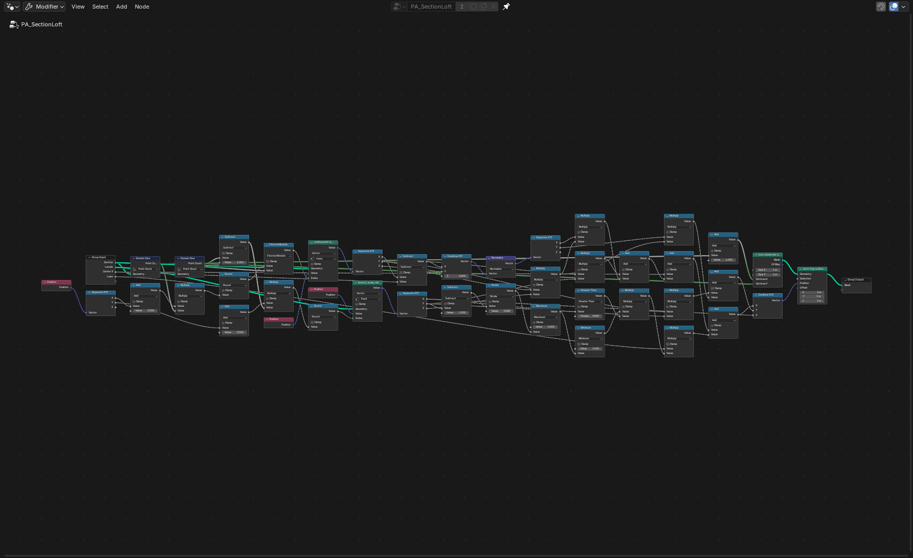

`one column per outline point, one row per level`: a **Mesh Grid** whose size comes from **Domain Size** of the two
inputs. Each vertex looks up its column's `outline point (x, y, relief weight)` and its row's
`level (z, scale, relief)` with **Sample Index**. Then `each ring: outline × scale + leaf relief at its height` places
it at height z, with its outline scaled about `Center X` and pushed outwards by `weight × relief`. That push is the
capital's foliage. The weights peak on the drum's lobes (`cos(8a)²`) and on the front rolls, so the leaves grow out of
the surface instead of being stuck on.

Because every ring is a row of the same grid, each level shares its vertices with the levels above and below. There
are no joints to hide.

### Trick · check the joint before building it

A Python `assert` in `continuous_pier()` tests 4 points on every edge of the pilaster outline against the capital's top
outline: "the upper shaft must lie completely inside its capital bearing". If a later edit to the pilaster pokes a
moulding out past the capital, the build stops instead of producing a ring with a hole in it.

> **Try it:** in `continuous_pier()`, change the capital's last scale (`(seat, 1.080, 0)`) to 1.0. The build stops on
> the assert above: without the flare, the pilaster's rolls stand outside the capital.

### e · The aisle behind

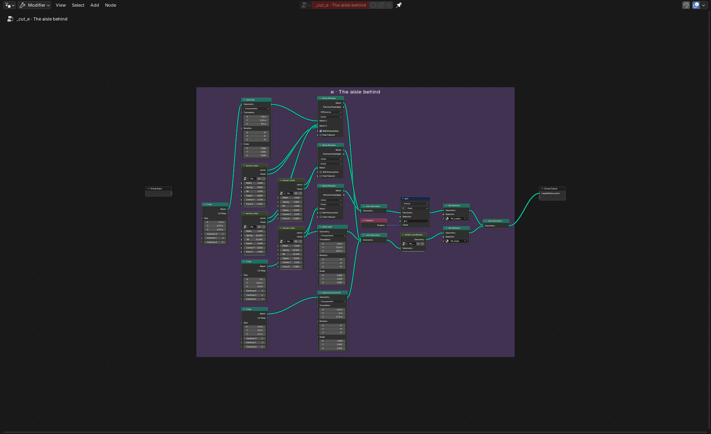

Through the arcade and the false tribune you see the aisle: 5.6 m wide, its outer wall pierced by two tiers of lancets
(2.4 m wide, springing at 9.0 and 15.2 m), under a flat `aisle vault` at 17.8 m with an `aisle transverse rib`. It is
a backdrop, so it is simple. `everything in one bay` joins frames a–e into the group's output.

---

## 2 · Ribs and bosses

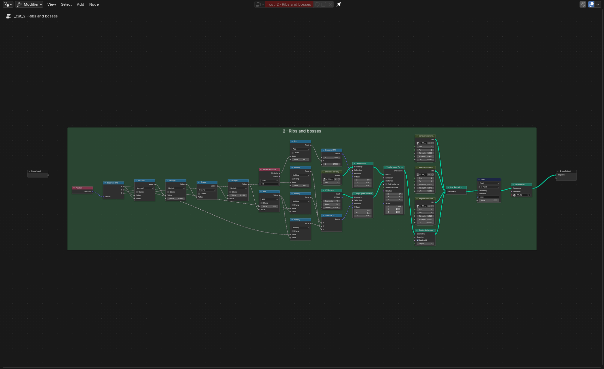

Three calls of `PA_HalfArch`:

| Call | Kind | Per bay | Section (wide × deep) | Lift |
|---|---|---|---|---|
| `transverse arches: 2 halves per bay` | 0 | 2 | 0.52 × 0.42 m | −0.16 m |
| `wall ribs (formerets)` | 1 | 4 | 0.30 × 0.34 m | −0.08 m |
| `diagonal ribs: 4 halves per bay` | 2 | 4 | 0.31 × 0.32 m | −0.12 m |

The *lift* lowers each rib below the vault surface, so its soffit hangs below the cells. Heavier ribs hang lower.

`eight-petal rosette`: a 48 × 16 **UV Sphere** of radius 0.55 m, its radius scaled by `1 + 0.18 cos(8a)` round z and
squashed to 45 % in height. `one boss per bay` hangs it at 27.58 m, at the centre of every bay. Rouen has no ridge rib,
so there is none here.

> **Try it** (in the node editor, no rebuild): set the diagonal call's **Kind** to 1. The diagonal ribs vanish, because
> that call now draws on top of the wall ribs. You can see the bare groins, where the courses of the two cell families
> meet on a skew line.

### Inside `PA_HalfArch`

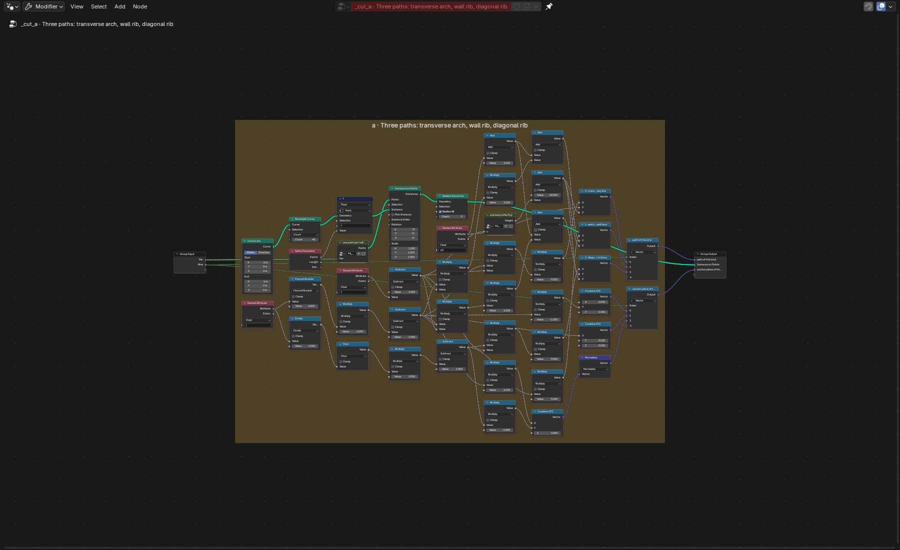

**a · Three paths.** `PA_Bays` gives Per points per bay. A 48-point line with a 0 → 1 parameter `t` is instanced on
each one. With u = 1 − t, `a` = ±1 from `j mod 2` and `b` = ±1 from `⌊j / 2⌋`, the three paths are:

| Kind | Label | Point at u |
|---|---|---|
| 0 | `0 · transverse arch: across the nave on the bay line` | `(a · u · W/2, y0, Zs + P(u))` |
| 1 | `1 · wall rib: along the wall face` | `(b · (W/2 − 0.05), y0 + B/2 + a · u · B/2, Zs + P(u))` |
| 2 | `2 · diagonal rib: corner to boss` | `(b · u · W/2, y0 + B/2 + a · u · B/2, Zs + P(u))` |

`path of this kind` and `section plane of this kind` are Index Switches on the **Kind** input. The plane is (0, ±1, 0)
for a transverse arch, (±1, 0, 0) for a wall rib, and for a diagonal the horizontal vector at right angles to the
diagonal.

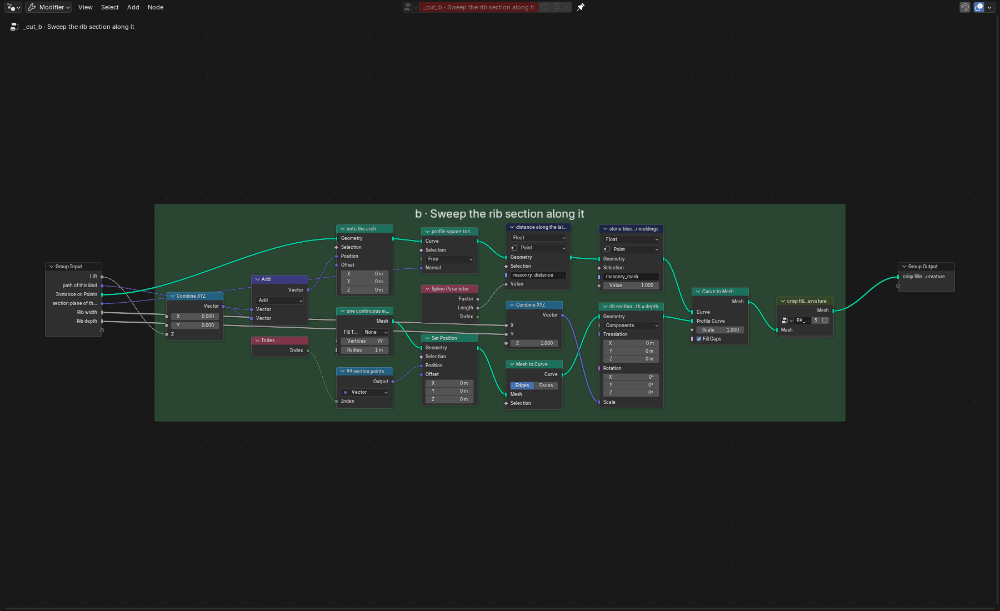

**b · Sweep the rib section along it.** `onto the arch` moves the curve onto its path, lowered by **Lift**.
`profile square to the arch's plane` sets the free normal. `rib section, scaled to width × depth` is a rounded soffit
roll with hollowed shoulders and small beads, written at unit size and scaled by **Rib width** and **Rib depth**.
**Curve to Mesh** and `PA_StoneNormals` finish it.

### Inside `PA_PointedProfile`

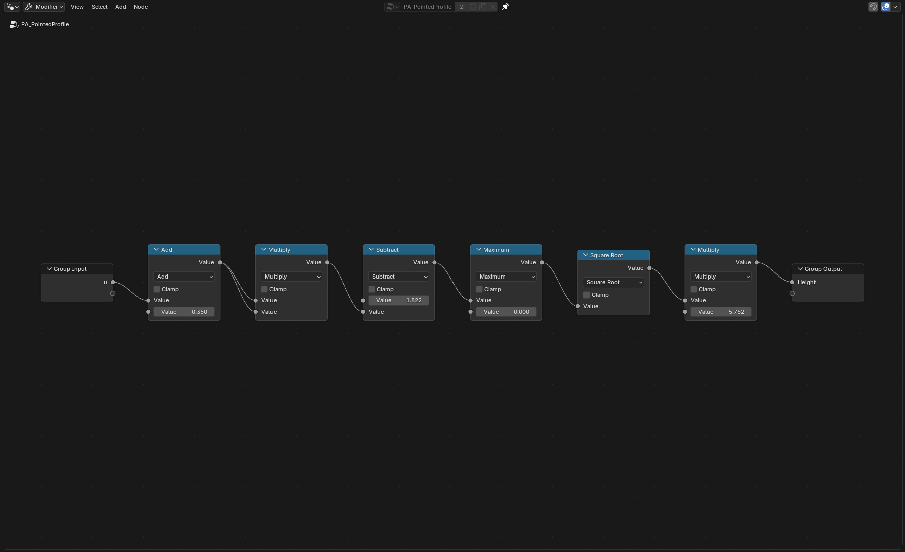

Eight nodes: `H / √(2ρ − 1) × √(ρ² − (u + ρ − 1)²)`. At u = 0 this is H, the crown. At u = 1 it is 0, the springing.
Every rib and the mortar bed call it. The cells use the same curve in angle form: `u = ρ cos θ − (ρ − 1)` and
`z = Zs + rz sin θ` describe the same ellipse. Because they all share one curve, they meet exactly. The diagonal rib
lies on the cells' crease, and the transverse arch lies on the cells' end, with no gap to hide.

> **Try it:** set `RHO = 1.0` and rebuild. The vault becomes round-arched, and the bay looks Romanesque. Ribs, cells and
> mortar all follow, because they share `P`. The wall arches don't change: they use `PA_LancetCutter`, which is always
> equilateral.

---

## 3 · Cells, stone by stone, and the mortar bed

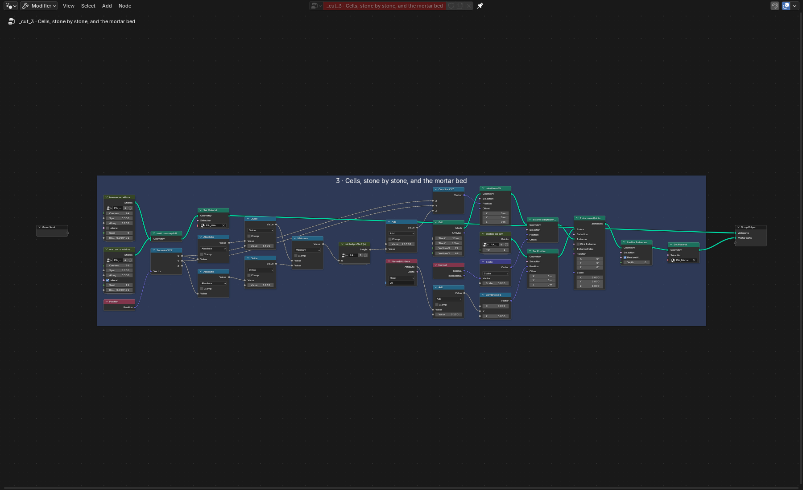

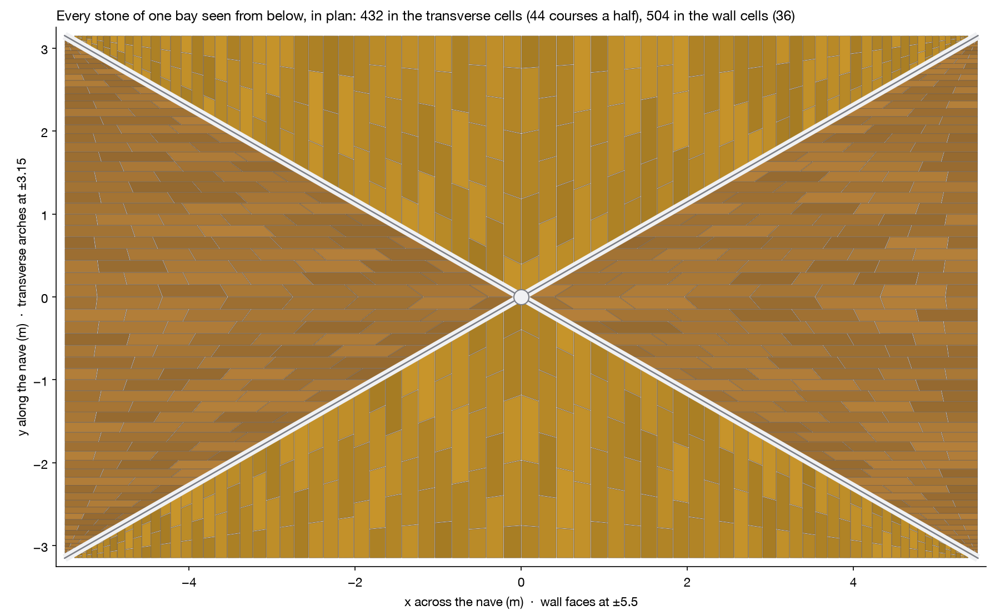

Two calls of `PA_VaultCells`:

| Call | Courses | Span, Along | Lateral | Seed |
|---|---|---|---|---|
| `transverse cells: axial running bond, 44 curved courses per half` | 44 | 5.5, 3.15 | off | 5 |
| `wall cells: axial running bond, 36 curved courses per half` | 36 | 3.15, 5.5 | on | 11 |

A transverse cell is a triangle between the two diagonals that touches a transverse arch. There, `min(u, v) = u`, so
the surface is a pure barrel running along the nave. The wall cells are the other two triangles, against the
clerestory walls. In them, span and length swap, and the courses run across the nave. The wall barrel's arc from
springing to crown is 8.50 m instead of 9.98 m, so 36 courses instead of 44 keep both families at about 23–24 cm a
course. **Row gap** is the 8 mm joint as a fraction of that arc, worked out in `cells()`.

`vault masonry follows the marked axial direction` joins both families and sets the `PA_Web` material.

`onto the soffit` and `a stone's depth behind` build the mortar: a 72 × 44 **Mesh Grid**, one bay in size, set onto
`Zs + P(min(u, v))` and pushed 6 cm along its normal. It is copied once per bay (`one bed per bay`). Without it, light
would leak through the 8 mm joints. With it, the joints read as dark warm mortar.

> **Try it** (in the node editor): set the transverse call's **Courses** to 22. Its courses are now 45 cm tall instead
> of 23 cm, while the wall cells keep their 24 cm courses. The two kinds of cell now look as if different masons laid
> them.

### Inside `PA_VaultCells`

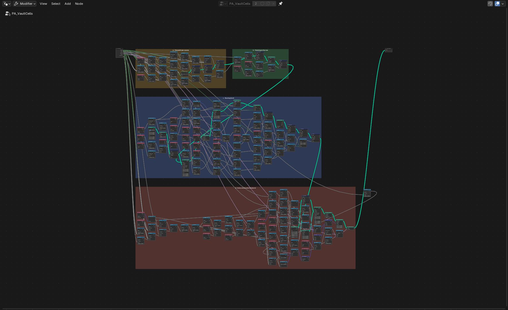

Real masons pave a barrel in courses along its axis, each course one step further round the curve. The group does
the same, in four frames.

**a · One point per course.**

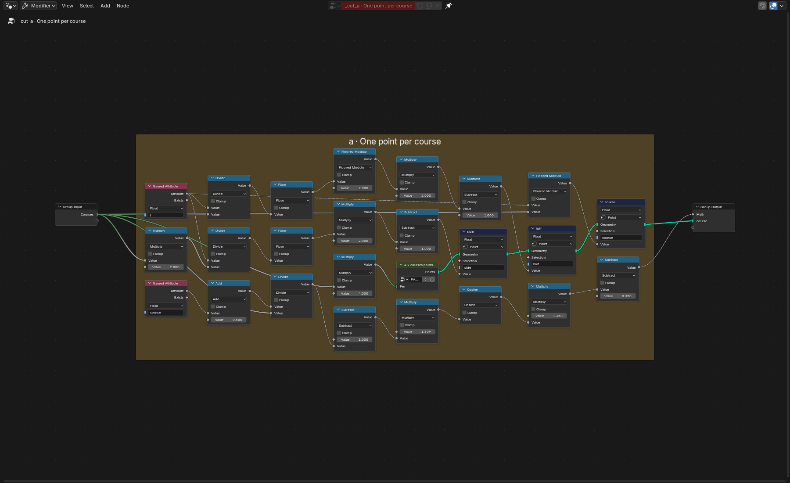

`4 × courses points per bay` makes `23 bays × 4 × Courses` points. On each it stores `side` and `half` (±1, which
quarter of the bay) and `course` (0 to Courses − 1). The course's angle round the barrel is
`θ = θtop × (1 − (course + ½)/Courses)`, with θtop = acos((ρ − 1)/ρ) ≈ 75°. From it comes `u = ρ cos θ − (ρ − 1)`.
This spaces the courses evenly *along the curve*, so the stones near the springing are not stretched.

**b · How long is the row.**

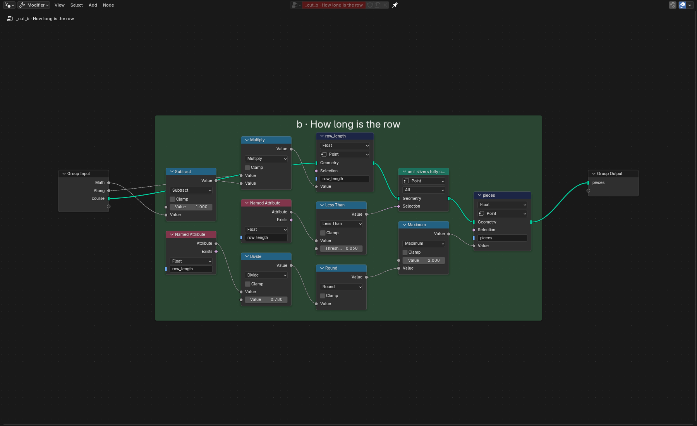

A course at u runs from the diagonal rib (where v = u) to the transverse arch (v = 1). Its length is
`row_length = Along × (1 − u)`: 3.15 m at the crown of a transverse cell, shrinking to nothing at the springing.
`omit slivers fully covered by the diagonal rib` deletes rows shorter than 6 cm, because the rib would hide them anyway.
Each row gets `pieces = max(2, round(row_length / 0.78))` stones.

**c · Running bond.**

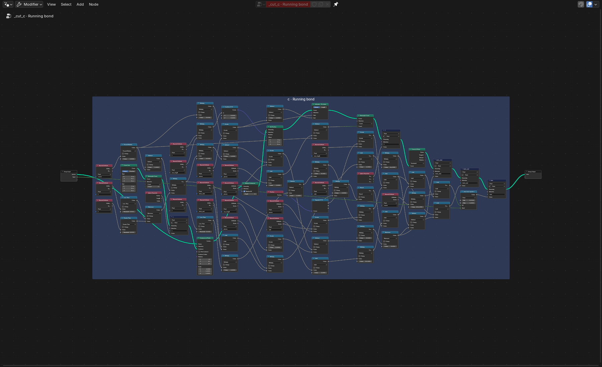

Each row becomes a two-point curve as long as the row. On odd courses, `alternate rows offset by half a stone` trims
half a stone off each end, and **Resample Curve** then places one point per stone centre. Even rows keep a point at
each end, which become half-stones. The result is the brick-wall pattern: every joint lands at the middle of the stone
above it. Each stone is stored as a span `brick_start … brick_end` along its row, less half the 8 mm joint on each
side.

**Trick · random per stone, identical per bay.** `stone tone repeats identically in every nave bay` gives each stone a
brightness between 0.91 and 1.03. Its ID is built from the stone's place *within* its bay:
`course × 256 + (side + 1) × 64 + (half + 1) × 32 + brick`. The bay number is left out. If it were included, the stone
that slides into a stone's place at the end of the loop would have a different tone, and the seam would flicker.

**d · Every stone onto the barrel.**

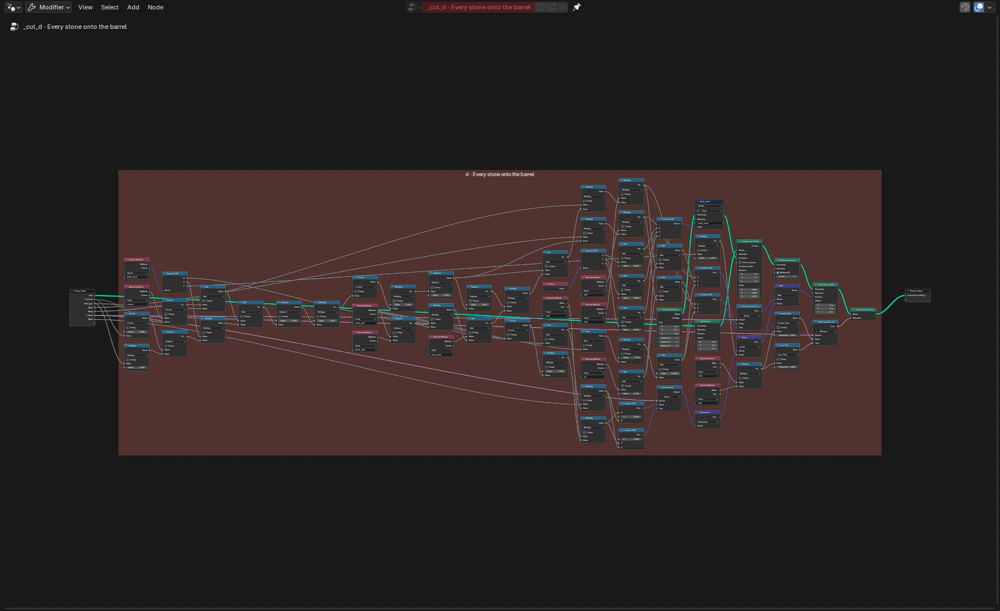

`subdivided brick parameter box` is a 2 × 3 × 2-vertex cube whose corners carry `brick_local` coordinates in 0–1. After
it is instanced on every stone point, `each stone conforms to the curved barrel and diagonal edge` maps each corner from
its parameter box onto the real surface:

- along the row: `v = u + (1 − u) × (brick_start + t × (brick_end − brick_start))`, so a stone at t = 0 of the first
  piece sits on the diagonal, where v = u, less half a joint;
- round the barrel: the course's own band of θ, less half a joint at each edge;
- outwards: up to 0.22 m along the barrel's normal, which is the stone's thickness.

`transverse cell: courses along y · wall cell: along x` and `barrel normal` are **Switch** nodes on **Lateral**. They
are the only place where the two families differ.

Because the mapping goes through the parameter, the stone that meets a diagonal is cut on the diagonal's skew line,
and every face lies exactly on the barrel. There are no flat boxes sticking out of a curved surface.
`masonry_review.json` measured the worst soffit error at under 0.008 mm, over 432 + 504 closed stones per bay.

**Flip Faces.** The four quarters of a cell are mirror images (`side` × `half`), and a mirror turns a mesh inside out.
`consistent winding on all four mirrored cells` flips the two quarters that are mirrored an odd number of times
(`which quarters are mirrored`): `side × half` < 0 for the wall cells, > 0 for the transverse cells.

> **Try it:** change `BRICK = 0.78` to `0.4` and rebuild. Each row now has about twice as many stones. The vault reads as
> brick, not cut stone, and the mesh almost doubles.

---

## 4 · The walk and the west end

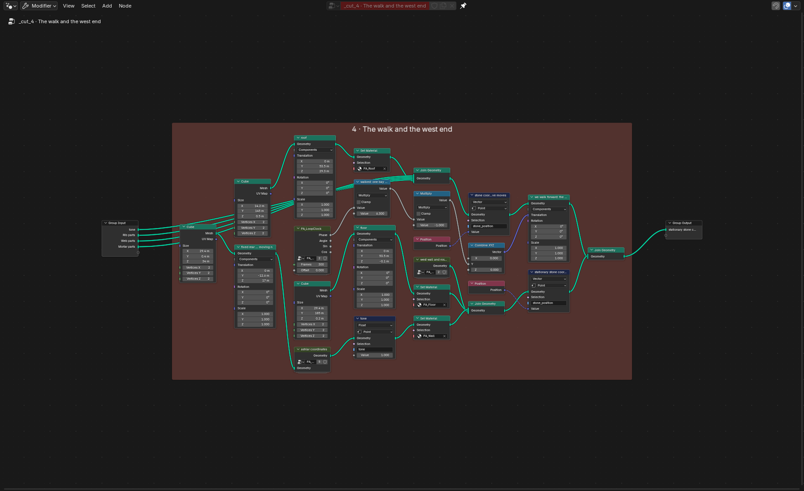

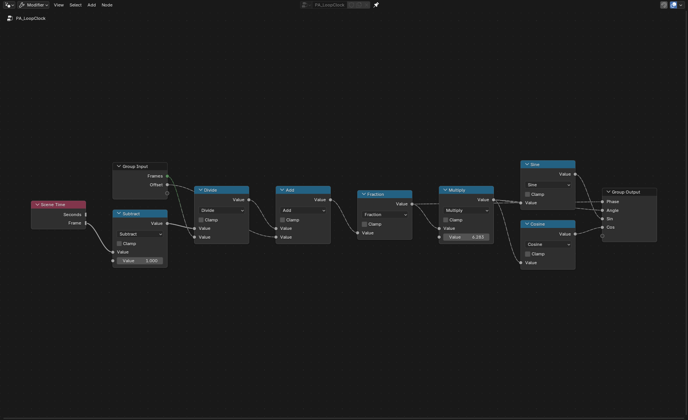

`PA_LoopClock` gives `Phase = fract((frame − 1) / 300)`, which is 0 at frame 1 and 0 again at frame 301.
`walked: one bay per loop` multiplies it by B = 6.3 m.

The nave (walls, ribs, cells, mortar, roof) is joined. Then two nodes do the walk:

1. `stone coordinates before the nave moves` stores each point's position as `stone_position`.
2. `we walk forward: the nave slides back one bay per loop` translates the nave by `(0, −walk, 0)`.

The camera never moves. The nave slides backwards past it. At frame 301 every bay sits where the previous bay sat at
frame 1, and since all bays are identical, the picture is identical.

Some things must **not** slide, and they are built after the Transform:

- `west wall and rose window` (`PA_WestWall`) at y = `WEST` ≈ 109 m: a wall with a rose window 8.8 m across (centre
  at 18.2 m), cut by a boolean, with three tracery rings, 16 spokes and a glass disc. If it moved, it would come 6.3 m
  nearer every loop and then jump back.
- **The floor** (`floor`).
- `fixed rear closure stops changing skylight through the moving nave end`: a wall at y = −12.6 m, about 11.6 m
  behind the camera. The nave's open rear end slides by 6.3 m over the loop, so without this wall a changing amount of
  sky would light the nave and the seam would show as a small jump in brightness.

`stationary stone coordinates` stores `stone_position` for these too, and both halves are joined into the output.

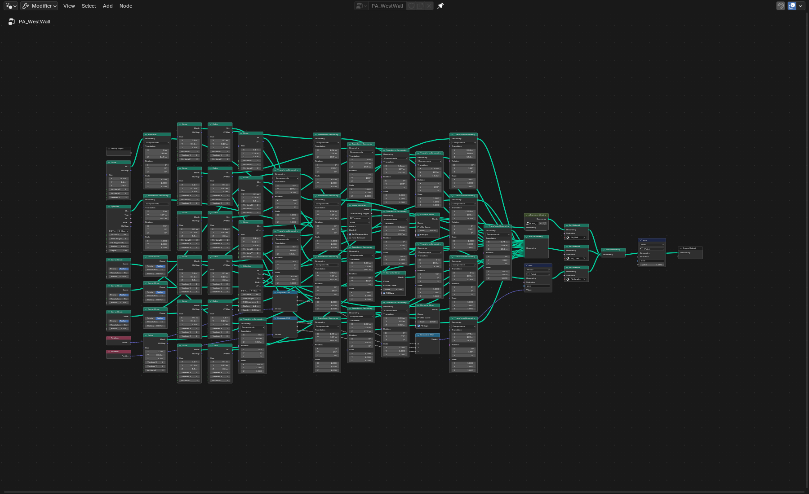

### Trick · texture that walks with the stone, and loops

The stone shaders read `stone_position`, not the live position, so the weathering stays on its stone as the nave
slides. That alone would break the loop: at frame 301 the stones are one bay further on, and the pattern would be
offset by B. So the shader group `PA_LimestoneNoise` wraps the y coordinate onto a circle of circumference B. It uses
**4D Noise** with `(x, cos(2πy/B) · B/2π, z)` as the vector and `sin(2πy/B) · B/2π` as W
(`4D noise: y wrapped onto a circle one bay round`). The noise is now periodic in y with period B, and the shift by one
bay is invisible.

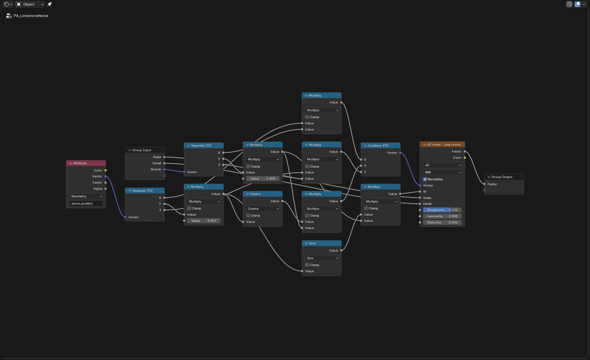

> **Try it:** in `build()`, multiply Phase by `2 * B` instead of `B`. The loop still closes, because two bays is also
> a period of the nave and of the noise, but the camera now walks twice as fast: 1.26 m/s instead of 0.63 m/s. One
> side effect: the clerestory lights' drivers still move one bay per loop, so their light drifts off the windows.

---

## Appendix A · materials

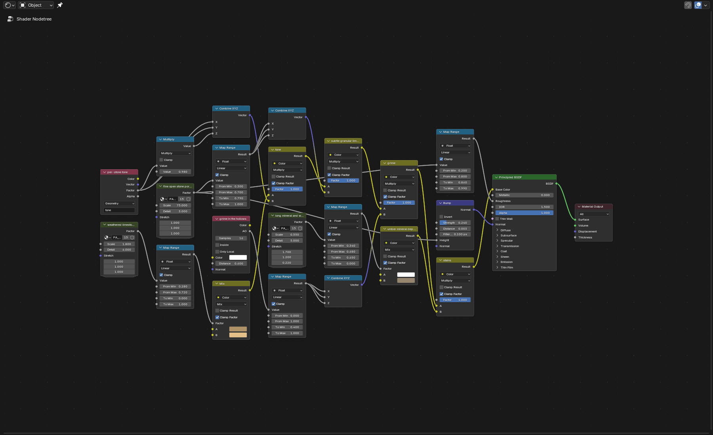

All the stone shares one recipe, `stone()`, with five colours: `Wall` and `Aisle` grey-taupe, `Trim` (all carved work)
a little lighter, `Rib` sandy, and `Web` (the cells) ochre `(0.69, 0.465, 0.22)`. Each uses `PA_LimestoneNoise` three
times. Layered by multiplication:

| Layer | Node label | What it does |
|---|---|---|
| base | `weathered limestone mottling` | 4D noise, scale 1.8, mixes between 63 % and 113 % of the base colour |
| per stone | `per-stone tone` | the `tone` attribute from sections 1–3 |
| pores | `fine open stone pores` | scale-75 noise: colour 0.79–1, roughness 0.86–0.99, and the bump height |
| blocks (walls) | `ashlar courses` | a Brick Texture on `auv`: 0.7 × 0.36 blocks, 7 mm mortar |
| blocks (mouldings) | `fine masonry joints, not applied collars` | a joint wherever `masonry_distance / 0.62` crosses a whole number, so one every 0.62 m along a rib or up a shaft |
| grime | `grime in the hollows` | Ambient Occlusion (0.6 m) darkens recesses by up to 74 % on trim |
| stains | `long mineral and water streaks` | noise stretched 0.22 × in z gives vertical umber streaks |

`PA_LeadedGlass` (`nodes-mat-glass.png` in the images folder) draws diamond quarries from `guv` with two
**Ping-Pong** maths (`u/0.15 ± v/0.22`) and a horizontal saddle bar every 0.84 m. Clear panes are transparent with a
pale cyan tint. An Emission, gated by **Light Path → Is Camera Ray**, makes the daylight seen *through* the glass glow
without lighting the nave.

## Appendix B · light

| Light | Setting | Why |
|---|---|---|
| `PA_Sun` | 10, colour (1.0, 0.88, 0.74), 30° up, heading 75°, 2° wide | a low warm sun through the far clerestory lays a patch on the near wall in every bay |
| `PA_Clerestory_…` | 46 area lights, 2.5 × 3.6 m, 35 W, pale blue, invisible to camera | soft sky bounce from each high window onto the vault webs |
| `PA_Fill` | 10 × 90 m area at 2.5 m, 1100 W, warm, pointing up | the lamps and the floor's bounce |
| world | (0.78, 0.85, 1.0) × 2.9 | sky through the aisle windows |

The clerestory lights have a driver, `y − 6.3 × fract((frame − 1)/300)`, so they slide with their windows. View transform
AgX Medium High Contrast, exposure 0.92.

---

## How it was rendered

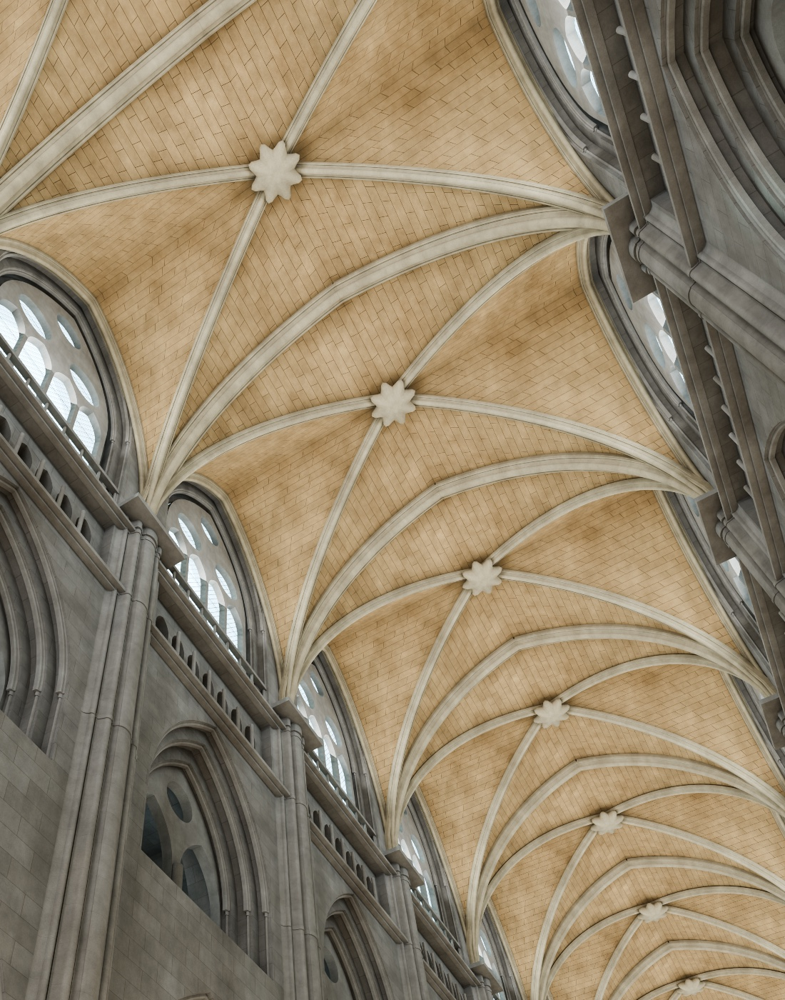

`rouen.blend` evaluates the whole tree, booleans included, on every frame. That is 3.76 million vertices. For the
animation, `prepare_color_video.py` makes `color/rouen_color.blend`. It splits the tree into two objects: the nave
without the walk Transform, and the still parts. A driver then moves the nave *object* by
`−6.3 × fract((frame − 1)/300)`. The geometry is the same (in the white-model test, cached and live frames differed by
at most 0.016 mean RGB on a 0–255 scale), but it is evaluated once, and **Persistent Data** keeps it between frames.

- Cycles, 1080 × 1080, 256 samples (adaptive threshold 0.01, at least 64), Blackman-Harris filter 0.9 px, OpenImageDenoise
  (accurate prefilter), fixed seed. No motion blur, no depth of field, no glow.
- The Ambient Occlusion nodes in the materials use 4 rays instead of 16, which changes a frame by 0.24 mean RGB.
- The 300 frames were split between the Mac (Metal, about 53 s a frame, 133 frames) and an RTX 4060 on the LAN
  through Flamenco (OptiX, about 33 s a frame, 167 frames). Frame 1 from the two devices differs by 0.26 mean RGB.
- Seam check (`color/loop_review.json`): every step between neighbouring frames is 3.66–4.11 mean RGB (median 3.79).
  The step from frame 300 back to frame 1 is 3.66, so the seam is no different from any other frame.

The loop was rendered before the tree was split into node groups. The grouped tree builds the same vault, ribs, mortar
and glass. The walls, carving and aisle come out within a few hundred faces of the original, because their boolean cuts
are now computed in single precision and the exact solver triangulates a few coincident faces differently. In
Workbench renders from three views, fewer than 30 of 810,000 pixels changed by more than 8 levels.

The camera is at (1.5, −1, 2), beside the nave's axis. It is turned 32° towards the far wall, tilted 48° up, with a
22 mm lens. `build.py -- --cam x,y,z,pitch,lens,roll,yaw` overrides it.

---

## The EEVEE version

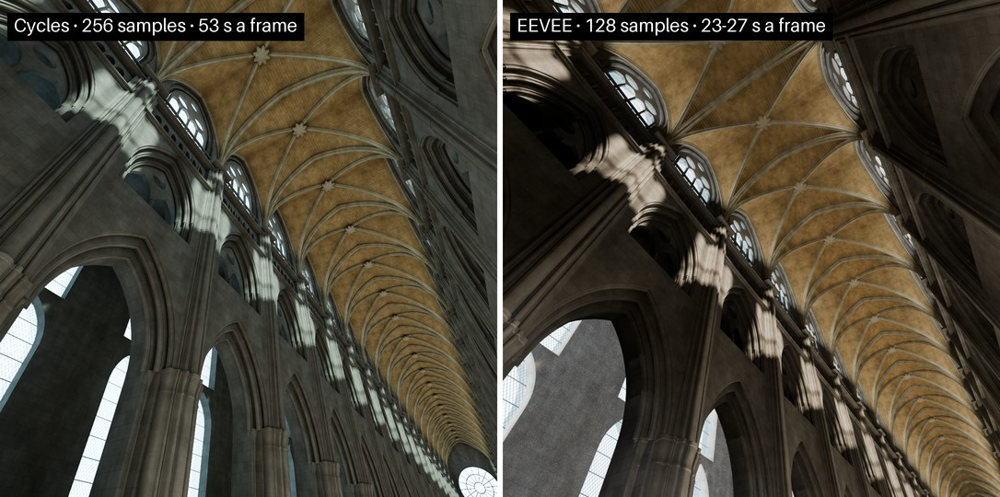

The same scene also renders in EEVEE, at 128 samples, in about 27 s a frame on the Mac or 23 s on the LAN farm's RTX
4060, instead of 53 s in Cycles. The geometry and the materials don't change at all. `eevee/prepare_eevee.py` opens
`color/rouen_color.blend`, switches the engine, adds baked light, and saves `eevee/rouen_eevee.blend`. Four problems had
to be solved on the way, and the last one is the interesting one.

### 1 · Indoors, EEVEE needs baked light

Cycles traces light through the clerestory windows, bounces it off the stone, and lets the sky in only where there is
a hole. EEVEE does that only for what is on screen (screen-space ray tracing and *Fast GI*). Everything else comes from
a **Light Probe Volume**: a 3D grid of points where the bounced light is baked in advance. With no probe, the sky lights
every surface as if there were no roof, and frame 1 averages 221 out of 255 instead of about 65.

- **It is parented to the moving nave object**, so the baked light slides with the stone it was baked on. (Moving a
  probe after baking moves its light with it; we checked by moving one 3 m and watching the frame change.)
- **It stops inside the aisle's outer wall.** The wall runs from |x| = 12.7 m to 13.9 m. The first volumes ended at
  13 m, so their outermost samples sat outside the church, saw the sky, and lit the aisle wall pale grey. Ending at
  13.3 m puts those samples inside the masonry, where EEVEE throws them away.

### 2 · Matching the light

Probes carry fewer bounces than a path tracer, so the far wall and the vault went dark. Three numbers bring the picture
back: the upward floor fill `PA_Fill` at 2.85 × its Cycles power, the clerestory window lights at 2.8 ×, and the
scene's indirect light at 1.5 ×. The window lights move with the nave, so lifting them can't disturb the loop.

What EEVEE can't give back is the sky seen *through* the windows lighting the stone: in Cycles it makes the cool,
almost white light on the near wall. In EEVEE that light only arrives through the blurry probe, so the picture is
warmer and the aisle seen through the arcade is lighter. The stone's fine pores are also sharper, because EEVEE has no
denoiser to soften them.

**Speed.** The 46 soft window lights each drew a shadow map of the 3.7 M-vertex nave on every sample. Switching their
shadows off took a frame from 78 s to 28 s and changed it by less than half a level. 64 samples would take about 40 %
less time, but the jittered soft shadows then turn grainy, and in motion that reads as boiling noise.

### 3 · What stays with the camera shows up as moving light, and as clipping

The camera never moves: the nave slides back one bay per loop. Everything that is *not* part of the nave (the west
wall with its rose window, the floor, the rear closure behind the camera, and the big floor fill) stays at a fixed
distance from the camera, so it travels with the viewer. Three artefacts came from that:

- **Sun patches sliding over the west wall.** Sun through the moving clerestory landed on the fixed west wall, so
  between about 1.5 s and 5 s its patches slid across stone that should be still. The sun is now **light-linked** to
  skip the stationary object (`PA_SunReceivers`, set to *Exclude*).
- **A flickering pier at the bottom left.** `PA_Fill` is a 10 × 90 m area light held still while the stone slides
  through its shadow map. Without jitter EEVEE estimates its soft shadow from a single shadow map, and the estimate
  jumped from frame to frame on the nearest pier. With **jittered shadows** the flicker band disappears, at the same
  brightness and cost.
- **Clipping at the far end.** The vault and the side walls slide *into* the fixed west wall, and the vault's section
  changes through each bay, so the line where they meet moved every frame and looked like geometry passing through the
  wall. No wall shape can hide that while the wall stands still and the nave moves. The EEVEE view therefore looks
  10° higher than the Cycles one (pitch 58° instead of 48°, same position, yaw and lens; `CAM_PITCH` in
  `prepare_eevee.py`), which keeps the whole west wall, rose window included, out of frame. The vault now runs out of
  the bottom-right corner instead of ending.

### 4 · Trick · bake an endless nave

The walk relies on one bay looking exactly like the next. With probes removed the loop is perfectly periodic (the
image after sliding one bay differs by 0.01), so any seam comes from the bake. The first bake drifted by about 10 levels
per bay: frame 300 → 1 jumped 12.6 mean RGB against 3.3 for an ordinary step. Switching off the sun, the fill, the
window lights, the sky or emission during the bake changed the drift by nothing. It came from the *shape* of the baked
field, which an orthographic view of the whole elevation shows directly:

- **Two volumes** (a fine near one and a coarse far one) met at y ≈ 50 m with a visible step in the light.
- **Surfels** (the light-catching discs the bake scatters over every surface) sit 0.25 m apart at the default density,
  and 6.3 m is 25.2 of those, so the pattern beat with a period of about six bays, 30 levels from bright to dark.
- **The end walls** (rear closure, west wall) are fixed at a distance from the camera, so the light near them is a
  world-fixed gradient. Baked into a volume that slides with the nave, a world-fixed gradient becomes drift.

The fix happens only during the bake:

1. one uniform volume from 70 m behind the camera to past the west wall, with cells of B / 6 = 1.05 m along the nave;
2. surfel density 16;
3. an **endless nave**: the end walls are cut out of a temporary copy of the stationary object, static copies of the
   nave run on two nave lengths before and behind, a long floor runs under them, and the fill reaches 45 m behind the
   camera.

Everything is put back before the file is saved. The drift over one bay fell from 10 to 2.3 (half size), and at full
quality, before any fade, the seam measured 4.9 against 3.0 for an ordinary step (at the earlier, lower view).

**Closing the last two levels.** `render_eevee.py --alt` renders an *alt pass* with the nave and its window lights one
bay further on (the drivers use `phase − 1` instead of `fract(phase)`). The geometry is identical, because the nave is
periodic; only the baked light is shifted by a bay, so **alt frame 301 is exactly main frame 1**. `eevee/crossfade.py`
blends the main pass into the alt pass over the last second:

`loop = (1 − φ) · main + φ · alt`, with φ = (frame − 270) / 30 for frames 271–300

Blending two renders would normally give ghosts, but every edge is in the same place in both, so only the light
mixes. The first version needed the blend across the whole loop (600 frames), because undoing 10 levels in a short fade
showed as the vault darkening. With 2 levels left, 30 extra frames are enough.

Seam check (`eevee/loop_review.json`): ordinary steps are 2.77–3.25 mean RGB (median 2.98), and the step from frame 300
back to frame 1 is 3.19. The vault stays between 76.3 and 78.8 all the way round.

**Rendering it.** All 330 frames run on the farm through Flamenco (about 23 s a frame, plus about 27 s at the start of
each 25-frame chunk). The farm can't apply the `--alt` driver change at render time, so it gets its own copy,
`eevee/rouen_eevee_alt.blend`. Mac and farm frames differ by about 3 levels with the jittered fill shadow, so a single
pass stays on one device; a small sync script copies the frames back as they finish.

## Try it yourself

1. **Drop the diagonals** (node editor). In section 2, set the diagonal `PA_HalfArch` call's Kind to 1. You see the
   bare groins where the two families of courses meet.
2. **Taller courses** (node editor). In section 3, set the transverse `PA_VaultCells` call's Courses to 22. The two
   cell families stop matching.
3. **Round the vault.** `RHO = 1.0`, then rebuild. The whole vault turns Romanesque, while the pointed windows stay
   Gothic.
4. **Smaller stones.** `BRICK = 0.4`, then rebuild. The cells turn to brickwork, and you can see why running bond needs
   the half-stones at the row ends.
5. **Change the hour.** `SUN_ELEVATION = 50`. The light through the far clerestory falls more steeply, so the sun
   patches slide down the near wall, from the triforium towards the tribune. Then try `SUN_HEADING = 255`. The sun now
   comes from the near side, and the patches move to the opposite elevation.
6. **Longer bays.** `B = 8.0` stretches every bay. The diagonal ribs flatten and the wall ribs get wider. The loop still
   closes in the `.blend`, but `prepare_color_video.py` has 6.3 written into its drivers, so change it there too before
   rendering an animation.
7. **Rebuild from scratch:**

   ```bash
   /Applications/Blender.app/Contents/MacOS/Blender -b --factory-startup --python build.py
   # then, for the animation scene:
   /Applications/Blender.app/Contents/MacOS/Blender -b rouen.blend --python prepare_color_video.py
   ```

   `--look 1` renders a half-size 48-sample check of frame 1, and `--clay` writes the white model.
8. **The EEVEE loop:**

   ```bash
   B=/Applications/Blender.app/Contents/MacOS/Blender
   $B -b color/rouen_color.blend --python eevee/prepare_eevee.py                # switch engine, bake the probe
   $B -b eevee/rouen_eevee.blend --python eevee/render_eevee.py                 # main pass → eevee/frames/
   $B -b eevee/rouen_eevee.blend --python eevee/render_eevee.py -- 271 300 --alt  # alt pass → eevee/frames_alt/
   uv run --with pillow --with numpy python eevee/crossfade.py            # blend → frames_loop/, loop.mp4
   uv run --with pillow --with numpy python eevee/seam_check.py           # loop_review.json
   ```

   Then try `FILL_BOOST = 1.0`, `WINDOW_BOOST = 1.0` and `INDIRECT = 1.0` in `prepare_eevee.py` to see EEVEE's own,
   much darker, idea of the nave.

*Made with Blender 5.2 Geometry Nodes for [Nodevember](https://nodevember.com) 2026, Day 6 · Vault.*
