# How eleven steel trees wake up after the rain

*A node-by-node walkthrough of Nodevember 2026 · Day 7 · Tree*

It is blue hour in an imagined garden, after the rain. Eleven tree-shaped towers stand over a dark tropical garden.
Their trunks are wrapped in ferns, and each opens into a wide steel crown around a bowl of violet light. Over eight
seconds the light comes on tree by tree: first the big tree on the left, then a suspended skyway, then the near tree
cut off by the right edge, then the grove behind. The shot plays once and then holds; it is not a loop. Every visible
mesh is a Geometry Nodes tree on an object with no geometry of its own. There are no imported models, image textures,
simulations or keyframes. The timing is done with drivers: a clock in the shaders and the power of eleven area lights.

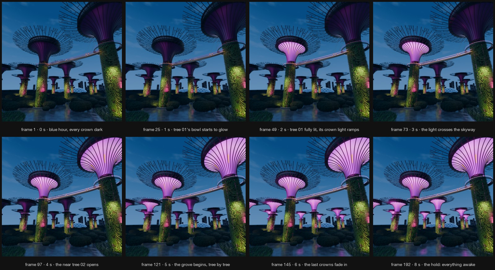

| File | What it is |
|---|---|
| [`../awakening.mp4`](../awakening.mp4) | the render: 960 × 960, 192 frames at 24 fps (8 s), EEVEE 64 samples |
| [`../render.png`](../render.png) | the hero still, 1440 × 1440, frame 168, EEVEE 96 samples |
| [`../piece.blend`](../piece.blend) | the scene. Each **PA_Supertree_01 … 11** object, **PA_Skyway**, **PA_RainGarden**, **PA_GardenAndSkyline** and **PA_LowRainMist** has one Geometry Nodes modifier |
| [`../build.py`](../build.py) | the script that builds the whole file; every node in this tutorial comes from it |
| [`../verify.py`](../verify.py) | checks the saved file: the audit, the light skin's shape and the steel frame's topology |

Units: **1 unit = 1 m.** The big left tree is 40 m tall; its light bowl is about 20 m across and its branch tips
reach about 39.5 m across.

This is an artistic interpretation of the Supertree Grove at Gardens by the Bay in Singapore, not a measured model.

---

## The one idea

> **One silhouette, many parts.** Every part of a crown is placed on the same curve, the profile R(u), Z(u). The
> light skin, its rim, the curved main ribs and every station where a branch joins sit on that curve, or at a fixed
> offset from it. So if you change the curve, the steel and the light change together.


Everything else answers one of these questions:

- **What shape is the bowl?** For u from 0 to 0.65, a quarter of an ellipse. It leaves the neck going straight up and
  reaches the rim almost flat. From 0.65 to 1.045 a straight, gently rising fringe carries the branches out to 1.05
  times the Crown Radius ([section 1](#1--one-profile-for-everything)).
- **How is the steel laid out?** 32 ribs. Each one ends in the same small set of straight bars between named stations
  on the profile. Neighbouring ribs alternate between a module and its mirror image, so the joints are staggered
  ([section 3](#3--crown-framework)).
- **When does each part light up?** Every point stores two numbers: `delay`, which is per tree, and `flow`, which is
  its height divided by the tree's height. A clock in the shader computes when the light reaches that point
  ([section 6](#6--light-arrival)).

### How to read the screenshots

Each tree in `piece.blend` is laid out in coloured frames, one per step, in the order the data flows. The frames in
the object trees are numbered `1 · Planted trunk`, `2 · Crown framework` and so on. The frames in the helper groups
are lettered `a · Quarter-ellipse bowl`, `b · Straight branch fringe`.

- Below each heading there is a **cut-out** of just that frame's nodes. Wires coming from another frame enter through
  a **Group Input** on the left, named after what they carry, such as `trunk radius r = 0.0625 h`. Wires that leave go
  to a **Group Output** on the right. Geometry with a material leaving a frame is named after the material, such as
  "PlantingFelt parts".
- Node titles such as `crown radius R(u)` or `arrival = 1.05 delay + 1.65 flow` are the labels in the `.blend`.
  **Store Named Attribute** nodes are titled with the attribute they write (`frame_radius`, `panel_u`, `delay`,
  `flow`).
- `build.py` uses a few small helpers everywhere, and each one turns into a handful of nodes. A clamp is a Maximum
  and a Minimum. A smoothstep is a clamp followed by t²(3 − 2t). A tube is a **Curve Circle** used as the profile of a
  **Curve to Mesh**. `shade` is **Set Shade Smooth** plus **Set Material**.

Click any screenshot to see it at full size.

---

## 0 · The map


| # | Section | Tree · nodes | Job |
|---|---|---|---|
| 1 | **One profile for everything** | `PA_CrownProfile` · 25, `PA_CrownPoint` · 11 | the silhouette R(u), Z(u), and a point on it for any rib phase |
| 2 | **Planted trunk** | `PA_SupertreeArchitecture` frame 1, `PA_FernAndBromeliad` · 46 | a bumpy cylinder covered in fern rosettes |
| 3 | **Crown framework** | `PA_SupertreeCrownFrame` · 64, `PA_RibModule` · 96 | 32 curved ribs, each ending in a module of straight bars, welded into one graph |
| 4 | **Light bowl** | `PA_SupertreeArchitecture` frame 3 | a 64 × 193 grid wrapped onto the profile, plus a steel rim |
| 5 | **Core, cap and balcony** | `PA_SupertreeArchitecture` frames 4 and 5 | the cone inside the bowl, the dark cap, pink light lines and the visitor balcony |
| 6 | **Light arrival** | `PA_SupertreeArchitecture` frame 6, two materials, eleven drivers | `delay` and `flow`, the shader clock, the crown lights |
| 7 | **Eleven trees** | `PA_Supertree_01_GN` … `_11_GN` · 1 each | one group node with six controls per tree |
| 8 | **Skyway** | `PA_Skyway_GN` · 185 | a cubic Bézier deck between the two front balconies |
| 9 | **Garden, skyline and sky** | `PA_RainGarden_GN` · 178, `PA_GardenAndSkyline_GN` · 167 | plaza, planting, visitors, tree canopies, land, towers, domes, mist and light |

`PA_SupertreeArchitecture` has 185 nodes in total. Node counts leave out frames and group inputs and outputs.


Each bar is computed from `build.py`: frame = 1 + 24 × seconds. In the grey band (from 6.55 s, frame 158, to the
end) every light is fully on and nothing changes. The hero still is frame 168, 6.96 s in.

---

## 1 · One profile for everything

`PA_CrownProfile` takes a parameter `u` and three sizes (Height h, Trunk Radius r, Crown Radius R) and returns a
radius and a height. It is the only place where the crown's shape is defined.

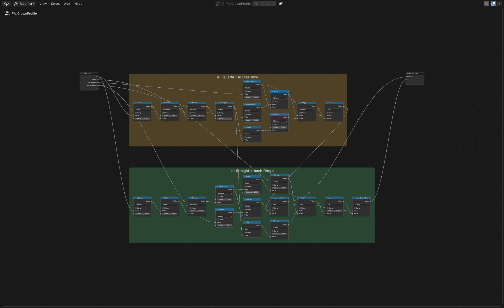

### a · Quarter-ellipse bowl

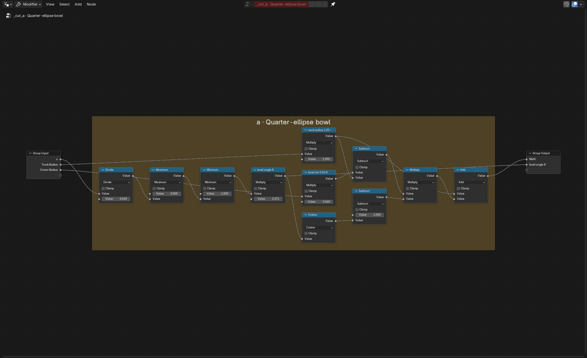

The first 65 % of u is the bowl. `bowl angle θ` goes from 0 to π/2 as u goes from 0 to 0.65. Then:

- radius = `neck radius 1.09 r` + (`bowl rim 0.56 R` − neck) × (1 − cos θ)
- height = h × (0.65 + 0.25 sin θ) (this sum is built in frame b, next to the fringe term)

Those are the two halves of an ellipse: a horizontal semi-axis of (rim − neck) and a vertical one of 0.25 h, centred
at the rim's radius and the neck's height. At θ = 0 the curve leaves the neck going straight up. At θ = π/2 it
arrives at the rim going straight out. For tree 01 (h = 40, R = 18.5, r = 2.5) the neck is 2.73 m from the axis at
26 m, and the rim is 10.36 m out at 36 m.

### b · Straight branch fringe

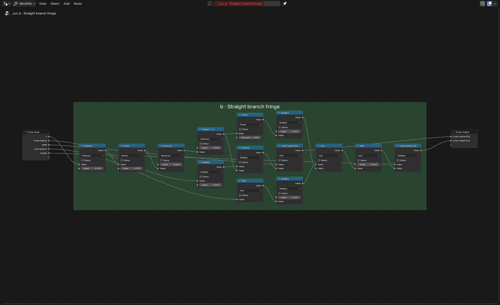

Past the rim, `fringe 0 → 1` runs from 0 at u = 0.65 to 1 at u = 1.045. It adds 0.49 R to the radius and lifts the
height by 0.065 h × fringe^1.35. The power bends the fringe up a little at the end, like branches that rise towards
their tips. At u = 1.045 the radius is (0.56 + 0.49) R = 1.05 R: 19.42 m on tree 01, at 38.6 m.

### Trick · one group, two offsets

The profile is a group, so the skin and the steel can't drift apart. Each part only applies its own small offset:

| Part | Radius | Height | u range |
|---|---|---|---|
| light skin (section 4) | × 0.96 | + 0.12 m | 0.0125 → 0.65 |
| skin rim (section 4) | × 0.96 | + 0.18 m | 0.65 |
| main rib and frame stations (section 3) | × 1.018 | − 0.17 m | 0 → 1.045 |

So the steel always runs just outside and just below the light. From the garden you look up at the bowl, and the
ribs cross in front of the glow as dark lines. There is no fake stripe painted on the skin.

### `PA_CrownPoint`

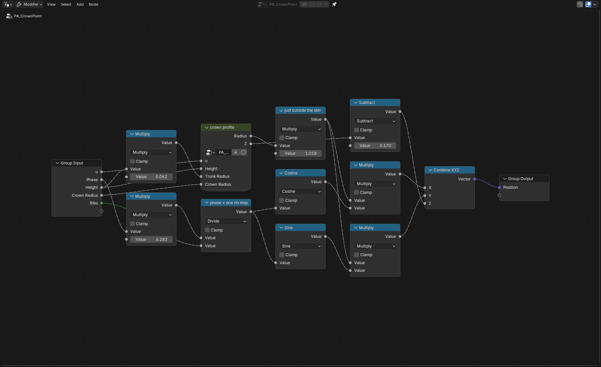

The frame needs points, not just a radius. `PA_CrownPoint` turns (u, Phase) into a position. `just outside the skin`
is the radius × 1.018, and `phase × one rib step` is Phase × 2π / Ribs. So Phase 0 is on the rib, and Phase ±0.24 is
about a quarter of the way to the next rib on either side. The rib module in section 3 is written entirely in these
(u, Phase) pairs, so it fits any size of tree and any number of ribs.

> **Try it:** in `PA_CrownProfile`, change the 0.56 in `bowl rim 0.56 R` to 0.45. The light bowl gets narrower, and
> so do the ribs and every branch station, because they all read this node. The tips move in to (0.45 + 0.49) R =
> 0.94 R. The dark cap does not follow: its discs are sized from R directly (section 5), so it now overhangs the bowl.

---

## 2 · Planted trunk

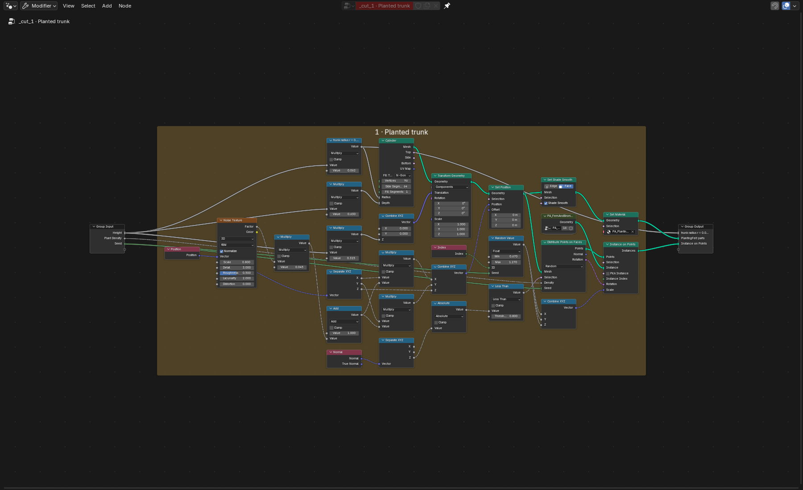

`trunk radius r = 0.0625 h` sets every horizontal size near the trunk: 2.5 m for a 40 m tree. The trunk is a
**Cylinder** with 96 vertices around, 64 side segments, radius r and depth 0.63 h, moved up so that it stands on
the ground. A **Noise Texture** (scale 0.8, detail 3) scales each vertex's X and Y by 1 + 0.045 × noise, so the
planted wall bulges a little, like a real living wall. The material is `PlantingFelt`, almost black green.

**Distribute Points on Faces** then scatters points with the tree's **Plant Density** (points per m²) and **Seed**.
The selection |normal.z| < 0.8 keeps only the sides, so the top and bottom caps stay bare. Each point gets one
`PA_FernAndBromeliad` rosette, rotated by the distribution's own **Rotation** output, so that the rosette's up axis
points out of the wall. A **Random Value** seeded with the tree's Seed gives each rosette a size from 0.67 to 1.27.
Tree 01 has about 396 m² of wall at density 8, so it carries about 3,200 rosettes.

### Inside `PA_FernAndBromeliad`

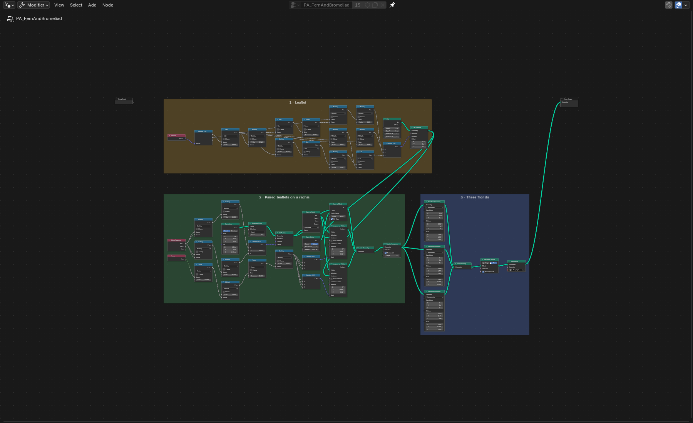

| Frame | What it does |
|---|---|
| `1 · Leaflet` | A 9 × 3 **Grid** bent into a leaflet 0.29 m long. Its width follows sin(πf)^0.7, so it is pointed at both ends, and it arches up by 0.025 sin(πf). |
| `2 · Paired leaflets on a rachis` | A line 0.95 m long, resampled to 14 points and curved by (0.38 f², 0, −0.22 f²). Two **Instance on Points** place a leaflet on each side at ±1.02 rad, shrinking towards the tip as 0.95 (1.02 − f)^0.65. A thin tube is the stem. |
| `3 · Three fronds` | Three copies of the frond, tilted 0.35, 0.55 and 0.7 rad and turned 0, 2.2 and 4.5 rad, at sizes 1, 0.85 and 0.65. |

The same group is reused in the garden beds (section 9), only bigger.

> **Try it:** on **PA_Supertree_01**, set Plant Density from 8 to 2. The wall shows through between the rosettes, and
> the trunk reads as a steel tower with a few plants rather than a living tree. Seed changes which points get used,
> not how many there are.

---

## 3 · Crown framework

Frame `2 · Crown framework` of the tree holds a single node: the group `Connected branching framework`, which is
`PA_SupertreeCrownFrame`. It has three outputs. **Geometry** is the steel you see. **Skeleton** is the welded
centre-line graph that `verify.py` checks. **Bay** is two neighbouring modules alone, for the inspection picture.

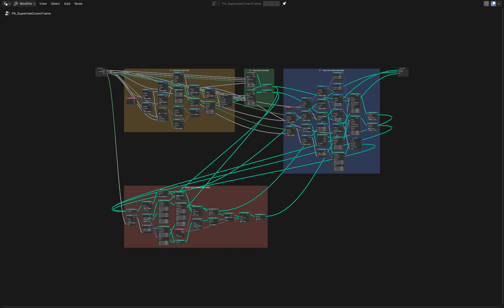

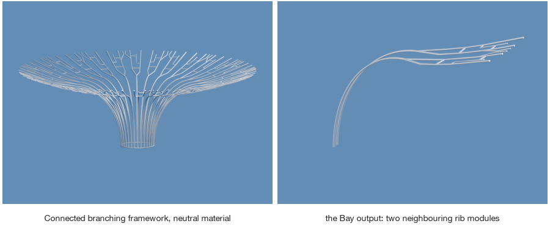

### 1 · Curved main rib

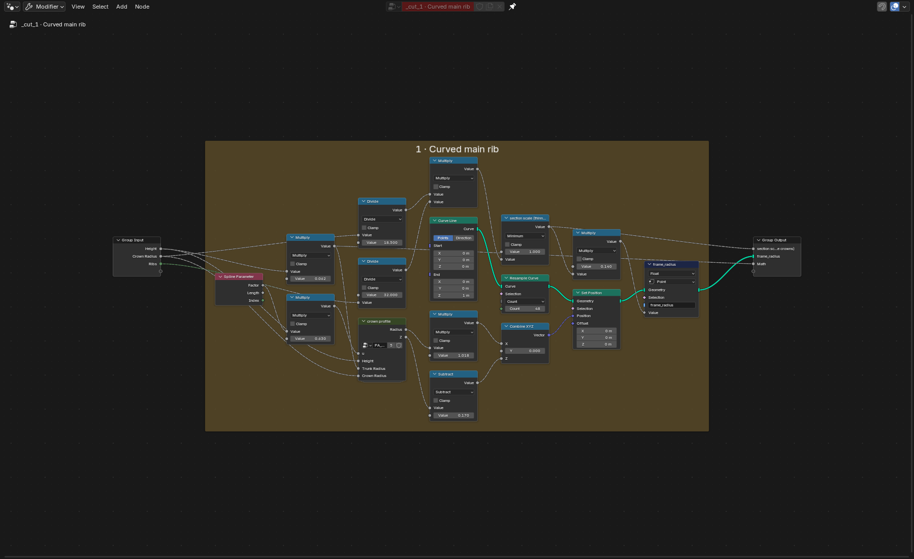

The main rib is a **Curve Line** resampled to 48 points. Its **Spline Parameter** factor, times 0.63, is u, so the
rib runs from the neck to just before the bowl rim. Set Position puts each point at (R(u) × 1.018, 0, Z(u) − 0.17):
the curve of section 1, in the XZ plane. A **Store Named Attribute** writes `frame_radius` = 0.14 × section scale.
The steel's thickness travels as an attribute until frame 4 turns the curves into bars.

`section scale (thinner on small, dense crowns)` is min(1, (R / 18.5) × (32 / Ribs)). The hero trees keep full-size
bars. The smallest crowns (R = 11) get bars 0.59 times as thick, so that the gaps between them stay open.

### 2 · Two rib modules

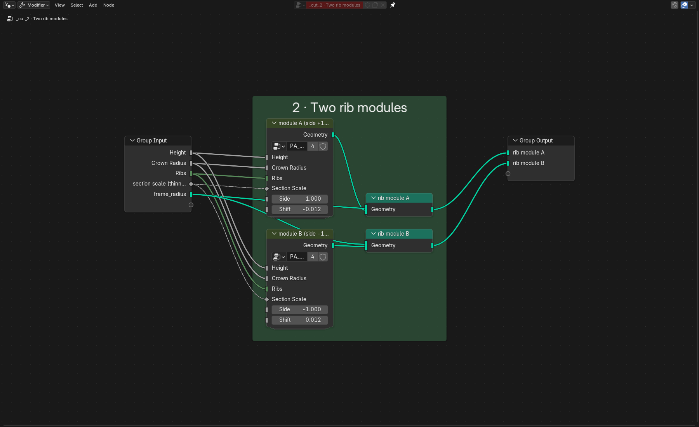

The outer branching of one rib is the group `PA_RibModule`. It is used twice: `module A (side +1, shift -0.012)` and
its mirror image `module B (side -1, shift +0.012)`. Each is joined with the main rib to give `rib module A` and `rib
module B`.

#### Inside `PA_RibModule`


The drawing shows two modules "unrolled": distance from the axis across, arc length around the crown up. Each
station is one `PA_CrownPoint` node, named in the file after the station and its u:

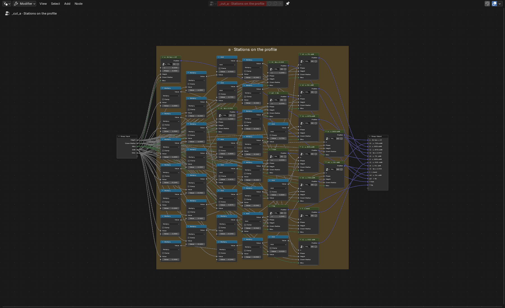

| Station | u | Phase | Role |
|---|---|---|---|
| `a · rib top u .63` | 0.63 | 0 | where the rib ends and the rails split |
| `l0 · u .735+shift`, `lt · u .805+shift`, `l1 · u .875+shift`, `l2 · tip u 1.045` | 0.735, 0.805, 0.875 (+ Shift), 1.045 | −0.24 | the first long rail |
| `r0 · u .75-shift`, `rt · u .805+shift`, `r1 · u .925-shift`, `nt · u .96-shift`, `r2 · tip u 1.045` | 0.75, 0.805, 0.925, 0.96 (± Shift), 1.045 | +0.24 | the second long rail |
| `f · L bend`, `mt · u .96-shift`, `g1 · L tip` | 0.875 + Shift, 0.96 − Shift, 0.995 | −0.04 | the L bracket, running close to the rib line |
| `Y fork`, `Y tip` | 0.995, 1.045 | +0.46, +0.42 | the short outward fork |

All phases are multiplied by **Side**, so module B is the mirror of A. **Shift** (−0.012 in A, +0.012 in B) slides
the joints of the two rails in opposite directions, so the ties of neighbouring ribs don't line up into a ring.

The other three frames connect the stations with straight bars. Each bar is a **Curve Line** from one station to the
next, and a **Store Named Attribute** with its `frame_radius` (times **Section Scale**):

| Frame | Bars | `frame_radius` |
|---|---|---|
| `b · Two long rails` | a → l0 → lt → l1 → l2, and a → r0 → rt → r1 → nt → r2: nine bars | 0.120 |
| `c · L bracket and Y fork` | l1 → f → mt → g1, and r1 → Y fork → Y tip: five bars | 0.085 |
| `d · Two short ties` | lt → rt and mt → nt: two bars | 0.055 |

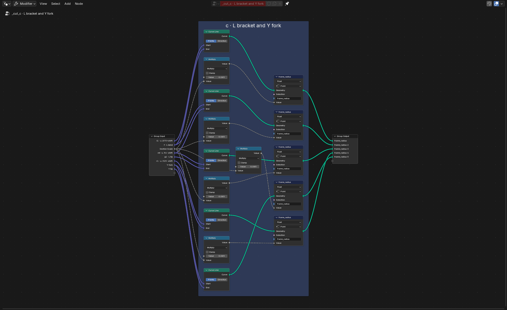

### Trick · no ring

The module has only two short ties, and they are staggered. A full ring of bars around the crown would be easier to
model, but it would make the crown look like a lampshade. The real Supertree crowns read as radial members with short
angular offshoots, so the ties are kept short and out of line, and there is no complete ring past the neck collar.

### 3 · Two mirrored families

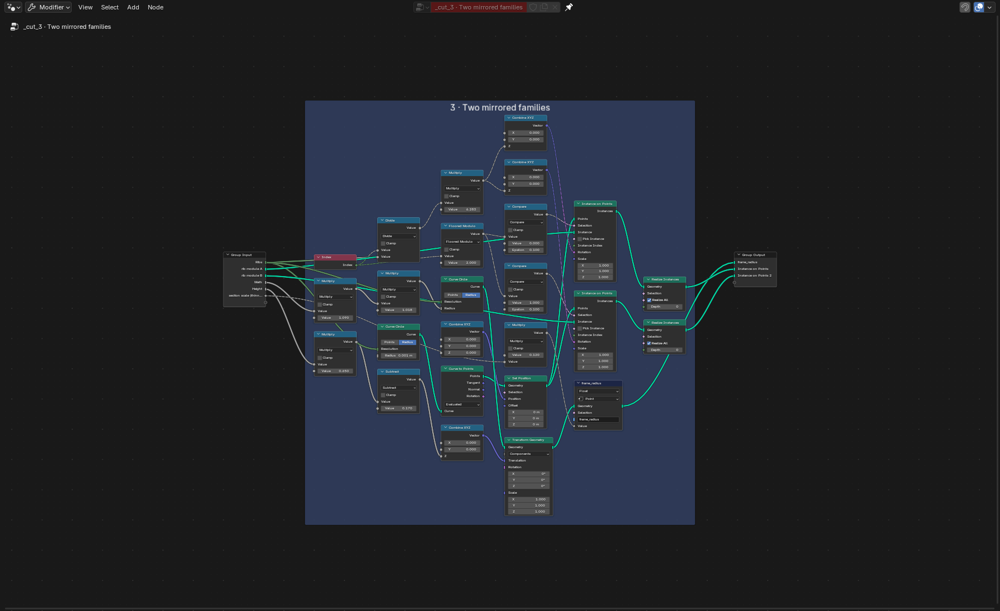

A **Curve Circle** with Resolution = Ribs (32) and a tiny radius, turned into points and moved to the origin, gives
32 points with indices 0 … 31. Two **Instance on Points** nodes share them. The first takes the even indices and
places `rib module A`, the second takes the odd ones and places `rib module B`, each rotated by index / Ribs × 2π.
Both are realized. A **Curve Circle** with 32 points at radius 1.09 r × 1.018, at the neck height 0.65 h − 0.17, is
the collar that holds the ribs together at the bottom of the bowl.

### 4 · Weld and section the steel

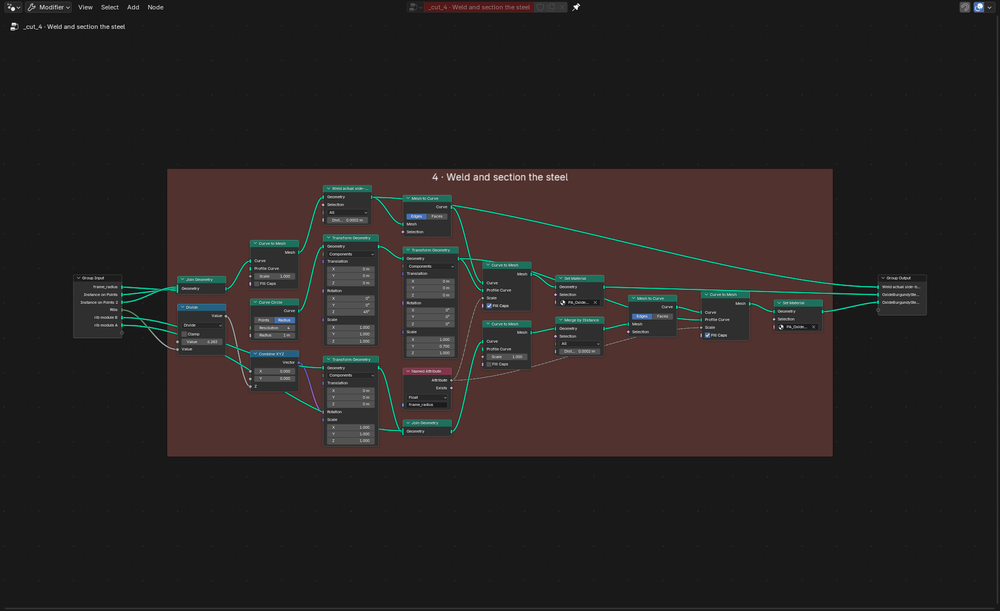

All the bars are separate curves at this point. **Curve to Mesh** with no profile turns them into a wire mesh, and
`Weld actual side-branch joints` (**Merge by Distance**, 0.0002 m) merges the endpoints that meet at a station. That
wire is the **Skeleton** output. **Mesh to Curve** turns it back into curves, and **Curve to Mesh** sweeps a profile
along them. The profile is a 4-point circle turned 45° and squashed to 0.7 in Y, a flat box about 1.41 × 0.99 times
`frame_radius`. The **Scale** input reads `frame_radius`, so each bar gets its own thickness. On a hero tree that
makes the main rib 0.20 × 0.14 m and a long rail 0.17 × 0.12 m.

### Trick · weld first, then give it thickness

The weld turns the module bars into one connected graph. For tree 01, `verify.py` finds 1,984 vertices and 2,048
edges in a single component, with 128 tips (degree 1) and 256 three-way joints (degree 3). Because the stations are
shared nodes, the bars of a module meet exactly, and a weld distance of 0.2 mm is enough. Sweeping the profile only
after the weld means that each straight bar is one clean box, with no doubled caps buried inside the joints.

> **Try it:** on **PA_Supertree_01**, change Ribs from 32 to 48. The crown gets 24 module A and 24 module B. Section
> scale drops to 32 / 48 = 0.67, so the bars get thinner and the crown stays open. The light skin doesn't change,
> because its 193 columns don't depend on Ribs (section 4). The pink light lines in section 5 go from 6 to 8, because
> they sit on every sixth rib.

---

## 4 · Light bowl


The skin starts as a flat **Grid**, 1 × 1 m, with 64 vertices in X and 193 in Y. Its own position gives two
coordinates, each from 0 to 1: u = x + 0.5 along the profile, and a = y + 0.5 around the tree. Both are stored, as
`panel_u` and `panel_a`, for the material. Then **Set Position** wraps the grid onto the profile:

- profile parameter: 0.0125 + 0.6375 u, so the skin covers u = 0.0125 … 0.65, from just above the neck to the rim;
- radius × 0.96, height + 0.12 m (the offsets from section 1);
- angle: 2π a.

The result is `Curved luminous skin`: 12,352 vertices, with no edge longer than 0.33 m on tree 01. A steel **rim**
closes it: a 192-point **Curve Circle** at the rim radius × 0.96, 0.18 m above the rim height, swept with a tube
0.17 m in radius.

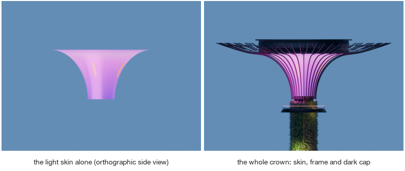

### Trick · parameterise from position, not index

The comment in `build.py` says it: *Blender Grid stores Y fastest*. If you derive u and a from the vertex **Index**
with a guessed stride, a wrong guess sends some rows from the neck to the rim and makes long bridge faces across the
bowl. Reading u and a from the grid's own X and Y avoids the guess. `verify.py` checks the result: every vertex of the
evaluated skin lies on the quarter ellipse to within 0.0001 (it measures 1 × 10⁻⁶), and no edge is longer than 1 m.

### The panel material


`PA_LuminousVioletCanopyPanels` reads `panel_u` and `panel_a` back through **Attribute** nodes:

- A **Color Ramp** along `panel_u` goes from deep violet (0) through magenta (0.52) and pale pink-white (0.72) to
  violet again at the rim (1). That gradient is what makes the bowl look lit from inside.
- `one gold sector in 11, mid band`: `panel_a` × 48, floored, gives 48 sectors around the bowl. The sectors whose
  number modulo 11 is 0 (sectors 0, 11, 22, 33, 44) turn warm gold, but only between u = 0.3 and 0.53. So each bowl
  has five gold stripes.
- The emission strength is 0.005 + 0.8 × `switched on (0.65 s fade)`. Section 6 explains the timing.

> **Try it:** change the 48 to 96 in that material. The sectors get half as wide, and the gold stripes are now
> sectors 0, 11, 22 … 88: nine thinner stripes instead of five.

---

## 5 · Core, cap and balcony

### 4 · Core and dark cap

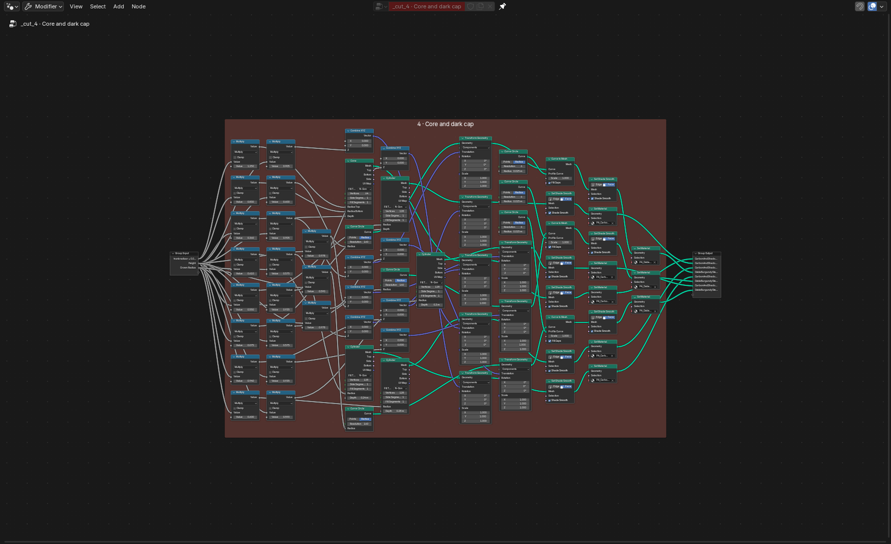

| Part | Node | Size and place |
|---|---|---|
| core | **Cone**, 64 vertices | radius 0.83 r at the bottom, 1.25 r at the top, 0.36 h tall, centred at 0.61 h |
| cap | **Cylinder**, 128 vertices | radius 0.55 R, 0.075 h thick, centred at 0.94 h |
| three discs | **Cylinder**, 128 vertices | at 0.905 h, 0.935 h, 0.978 h; radii 0.60 R, 0.575 R, 0.59 R; 0.28, 0.24, 0.30 m thick |
| disc edges | **Curve Circle**, 160 points, tube 0.025 m | one on the rim of each disc, in steel |

All of it uses the dark material `CarbonAndShadow`. The cap is deliberately wider than the bowl (0.55–0.60 R against
0.56 × 0.96 R). From below it reads as a dark lid that hides the top of the core, as on the real trees.

### 5 · Climbing lights and balcony

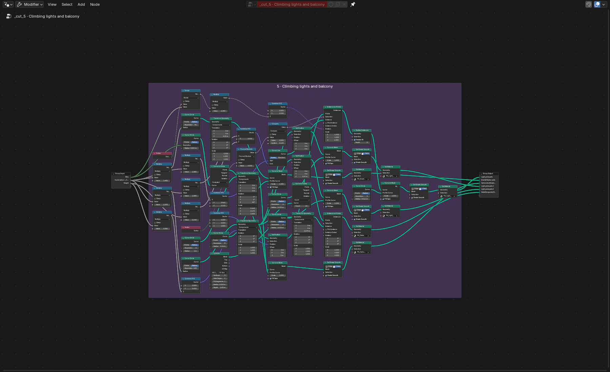

- **Climbing lights.** The same "Ribs points at the origin" trick as in section 3. A vertical line from 0.1 m to
  0.64 h, 1.08 r from the axis, is instanced on the points whose index modulo 6 is 0 and turned to its rib. That
  gives 6 lines on a 32-rib tree. They are thin tubes (0.012 m) in the pink light material.
- **Planter.** A stone ring of radius 1.48 r at 0.25 m, tube radius 0.24 m.
- **Balcony.** A circle of radius 1.9 r at 0.58 h. A flattened square profile (0.66 × 0.17, turned 45°) swept along it
  is the deck. Two pink rails sit at 0 and 0.97 m above it, and 64 steel posts 0.95 m tall stand on it.

The balcony height matters: 0.58 h is where the skyway lands (section 8).

---

## 6 · Light arrival

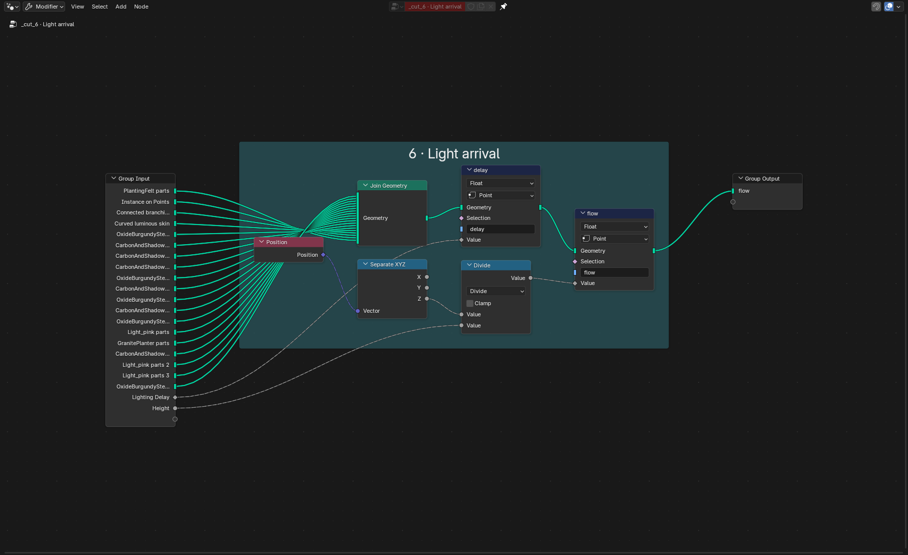

Frame 6 joins every part of the tree and stores two attributes on every point:

- `delay` = the tree's **Lighting Delay** input, the same for the whole tree;
- `flow` = z / h, which is 0 at the ground and about 1 at the top of the cap.

Nothing in the geometry moves. The animation lives in two materials, which read those attributes and a clock.

### The shader clock

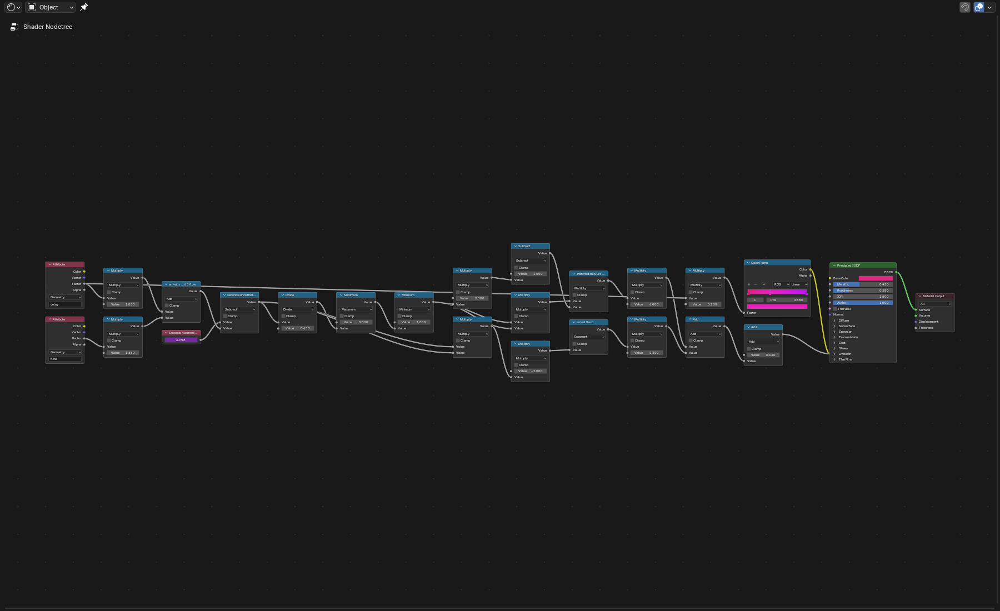

`Seconds / scene frame` is a **Value** node with a driver, `(frame-1)/24`, so it reads 0 on frame 1 and 7.96 on frame
192. Then, for every shading point:

| Node | Formula | Meaning |
|---|---|---|
| `arrival = 1.05 delay + 1.65 flow` | 1.05 × delay + 1.65 × flow | when the light reaches this point, in seconds |
| `seconds since the light arrived` | clock − arrival | negative before, positive after |
| `switched on (0.65 s fade)` | smoothstep(age / 0.65) | 0 before arrival, 1 from 0.65 s after |
| `arrival flash` | exp(−2 age²) | a soft pulse centred on the moment of arrival |

The light materials (`Light_pink` for the climbing lines, the balcony and skyway rails; `Light_gold` for the skyway's
base lines) emit 0.13 + strength × on + 2.2 × flash, with strength 6 for pink and 3.8 for gold. So they are faintly
lit from the start, flash as the front passes, and settle at full strength. The panels use the same `arrival` and
`on` without the flash.

Because `flow` grows with height, the front climbs each tree from the ground to the cap in 1.65 s: up the trunk lines
first, then through the bowl from the neck to the rim. `delay` × 1.05 sets when each tree starts.

### Trick · colour from delay

`Light_pink` doesn't use a fixed colour. A **Color Ramp** on delay × 0.28 runs from rose (0) through magenta (0.38)
to violet (1). Tree 01 (delay 0) gets warm rose rails, tree 02 (delay 2.0, ramp 0.56) is more magenta, and the grove
(delays 2.9–4.05, ramp 0.81–1) turns violet. The colour gets cooler with distance, as it would through haze.

### Crown lights

The glowing skin lights very little of the scene around it. So each tree also has an area light,
`PA_CrownGlow_<n>`, below its crown and aimed up at the cap. Its power has a driver:

`300+3700*min(1,max(0,((frame-1)/24-{delay}-1.0)/1.4))`

That is 300 W until delay + 1 s, then a straight ramp to 4,000 W over 1.4 s. For tree 01 that is 1.0–2.4 s, just as
its bowl comes on. The `{delay}` is written into the expression when `build.py` runs.

> **Try it:** on **PA_Supertree_02**, set Lighting Delay from 2.0 to 0. Its trunk and bowl now light together with
> tree 01, but its crown light still ramps at 3.0–4.4 s, because that driver has 2.0 typed into it. Edit the driver
> on `PA_CrownGlow_1` too (the lights are numbered from 0) to make them match.

---

## 7 · Eleven trees

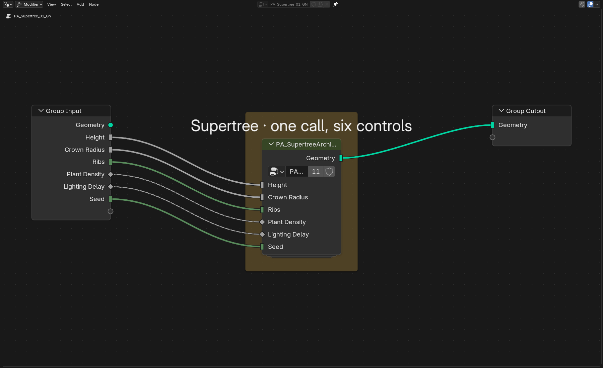

Each tree is its own object with its own tiny tree: one `PA_SupertreeArchitecture` node fed by six modifier
controls. The values come from the `TREES` list in `build.py` (x, y, Height, Crown Radius, Lighting Delay). Ribs is
32 everywhere, Plant Density is 8 on the two front trees and 3.5 on the others, and Seed is 21 + 17 × index.

| Tree | Position (m) | Height | Crown Radius | Lighting Delay |
|---|---|---|---|---|
| 01 | (−12, 19) | 40 | 18.5 | 0 |
| 02 | (22, 4) | 48 | 22 | 2.0 |
| 03 | (−31, 37) | 29 | 13.5 | 2.9 |
| 04 | (4, 43) | 33 | 14.5 | 3.5 |
| 05 | (34, 70) | 28 | 13 | 4.05 |
| 06 | (−12, 78) | 25 | 12 | 3.8 |
| 07 | (−49, 69) | 26 | 12.5 | 3.5 |
| 08 | (14, 98) | 24 | 11 | 3.9 |
| 09 | (51, 102) | 24 | 12 | 4.0 |
| 10 | (−36, 117) | 23 | 11 | 3.6 |
| 11 | (−56, 38) | 30 | 14 | 3.2 |

Tree 02 is the tallest and closest to the camera; the 24 mm lens crops its crown at the top-right corner. The grove
delays are not in order of distance. Trees light in a loose wave, not in a strict sweep from front to back.

---

## 8 · Skyway

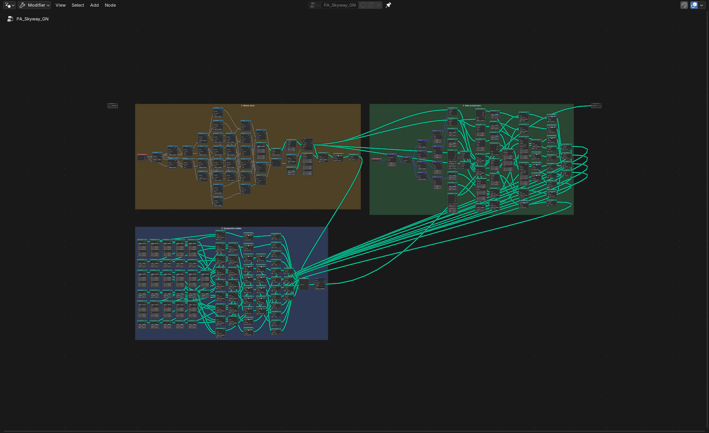

### 1 · Bezier deck

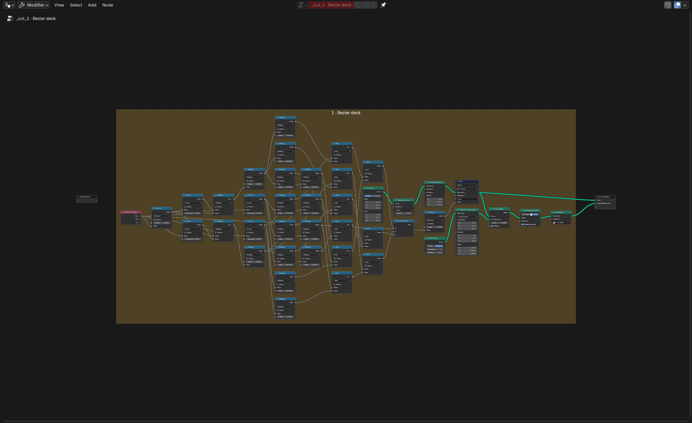

The deck is a **Curve Line** resampled to 192 points. `cubic Bezier through BRIDGE` moves each point to the cubic
Bézier of the four control points in `BRIDGE`, with the spline factor t:

(1 − t)³ P0 + 3 (1 − t)² t P1 + 3 (1 − t) t² P2 + t³ P3

The ends are P0 = (−12, 19, 23.2) and P3 = (22, 4, 27.84): the axes of trees 01 and 02, at 0.58 of their heights. So
the skyway runs from balcony to balcony. The same formula is written in Python as `bridge_point`, and the cables
and visitors use it to find points on the deck. A flattened square profile (scaled 1.23 × 0.145, turned 45°) swept
along the curve is the deck.

The deck stores `flow` = 1 − t, and frame 3 stores `delay` = 1.7 on all of it. So the light reaches the tree 02 end
first (at 1.05 × 1.7 = 1.79 s), and the tree 01 end 1.65 s later.

### 2 · Rails and pickets · 3 · Suspension cables

The tangent crossed with +Z gives a sideways direction. On each side, 0.87 m out:

- a pink light rail 1.14 m up (tube 0.046 m) and a gold light line at 0.08 m (tube 0.045 m);
- 145 bronze pickets, 1.06 m tall, and two thin bronze rails 0.36 and 0.70 m above the gold line.

Eight pairs of cables hang the deck. Those at t = 0.07, 0.13, 0.20, 0.28 run up to tree 01 at 37 m, and those at 0.72,
0.80, 0.88, 0.94 run up to tree 02 at 44 m, just under each cap. Their top ends spread 2.5 m to each side.

> **Try it:** in frame 1, replace `flow` = 1 − t with t itself (link the **Spline Parameter** factor straight into
> the `flow` store). Now the light runs along the skyway from the left tree to the right one, starting 1.79 s in,
> before tree 01 has finished.

---

## 9 · Garden, skyline and sky

### `PA_RainGarden_GN`

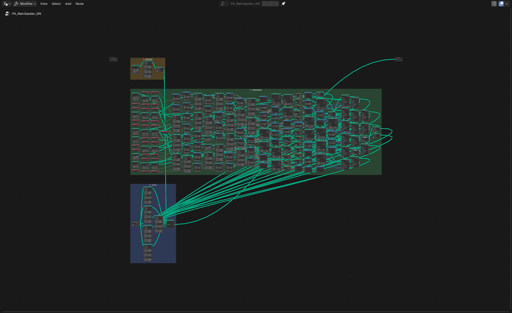

- `1 · Wet plaza`: one 320 × 320 m plane with `RainPolishedPlaza`. In that material a large noise makes puddles
  (roughness 0.045 where wet, up to 0.385 where dry), a **Brick Texture** makes pavers, and a fine noise bumps them.
  The wet patches reflect the coloured lights.
- `2 · Planting beds`: ferns scattered over a 135 × 65 m area (0.28 per m², sizes 0.75–2.4), two oval beds with
  granite rims, and a small fern island at the foot of every tree (radius 0.074 h, density 3.2). All of them use
  `PA_FernAndBromeliad`.
- `3 · Visitors`: five small people on the skyway at t = 0.15, 0.19, 0.45, 0.70, 0.73, from `PA_Visitors` (a
  stretched sphere for the body, an ico sphere for the head, four tubes for the limbs).

### `PA_GardenAndSkyline_GN`

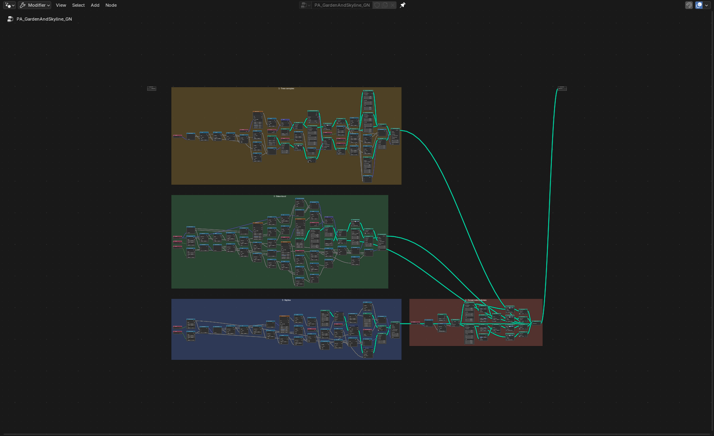

- `1 · Tree canopies`: one leafy ball (an ico sphere pushed out by noise, with 85 small leaves per m²) is copied
  twice more to make a lumpy crown. That crown is instanced 440 times between y = 12 and 130 m, at sizes 1.1–3.2.
- `2 · Distant land`: a 650 × 1,075 m grid from y = 125 to 1,200 m. Its height is `shared ground height`: (0.18 +
  1.1 × noise) × smoothstep((y − 125) / 40). So it rises gently out of the flat plaza. The material
  `Far land fades into blue-hour haze` mixes towards the sky colour with distance, so the far land doesn't end as a
  black wall. A belt of 200 low bushes sits on the same height field.
- `3 · Skyline`: 36 boxes, 9–32 m tall and 3–8 m wide, between y = 230 and 290 m. Each base sits 0.35 m below
  `shared ground height` at its centre, so every tower is seated in the land. `tools/inspect_skyline.py` checks
  that: 180 samples (the centre and four corners of every tower) are all below the ground surface. The glass has
  lit window bands from a modulo on height and a noise.
- `4 · Conservatory domes`: the upper half of an ico sphere, scaled into two domes. **Mesh to Curve** on the same
  mesh gives the triangular glazing bars.

### Trick · one height field, used twice

The land and the tower foundations call the same function, `skyline_ground_height`. That function builds the same
nodes from a different position each time: the land's own vertices, and each tower's random (x, y). So a tower can
never float or sink by more than the 0.35 m it is set into the ground, wherever the noise puts the hills.

### Mist, sky and light

- `PA_LowRainMist`: a 140 × 105 × 12 m box with a **Principled Volume** whose density (0.003 × noise) fades out
  from the ground to 10 m. It is the low mist after the rain.
- `PA_BlueHour` world: a gradient from (0.10, 0.22, 0.44) at the horizon to (0.016, 0.07, 0.20) overhead, with soft
  noise clouds, at strength 0.65.
- 52 lights: a cool sky softbox, a rim light and a plaza fill. Each tree has four: a warm uplight on the ferns, the
  `CrownGlow`, and two coloured lights on the planted trunk. Five warm point lights under the skyway spill onto the
  wet plaza. Of the per-tree lights, only those of the two front trees cast shadows. That keeps EEVEE's shadow
  budget for the trees that are close enough to show them.
- Camera: 24 mm, at (1, −31, 10) m looking at (0, 20, 27): 10 m up, tilted towards the crowns, so the garden's
  layers show. The far clip is 1,600 m, so the distant land is never cut off.

---

## How it was rendered

- **Engine:** EEVEE (Blender 5.2) with ray tracing on, AgX "Medium High Contrast", exposure 0.8. `pb.post` adds a
  little bloom and fog in the compositor.
- **Hero still:** `build.py --hero`, 1440 × 1440, 96 samples, frame 168.
- **Animation:** 960 × 960, 64 samples, 192 frames. It was rendered on a small LAN render farm (Flamenco on one PC
  with an RTX 4060) in about 16 minutes, so about 5 s per frame. `finish.py` encoded the MP4 and the preview GIF and
  checked that all 192 frames decode.
- **Checks:** `verify.py` writes `checks/verification.json`: the procedural audit, the light skin's ellipse error and
  edge lengths, the frame's graph (one component, 128 tips, 256 joints), a clearance check between non-neighbouring
  bars (no intersections), and the crown-light power at five frames.

---

## Try it yourself

1. **Reshape every crown at once.** In `PA_CrownProfile`, change the 0.25 in the height formula (frame b) to 0.35.
   The bowl gets deeper: the rim moves up by 0.1 h, and the ribs and branch stations follow it. The dark cap does not
   move. On the hero tree the rim is now at 40 m, above the top of the cap (39.3 m), so a ring of light shows over
   the lid. (`verify.py` would now fail its ellipse check, because it tests against 0.25.)
2. **Open up the steel.** On **PA_Supertree_01**, set Ribs to 20. Section scale is min(1, 32 / 20) = 1, so the bars
   keep their size, but there are fewer of them, and the light shows between them in wide gaps.
3. **Change the wave.** Give the grove trees delays in order of distance (3.0 for the nearest, up to 4.0 for tree
   10). The grove now lights as one sweep from front to back. Remember to edit their `CrownGlow` drivers too.
4. **Light from the top down.** In frame 6 of `PA_SupertreeArchitecture`, store `flow` = 1 − z / h. The light now
   starts at the cap and runs down the bowl and the trunk.
5. **A bigger tree.** Set **PA_Supertree_01** to Height 55. The trunk gets taller and thicker and the crown rises,
   keeping its Crown Radius. But the skyway still ends at 23.2 m, inside the trunk and below the new balcony at
   31.9 m. Move `BRIDGE[0]` in `build.py` and rebuild.
6. **Rebuild from scratch.** From the repository root:

   ```sh
   /Applications/Blender.app/Contents/MacOS/Blender -b --factory-startup \
       --python nodevember/2026/day07-tree-v6-supertree/build.py -- --preview
   /Applications/Blender.app/Contents/MacOS/Blender -b nodevember/2026/day07-tree-v6-supertree/piece.blend \
       --python nodevember/2026/day07-tree-v6-supertree/verify.py
   ```

   The first command writes `piece.blend`, `checks/audit.json` and `preview.png`. Add `--hero` for the 1440² still.

*Made with Blender 5.2 Geometry Nodes for [Nodevember](https://nodevember.com) 2026, Day 7 · Tree.*
