# How a hand of spheres turns to stone and grows a mushroom on its fingertip

*A node-by-node walkthrough of Nodevember 2026 · Day 8 · Mycelium (v5, Fingertip)*

A weathered stone hand stands in a carpet of fern moss with a low sun behind it, palm towards us, index finger
raised. White hyphae creep out of the soil in a few patches and climb the stone, densest low down and in the hollows.
A few of them thicken into cords that run up the raised finger, a white knot swells on its tip, and a pin breaks out.
The camera moves in twice: first to the finger, then to a close-up from a little below the cap. Meanwhile the stem
stretches, and the cap swells into a bell and opens into a parasol. The shot ends in a 2.5-second hold while spores
fall. It lasts 15 seconds and plays once; it is not a loop.

Nothing in the shot is simulated, modelled by hand or textured from an image, and only the camera has keyframes
(`pb.audit`: strict procedural, no issues). The hand is not a sculpted mesh either. It is 3 130 spheres placed by
bone lengths and joint angles, melted into one surface by a signed distance field.

This piece reuses the mushroom, the moss, the forest floor and the growth clock of
Day 8 v4, Bonnet, an earlier take with its own tutorial (not published here). This
walkthrough covers what is new: the hand, the mycelium on the stone, the stone material, the backlight and the light
link on the far trunks, and the camera.


| File | What it is |
|---|---|
| [`../loop.mp4`](../loop.mp4) | the render: 1080 × 1080, 360 frames at 24 fps, Cycles 128 samples, vignette and grain added in ffmpeg |
| [`../render.png`](../render.png) | frame 360, the close-up |
| [`../render-wide.png`](../render-wide.png) | frame 360 from a lower version of the opening camera: the whole hand with its mushroom |
| [`../piece.blend`](../piece.blend) | the scene. Each object (**PA_Hand**, **PA_Mycelium**, **PA_Mushroom**, **PA_Moss**, **PA_Ground**, **PA_Forest**, **PA_Trunks**, **PA_Canopy**) has one Geometry Nodes modifier |
| [`../build.py`](../build.py) | the script that builds the whole file; every node in this tutorial comes from it |
| [`../save_final.py`](../save_final.py) | builds the file with the final render settings |
| [`../still_wide.py`](../still_wide.py) | renders `render-wide.png` from `piece.blend` |
| [`src/`](src/) | the scripts behind the figures in this tutorial |

Units: **1 unit = 1 cm.** The hand is 1.4 × life size, and its raised fingertip stands 20.9 cm above the soil. The
stem grows to 5.7 cm, and the open cap is about 4.4 cm across. The finest hyphae are about a tenth of a millimetre
thick.

---

## The one idea

> **Model the bones, not the skin.** Each finger is three bone lengths and three joint angles. Spheres strung along
> the bones melt into one smooth surface in a signed distance field. So a carved hand comes out of a dozen numbers per
> finger, and changing the pose only means changing angles.


Everything else in the piece reads that surface:

- **Where do the hyphae run?** Along shortest paths on the stone's own mesh, down to a few patches of soil.
- **Which threads become cords?** Shortest paths on the same mesh, up to the fingertip.
- **When does a thread appear?** When its cost from the soil is below `reach(T)`. The colony's front is a level line
  of that cost, and it rises with the growth clock.
- **Where does the mushroom stand?** On the fingertip. Python works the fingertip out from the same bone numbers
  (`FINGERTIP`), so the mushroom, the cords' target and the camera all follow the finger.

### How to read the screenshots

The larger trees in `piece.blend` are laid out in coloured frames, one per step, in the order the data flows. The
frames in the object trees are numbered (`1 · Fingers`, `2 · Palm and wrist`, …). The frames in the helper groups are
lettered (`a · Three bones, three curls`, …).

- Below each heading there is a **cut-out** of just that frame's nodes. Wires coming from another frame enter through
  a **Group Input** on the left, named after what they carry, such as `the whole skeleton` or `behind the front`.
  Wires that leave go to a **Group Output** on the right.
- Node titles such as `reach(T)`, `oval section` or `box: < 0 inside the nail` are the labels in the `.blend`. Every
  **Store Named Attribute** and **Named Attribute** node is titled with its attribute name (`d`, `cav`, `hz`, …).
- Small helpers that `build.py` uses everywhere turn into a few nodes each. A smoothstep is six Math nodes (clamp,
  then t²(3 − 2t)), a mix is three, a random number is a **Random Value** node fed an index, and a noise is a **Noise
  Texture**. The parts of the hand that repeat (a bone, a knuckle, a capsule of spheres, a nail) are node groups, so
  each appears once.

Click any screenshot to see it at full size.

---

## 0 · The map


| # | Section | Tree · nodes | Job |
|---|---|---|---|
| 1 | **Growth clock** | `PA_Growth` · 14 | T, Tu and one Float Curve per process |
| 2 | **Hand** | `PA_Hand_GN` · 110, `PA_Capsule` · 9, `PA_Nail` · 40 | fingers, palm and muscle as spheres → distance field → weathered stone; hollows and height for later |
| 3 | **Finger** | `PA_Finger` · 49, `PA_Bone` · 22, `PA_Knuckle` · 17 | one finger from three bone lengths, three curls and two radii |
| 4 | **Mycelium** | `PA_Mycelium_GN` · 319 | two shortest-path fields on the stone; hyphae, cords, fuzz and the stem foot |
| 5 | **Stone** | material `PA_Stone` · 110, `PA_Rosettes` · 23 | sandstone colour, grime in the hollows, lichen, damp near the soil |
| 6 | **Mushroom** | `PA_Mushroom_GN` · 284, `PA_Cap` · 86 | the v4 Bonnet, 1.3 × larger, standing on the fingertip |
| 7 | **Light and forest** | `PA_Canopy_GN` · 62, `PA_Forest_GN` · 60, `PA_Trunks_GN` · 13 | a low backlight through the leaves, the forest out of focus, trunks the sun skips |
| 8 | **Camera** | Python keys | wide → finger → close-up, and the aperture |

Node counts leave out frames and group inputs and outputs. The moss (`PA_Moss_GN` · 188) and the forest floor
(`PA_Ground_GN` · 231, `PA_GroundZ` · 18) are the v4 ones with two changes: they leave out the hand's footprint (an
ellipse in the hand's own frame, `footprint` in `build.py`), and the moss now covers the whole floor in about 10 500
low, creeping fronds.


To turn T into a frame, take 1 + 299 × T. In the grey band (frames 300–360) T is stuck at 1 and nothing grows. The
spores keep falling and the stem keeps circling a little, because they read a second clock, `Tu`, that keeps running.
The camera creeps 1.2 cm closer during the hold.

---

## 1 · Growth clock

`PA_Growth` is the v4 clock, re-timed: growth fills 300 frames instead of 264, and a 60-frame hold follows.

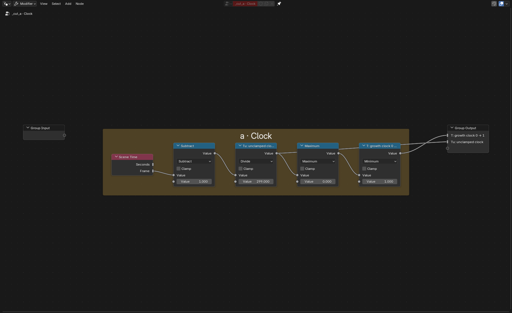

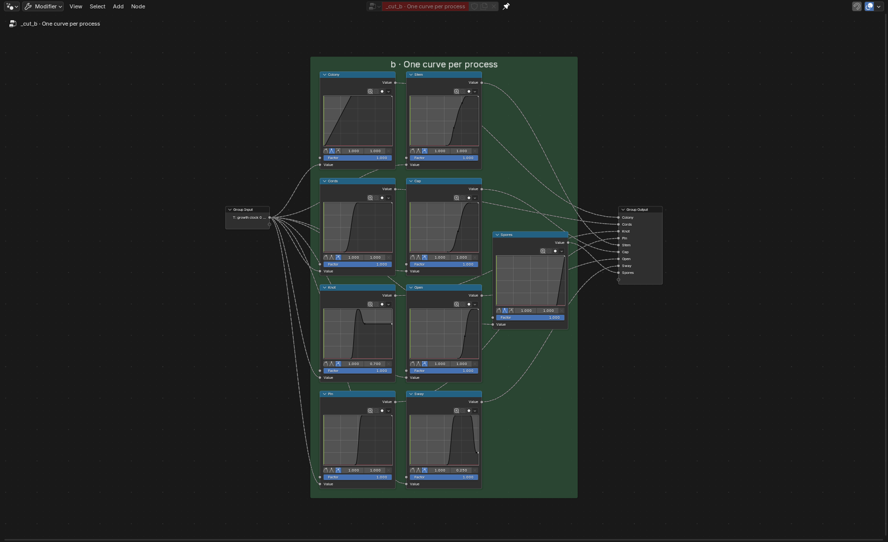

| Curve | rises over T | frames | what reads it |
|---|---|---|---|
| `Colony` | 0.02 → 0.40 (straight line) | 7–121 | the mycelium's growth front |
| `Cords` | 0.30 → 0.50 | 91–150 | cord thickness |
| `Knot` | 0.40 → 0.50, then back to 0.7 by 0.60 | 121–180 | the white knot on the fingertip |
| `Pin` | 0.46 → 0.56 | 139–168 | the size of the whole mushroom body |
| `Stem` | 0.53 → 0.84 | 159–252 | stem height and radius |
| `Cap` | 0.55 → 0.88 | 165–264 | cap arc length and flesh |
| `Open` | 0.70 → 0.92 | 210–276 | how far the cap unbends |
| `Sway` | 0.54 → 0.66, down to 0.25 by 0.97 | 162–291 | circumnutation of the stem |
| `Spores` | 0.88 → 1 | 264–300 | nothing: spore release reads `Tu` directly, so that it can go on in the hold |

`Colony` is a straight line, so the colony's front moves at a steady speed in cost. It reaches the fingertip when
`Colony` is 0.97 (frame 117), before the camera has gone far.

> **Try it:** move the last key of `Colony` from T 0.40 to T 0.30. The front then reaches the fingertip at frame 88,
> twelve frames before the camera starts to move, so the whole stone is covered while the shot is still wide. Nothing
> else changes, because only the growth front reads `Colony`.

---

## 2 · Hand

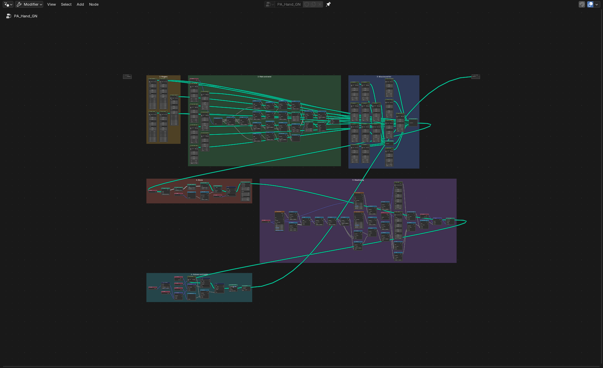

The hand is built in its own frame, at life size: the palm faces −y (towards the camera), the fingers point up +z,
and the thumb is on the +x side. Sections 1–3 only make points with a radius. Section 4 turns them into stone, and
sections 5–6 weather it and measure it.

### 1 · Fingers

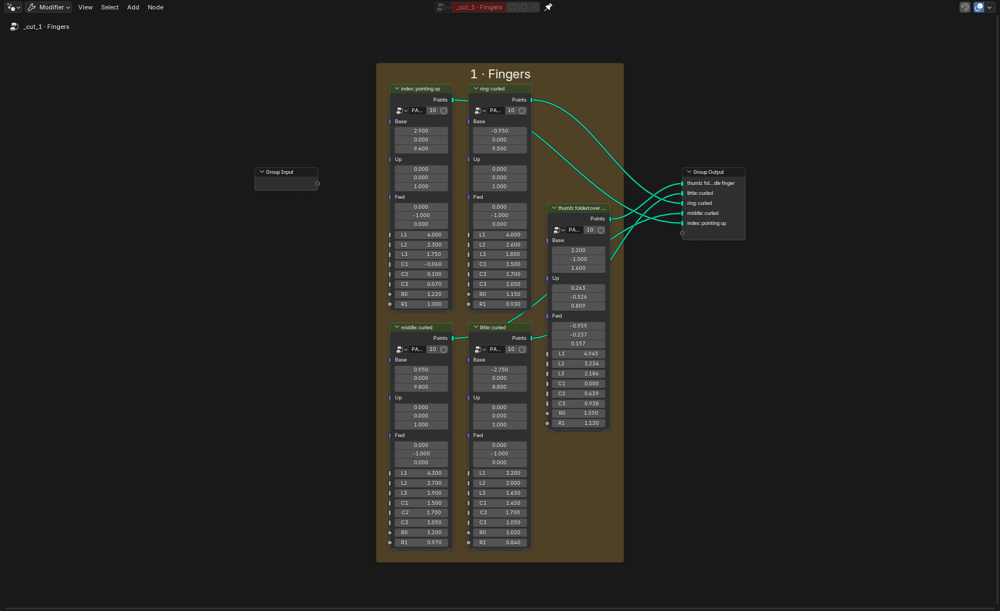

Five **PA_Finger** nodes ([section 3](#3--finger)), one per finger. Each gets the position of its knuckle, two
directions (`Up`, along the straight finger, and `Fwd`, towards the palm), three bone lengths, three curls and two
radii. All the numbers are in `FINGERS` in `build.py`:

| finger | knuckle | bone lengths | curls (rad) | radius at knuckle → tip |
|---|---|---|---|---|
| `index: pointing up` | (2.9, 0, 9.4) | 4.0, 2.3, 1.75 | −0.06, 0.10, 0.07 | 1.22 → 1.0 |
| `middle: curled` | (0.95, 0, 9.8) | 4.3, 2.7, 1.9 | 1.5, 1.7, 1.05 | 1.2 → 0.97 |
| `ring: curled` | (−0.95, 0, 9.5) | 4.0, 2.6, 1.8 | 1.5, 1.7, 1.05 | 1.15 → 0.93 |
| `little: curled` | (−2.75, 0, 8.8) | 3.2, 2.0, 1.65 | 1.45, 1.7, 1.05 | 1.02 → 0.84 |
| `thumb: folded over the middle finger` | (2.2, −1.0, 1.6) | 4.94, 3.23, 2.19 | 0, 0.64, 0.94 | 1.55 → 1.12 |

The curled fingers turn about 1.5 rad (86°) at the knuckle and 1.7 rad at the middle joint, so their last bones point
back towards the palm: a fist. The index's small curls (−0.06, then +0.10 and +0.07) keep it from looking ruler
straight.

### Trick · pose the thumb by its joints

The thumb is hard to pose by angles, because it leaves the hand at a slant. So `build.py` gives it as four points in
space: wrist, knuckle, middle joint and tip (`THUMB`), with the last bone lying across the curled middle finger.
`fit_chain` turns them into what **PA_Finger** expects. `Up` is the first bone's direction, `Fwd` lies in the plane of
the bones, and the lengths and curls are measured from the points. The numbers in the last row of the table come from
there.

### 2 · Palm and wrist

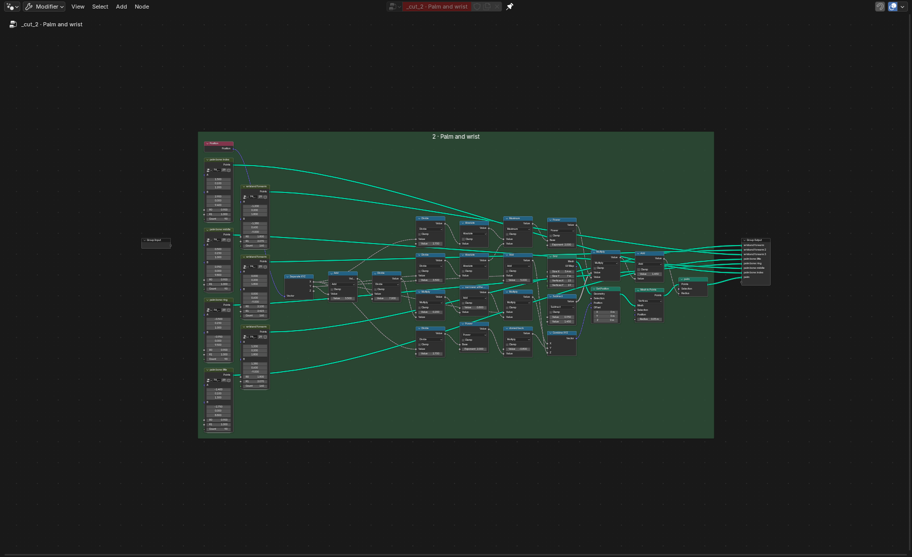

- **The palm** is a **Mesh Grid**, 5.4 × 7.0 with 15 × 19 vertices, stood upright (its y becomes height, from 1.5 to
  8.5). Two labelled formulas shape it. `narrower at the wrist` scales x from 0.8 at the wrist to 1.0 at the knuckles.
  `domed back` bends the slab's sides 0.8 towards the palm, so the back is rounded and the palm cupped. **Mesh to
  Points** keeps the 285 vertices as points, and each gets a radius of 1.45 in the middle, falling to 0.95 at the
  edges (a mix by edge distance²).
- **The four palm bones** are capsules from a point near the wrist to each finger's knuckle: 90 spheres each, radius
  0.9 → 1.0.
- **The wrist and forearm** are three thick capsules (radius 1.8, 2.1 and 1.8, growing 15 % towards the elbow), 160
  spheres each, running from the wrist down to z −9. They end up under the moss, but they give the stone a believable
  root.

#### Inside `PA_Capsule`

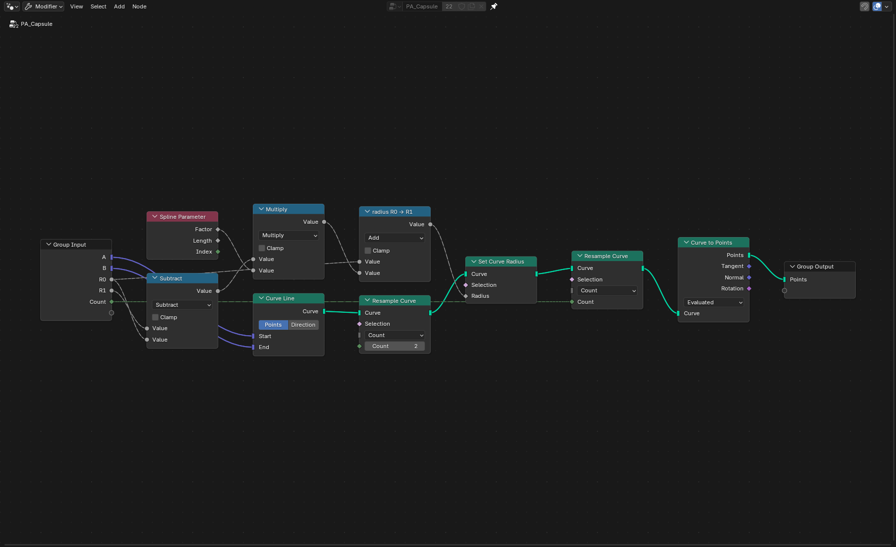

A capsule is a line from `A` to `B` turned into `Count` points whose radius goes from `R0` to `R1` (`radius R0 → R1`).
The first **Resample Curve** keeps the two end points so that the radius can be set at each. The second spaces `Count`
points evenly, and the radius between them is interpolated. Every palm bone, muscle and wrist piece is one of these;
the hand uses 22 of them.

### 3 · Muscle and fist


Spheres along bones make a skeleton. A hand needs flesh between the bones, so long capsules lie where the muscles are:

| capsule | from → to (life-size cm) | radius | spheres |
|---|---|---|---|
| `ball of the thumb` | (1.5, −1.3, 1.0) → (3.0, −2.6, 4.6) | 1.6 → 1.25 | 60 |
| `hollow of the palm` | (−0.4, −0.75, 1.6) → (0.4, −0.8, 5.6) | 1.2 → 1.1 | 40 |
| `edge of the little finger` | (−1.7, −0.55, 1.4) → (−2.3, −0.6, 6.8) | 1.3 → 1.1 | 60 |
| `web of the thumb` | 10 strands between the thumb's long bone and the index's | 1.1 → 0.95 | 40 each |
| `inside the fist` | (−2.6, −2.6, 8.0) → (1.4, −2.7, 8.3) | 1.25 | 60 |
| `inside the fist, lower` | (−2.4, −2.3, 6.8) → (1.2, −2.4, 7.0) | 1.05 | 50 |

The `hollow of the palm` fills the middle of the palm a little, so the palm stays shallow, as a carving would make
it. The web is strung like a hammock between two bones: strand t starts at fraction t of the thumb's long bone and
ends at 0.2 + 0.65 t of the index's palm bone, for ten values of t from 0.25 to 1. The two fist capsules fill the
space inside the curled fingers. A real hand has a gap there, but a stone carving is solid.

The last node joins everything into `the whole skeleton`: 3 130 spheres. There are 1 335 in the fingers (5 × (3 bones
× 44 × 2 rows + 3 knuckles)), 285 in the palm, 360 in the palm bones, 480 in the wrist and 670 in the muscle and fist.

### 4 · Stone

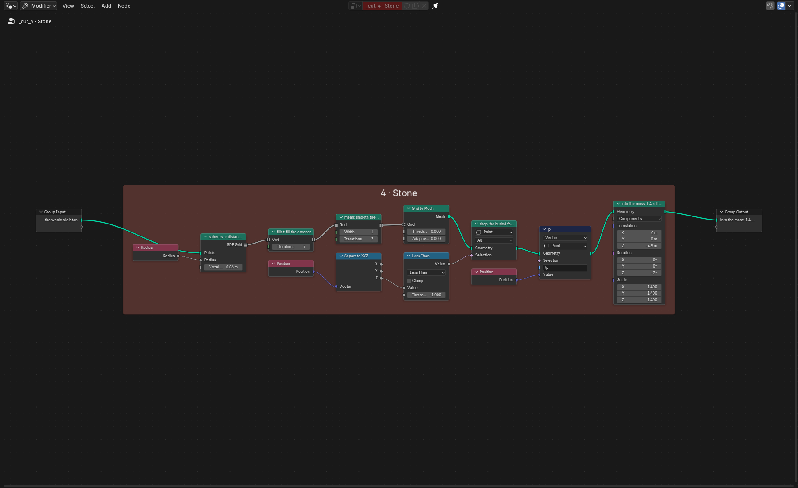

| Node | What it does |
|---|---|
| `spheres → distance field (0.6 mm voxels)` | **Points to SDF Grid**: each point's radius is the radius of its sphere; voxel size 0.06 |
| `fillet: fill the creases` | **SDF Grid Fillet**, 7 iterations: rounds the inside corners where spheres meet |
| `mean: smooth the bumps` | **SDF Grid Mean**, width 1, 7 iterations: averages the field, which flattens the bead of every single sphere |
| **Grid to Mesh** | the surface at distance 0, no adaptivity |
| `drop the buried forearm` | deletes everything below z −1 (4.5 below the soil line, which is at z 3.5 in the hand's frame); 146 493 vertices remain |
| `lp` | stores each vertex's position in the hand's own frame, for the nails |
| `into the moss: 1.4 × life size` | **Transform**: down by 3.5 × 1.4 so the soil line lands at z 0, turned −7° about z, scaled 1.4 |

### Trick · Fillet, then Mean

The raw distance field of the spheres is exact, and that is the problem: you can see every sphere. There is a crease
wherever two spheres meet, and a ring along each finger (the second panel of the figure above). The two grid filters
fix different things. **Fillet** only adds material, in concave corners, so the crease between the palm and a finger
becomes a soft fold. **Mean** blurs the field everywhere, which melts the small bumps of individual spheres but would
also round off the fingertips if it were pushed far. Seven iterations of each, at 0.6 mm voxels, give the look of a
cast that has been rubbed smooth.

### 5 · Weathering

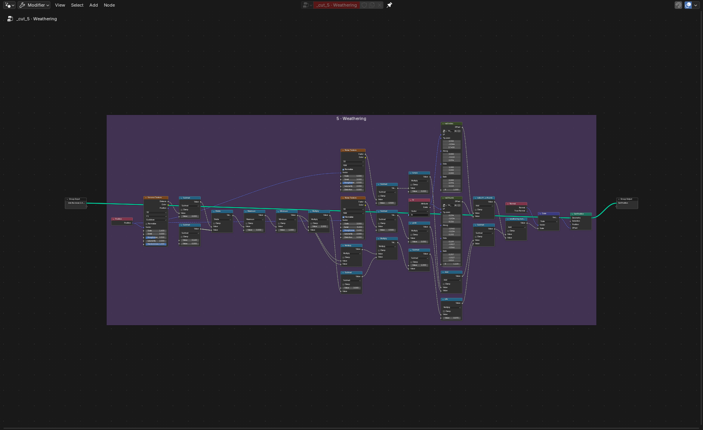

Everything here is a displacement along the normal, in scene centimetres:

- `lumps`: noise at scale 0.3, up to ±0.11. Broad unevenness, as if the stone had been worn by water.
- `grain`: noise at scale 3.0, ±0.025. The texture of sandstone.
- `pits`: wherever a point lies near a **Voronoi Texture** feature point (scale 1.6, distance under 0.16), the surface
  sinks by up to 0.07. Pits are about 2 mm across.
- `nails of the index and the thumb`: two **PA_Nail** nodes, one on each of the fingertips the camera sees.

#### Inside `PA_Nail`

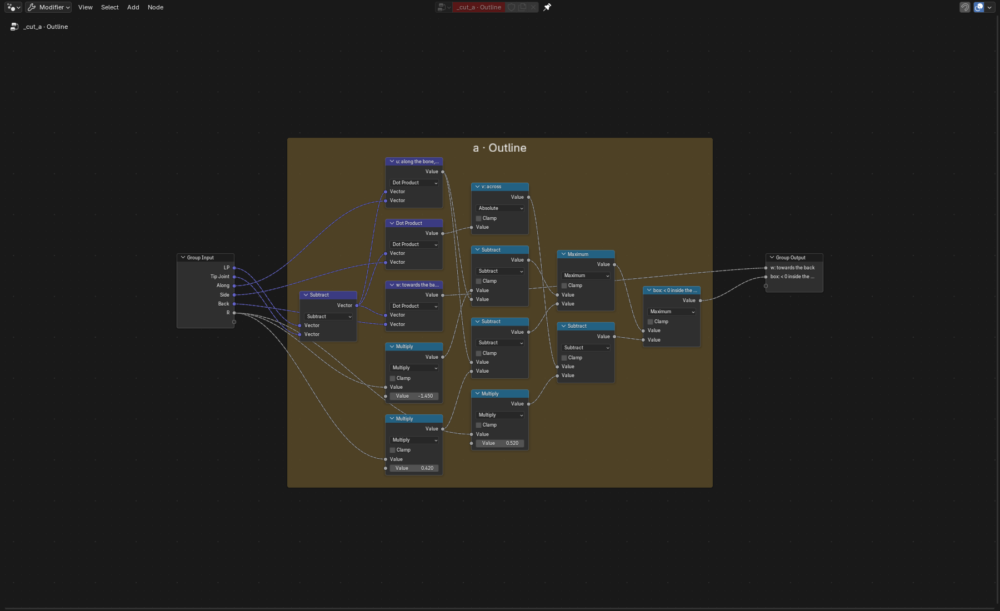

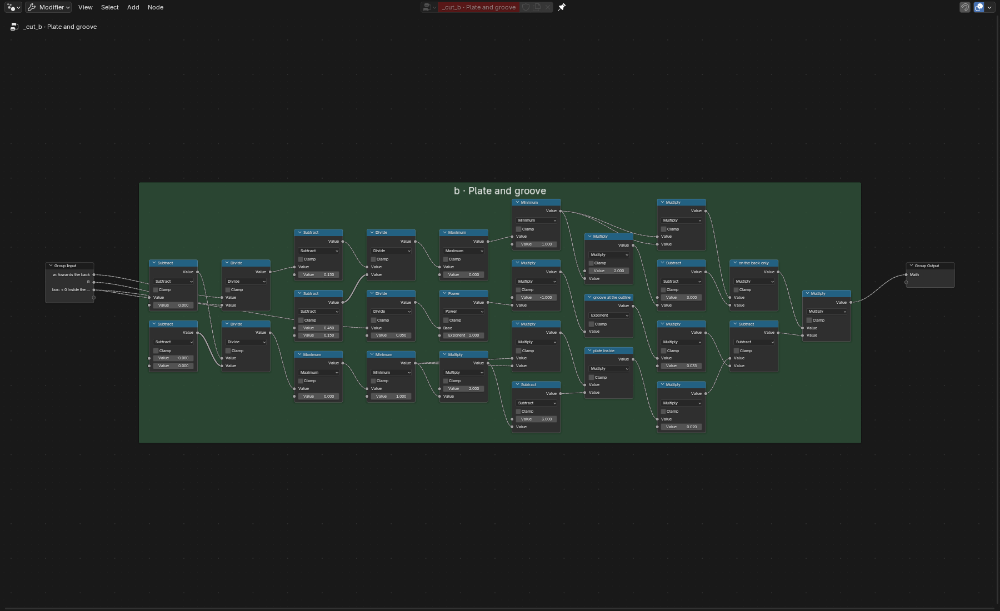

A nail is a rectangle on the back of the last bone. `build.py` gives the group the last joint, the bone's direction,
its sideways and backwards directions (all from the Python twin of the finger, `chain_py`) and the tip radius `R`.

- **a · Outline.** `u: along the bone, 0 at the last joint`, `v: across` and `w: towards the back` are three dot
  products of LP − Tip Joint. `box: < 0 inside the nail` is negative inside a box from 1.45 R behind the last joint
  to 0.42 R past it, and 0.52 R to either side.
- **b · Plate and groove.** `plate inside` raises the inside by 0.02. `groove at the outline` cuts a channel 0.035 deep
  along the box's edge (a Gaussian of box / 0.05). `on the back only` fades it in as w / R goes from 0.15 to 0.45, so
  the nail does not show through to the pad.

The group works on `lp`, the position stored before the **Transform**. Life-size bone numbers then line up with the
stone, wherever the hand is moved or turned.

### 6 · Hollows and height

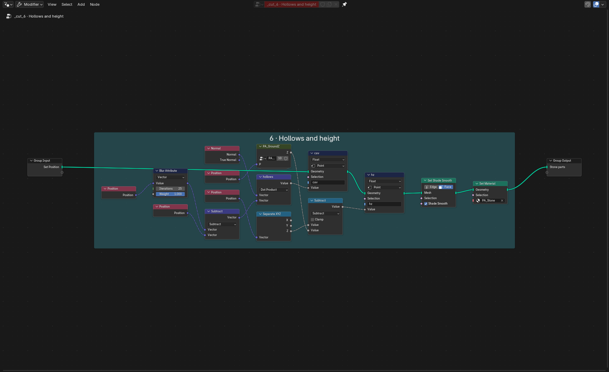

Two numbers that the mycelium and the material read later:

- `cav` = N · (blur(P) − P). **Blur Attribute** averages each vertex's position with its neighbours 25 times. In a
  hollow the averaged point lies outside the surface, in front of it, so `cav` is positive. On a ridge or a knuckle
  it lies inside, so `cav` is negative.
- `hz` = z − the soil height under the vertex (**PA_GroundZ**, the same group the moss uses).

> **Try it:** in the .blend, select the `index: pointing up` node and set `C2` to 0.8. The finger bends at its middle
> joint, towards the camera. But the mushroom now floats where the tip used to be, and the nail is left behind too.
> The mushroom, the cords' target, the camera and the nail read numbers that Python works out when the file is built
> (`FINGERTIP`, `chain_py`). Make the same change in `FINGERS` in `build.py` and rebuild, and they all follow the
> finger.

---

## 3 · Finger

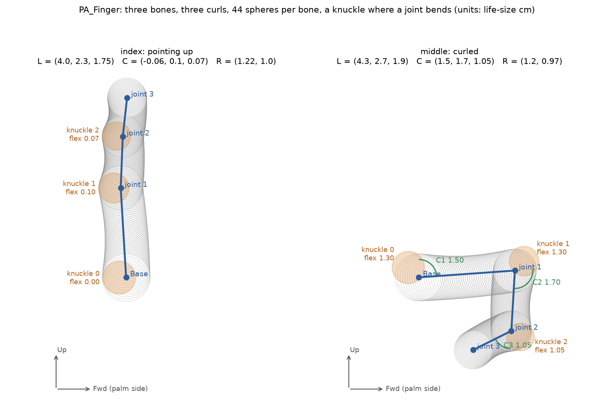

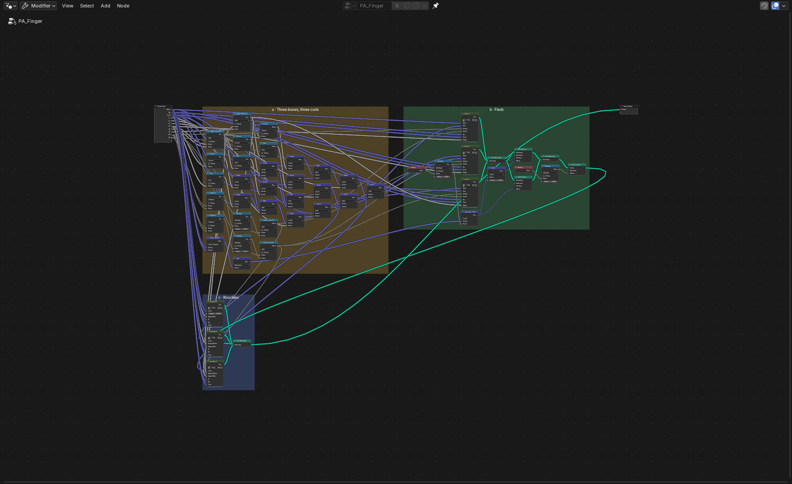

### a · Three bones, three curls

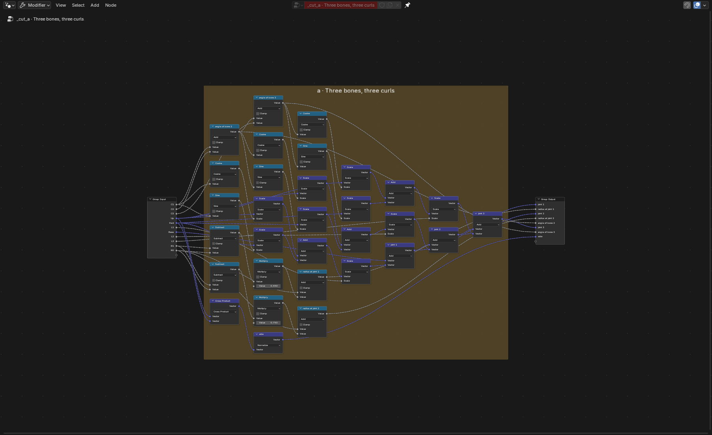

A finger lives in one plane, the plane of `Up` and `Fwd`. Each bone turns from the one before by its curl, so bone k
points at angle Ak = C1 + … + Ck from `Up` (`angle of bone 2`, `angle of bone 3`). Each joint is the joint before
plus the bone length times that direction:

```
joint k = joint k−1 + Lk · (Up · cos Ak + Fwd · sin Ak)
```

The radius goes from `R0` at the knuckle to `R1` at the tip. At the two middle joints it is mixed at 45 % and 75 %
(`radius at joint 1`, `radius at joint 2`), so 45 % of the taper happens along the first, longest bone. `side` is
the normalised cross product of `Up` and `Fwd`. It is perpendicular to the finger's plane, and the oval section is
built along it.

### b · Flesh

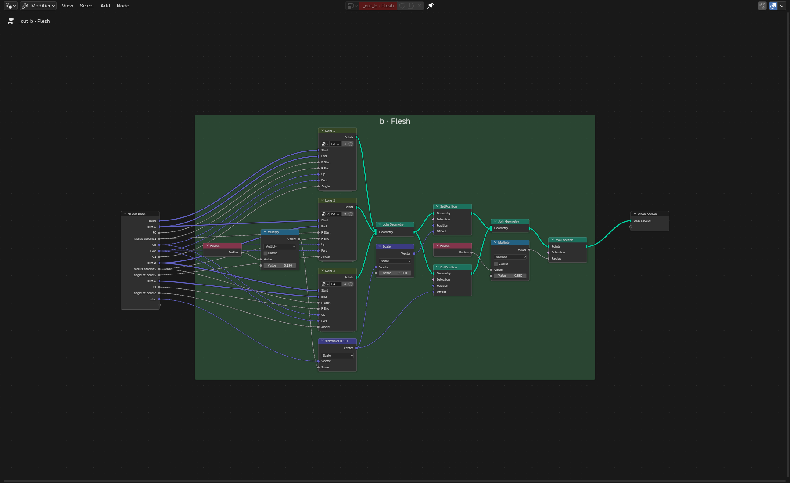

Three **PA_Bone** nodes put 44 spheres on each bone. Then the whole finger is copied twice, 0.18 r to either side along
`side` (`sideways 0.18 r`), and every radius is multiplied by 0.88 (`oval section`). Two rows of slightly smaller
spheres make a section that is wider than it is deep, like a real finger.

#### Inside `PA_Bone`

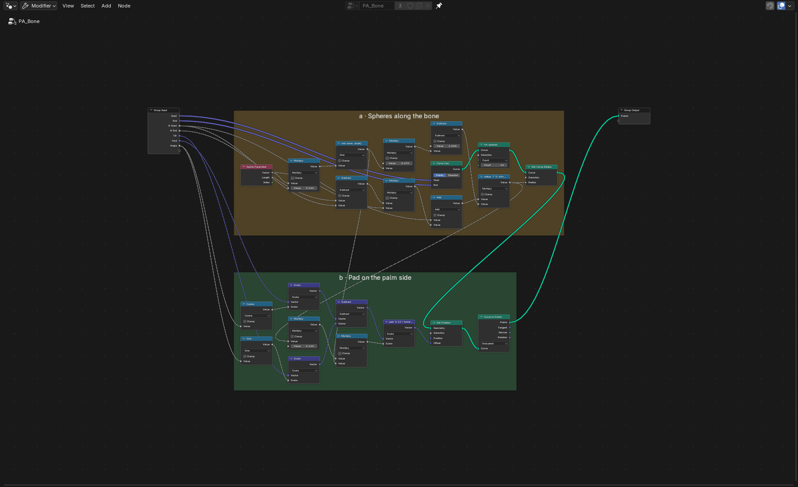

- `44 spheres`: a **Curve Line** from joint to joint, resampled to 44 points.
- `mid-bone: sin(πt)` is 0 at both joints and 1 halfway along. `radius: 7 % slimmer mid-bone` multiplies the mixed
  radius by 1 − 0.07 sin(πt). A finger is slimmer between its joints than at them.
- `pad: 0.12 r towards the palm` shifts the middle of the bone by 0.12 r sin(πt) towards the palm side,
  Fwd cos A − Up sin A. The pads swell on the palm side while the back stays flat, so the joints show on the back,
  as they do on a real finger.

### c · Knuckles

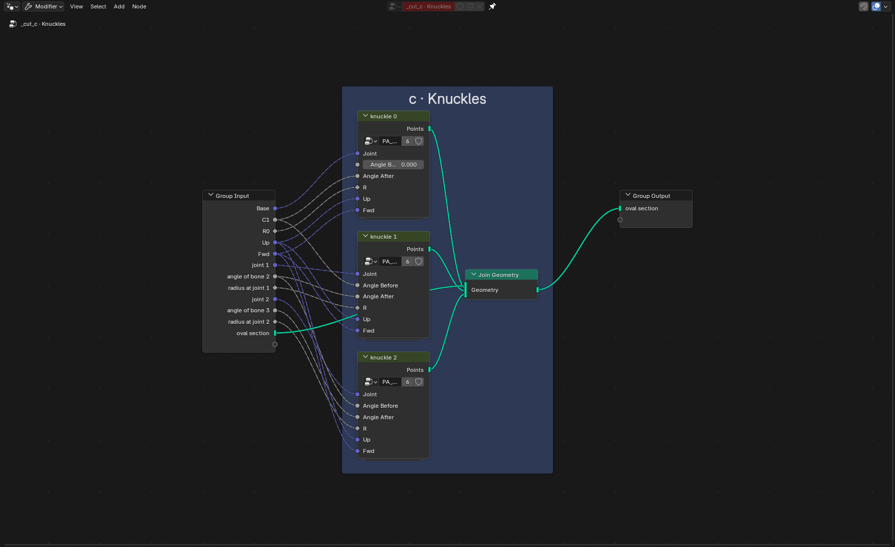

#### Inside `PA_Knuckle`

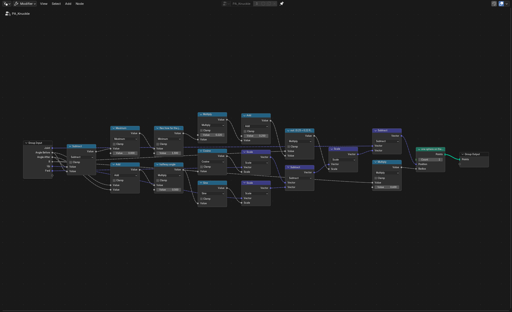

When a finger bends, the head of the bone pushes out on the back of the joint. **PA_Knuckle** adds one sphere there:

- `flex: how far the joint bends` is the difference between the angles after and before the joint, clamped to
  0 … 1.3.
- The sphere sits on the back of the joint, along the halfway angle, at `out: (0.25 + 0.22 flex) R` from the joint
  axis. Its radius is 0.6 R (`one sphere on the back`).

On a straight joint the sphere sits 0.25 R behind the axis, inside the flesh, so it barely shows. On a fully bent one
it sits 0.54 R out and makes the hard corner of a fist (the orange spheres in the figure).

> **Try it:** in **PA_Knuckle**, change the 0.22 in `out: (0.25 + 0.22 flex) R` to 0.6. The curled fingers grow bony,
> angular knuckles. The raised index hardly changes, because none of its joints bends by more than 0.1 rad.

---

## 4 · Mycelium


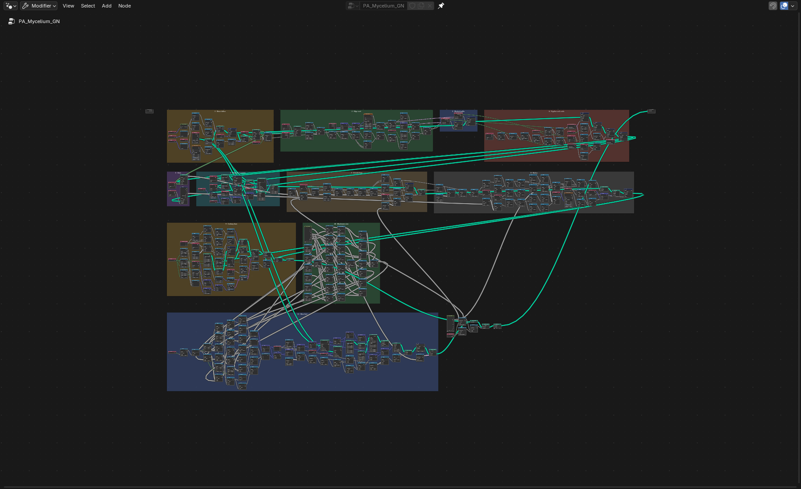

In v4 the mycelium grew on a flat lattice laid over the soil. Here it grows on the stone itself: the hand's own mesh
is the lattice.

### 1 · Stone lattice

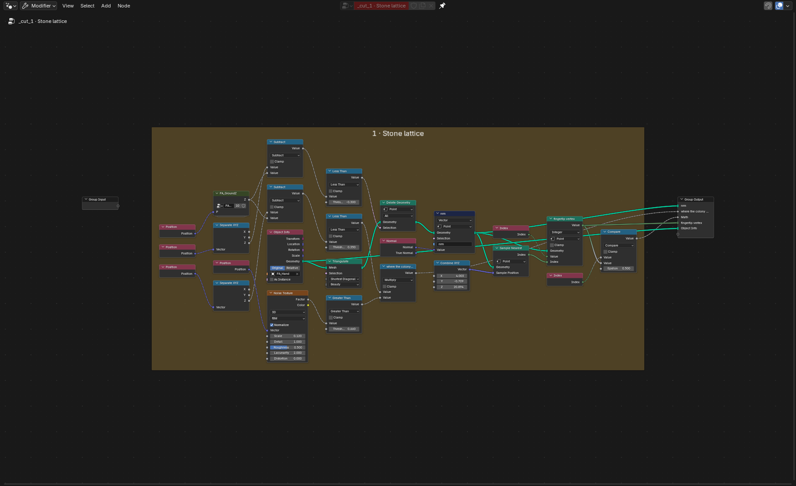

- **Object Info** reads **PA_Hand**, already weathered and carrying `cav` and `hz`. **Triangulate** makes sure every
  face gives diagonal edges too, so paths are not forced along a grid. Everything more than 0.3 below the soil is
  deleted. That leaves 113 088 vertices and 338 805 edges.
- `nrm` stores the stone's normal, for lifting threads off it later.
- `fingertip vertex`: **Sample Nearest** finds the vertex closest to `FINGERTIP`, and **Sample Index** hands its index
  to every point.
- `where the colony leaves the soil`: vertices within 0.35 of the soil where a coarse noise (scale 0.12) is above
  0.66. That gives 616 vertices in a few patches around the base.

### 2 · Edge cost

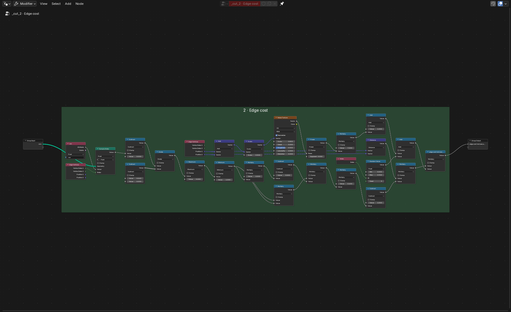

```
edge cost = length × (1 − 0.6 · smoothstep(0, 0.06, cav)) × (1 + 7 · wander³ + random(0 … 0.9))
```

- **Hollows are cheap:** an edge in a hollow costs as little as 40 % of its length, so threads gather in the creases
  between the fingers and along the folds of the palm, as hyphae follow moisture.
- **Wander:** a noise at scale 0.8, cubed, makes a few blotches up to 8 × as expensive. The threads curve round them.
- **Random:** up to +0.9 per edge, so that neighbouring paths do not run side by side.

### 3 · Shortest paths

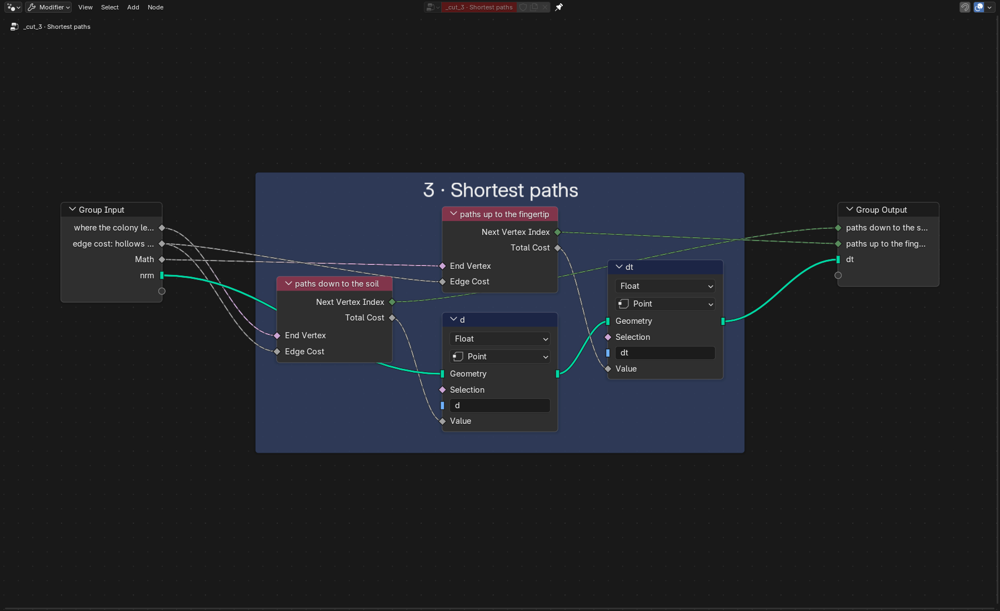

Two **Shortest Edge Paths** nodes run on the same mesh with the same cost. `paths down to the soil` ends at the soil
patches, and `paths up to the fingertip` ends at the one fingertip vertex. Each node gives every vertex its next
vertex along the cheapest path and the total cost of that path. The totals are stored as `d` (to the soil) and `dt`
(to the fingertip). These are the two fields in the figure above.

### Trick · one mesh, two fields

The colony and the cords grow in opposite directions: the colony spreads out of the soil and climbs, while the cords
carry food up to where the mushroom will fruit. Both are shortest paths over the same stone, but towards different
ends. With one field per direction, the colony's front is a level line of `d` (the dark contours on the left), and
the cords are the paths down the slope of `dt` (on the right).

### 4 · Hyphae and cords

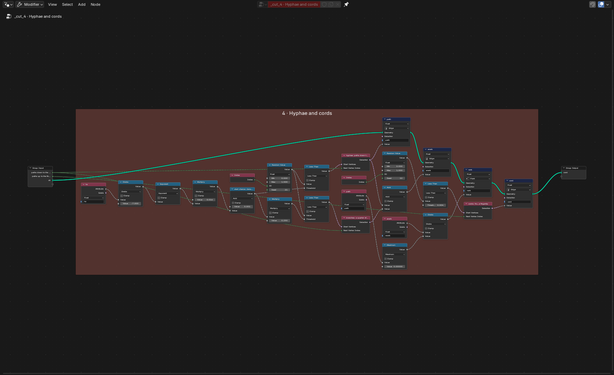

A hypha is the path from a random start vertex down to the soil. **Edge Paths to Selection** marks every edge on the
way.

- `start chance: dense low, sparse high` = 0.0012 + 0.016 e^(−hz/7). That is 1.7 % of vertices at the soil line,
  0.7 % at 7 cm up and 0.2 % at the fingertip. The stone is wrapped in threads at its foot and laced more lightly
  higher up.
- `hyphae: paths down to the soil` starts from vertices that pass that chance. `branches: a quarter of them` does it
  again from a quarter of them. Edges on both get rank 2, so the trunk lines of the network thicken.
- `cords: from 0.35 %, to the fingertip`: about 400 vertices send a path up to the fingertip.

### 5 · Stats

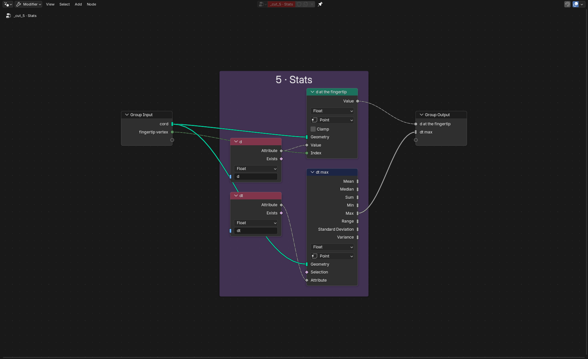

`d at the fingertip` sets the scale of the growth front: the front has reached the tip when `reach(T)` equals it.
`dt max` normalises cord thickness.

### 6 · Network → curves

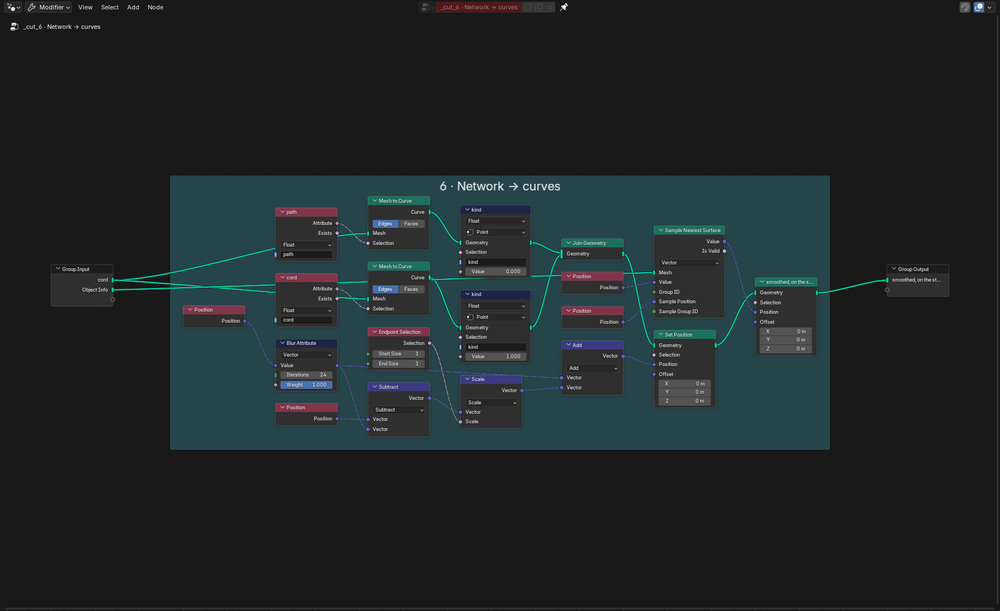

### Trick · blur along the curve, then snap back

Paths on a triangle mesh zigzag: straight runs along edges and sharp turns at vertices. They look like cracks, not
like threads. **Blur Attribute** on the position, 24 iterations, smooths each curve along its own length (a curve's
points only neighbour each other). **Endpoint Selection** keeps the two ends where they are, so curves still meet at
their junctions. But a smoothed curve cuts across convex stone, the way a chord cuts a circle. **Sample Nearest
Surface** puts every point back onto the hand (`smoothed, on the stone`).

### 7 · Growth front

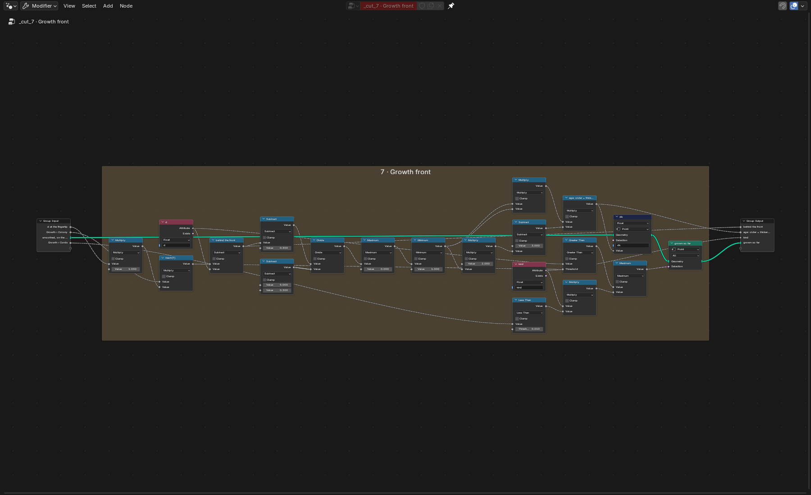

The v4 front, unchanged. `reach(T)` = `Colony` × `d at the fingertip` × 1.03. Every point whose `d` is above it is
deleted (`grown so far`), and the cords stay hidden until `Cords` starts to rise. `behind the front` is how far a point
is behind the front, in cost. `age: older = thicker, whiter` turns that into 0 … 1 between 0.3 and 5.

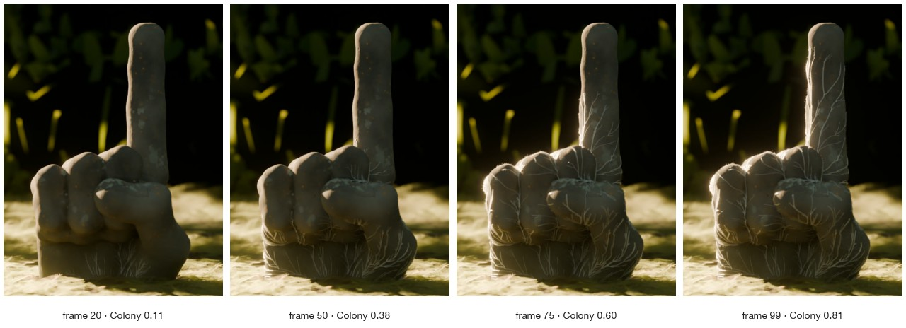

### 8 · Radius

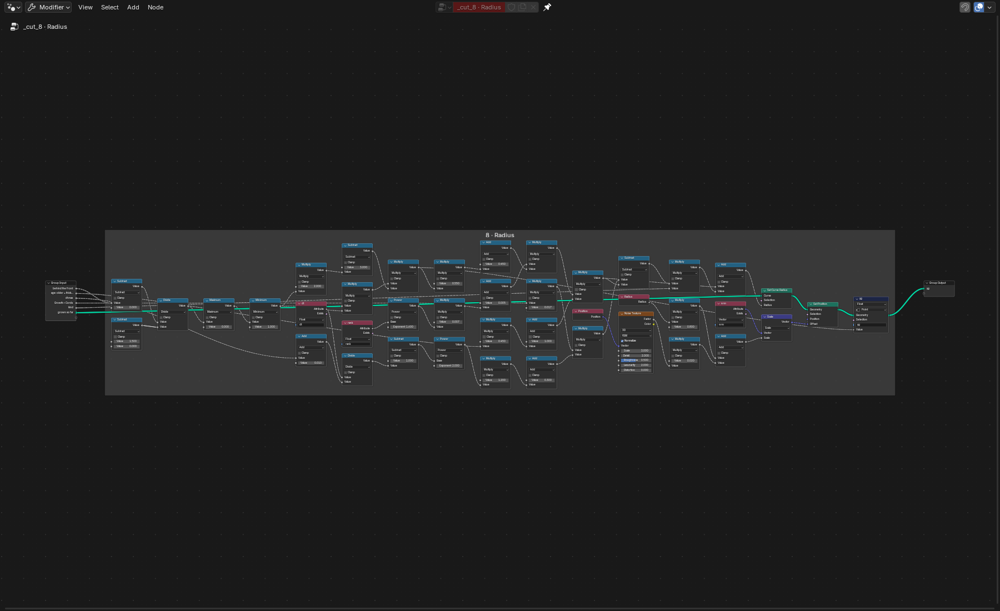

- Hyphae: (0.0055 + 0.007 rank^1.6) × (0.45 + 0.55 young) × (1 + 0.45 age). Tips taper over the first 1.5 of cost
  behind the front, and old trunk lines reach a radius of 0.018.
- Cords: `Cords` × 0.017 × (0.3 + 1.2 near²), where near is 1 at the fingertip and 0 farthest from it. Cords thicken
  as they converge, up to a radius of 0.026 at the tip.
- Each thread is lifted along `nrm` by 0.8 of its radius, plus a little noise, so it lies on the stone and not inside.

### 9 · Cottony fuzz

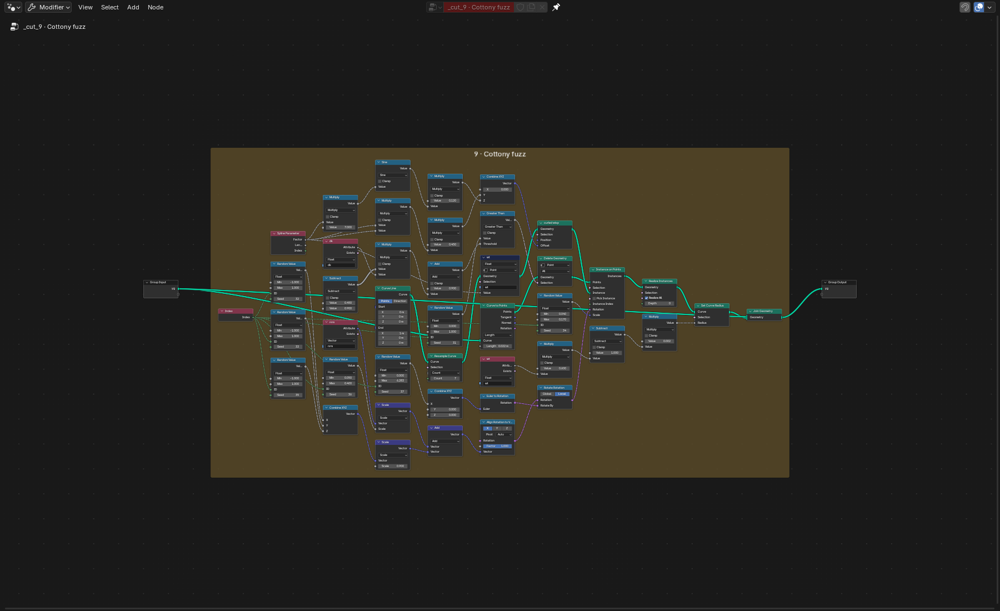

Real hyphae are fluffy. Points every 0.022 along every curve each get a wisp. Young threads keep 90 % of their wisps
and old ones 45 %, so the margin is the fluffiest part.

- `curled wisp`: a 7-point line, bent by (0, 0.45 t², 0.12 sin 7t). The bend is a hook with a small kink, not a
  bristle.
- It is aimed at `nrm` × 0.05–0.4 plus a random vector × 0.9, so it lies low along the stone, and it is spun about its
  own axis by a random angle, so the hooks curl every way.
- Each wisp is 0.04–0.17 long, with a radius of 0.0019 that tapers to 40 % at its tip.

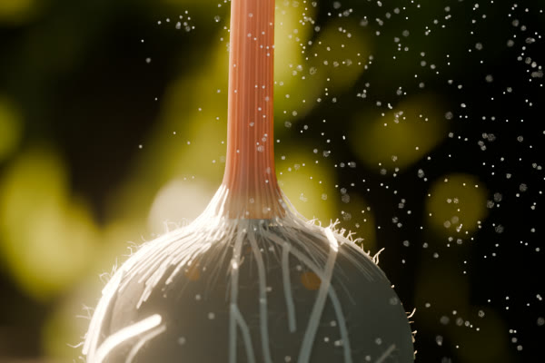

### 10 · Mushroom size and 11 · Stem foot

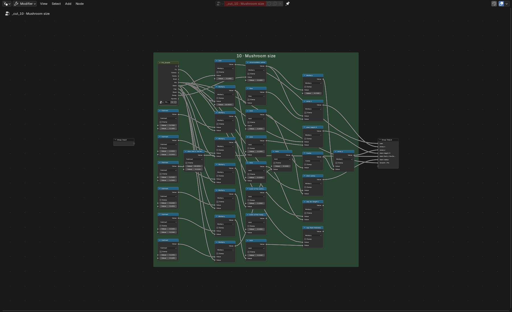

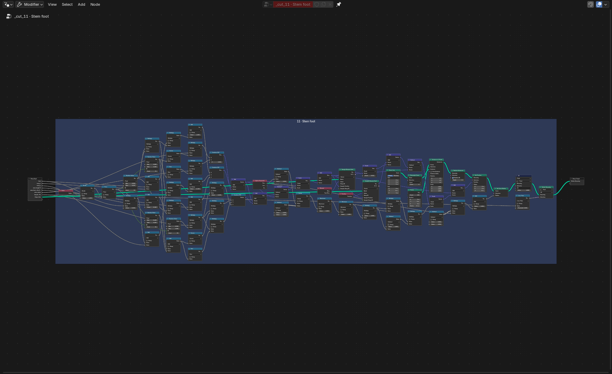

Section 10 repeats the mushroom's own sizes from the clock (the same numbers as `1 · Clock → sizes` in
**PA_Mushroom_GN**), so the foot fits the stem. Section 11 is the v4 stem foot, but draped. Each of 220 fibrils leaves
the stem's surface near its foot and runs outwards and down, 0.35–1.3 long. Over the first 35 % of its length it is
pulled onto the stone (**Sample Nearest Surface** of the position and of the normal, 0.012 out), and from there on it
lies on it. The fibrils wrap the fingertip instead of sticking out into the air.

> **Try it:** in `where the colony leaves the soil`, change the threshold 0.66 to 0.5. Many more soil patches start
> the colony, so the front rises evenly all round the base instead of from a few places. `d at the fingertip` gets
> smaller, and `reach(T)` scales with it, so the colony still reaches the fingertip at the same frame.

---

## 5 · Stone

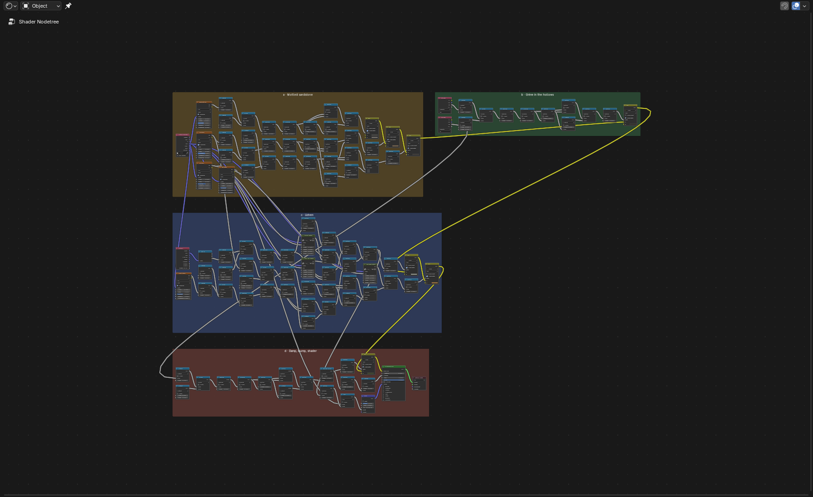

The material reads the two numbers the hand stored, `cav` and `hz`, through **Attribute** nodes. Everything else comes
from **Texture Coordinate** (Object).

### a · Mottled sandstone

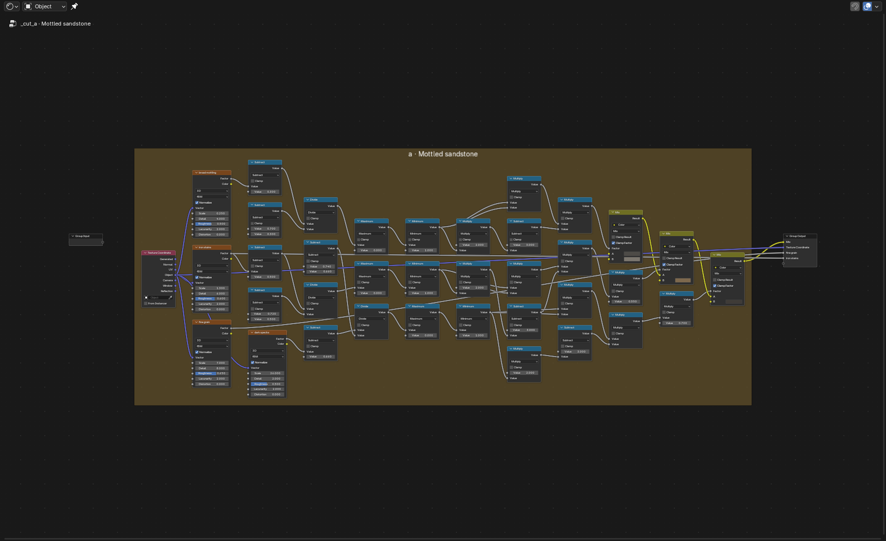

`broad mottling` (scale 0.25) mixes dark grey (0.075) into pale ochre-grey (0.20). `iron stains` (scale 1.3) add a rust
brown where they peak. `dark specks` (scale 26, thresholded) sprinkle dark grains. `fine grain` (scale 7) is kept
for the lichen edges and the bump.

### b · Grime in the hollows

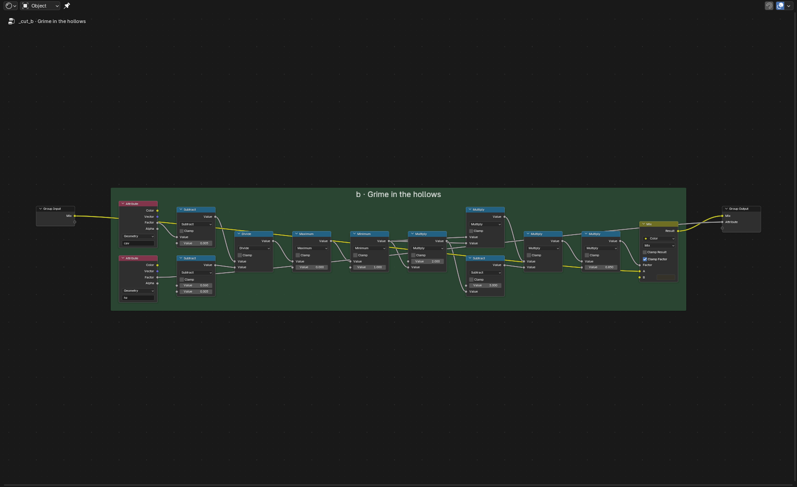

Dirt collects where water stands. Where `cav` rises from 0.005 to 0.06, the colour goes up to 85 % of the way to a
near-black brown. The grime comes from the geometry tree, so it follows the actual creases of the carving.

### c · Lichen

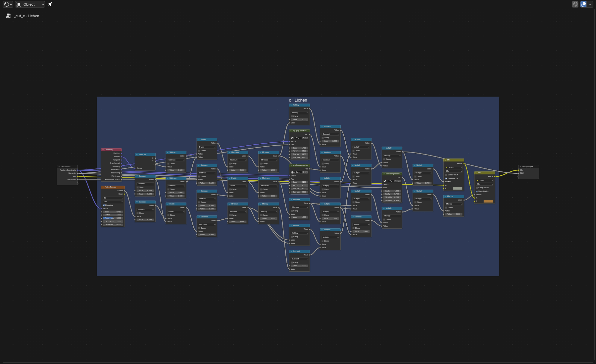

Crustose lichen grows in round rosettes that merge into crusts, more on surfaces that face up.

- `colonies`: a broad noise (scale 0.45) decides where lichen grows at all.
- `big grey rosettes` and `small grey rosettes` (**PA_Rosettes** at scales 1.4 and 3.1) are combined with Maximum,
  multiplied by the colonies and by `faces up`. They mix 70 % of the way to pale grey-green.
- `rare orange rosettes` (scale 4.0, only 7 % of cells) appear where the iron stains are strong.

#### Inside `PA_Rosettes`

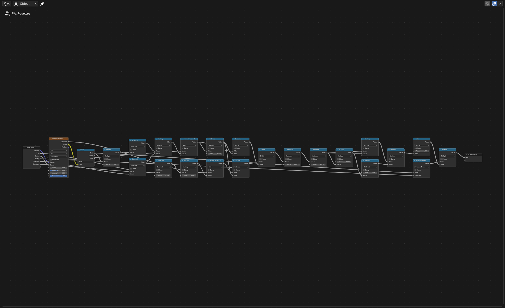

Each **Voronoi** cell holds at most one rosette. The red channel of the cell's random colour is a `cell id` between 0
and 1. `only some cells` keeps the cells whose id is above `Rarity`, and `size of this rosette` = Size Min + fract(7 ×
id) × (Size Max − Size Min), so neighbouring rosettes differ. `ragged distance` adds the fine grain noise to the
distance from the cell's centre. `disc` is 1 inside the size and fades out over 0.06. The rosettes' edges come out
frayed, and where two neighbours both grow large they merge.

### d · Damp, bump, shader

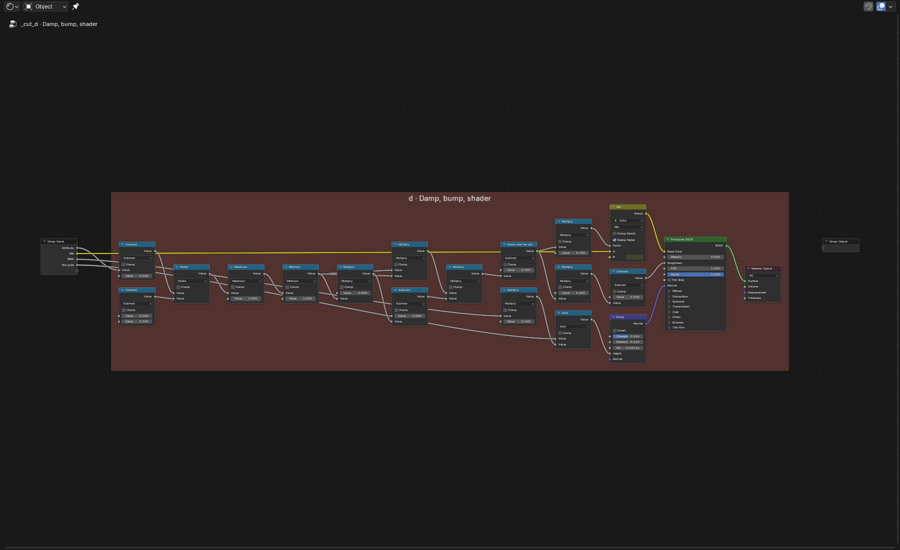

`damp near the soil` is 1 at the soil line and fades out by 5 cm up (a smoothstep of `hz` from 0.3 to 5). It darkens
the colour 70 % of the way to a dark olive and lowers the roughness from 0.9 to 0.6, so the stone looks wet where it
meets the moss. The bump height is the fine grain plus 0.4 × lichen: the rosettes stand slightly proud of the stone.

> **Try it:** in the `big grey rosettes` node, set `Rarity` from 0.3 to 0. Every cell inside a colony now holds a
> rosette instead of 70 % of them, so the colonies close up into a grey crust, broken only where neighbouring
> rosettes happen to be small. Set it to 0.9 instead, and the big rosettes become rare spots.

---

## 6 · Mushroom

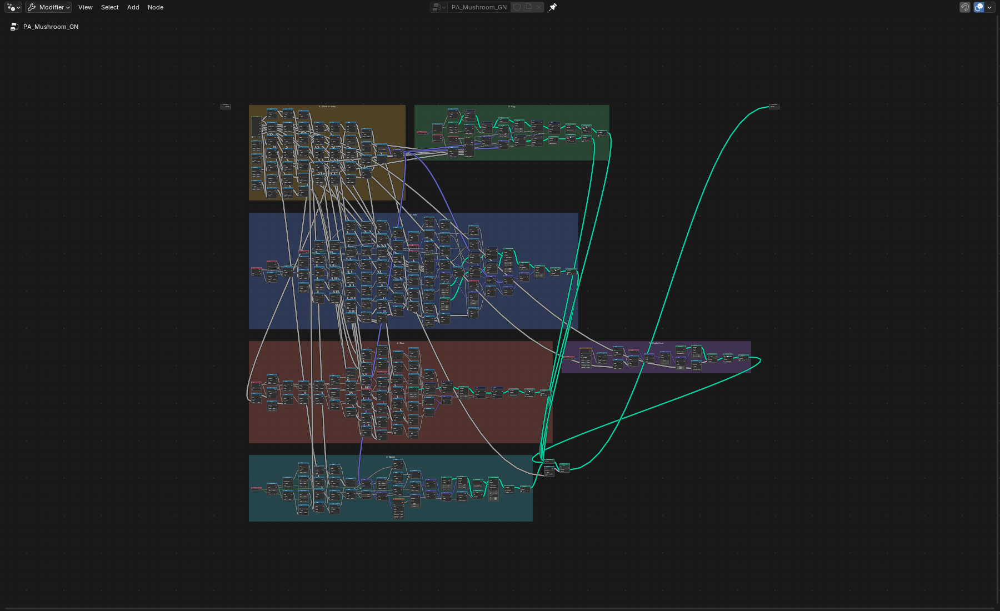

The mushroom is the v4 Bonnet: the overview above shows its six frames, the clock → sizes, the cap as an arc of two
curvatures (**PA_Cap**), the gills that hold the margin out, the stem, the hyphal knot and the spores. Three things
changed from v4:

- **It is 1.3 × larger,** so it holds its own on a stone finger: `stem height H` = `Pin` × mix(0.18, 5.7, `Stem`) and
  `cap arc length L` = `Pin` × mix(0.39, 2.5, `Cap`). The thickness and the stem radius scale with them.
- **It stands on the fingertip.** The stem's axis starts at `FINGERTIP` (`stem foot z: the fingertip` is 0.12 below
  it, so the foot sinks into the knot), and the hyphal knot sits there too.
- **It runs on the re-timed clock** (section 1), so the cap finishes opening at frame 276, while the camera is still
  closing in on it.

---

## 7 · Light and forest

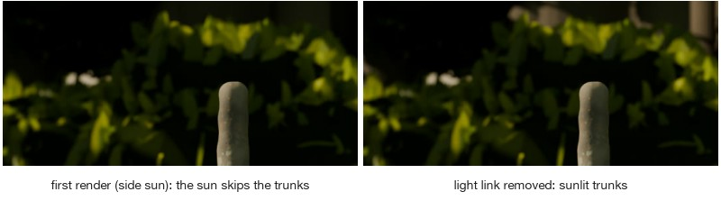

### Sun, sky and fill

A low, hard, golden sun (**PA_Sun**: 0.53°, the real sun's size, colour (1.0, 0.66, 0.36), strength 25) comes from
behind the hand, a little to the left, 25° up. The sky is the v4 two-faced world. It lights the scene in a dim, cool
green-grey ((0.30, 0.42, 0.40) × 0.5), but the camera sees warm gaps ((1.0, 0.80, 0.50) × 1.0, **Light Path** · Is
Camera Ray). The hand's face is in its own shadow, so a soft area light from the front left (**PA_Fill**, 5 kW) keeps
it out of black. Warm sun against cool shade is what reads as sunlight.

### Trick · put the sun behind the subject


The light took three renders. The first had the sun from the left and a little behind (`SUN_DIR` (0.86, −0.22,
−0.46)). The camera looks at the palm, and for a surface facing the camera N · L was about −0.2: everything in the
shot was the hand's shadow side, lit only by the sky and the fill, and it read as overcast. A stronger sun with a
dimmer sky and fill (sun 7.5 → 14, sky 0.6 → 0.35, fill 9 → 2.5 kW) changed almost nothing on the hand.

The second turned the sun round to the front left ((0.86, 0.22, −0.40)). Every knuckle got a lit side and a shadow
side, and the hand threw its shadow across the moss. That is correct, but it still did not read as strong sun:
sunlit grey stone is only lighter grey stone, and with the sky and fill low, the whole frame got darker.

The final sun stands behind the hand ((0.45, −0.78, −0.43)). Sunlight shows best where a photographer looks for it,
in thin things with the light behind them. Every moss tip glows, a rim of light runs down the finger and its cords,
the stem glows warm, the cap's edge gets a halo, and the shadows run towards the camera across bright moss. For the
dark face of the hand the fill went up to 5 kW, and exposure +0.4 with a bloom of 0.5 lets the bright edges glow.
The canopy holes and the shade behind the hand are worked out from `SUN_DIR`, so they followed on their own.

### Canopy

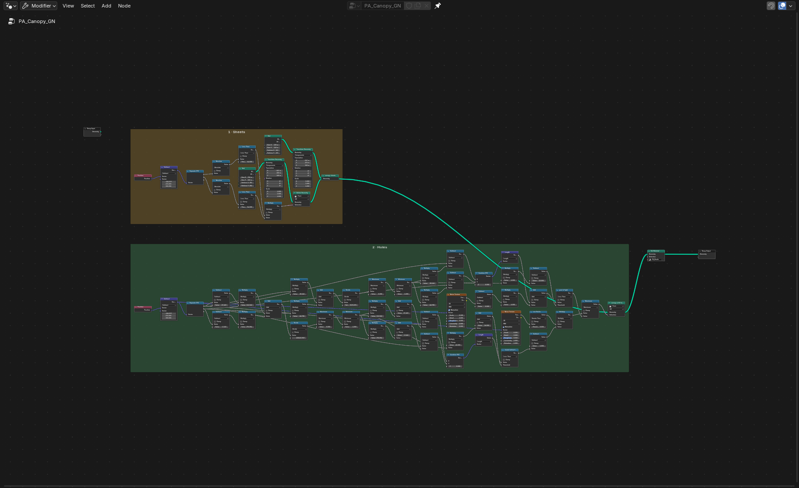

This is the v4 canopy trick:
two sheets 1.5 m up that are invisible to the camera and only cast shadows, with holes cut where the light must land.
The holes are drawn in ground-projected space. Here the `pool of light` runs from the hand's foot to where the ray past
the cap's top meets the ground, so the whole hand and its mushroom stand in sun. The strip `shade behind the hand`
keeps the forest behind the finger in leaf shade, along the line the middle camera looks down. The pale cap and the
white cords then have a dark backdrop.

### Forest and trunks

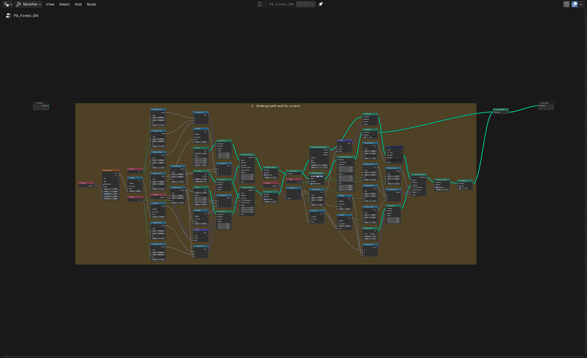

**PA_Forest_GN** is the v4 undergrowth (90 dark masses dressed in leaves) plus 80 `far crowns` up to 3.3 m high and
10 m away. In the close-up the camera looks slightly up, and without the crowns the sky would show behind the cap. The
forest casts no shadows. Its dark masses are near black, smooth-shaded and have no specular at all
(`Specular_IOR_Level` 0). Under the low sun their flat faces shone as grey planes, and with any lighter colour their
smooth shapes showed as pale green slabs in the bokeh. Only the leaves on them should catch the sun.

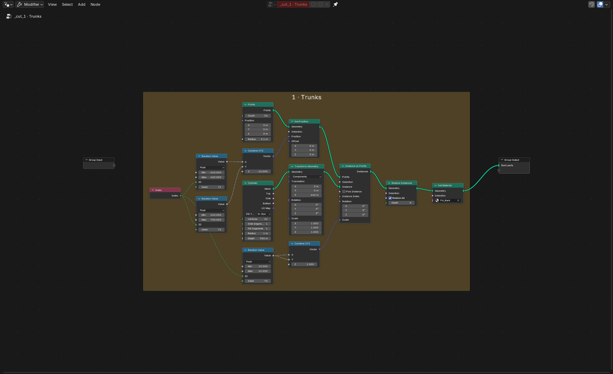

**PA_Trunks_GN** stands 34 trunks 2.6–7 m behind the hand, each 20–52 cm thick and 9 m tall. They are only ever seen
out of focus.

### Trick · let the sun skip the trunks

Lit by a low side sun, even dark bark turns into pale grey columns, and next to a stone hand they read as more stone.
The figure at the top of this section shows it under the first render's sun, from the left and a little behind.
**Light linking** in Cycles solves it at the source: the sun does not light the trunks at all, while the sky and the
fill still do. Under the final backlight the trunks face the camera with their shadow side, so the link matters less:
without it, only a thin rim of light shows on the nearest trunk at the top right. It costs nothing, so it stayed.

```python
skip = bpy.data.collections.new('PA_SunSkips')
skip.objects.link(trunks)
skip.collection_objects[0].light_linking.link_state = 'EXCLUDE'
bpy.data.objects['PA_Sun'].light_linking.receiver_collection = skip
```

In the UI, that is **PA_Sun** → Object Properties → Shading → Light Linking → Receivers, with **PA_Trunks** set to
Exclude. The trunks are their own object for this reason. In v4 they were part of the forest.

> **Try it:** set `SUN_DIR` back to the first render's (0.86, −0.22, −0.46), rebuild, clear **PA_Sun**'s Light Linking
> receivers and render frame 1. The trunks at the top turn pale and the forest behind the hand looks like a ruin of
> stone pillars.

---

## 8 · Camera

The camera is the only thing with keyframes. A Python loop in `build.py` (`rig`) writes one key per frame for the
camera, its target, the focus distance and the f-stop, from three set-ups:

| set-up | camera → target | distance | f-stop | what it shows |
|---|---|---|---|---|
| wide | (−22, −96, 10) → (−1.2, 0.6, 11) | 98.8 | 0.11 (f/11) | the whole hand in its clearing |
| finger | 62 in front of, 13 left of and 6 below a point 1.6 under the fingertip | 63.6 | 0.05 (f/5) | the finger and its cords, the forest a blur |
| close-up | 26 from a point 3 above the fingertip, a little below it | 26.0 | 0.16 (f/16) | the whole mushroom from under the cap, gills showing |

```
c1 = smooth01((T − 0.33) / 0.40)        # wide → finger, T 0.33–0.73 (frames 100–219)
c2 = smooth01((T − 0.74) / 0.24)        # finger → close-up, T 0.74–0.98 (frames 222–294)
camera = CAM0.lerp(CAM1, c1).lerp(CAM2, c2)
```

In the hold the camera creeps 1.2 cm along its line of sight, so the last 2.5 seconds are not a frozen frame. The lens
is 100 mm. Focus is always on the target. Blender works out the aperture as if 1 unit were 1 m, so in this centimetre
scene every f-stop is 100 times smaller: 0.11 behaves like f/11 on a real lens at real scale. The close-up stops down
to f/16 so that the whole cap and the top of the finger are sharp together.

> **Try it:** in `build.py`, change the close-up distance in `CAM2` (`* 26.0`) to 18 and rebuild. The frame is then
> 6.5 cm wide instead of 9.4. The cap nearly touches the top edge, and only the very tip of the finger is left at the
> bottom, so the last shot barely shows where the mushroom stands.

---

## How it was rendered

- Cycles, 128 samples with denoising, 1080 × 1080, at most 10 bounces (6 diffuse), AgX Medium High Contrast,
  exposure +0.4, persistent data (the moss, the ground and the hand stay in memory between frames).
- All 360 frames were rendered on one machine, an Apple M4 Pro (Metal), with `render_frames.sh` (in `lib/`):
  99 minutes, about 16 seconds a frame. Most of a frame's time goes on re-evaluating the mycelium and the mushroom,
  not on sampling. The two earlier lighting renders ran on a LAN render farm node (RTX 4060, OptiX, through Flamenco)
  in about 70 minutes each. With about 20 million moss curve points, OptiX and Metal render the out-of-focus hair a
  little differently, so a shot is never split between the two.
- A bloom in the compositor (`pb.post(bloom=0.5)`: a **Glare** node, Bloom, threshold 0.8) lets the backlit edges
  and highlights glow.
- Vignette and grain were added in ffmpeg (`vignette=angle=PI/6,noise=alls=5:allf=t+u`): the 5.x compositor has no
  grain node.
- `loop.mp4` was encoded from the frames with libx264 at CRF 16 (`-preset slow`, yuv420p), and `render.png` is
  frame 360 with the same vignette and a still grain (`allf=u`).
- `render-wide.png` is frame 360 rendered from a lower version of the opening camera by `still_wide.py`.

The figures in this tutorial come from the scripts in [`src/`](src/). `hand_stages.py` re-wires the end of
**PA_Hand_GN** for the four Workbench stages. `cost_fields.py` paints `d` and `dt` on the lattice in EEVEE.
`sun_link.py` renders frame 1 with and without the link, from the first render's `.blend` (side sun).
`finger_chain.py` is the side view of **PA_Finger**, drawn with the same arithmetic. `crops.sh` cuts the inputs for
`figs.json`, including frame 133 of the three lighting renders for the sun-direction figure.

## Try it yourself

1. **Turn the hand.** In `build.py`, change `HROT` from −7° to 20°. The hand turns 27° on its base, and everything
   that hangs off it follows: `FINGERTIP` (so the mushroom, the cords' target and both closer cameras), the nails, and
   the footprint the moss and litter leave out. The opening camera stays where it was, so the first shot sees the
   hand from further round on its little-finger side.
2. **Change the gesture.** Straighten the middle finger too, with the index's curls (−0.06, 0.10, 0.07): a ✌. The thumb
   still rests where the middle finger used to curl, so move its last two joints in `THUMB` onto the ring finger.
   Also shorten `inside the fist`, or it shows as a bar under the raised fingers.
3. **Older stone.** In `5 · Weathering`, change the 0.22 in `lumps` to 0.5 and the 0.07 in `pits` to 0.15. The hand
   looks eroded, and since `cav` is measured after the weathering, more grime and more hyphae gather in the new hollows.
4. **More cords.** In `4 · Hyphae and cords`, change the cord start chance 0.0035 to 0.012. About 1 350 paths climb to
   the fingertip, and the finger is sheathed in a white rope of them by frame 150.
5. **Seeds of the colony.** In `where the colony leaves the soil`, change the noise scale 0.12 to 0.5. The patches
   become many small ones, and the colony climbs from all round the base at once.
6. **Move the sun.** Set `SUN_DIR` to (0.86, 0.22, −0.40) or (0.86, −0.22, −0.46), the two earlier renders in
   section 7, and rebuild. The canopy holes and the shade behind the hand are worked out from it, so the hand stays in
   its pool of light; render frame 133 and compare it with the sun-direction figure.
7. **Rebuild from scratch.** `Blender -b --factory-startup --python build.py -- --preview --frame 300` builds the whole
   scene and renders frame 300 to `preview.png` (half size, 32 samples). Add `--save my.blend` to keep the file.

*Made with Blender 5.2 Geometry Nodes for [Nodevember](https://nodevember.com) 2026, Day 8 · Mycelium.*
