# How one maple key spins down through low sun, built as one surface from a single (s, v) field

*A node-by-node walkthrough of Nodevember 2026 · Day 9 · Winged (v5, Solo)*

A single silver maple key (a samara: one seed, one papery wing) spins about its centre of mass, just behind the heavy
nut, wing tip coned up. The
camera falls with it, a little above, so the key fills the frame while dust motes stream past and the sunlit wood far
below drifts upward as soft green and gold bokeh. Halfway through, a gust tips the spin over; the low sun rakes across
the ridged wing; then the key rights itself. The loop is 12 seconds long and has no seam: the key turns a whole number
of times, every wobble repeats once per loop, and the world below slides up exactly one tile.

Nothing is simulated, modelled by hand or textured from an image, and the loop has no keyframes (`pb.audit`: strict
procedural, no issues). The three objects in the scene are empty meshes with a Geometry Nodes modifier each, and the only clock is
the frame number.


| File | What it is |
|---|---|
| [`../loop.mp4`](../loop.mp4) | the render: 1080 × 1080, 288 frames at 24 fps (12 s), Cycles 128 samples, motion blur |
| [`../render.png`](../render.png) | frame 161, near the gust's peak |
| [`../sliders/sliders.mp4`](../sliders/sliders.mp4) | the second video: the same key on nine keyframed modifier sliders, 624 frames (26 s), white clay on black, readout at the bottom |
| [`../nodes/`](../nodes/) | full screenshots of the main node trees |

The scene file (`piece.blend`) and the Python that builds it (`build.py`; `sliders.py` and `hud.py` for the second
video) are not published. Every node is in the screenshots below, and the text names those scripts where a value
lives in them.

Units: **1 unit = 1 cm.** Blender labels lengths in metres, so read "0.1 m" in a screenshot as 1 mm. The key is
5.4 cm from the nut's tip to the wing's tip (5.7 cm with the stub of stalk) and 1.7 cm across the wing at its widest,
about the size of a real silver maple key.

---

## The one idea

> **The whole key is one surface over two numbers.** Every point has an `s` (0 at the stalk's snapped end, 1 at the
> wing tip) and a `v` (0 on the leading edge, 1 on the trailing edge), and lies on the upper or the lower face. One
> node group turns (s, v) into a point on a mid-surface; one UV sphere is wrapped onto it, and a thickness field gives
> it a nut, a paper membrane, a round vein along each edge and raised veins between them. The veins are lines of
> constant "vein number" k(s, v), and the same `k` corrugates the membrane and raises the veins on both faces. So
> shape, veins and relief line up by construction, nothing can poke through anything, and eight sliders reshape it all
> together.


Everything else is bookkeeping around that field:

- **Where does each point go?** `PA_KeyShape`: the outline as a smooth union of stalk-and-nut and wing, then arch,
  bend, twist and a wavy margin, flat over the nut (§ 2).
- **What is it made of?** `PA_Samara` wraps a 400 × 640 UV sphere onto that surface and gives it thickness: a ribbed
  nut, 0.1 mm of paper with raised veins, a round vein along the leading edge and a thinner one along the trailing
  edge (§ 3). `PA_Pericarp` paints veins and nut from the same
  (s, v) (§ 4).
- **How does it fall?** It doesn't: the key spins in place and the world slides up past it (§ 5–8).

### How to read the screenshots

The trees in `piece.blend` are laid out in coloured frames, one per step, in the order the data flows. The frames in
the object trees are numbered (`1 · The key`, `2 · Autorotation`). The frames in node groups and materials are
lettered (`a · Along the key`, `b · Stalk and nut, and the wing, from above`, …).

- Below each heading there is a **cut-out** of just that frame's nodes. Wires coming from another frame enter through
  a **Group Input** on the left, named after what they carry, such as `chord` or `vein number k`. A wire from one
  output of a node group is named after both, as in `shape at (s, v) › Chord`. Wires that leave go to a **Group
  Output** on the right.
- Node titles such as `stalk and nut, seen from above`, `nut bulge` or `vein mask` are the labels in the `.blend`.
  Every **Store Named Attribute** and **Named Attribute** node is titled with its attribute name (`ks`, `phi`, `ws`,
  `wv`, `nut`, `lev`, `mev`, `np`, `rib`).
- Small formulas that `build.py` uses everywhere are node groups, so each shows as one green node: `PA_Smoothstep`,
  `PA_SmoothMax`, `PA_SmoothMin`, `PA_Mix`, `PA_Clamp`, `PA_Harmonic` and `PA_InFrustum` ([Helper
  groups](#helper-groups) shows inside them).

Click any screenshot to see it at full size.

---

## 0 · The map


| # | Section | Tree · nodes | Job |
|---|---|---|---|
| 1 | **Loop clock** | `PA_Loop` · 3 | Loops = (frame − 1) / 288: the only clock |
| 2 | **Key shape** | `PA_KeyShape` · 80 | (s, v) and eight shape inputs → a point on the mid-surface: stalk and nut ∪ wing |
| 3 | **Samara** | `PA_Samara` · 181 | one UV sphere wrapped onto that surface and thickened: nut, membrane, edge veins, ridges, raised veins, ribs |
| 4 | **Pericarp material** | `PA_Pericarp` · 116 | veins painted from (s, v); paper; the nut; light through the wing |
| 5 | **Flight** | `PA_Flight` · 34 | gust, spin, coning, tilt, drift and the world's slide, all periodic |
| 6 | **Key** | `PA_Key_GN` · 13 | the samara moved onto its spin axis, coned, spun and tilted |
| 7 | **Motes** | `PA_Motes_GN` · 30 | 320 specks of dust in two depth bands, sliding past |
| 8 | **Flecks** | `PA_Flecks_GN` · 32 | 70 sunlit leaves far below that are only ever seen as bokeh |
| 9 | **Light, camera, world** | Python | a low sun linked to the key and motes; 100 mm lens at f/10 |
| 10 | **The sliders reel** | `sliders.py`, `hud.py` | the same samara on keyframed modifier sliders, with a readout |

Node counts leave out frames and group inputs and outputs; a helper group counts as one node. With frames and group
inputs and outputs, the file holds 625 nodes.

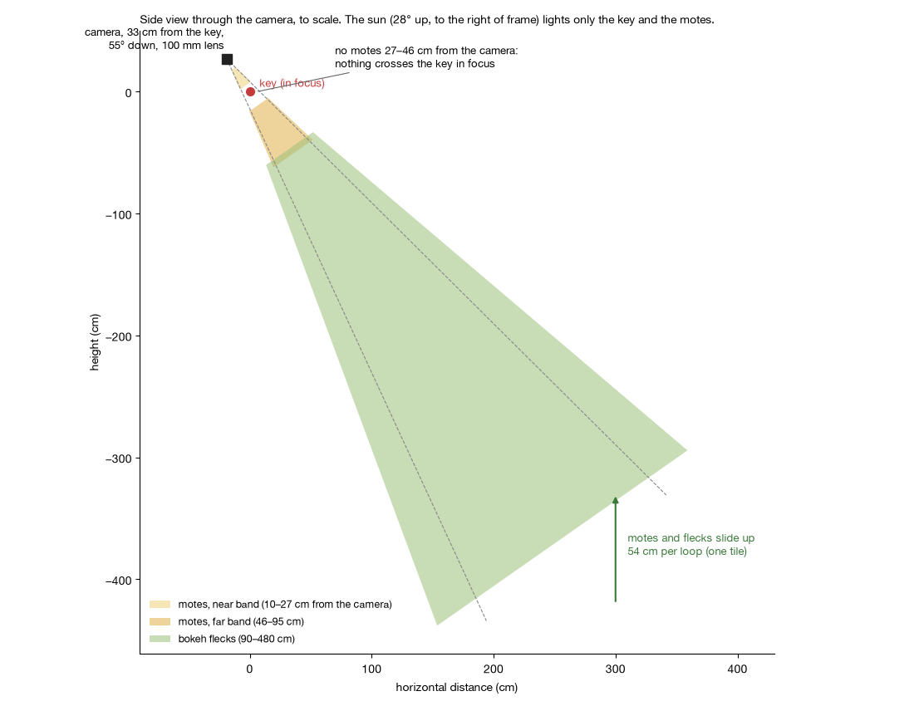

The camera and the key never move. Only the things around them do: the motes and the flecks slide up 54 cm per loop,
the distance the key "falls" in nine turns at 6 cm a turn. Nothing sits between 27 and 46 cm from the camera, so
nothing in focus ever crosses the key.

---

## 1 · Loop clock

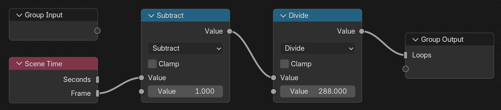

`PA_Loop` is three nodes: **Scene Time** → Frame − 1 → ÷ 288. Its output `Loops` is 0 on frame 1, 1 on frame 289
(which is frame 1 again), and keeps counting after that. Every motion in the piece is written as a function of
`Loops` that has the same value at t and t + 1: a whole number of turns, or a sine with a whole number of cycles
per loop. That is the whole seam strategy; no frame is ever blended or cross-faded.

---

## 2 · Key shape

`PA_KeyShape` takes `s` and `v` and the eight shape inputs and returns a **Position** on the key's *mid-surface*: a
sheet with no thickness that runs from the snapped end of the stalk to the wing tip. It also returns the numbers
`PA_Samara` needs to thicken that sheet (`x`, `Span`, `Chord`, `Plan y`, `Nut half-width`). It knows nothing about
meshes: `PA_Samara` calls it three times for each of the key's 51 042 vertices.

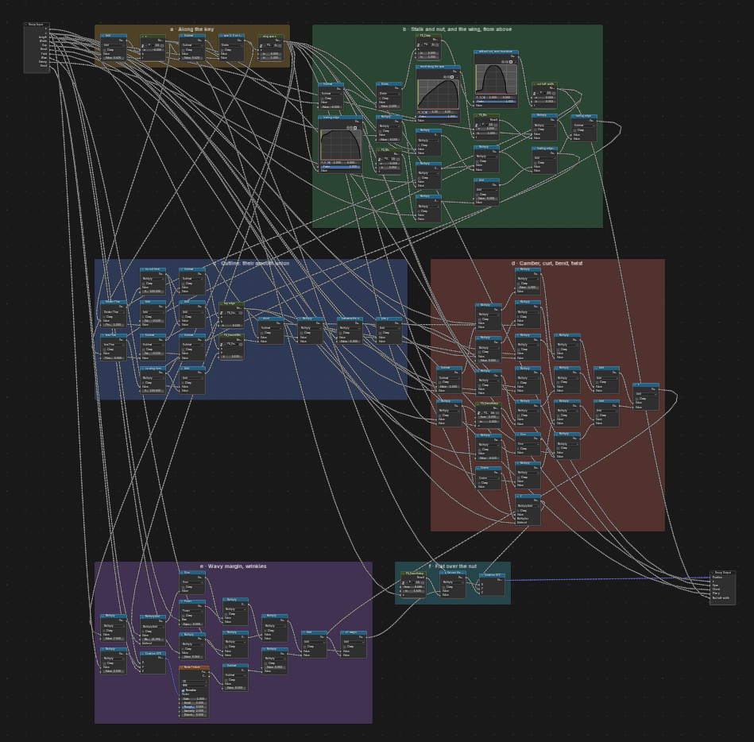

The key's own frame: the nut's tip is at the origin, the span runs along +x, the leading edge is on the +y side and
the upper surface faces +z.

### a · Along the key

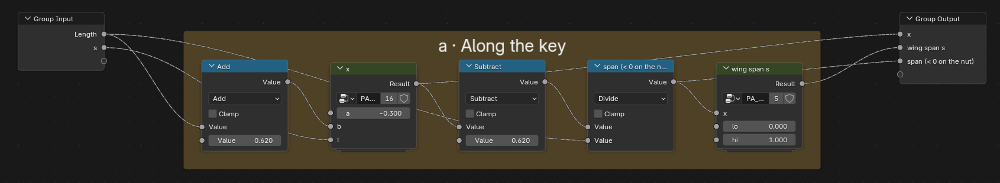

`x` = mix(−0.30, 0.62 + Length, s) runs from the stalk's snapped end (x = −0.30 cm) to the wing tip (5.42 cm for the
hero key). The wing starts halfway along the 1.25 cm nut, at x = 0.62 cm, where a real key's wing grows out of the
side of the seed. `span (< 0 on the nut)` = (x − 0.62) / Length, and `wing span s` is that clamped to 0..1. So two
numbers run along the key: `s` along all of it, and `wing span s` along the wing only (0 at its root, and 0 everywhere
in front of the root).

### b · Stalk and nut, and the wing, from above

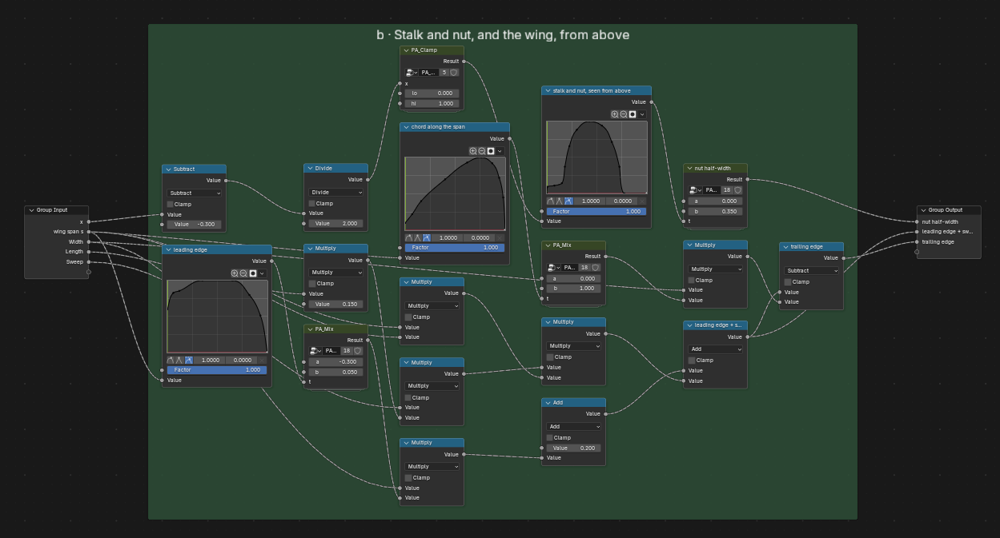

Two outlines seen from above, each drawn by Float Curves:

| Value | Formula | Hero key |
|---|---|---|
| `nut half-width` | `stalk and nut, seen from above`(x) | 0.03–0.04 cm along the stalk, 0.35 cm at x = 0.55, 0 at the nut's back end (x = 1.25) |
| `leading edge + sweep` | 0.20 + Width × `leading edge`(span) + Sweep × 0.15 Length × span² | the wing's front edge: almost straight, then curving back to the tip |
| `trailing edge` | `leading edge + sweep` − Width × `chord along the span`(span) | 0.17 cm behind the leading edge at the root, 1.7 cm at span 0.76, meeting it at the tip |

(Here *span* is `wing span s`.) The stalk and nut are centred on y = −0.12 cm, so the nut's upper edge sits about level
with the wing's leading edge, as on the reference keys. `chord along the span` is narrow at the root (0.10 of Width),
widest at span 0.76 and closes to 0 at the tip. `leading edge` rises a little, then drops by 0.35 × Width over the
last third, which gives the rounded, back-swept tip. Width scales both, so a wider key is not just a stretched one.

### c · Outline: their smooth union


The key's outline is the union of the two shapes: at each x, its top edge is the higher of the two upper edges and
its bottom edge the lower of the two lower edges. Where a part does not exist, its edges are pushed 100 cm out of
the way: `no nut here` = 100 × (x > 1.25), `no wing here` = 100 × (span < 0).

A plain maximum and minimum would leave a sharp notch where the wing's trailing edge leaves the nut. `PA_SmoothMax`
and `PA_SmoothMin` round it off over k = 0.1 cm: smooth max(a, b) = max(a, b) + k/4 × (1 − |a − b| / k)² while a and
b are within k of each other, and the plain maximum after that. That rounded notch is the key's neck.

| Value | Formula |
|---|---|
| `top edge` | smooth max(nut's upper edge − `no nut here`, `leading edge + sweep` − `no wing here`) |
| `chord` | `top edge` − smooth min(nut's lower edge + `no nut here`, `trailing edge` + `no wing here`) |
| `back across the chord` | −v × `chord` |
| `plan y` | `top edge` + `back across the chord`: where (s, v) lies, seen from above |

So v = 0 is the top edge all along the key (the stalk's and nut's upper side, then the wing's leading edge) and v = 1
is the bottom edge.

![Top: the key's outline from above, drawn with the same curves: the stalk and nut in red dashes, the wing's leading and trailing edges in blue dots starting inside the nut, and their smooth union in black, with a rounded neck where the wing's trailing edge leaves the nut. Middle: the stalk and nut from the side, a second Float Curve, 4.8 mm thick at its widest and fading into 0.1 mm of membrane by x = 1.7 cm. Bottom: four cross-sections, a round stalk, an oval nut, the neck where the nut meets the leading-edge vein, and the wing at its leading edge, a thin membrane ending in a round vein](images/outline.png)

The figure redraws this frame in numpy with the same curves (`tutorial/src/plots.py`), with Cup, Bend, Twist and Wave
at 0. The middle panel is the second Float Curve, used in § 3 c, and the bottom row cuts the finished key across at
four places.

### d · Camber, curl, bend, twist

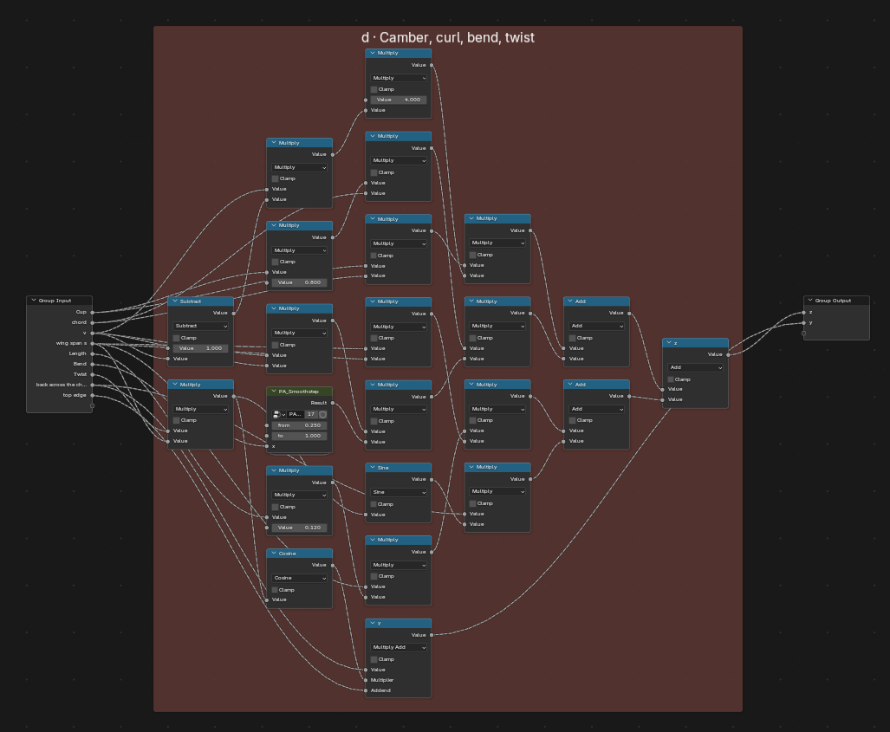

- **Camber:** Cup × chord × 4v(1 − v), an arch across the chord, highest at mid-chord (0.41 cm for the hero key's
  Cup 0.24 where the chord is widest).
- **Curl:** 0.8 Cup × chord × v² × smoothstep(0.25, 1, span): the trailing edge lifts more than the arch alone, and
  more towards the tip.
- **Bend:** Bend × 0.12 Length × span²: the span curves up towards the tip (0.17 cm for the hero key).
- **Twist:** the chord turns about the top edge by Twist × span radians (14° at the tip for Twist 0.25). The node `y`
  is `back across the chord` × cos + `top edge`; the sine part goes into `z`.

Curl, bend and twist read `wing span s`, which is 0 in front of the wing, so only the camber reaches the nut. Frame f
deals with that.

### e · Wavy margin, wrinkles

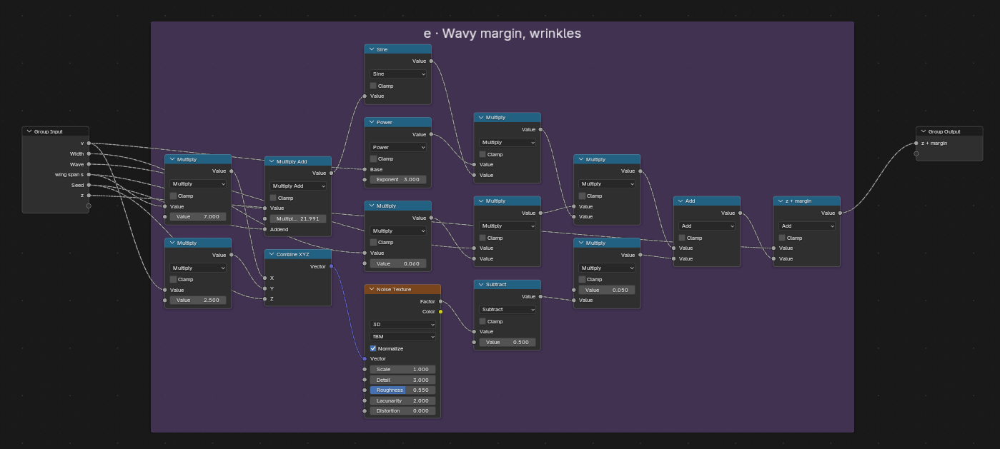

`Wave` × 0.06 Width × v³ × sin(2π · 3.5 span + Seed) ripples the trailing edge: three and a half waves along the
span, nothing at the leading edge (v³). The **Multiply Add** node's 21.991 is 2π × 3.5. Seed shifts the waves along
the span. A Noise Texture over (7 span, 2.5v, Seed) adds about a tenth of a millimetre of wrinkle everywhere, so no
two keys are mirror-smooth. The result is `z + margin`.

### f · Flat over the nut

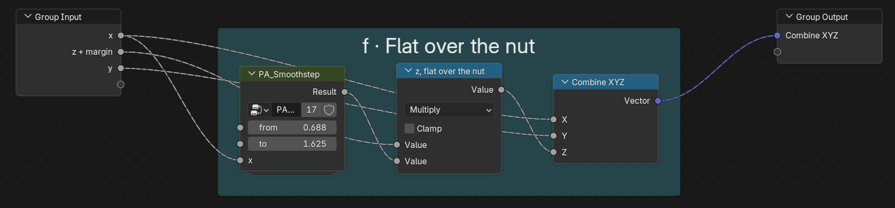

`z, flat over the nut` = z × smoothstep(0.69, 1.63 cm, x), from 0.55 to 1.3 nut lengths. The stalk and nut keep a flat
mid-surface and get all their roundness from the thickness in § 3 c, a hump on each side of a flat sheet. The arch,
the bend and the waves begin behind the nut and are at full strength 0.4 cm past its end.

> **Try it:** connect `z + margin` straight to the **Combine XYZ**, skipping frame f. The nut's mid-surface then
> arches with the wing: by 1.7 mm across the nut's 7 mm width at the hero's Cup 0.24, and by 3.9 mm at Cup 0.55
> (frame 201 of the sliders reel), more than the nut's 2.4 mm half-thickness.

---

## 3 · Samara

`PA_Samara` builds one key at the origin from the same eight inputs (Seed, Length, Width, Cup, Bend, Twist, Wave,
Sweep). Stalk, nut, wing and leading-edge vein are **one closed surface**: one UV sphere, every vertex moved once, one
material.

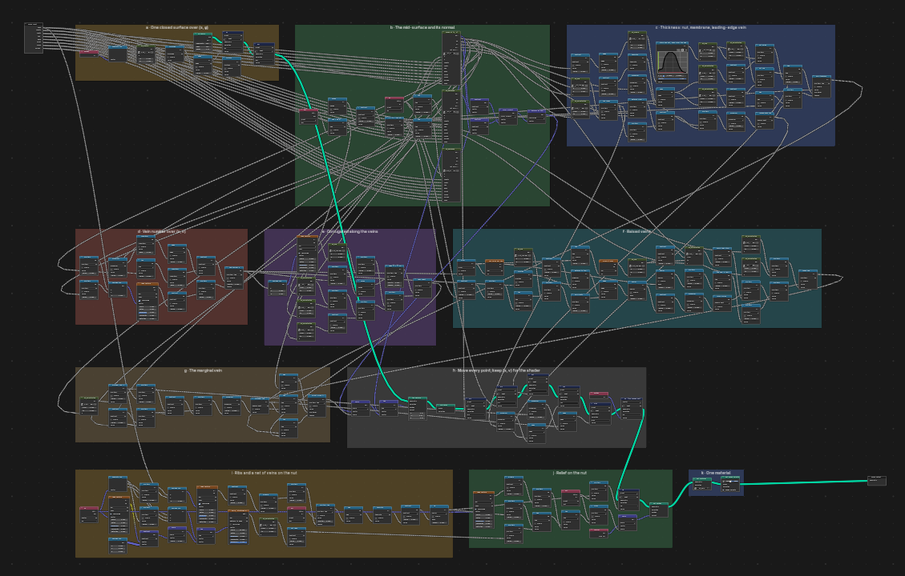


### a · One closed surface over (s, φ)

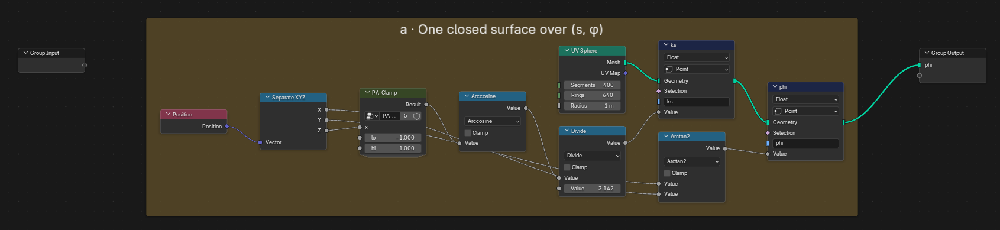

A **UV Sphere** of radius 1 with 640 rings (along the key) and 400 segments (around it): fine enough that the
vertices sit about 0.13 mm apart across the middle of the wing, so even a narrow raised vein (frame f) gets several of
them. Two numbers are stored on it before anything moves. `ks` = arccos(z) / π runs 0 → 1 from the top pole to the bottom pole and becomes `s`, the place
along the key. `phi` = atan2(y, x) runs −π → π around each ring and becomes the place around the key's cross-section.
The two poles become the two ends of the key: the stalk's snapped end and the wing tip.

### b · The mid-surface and its normal

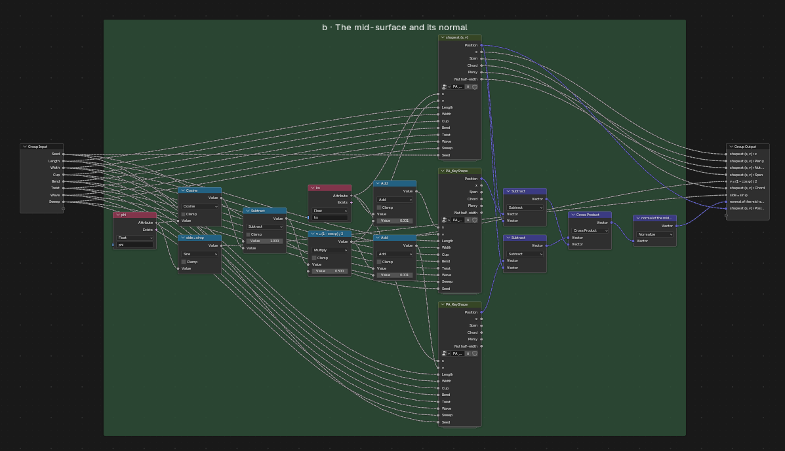

Going once round a ring, φ runs from 0 at the leading edge, over the upper face to ±π at the trailing edge, and back
under the lower face. `v = (1 − cos φ) / 2` turns that into the place across the chord, visited twice per ring, once
on each face; `side = sin φ` says which face, and how far from the edges. `shape at (s, v)` is `PA_KeyShape` at that
point. Two more calls, a step of 0.001 along s and along v, give two directions along the sheet; their cross product
is the `normal of the mid-surface`.

The **Normal** node can't give this: the mid-surface is never built as geometry, and the sphere's own normal points
away from its centre.

### c · Thickness: nut, membrane, leading-edge vein


Every point will sit `half-thickness` away from the mid-surface, along its normal:

  half-thickness = sin φ × (nut bulge + 0.005) + sign(sin φ) × leading-edge vein

| Node | What it gives | Hero key |
|---|---|---|
| `stalk and nut, seen from the side` | a second Float Curve over x: how thick the stalk and nut are | 0.032–0.038 cm on the stalk, 0.24 cm at x = 0.55, gone by x = 1.7 |
| `nut bulge` | that × (1 − smoothstep(0.9, 1.5, off)), with off = distance from the nut's centre line ÷ its half-width | the bulge ends at the nut's own edges, so the wing beside the nut stays paper |
| 0.005 | the membrane | 0.1 mm of paper everywhere |
| `vein radius` | mix(0.04, 0.014, wing span s) × smoothstep(0.7, 1.15, x) | 0.4 mm at the wing's root, 0.14 mm at its tip, nothing on the nut |
| `leading-edge vein` | √(d (2r − d)), with d = `distance from the leading edge` = v × chord, while d < 2r | the half-height of a circle of radius r touching the top edge: a round tube |
| `nut skin` | where the nut is, for the shader | stored as `nut` in frame h |

Why sin φ: across the chord, y follows cos φ (frame b) and the thickness follows sin φ, so a constant thickness makes
an ellipse. That is why the stalk and the nut come out round in cross-section, and why the two faces would meet in a
sharp edge at φ = 0 and ±π. The vein term is multiplied by the sign of sin φ instead, so it adds the same height to
both faces: a circle around the leading edge. Frame g rounds the trailing edge the same way.

### Trick · one surface, so nothing pokes through

A first version of this key was three meshes (a membrane, a vein tube and a squashed sphere for the nut) and needed a
whole frame of nodes to keep the wing's root inside the nut. At high Cup or Wave it still came through the nut's skin.
Here every point is the mid-surface plus or minus a thickness along one normal: the upper face always lies on the
+normal side and the lower face on the −normal side, and the nut and the vein are only places where that thickness is
larger. There is no second surface for anything to cut through, at every slider value the reel visits.

### d · Vein number over (s, v)

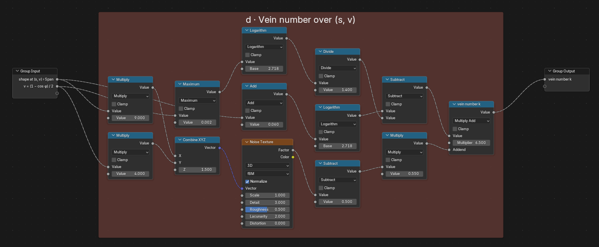

A silver maple key's veins fan out of the root: the ones that start near the trailing edge reach it quickly, the ones
near the leading edge run beside it to the tip. The curves v = (s'/a)^1.4, with s' = span + 0.06, do exactly that: a
small `a` meets the trailing edge near the nut, a large `a` runs on to the tip. Solving for `a` gives each point its
vein's number:

  k = 6.5 × (ln(span + 0.06) − ln v / 1.4) + 0.55 × (noise − 0.5)

A vein runs wherever `k` is a whole number. The 6.5 (`VEINS` in `build.py`) sets how many there are; the noise (over
9 span, 4v and 1.5, the key's `tint` × 10) bends them a little so they are not perfect curves.

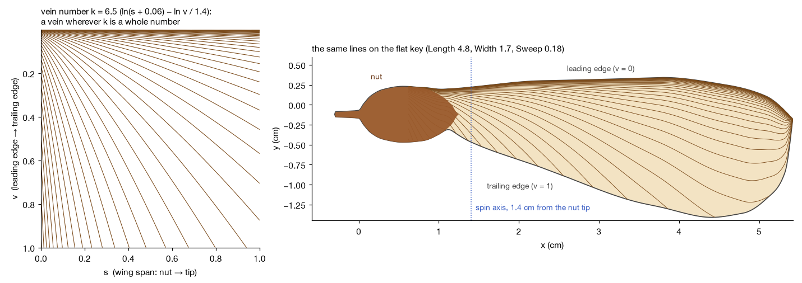

### e · Corrugated along the veins

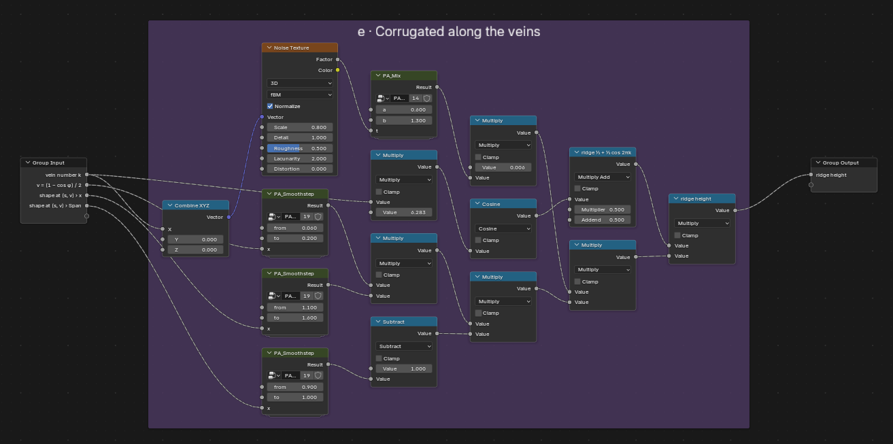

`ridge ½ + ½ cos 2πk` is 1 on every vein and 0 halfway between two. `ridge height` is that × 0.006 cm × mix(0.6, 1.3,
noise over k): ridges of 0.04 to 0.08 mm, different from vein to vein. They fade out within v < 0.2 (where the
leading-edge vein is), over the nut (x < 1.6 cm) and over the last 10 % of the span.

### Trick · one field for shape, veins and relief

The ridges and raised veins are a fraction of a millimetre, far too small to see as shape, but a low sun raking across
them draws real light and shadow lines. Because the shader paints its veins from the same `k` (§ 4), the shadows fall exactly along
the painted veins and the wing reads as stiff, ribbed paper instead of flat clay.

> **Try it:** in frame d, change the **Multiply Add**'s 6.5 to 3.25. The ridges and raised veins halve, but
> `PA_Pericarp` still paints 6.5 veins per unit, and the shadow lines drift off the painted veins. Change `VEINS` in `build.py` instead and
> rebuild: both follow.

### f · Raised veins


Cross-sections of a samara wing ([Ezra, Levavi and Bar-On, *Acta Biomaterialia* 158,
2023](https://www.sciencedirect.com/science/article/pii/S1742706122008431)) show its veins as bundles just under both
skins, each bulging the surface outwards, and the wing's free edge finished by one thick marginal vein. The
corrugation in frame e bends the paper but keeps it equally thick everywhere. This frame and the next thicken it.

| Node | What it gives | Hero key |
|---|---|---|
| `distance to the nearest vein` | min(fract k, 1 − fract k) | 0 on a vein, ½ halfway between two |
| `one value per vein` | White Noise of floor(k) | the same number `PA_Pericarp` frame b uses for that vein's painted width |
| `half-width` | (0.05 + 0.07 (1 − v)) × mix(0.5, 1.5, one value) × 1.5, in units of k | 1.5 times the painted vein's: 0.15–1 mm wide, narrower towards the trailing edge |
| `round profile` | √(1 − (distance ÷ half-width)²) | a rounded bump, 1 on the vein's crest |
| `some veins stop short` | 1 − smoothstep(end − 0.15, end, v), end = mix(0.45, 1.3, White Noise of floor(k) + 0.5) | each vein ends where its painted line ends |
| `vein size: a few big ones` | 0.25 + 2 × (one value)³ | most veins low, about one in five standing out, as on the reference keys |
| `raised vein` | 0.011 cm × size × profile × stop, faded in over v 0.04–0.12 and x 1.1–1.6 cm | crests 0.03–0.25 mm above the paper, on each face |

Because the bumps follow the same `k`, the same vein width and the same end points as the painted veins, the dark lines
in `PA_Pericarp` run along their crests.

### g · The marginal vein

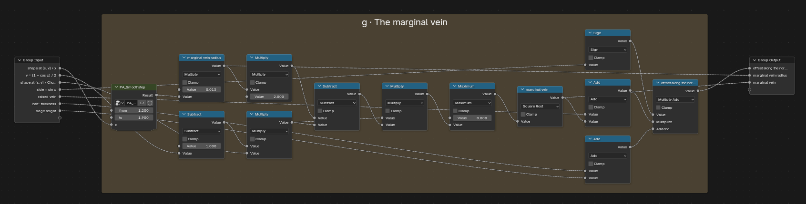

| Node | What it gives | Hero key |
|---|---|---|
| `marginal vein radius` | 0.015 cm × smoothstep(1.2, 1.9, x) | 0.15 mm along the wing, none on the nut |
| `marginal vein` | √(d (2r − d)), d = (1 − v) × chord | a round tube along the trailing edge, like the leading-edge vein in frame c |

`offset along the normal` = `half-thickness` + `ridge height` + sign(sin φ) × (`raised vein` + `marginal vein`). The
sign of sin φ pushes the two faces apart on a vein instead of moving them together, so the wing is thicker there, and
the trailing edge ends in a bead instead of a knife edge.

### h · Move every point; keep (s, v) for the shader

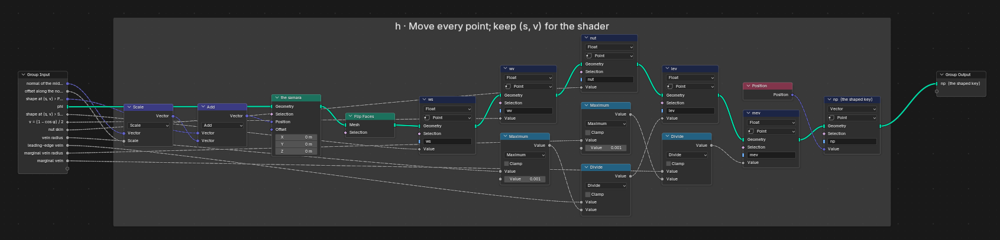

**Set Position** (`the samara`) moves every vertex of the sphere to `shape at (s, v)` + normal × `offset along the
normal`. Both faces move by the same ridge height, so the paper corrugates; the veins push them apart. **Flip
Faces** turns the normals outwards again: φ runs round the rings the opposite way to the key's own frame, which turns
the surface inside out.

Then six attributes for the frames below and for the shader:

| Attribute | Value |
|---|---|
| `ws` | `wing span s`: 0 on the stalk and nut, 0 → 1 along the wing |
| `wv` | v: 0 on the top edge, 1 on the bottom edge |
| `nut` | `nut skin`: 1 on the stalk and nut, 0 on the wing |
| `lev` | `leading-edge vein` ÷ `vein radius`: 1 on the vein's crest |
| `mev` | `marginal vein` ÷ its radius: 1 on the crest along the trailing edge |
| `np` | the shaped position |

### Trick · fields are read where they are used

Frame i needs the angle round the key to lay out the nut's ribs, but by then every point has moved: atan2 of the
**Position** there would be an angle about the shaped key's origin, which means nothing. So frame a stores `phi` and
`ks` on the sphere, and the attributes travel with the vertices. The shader works the same way: it paints veins in
(s, v) on a key that is curved, twisted and corrugated. A Geometry Nodes field has no value until a node evaluates it
on some geometry, and **Position** means "where this point is now".

### i · Ribs and a net of veins on the nut

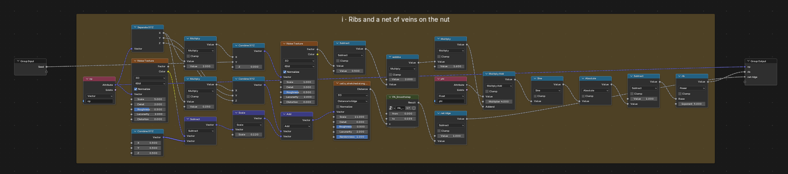

`rib` = (1 − |sin(4φ + 1.6 wobble)|)⁵: eight narrow ridges round the key, four on each face, one at each zero of
sin 4φ, wandering sideways with a `wobble` noise along x. `cells, stretched along the nut` is a Voronoi distance to
edge (scale 11) over `np`, squeezed to 0.35 along x and warped by a noise; `net ridge` = 1 − smoothstep(0, 0.035,
distance) is the raised net of veins on the seed's skin in the reference photos.

### j · Relief on the nut

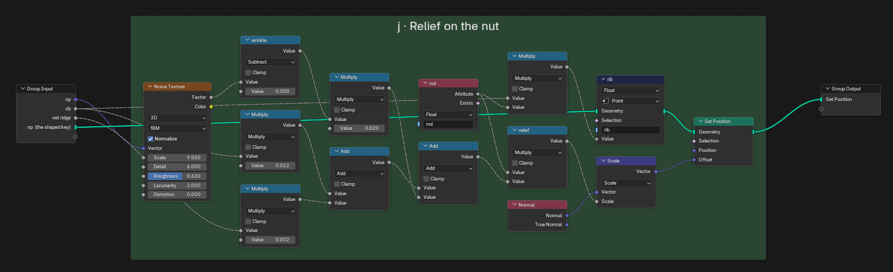

**Set Position** pushes the surface along its own **Normal** (the shaped key's, now) by `relief` = `nut` × (0.022 cm ×
rib + 0.0025 cm × net ridge + 0.02 cm × wrinkle): ribs 0.2 mm proud, a fine net and creased skin, all fading out with
`nut` where the nut turns into the wing. `rib` × `nut` is stored for the shader.

### k · One material

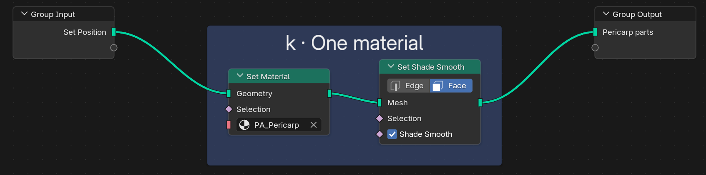

**Set Material** `PA_Pericarp` (the fruit wall: a samara's wing and its seed's shell are one organ) and **Set Shade
Smooth**. The key is 255 602 vertices and 511 200 triangles: one closed surface.

---

## 4 · Pericarp material

`PA_Pericarp` paints the whole key. The attribute `nut` blends from the wing's paper to the nut's shell, so the colour
runs through the neck as smoothly as the surface does.

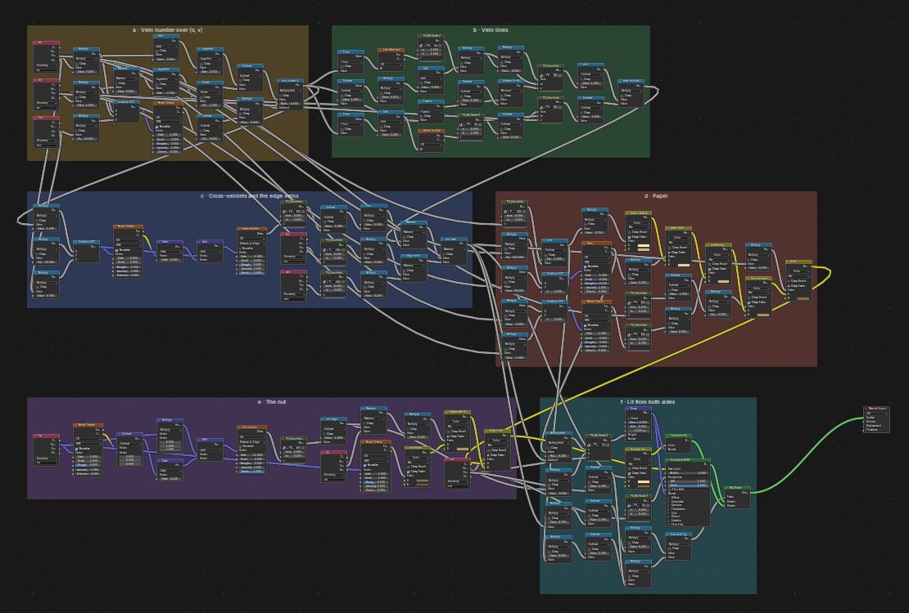

### a · Vein number over (s, v)

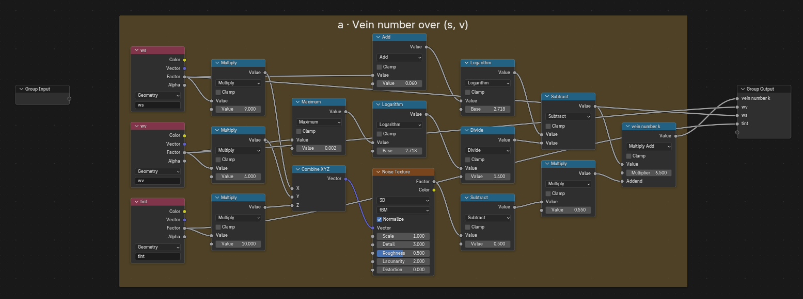

The shader rebuilds `vein number k` from the `ws`, `wv` and `tint` attributes, with the same formula, the same 6.5 and
the same noise seed (`tint` × 10 = 1.5) as `PA_Samara` frame d, so the painted veins sit on the ridges.

### b · Vein lines

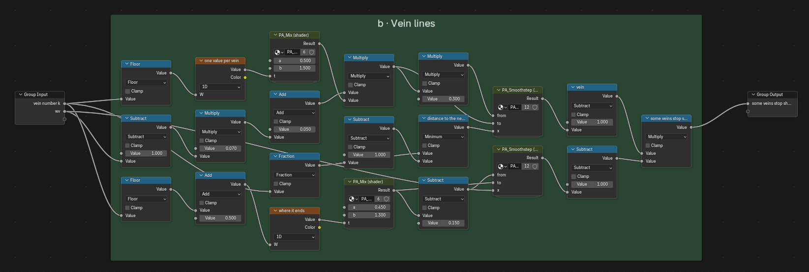

| Node | What it gives |
|---|---|
| `distance to the nearest vein` | min(fract k, 1 − fract k): 0 on a vein, 0.5 halfway between |
| `one value per vein` | White Noise of floor(k): each vein gets its own random number |
| `vein` | 1 − smoothstep(0.3 w, w, distance), with w = (0.05 + 0.07 (1 − v)) × mix(0.5, 1.5, that number): veins are thicker near the leading edge, and each one differs by up to ±50 % |
| `where it ends` | a second random number per vein, mapped to v = 0.45 … 1.3 |
| `some veins stop short` | `vein` × (1 − smoothstep(end − 0.15, end, v)): many veins fade out before they reach the trailing edge, as on the reference keys |

### c · Cross-veinlets and the edge veins

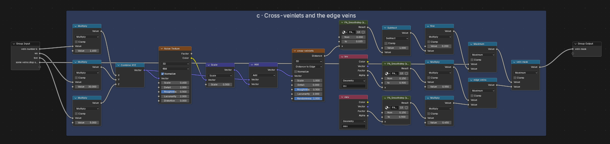

`fine` = 0.2 × (1 − smoothstep(0, 0.035, d)), where d is a Voronoi distance to edge over (1.6 k, 30 s, 5 tint),
warped by a noise: the faint net of `cross-veinlets` between the veins. `edge veins`, the larger of 0.55 ×
smoothstep(0.15, 0.5, `lev`) and 0.45 × smoothstep(0.15, 0.5, `mev`), darkens the tube along the leading edge (§ 3 c)
and the marginal vein (§ 3 g) towards their crests. `vein mask` is the largest of the three.

### d · Paper

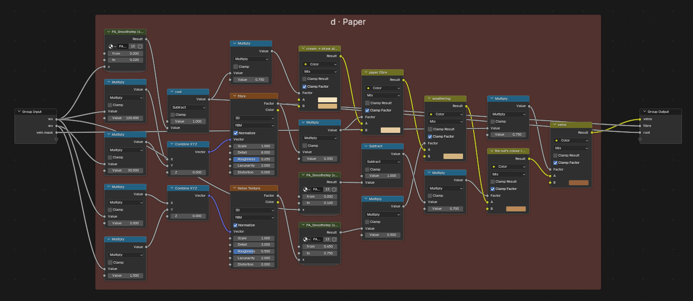

The membrane is cream (0.93, 0.80, 0.54) turning straw-brown over the first 22 % of the span
(`cream → straw at the root`), with fine `paper fibre` noise (over 120 span, 30 v) and soft `weathering` blotches.
`the nut's colour runs into the root` adds a reddish brown over the first 16 % of the span, so the wing darkens into
the nut as on a real key. `veins` paints the vein mask dark brown (0.30, 0.12, 0.045) at 75 %.

### e · The nut

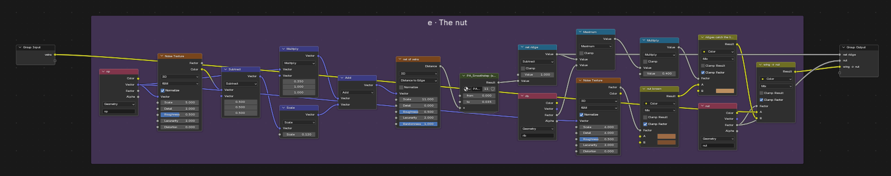

The nut reads `np`, so its pattern sticks to it. `net of veins` is the same Voronoi as in `PA_Samara` frame i (scale
11, 0.35 along x, the same warp), so the painted net lies on the raised one. `nut brown` mottles between (0.34, 0.15,
0.06) and (0.20, 0.08, 0.03), and `ridges catch the light` lightens the ribs and the net by 40 %. `wing → nut` blends
from the wing's colour to the nut's by the `nut` attribute.

### f · Lit from both sides

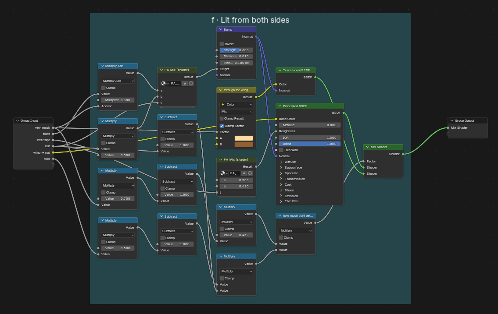

A samara wing is thin enough to glow when the sun is behind it. A **Principled BSDF** (roughness 0.5 on the wing, 0.62
on the nut; sheen 0.35) gives the front. A **Translucent BSDF** gives the back, amber `through the wing` and dark
where the veins block the light. `how much light gets through` is 0.45 × (1 − 0.7 vein mask) × (1 − 0.5 root) × (1 −
nut): up to 45 % of the shading is light through the paper, less on veins and at the root, and none through the nut. A
**Bump** (strength 0.6) from fibre and vein mask on the wing, and from the net on the nut, adds the fine relief that
the geometry cannot.

---

## 5 · Flight

`PA_Flight` turns `Loops` into the key's motion. Every output repeats once per loop.

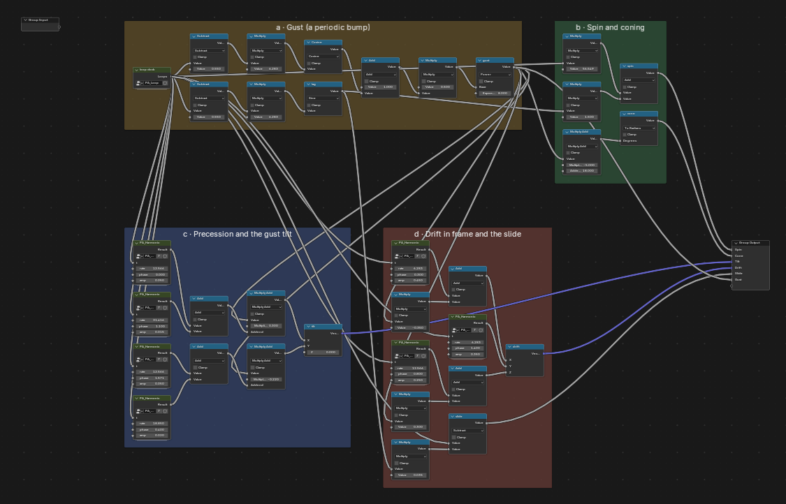


### a · Gust (a periodic bump)

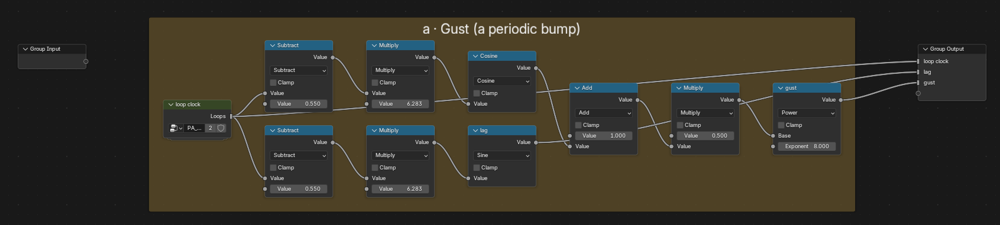

`gust` = (½ (1 + cos 2π (t − 0.55)))⁸. A cosine is periodic; raised to the 8th power it becomes a single smooth bump,
peaking at t = 0.55 (frame 159) and above half strength for frames 132–186, and still exactly the same at t and t + 1.
`lag` = sin 2π (t − 0.55) is its quarter-turned partner, used to speed things up and slow them down around it.

### b · Spin and coning

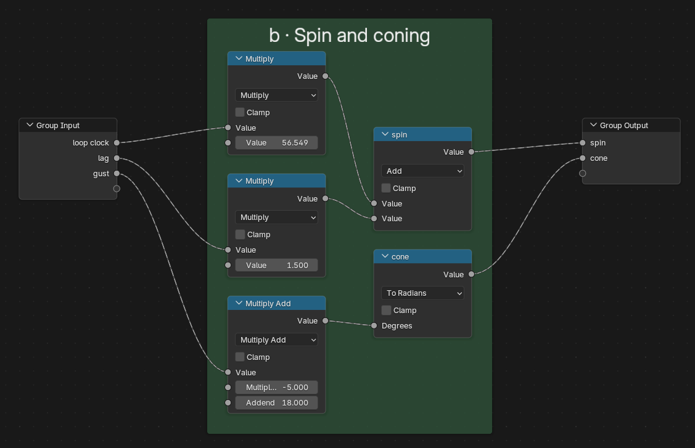

`spin` = 9 × 2π × t + 1.5 `lag`: nine whole turns per loop (0.75 turns a second), with a slow wave of up to ±86° that
makes the key turn faster through the gust. `cone` = 18° − 5° × `gust`: a samara flies with its wing tipped up into a
shallow cone; the gust flattens it to 13°.

### c · Precession and the gust tilt

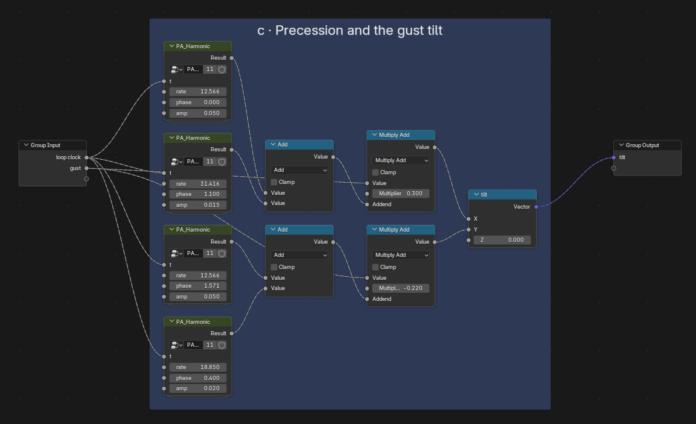

The spin axis is never quite vertical. Two `PA_Harmonic` nodes per axis (2 and 5 cycles per loop on x, 2 and 3 on y,
the two 2-cycle ones a quarter-turn apart) make it circle and wobble by 3–4°, as a real key's axis precesses. In
the gust, `tilt` adds 0.30 rad (17°) about x and −0.22 rad (−13°) about y: the whole spin disc tips, and the sun rakes
across the wing.

### d · Drift in frame and the slide

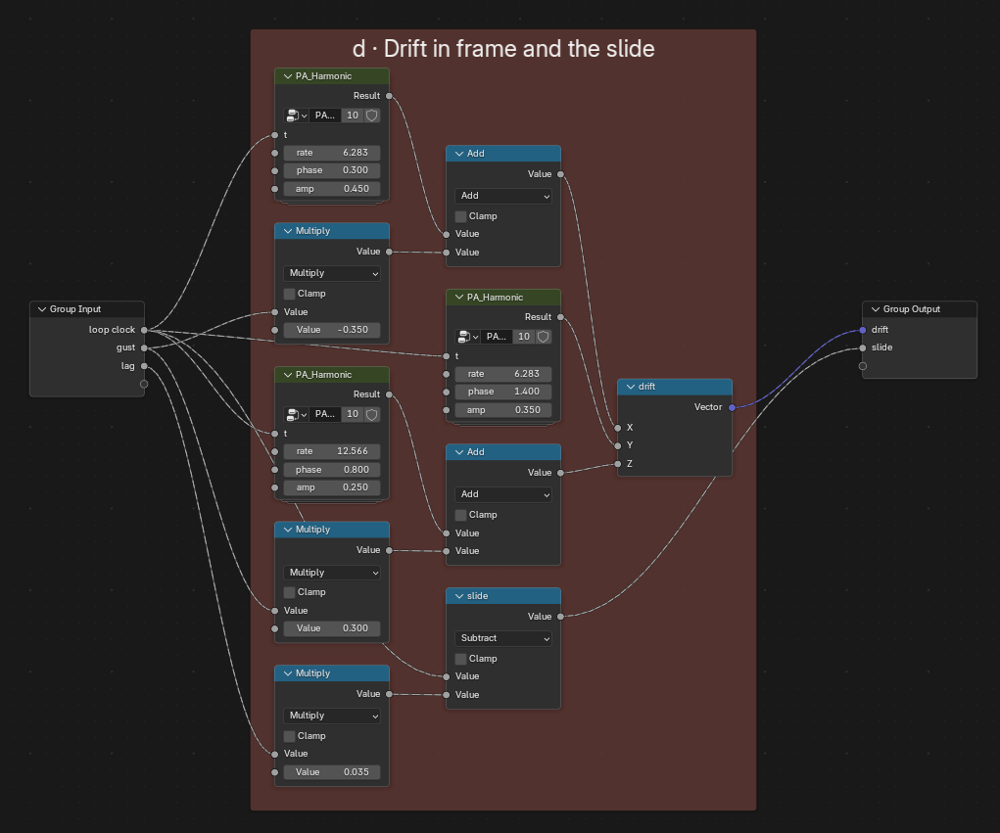

`drift` moves the key around the frame by up to 0.45 cm (x), 0.35 cm (y) and 0.25 cm (z), and the gust pushes it
0.35 cm aside and 0.3 cm up. `slide` = t − 0.035 `lag` is how far the world has slid, in loops: at the gust's peak it
advances 22 % slower (1 − 0.035 × 2π), so the key seems to hang for a moment.

### Trick · whole numbers make the seam

Every term above is either `t` times a whole number of turns or a sine with a whole number of cycles per loop, so frame
289 is frame 1. Change `N_TURN` in `build.py` to 8.5 and the key jumps half a turn at the seam; change it to 8 and it
loops again, just slower.

> **Try it:** set `GUST_AT` in `build.py` to 0.25 and rebuild. The gust moves to frame 73; nothing else changes,
> because the gust, its lag and the slower descent all read the same t − GUST_AT.

---

## 6 · Key

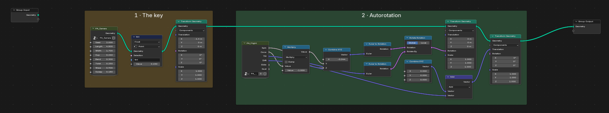

### 1 · The key

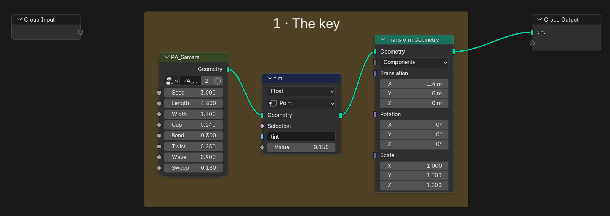

The hero key: Seed 3, Length 4.8, Width 1.7, Cup 0.24, Bend 0.30, Twist 0.25, Wave 0.9, Sweep 0.18. The **Transform**
moves it 1.4 cm along −x, so the object's origin, which is the spin axis, sits 1.4 cm from the nut's tip, where the
wing leaves the nut. A real samara spins about an axis through its centre of mass, and in measured keys that lies 24–30 %
of the way from the nut end ([Nave et al.](https://arxiv.org/abs/2010.12553)); 1.4 cm is 26 % of this 5.4 cm key.
So the nut is not the hub: it swings round a small circle of its own every turn, as strobe photos of falling keys
show.

### 2 · Autorotation

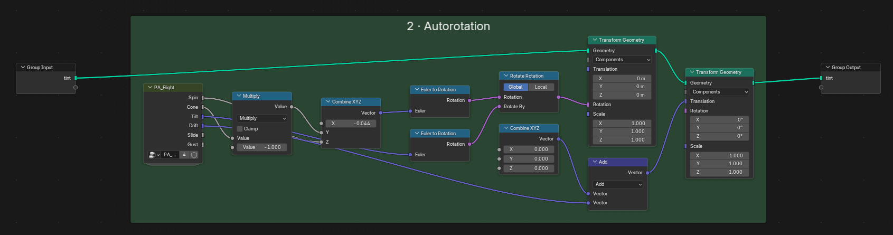

**Euler to Rotation** (−2.5°, −`Cone`, `Spin`) does three things in order: it pitches the wing 2.5° about its span,
leading edge down, raises the tip by the cone angle, and turns the whole key about the vertical. **Rotate Rotation** (global) then tips that
spin disc by `Tilt`, and a last **Transform** adds `Drift`. The order matters: tilting before spinning would tilt the
wing, not the disc.

### Trick · numbers from real keys

| | Real keys | Here |
|---|---|---|
| Pitch, leading edge down | −0.7° to −2.6° gives the most thrust in a wind tunnel ([Jung and Rezgui 2024](https://pmc.ncbi.nlm.nih.gov/articles/PMC11441657/)) | −2.5° |
| Cone | 5–15° gives the most thrust (same study) | 18°, 13° in the gust: a little steeper, so the cone reads on screen |
| Spin axis | the centre of mass, 24–30 % of the length from the nut end ([Nave et al.](https://arxiv.org/abs/2010.12553)) | 1.4 cm, 26 % |
| Fall per turn | 8.5 cm for a Norway maple key (1.10 m/s at 13 turns a second); 6.2 cm for a 3D-printed silver maple key (1.36 m/s at 22 turns a second), same paper | 6 cm |
| Turns a second | 13–22 | 0.75 |

At 0.75 turns and 4.5 cm a second, the loop is a real key slowed about 17–30 times. Against the silver maple numbers it
is slowed 29 times in spin and 30 in fall: the same factor, so it reads as slow motion rather than as a key that
spins too slowly for how fast it drops.

---

## 7 · Motes

Dust and pollen in the sunbeam, on both sides of the key.

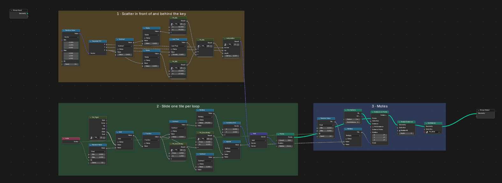

### 1 · Scatter in front of and behind the key

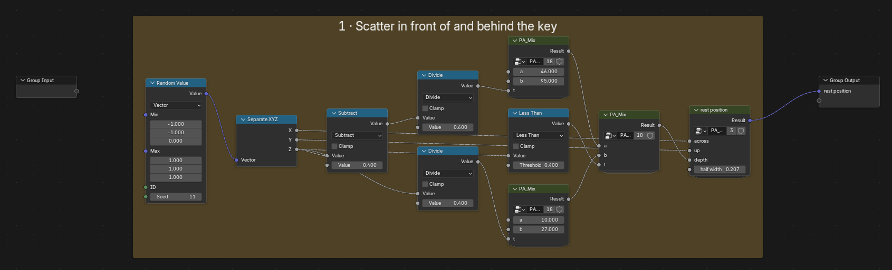

One **Random Value** (vector, seed 11) gives each point two numbers across the view and one depth number `w`. 40 %
(w < 0.4) go to the near band, 10–27 cm from the camera; the rest to the far band, 46–95 cm. `PA_InFrustum` turns
(across, up, depth) into a point inside the camera's view, 15 % wider than the frame, so the motes fill the shot at
every depth: the `rest position`.

### 2 · Slide one tile per loop

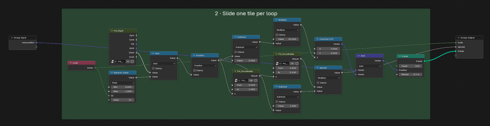

`u` = fract(`Slide` + a random offset per mote) runs 0 → 1 once per loop, each mote at its own phase. The mote sits at
its rest position + (0, 0, 54 cm × (u − 0.5)): it rises 54 cm per loop and then jumps back 54 cm. `appear` =
smoothstep(0, 0.1, u) × (1 − smoothstep(0.9, 1, u)) shrinks it to nothing over 1.2 s either side of the jump. Most
motes are out of view by then, but a far one (46–95 cm away) can still be on screen; shrinking it slowly reads as a
speck drifting out of the sunbeam instead of a pop. **Points** makes 320 of them.

### Trick · slide the world, not the key

A falling key would need a camera that falls with it and a world that never ends. Here the key and camera stay put,
and the world is one 54 cm tile that slides up and wraps. Because `Slide` advances exactly one tile per loop, every
mote is back where it started on frame 289.

### 3 · Motes

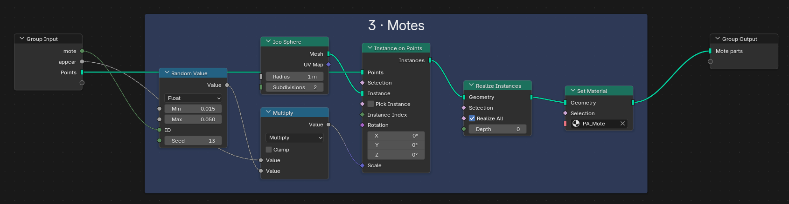

Ico spheres of 0.15–0.5 mm radius, with a warm, glowing `PA_Mote` material (emission 4), so they stay bright when out
of focus.

---

## 8 · Flecks

The wood far below is never modelled. All the camera sees of it are 70 spots of sunlit leaf, far out of focus.

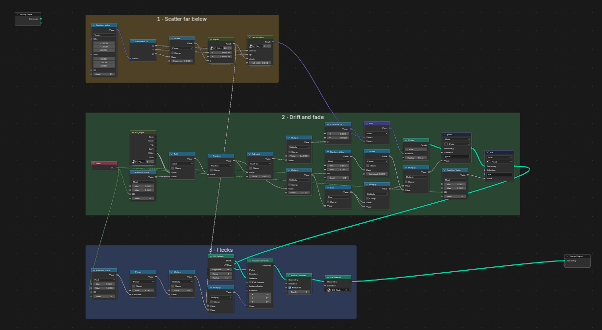

### 1 · Scatter far below

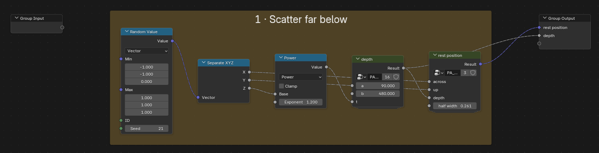

`depth` = mix(90, 480, w^1.2) cm, placed by `PA_InFrustum` 45 % wider than the frame.

### 2 · Drift and fade

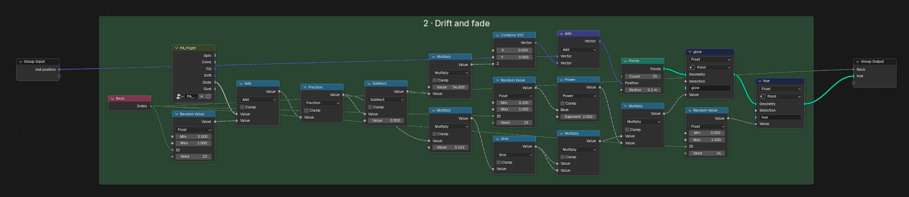

The same slide and wrap as the motes, but instead of shrinking at the jump each fleck fades: `glow` = sin²(π u) ×
(random 0.15–1)². It is dark at the jump and brightest halfway. Squaring the brightness leaves a few bright flecks
among many dim ones, as dappled light does. `hue` picks between leaf green and sunlight.

### 3 · Flecks

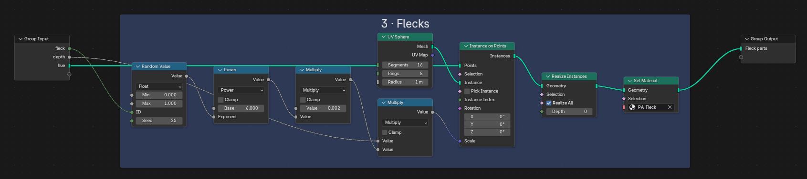

Each fleck's radius is depth × 0.002 × 6^random: 0.2 % to 1.2 % of its distance, so its size on screen doesn't depend
on how far away it is. `PA_Fleck` is pure emission: `leaf green → sun` by `hue`³, strength 4 × `glow`.

> **Try it:** in `PA_Flecks_GN` frame 2, set the **Points** count to 300. The discs overlap into a brighter, busier
> background behind the key; with 70 they read as separate spots of light.

---

## 9 · Light, camera, world

These are set in Python (`camera()` and `light()` in `build.py`).

| | Setting | Why |
|---|---|---|
| **Camera** | 100 mm lens, 36 mm sensor, 33 cm from the key, looking 55° down | at 33 cm the frame is 11.9 cm wide: the key fills about half of it in every turn |
| **Depth of field** | focus 33 cm, f-stop 0.10, round aperture | Blender reads the lens in metres; in a centimetre scene an f-stop of 0.10 gives a 1 cm aperture, which is f/10 for a real 100 mm lens |
| **Sun** | strength 13, warm (1.0, 0.74, 0.46), 0.6° wide, 28° up, to the right and a little towards the camera | low and hard, so the ridges cast shadows |
| **Fill** | strength 0.35, cool (0.62, 0.76, 1.0), from the lower left | keeps the shaded side of the wing from going black |
| **Light linking** | both lights light only the `PA_Lit` collection (the key and the motes) | the wood below stays in deep shade |
| **World** | near black, a little greener towards the horizon (`deep shade`) | a forest floor seen from above, in shadow |
| **Colour** | AgX, Medium High Contrast; motion blur, shutter 0.15 | the wing stays sharp enough at 0.75 turns a second |

### Trick · a 1 cm aperture

In a scene built in centimetres, Blender's f-stop is off by a factor of 100. f/10 would give almost no blur here.
The f-stop of 0.10 makes the aperture the size a real 100 mm lens at f/10 has, so the flecks 90–480 cm away blur
into large discs while the 5 cm key stays sharp.

---

## 10 · The sliders reel

The second video shows the same key driven only through its Geometry Nodes modifier: nine sliders, each moved in turn
and then all together, with the numbers on screen.

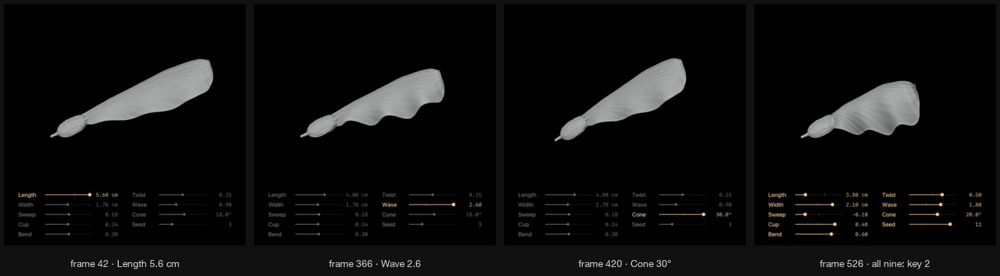

`sliders.py` imports `build.py` and changes three things before building:

1. **The key's inputs become modifier sliders.** Its `build_key` uses `g.param` to put Length, Width, Sweep, Cup, Bend,
   Twist, Wave, Seed and Cone on the **PA_Key** modifier, each with a range a little wider than the reel uses, and
   feeds eight of them to `PA_Samara`.
2. **The key holds one pose.** No spin, precession, drift or gust: **Euler to Rotation** (−2.5°, −Cone, 18°), then a
   **Transform** that puts the hero key's middle at the centre of the view. `PA_Flight` keeps only `Slide`.
3. **Nothing else moves.** The flecks and motes are deleted and the world is switched off; the camera comes in to
   25 cm.

The reel is rendered as white clay (`--clay`: Workbench, studio light, no depth of field), so shape is the only thing
on screen.

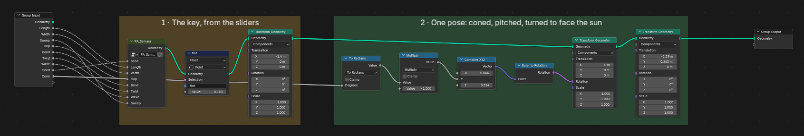

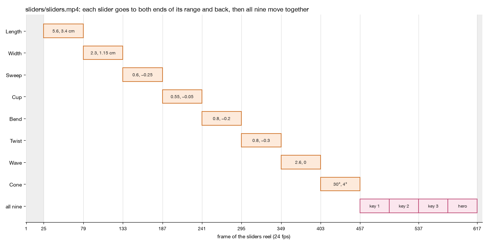

Each slider's 54 frames are: 14 frames to its first end, a 6-frame hold, 14 frames to the other end, a 6-frame hold,
14 frames back. The finale morphs all nine sliders to three other keys (18 frames each, then a 22-frame hold) and back
to the hero. Seed is the only input that changes only in the finale.

### Trick · keyframe the modifier inputs

Geometry Nodes modifier inputs can be keyframed like any property:

```python
inp = getattr(mod.properties.inputs, identifier)    # Blender 5.2: inputs live under mod.properties
inp.value = 0.55
inp.keyframe_insert('value', frame=201)
```

`animate()` does this for every key, sets the handles to auto-clamped Bézier, then evaluates each F-curve on every
frame and writes the values to `sliders/hud.json`. `hud.py` draws the readout from that file with Pillow and pipes the
frames to ffmpeg, so the numbers on screen are exactly the inputs that made each frame.

> **Try it:** in your own build of the reel, select **PA_Key** and open its modifier. Right-click a slider → **Clear
> Keyframes**, then drag it: the key reshapes live. Without clearing, the value jumps back when the frame changes.

---

## Helper groups

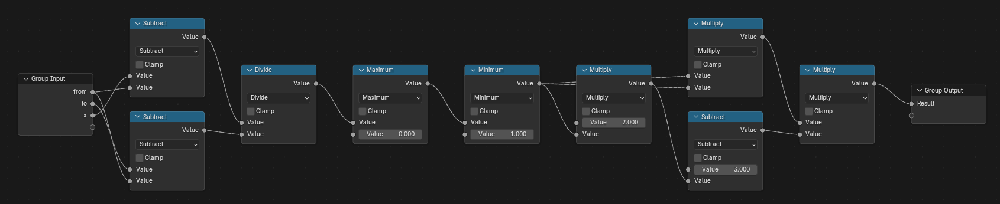

| Group | Nodes | Formula | Used for |
|---|---|---|---|
| `PA_Smoothstep` | 9 | t = clamp((x − from) / (to − from)), then t²(3 − 2t) | every soft edge: the curl, flat over the nut, the nut's bulge and skin, ridge fades, vein edges, where raised veins stop and the marginal vein starts, the motes' fade at the jump |
| `PA_SmoothMax` | 9 | max(a, b) + k/4 × (1 − \|a − b\| / k)², the last term only while \|a − b\| < k | the key's top edge: the nut's and the wing's, with a rounded neck |
| `PA_SmoothMin` | 9 | min(a, b) − k/4 × (1 − \|a − b\| / k)² | the key's bottom edge |
| `PA_Mix` | 3 | a + (b − a) t | Float Curve ranges, depths, the vein radius, ridge heights, raised-vein widths and sizes |
| `PA_Clamp` | 2 | min(max(x, lo), hi) | the wing span; where along the stalk-and-nut curves |
| `PA_Harmonic` | 3 | amp × sin(t × rate + phase) | every wobble in `PA_Flight` |
| `PA_InFrustum` | 13 | camera + depth × forward + (across, up) × depth × half width | putting motes and flecks inside the view |

Shader trees can't use Geometry Nodes groups, so the material has its own `PA_Smoothstep (shader)` and
`PA_Mix (shader)`, with the same nodes inside.

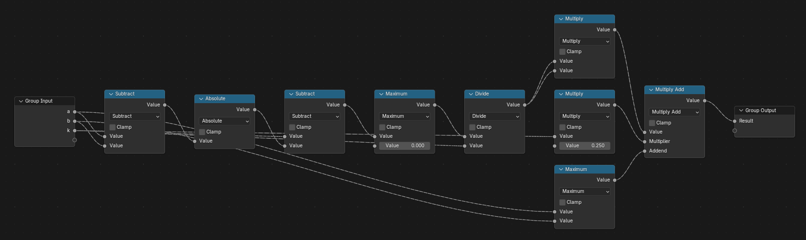

`PA_SmoothMin` is the same with the minimum and −k/4.

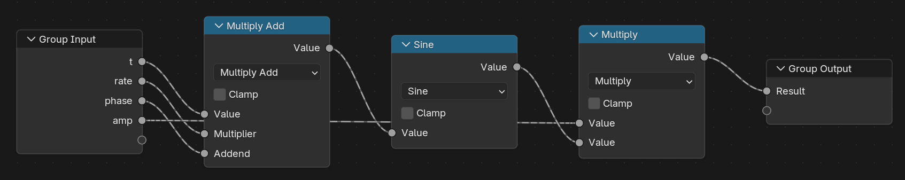

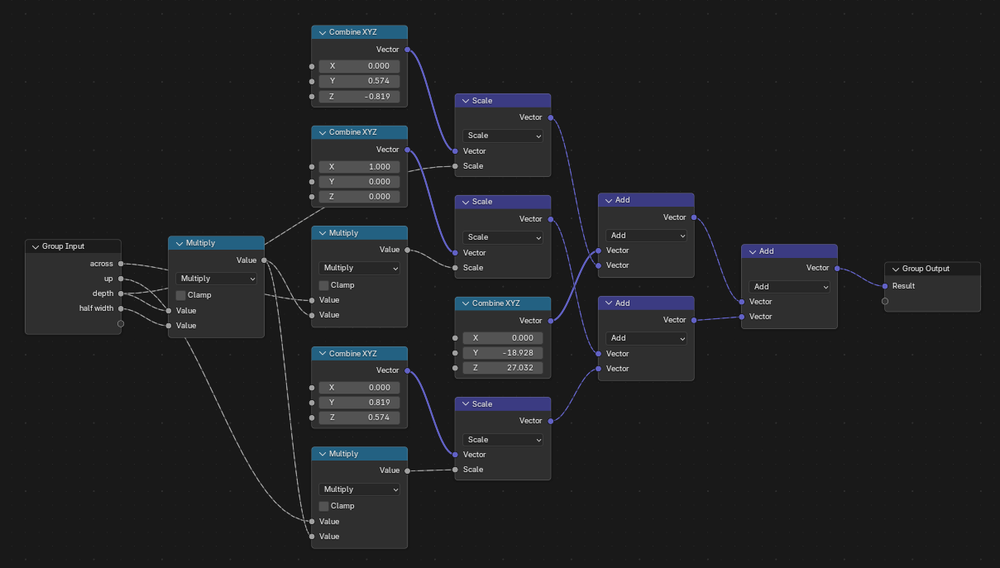

---

## How it was rendered

- **Cycles**, 128 samples, denoised, 8 bounces, indirect light clamped at 6; Metal on a Mac. 288 frames took 39 minutes
  (about 8 s a frame, the key now 255 602 vertices). `render_frames.sh` renders a PNG sequence (restarting after a
  crash and skipping finished frames) and encodes `loop.mp4` with ffmpeg.
- **Seam check:** frame 288 → frame 1 differs as much as any two neighbouring frames (PSNR 20.45 dB against
  18.23–22.05 dB between neighbours).
- **The sliders reel:** 624 frames in Workbench as white clay (`sliders.py --clay` → `sliders/clay/clay.blend`), 4
  minutes on the same Mac; `hud.py` then adds the readout. Frame 624 runs back into frame 1 unchanged.
- **Proof:** `pb.audit` reports strict procedural, no issues. Every mesh comes from Geometry Nodes on an empty object.

---

## Try it yourself

1. **A new key.** In `PA_Key_GN`, change the `PA_Samara` node's Seed from 3 to 7. The wave and wrinkles shift, and the
   nut's ribs wander differently; the outline stays the same, because Seed only feeds noise and phases.
2. **A longer, slimmer key.** Length 5.5, Width 1.3, Sweep 0.45 (the start of the reel's "key 1"). The nut and the
   wing are one surface, so they stay joined: the neck simply moves with the wing's root.
3. **Flat veins.** Set `CORR` and `VEIN_H` in `build.py` to 0 and rebuild. The veins are still painted, but the
   raking light no longer draws shadow lines along them: compare frame 161 before and after.
4. **A slower fall.** Set `N_TURN` to 6 in `build.py`. `S` follows (36 cm per loop), so the world slides 2/3 as fast
   and the key turns 0.5 times a second. Keep it a whole number, or the loop jumps.
5. **Light from behind.** Flip the sun's horizontal direction (`SUN_DIR` x and y to −0.86 and 0.12), so it shines from
   the far side. More of the wing glows amber through the translucent membrane, with the veins dark against it.

*Made with Blender 5.2 Geometry Nodes for [Nodevember](https://nodevember.com) 2026, Day 9 · Winged.*
