# How one Geometry Nodes group grows six kinds of geode from one field and one ico sphere

*A node-by-node walkthrough of Nodevember 2026 · Day 10 · Geode*

The video (27 s, 646 frames) shows a sawn geode lying on a black studio floor. Seven of the generator's sliders move
one at a time: shape, wall thickness, agate bands, crystal size, tip length, blade shape and colour zoning. Then the
same graph morphs through five other classic kinds and back to amethyst. Stone, crystals, bands and every colour come
from one Geometry Nodes modifier and its sliders. There are no image textures, no simulation and no modelled or
imported meshes (`pb.audit`: strictly procedural, no issues). The only animation is keyframes on the modifier's
sliders.

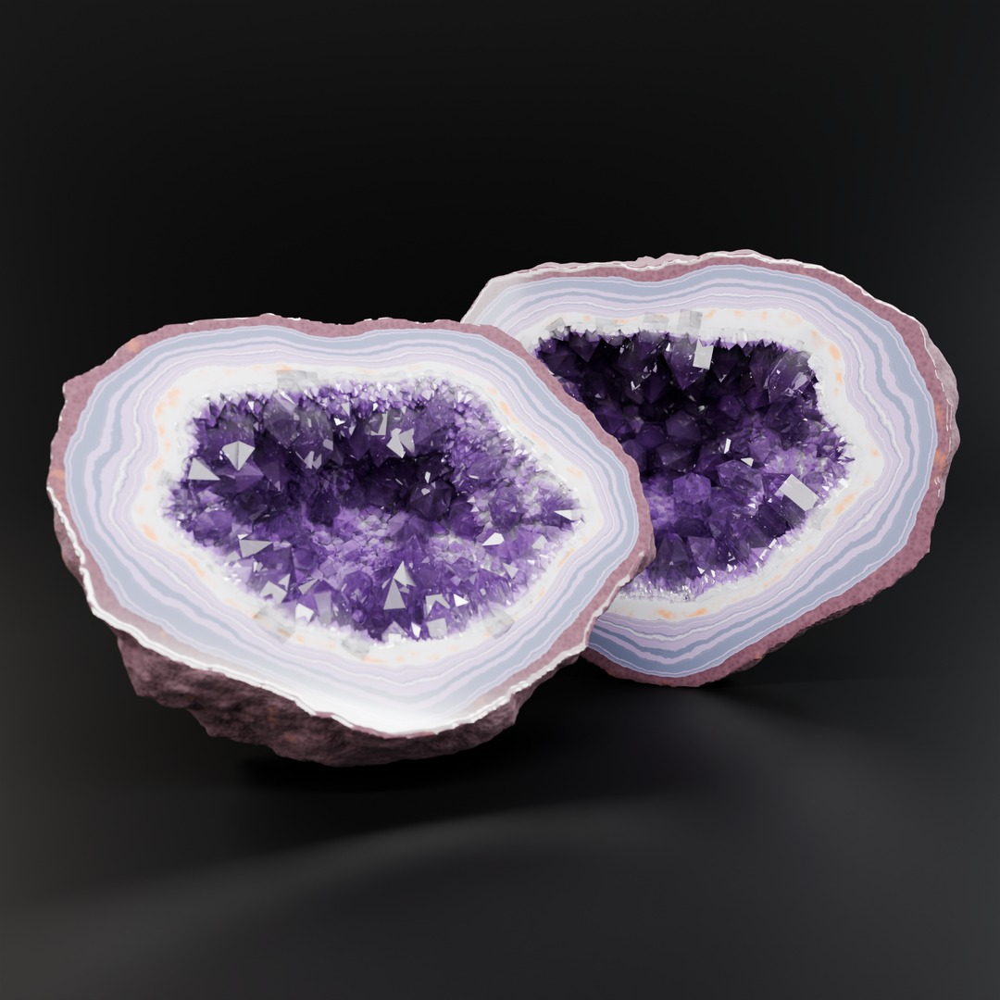

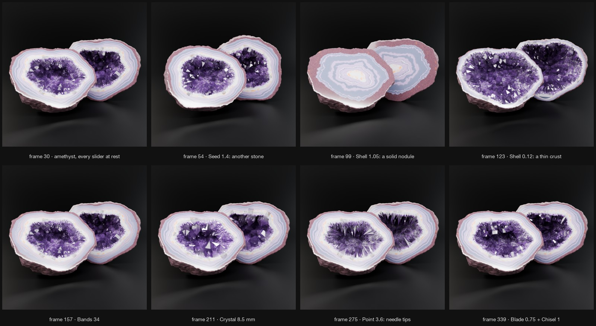

| File | What it is |
|---|---|
| [`../sweep/loop.mp4`](../sweep/loop.mp4) | the video without text: 1080², 24 fps, 646 frames (26.9 s), Cycles 64 samples + denoise |
| [`../sweep/sweep.mp4`](../sweep/sweep.mp4) | the same frames with the slider readout and the kind names composited on top |
| [`../render.png`](../render.png) | the still above: 2160², 160 samples + denoise (the video's last frame) |
| [`../_still_494.png`](../_still_494.png) | frame 494: the celestine preset |
| [`../_sheet_six.png`](../_sheet_six.png) | the six presets side by side |
| [`../nodes/`](../nodes/) | full screenshots of the main tree and the field |

The generator lives in a scene file (`piece.blend`: object **PA_Geode**, modifier **PA_Nodes** with the tree
`PA_Geode_GN`) that a Python script builds (`build.py`; `sweep.py` and `hud.py` for the video). Neither is
published. Every node is in the screenshots below, and the text names those scripts where a value lives in them.

---

## The one idea

> **The whole stone is one number per point in space.** A single implicit field, `PA_GeodeField`, says for any
> position whether it is rock, hollow or outside, and how deep into the wall it lies. Geometry Nodes samples the
> field on a cube grid and meshes it. The shader reads the depth to paint the agate bands. The crystals stand on the
> field's inner surface.

Everything else is bookkeeping around that field:

- **Where is the stone?** `PA_GridBox` sizes a grid just big enough to hold it (1 · Grid).
- **What does the cut face show?** The field's depth, stored on the mesh, read as rind, agate, quartz or onyx
  (2 · Rock and 5 · Rock material).
- **Where do the crystals go?** A fixed set of 10 242 directions is ray-cast from the centre onto the cavity wall
  (3 · Crystals). The set never changes, so while a slider moves each crystal glides along the wall instead of
  re-scattering.
- **What kind of geode is it?** Only slider values. A preset is a dictionary of them, and the six below differ in
  nothing else.

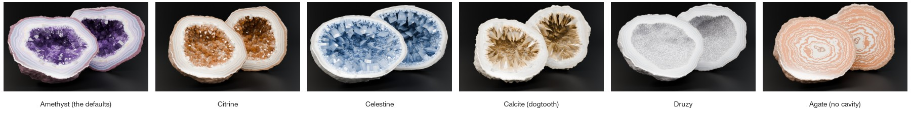

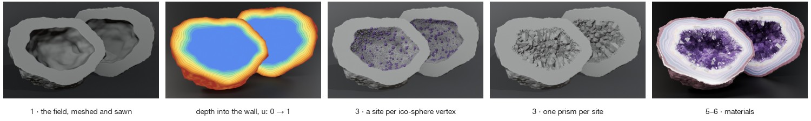

### How to read the screenshots

- Each coloured frame is one section of a tree. The main tree's sections are numbered (`1 · Grid`); sections inside a
  node group are lettered (`a · Shape`).
- A **cut-out** shows one section on its own. Wires that come from another section enter through a Group Input socket
  named after what they carry (`wall: smooth distance to the outer surface`). Wires that leave exit through a Group
  Output socket.
- The main tree has one Group Input per section, labelled `sliders`, showing only the sliders that section uses.
  Group Input nodes are only views of the group's inputs, so any number of them can exist. In a cut-out, those sliders
  are the Group Input sockets on the left.
- Small formulas are node groups, so they show as one titled node instead of a chain of Math nodes: `PA_Smoothstep`,
  `PA_Clamp`, `PA_Mix` and `PA_ByRing` (see [Helper groups](#helper-groups)). The shader trees use their own copies,
  named "(shader)".
- Groups pass data to each other and to the shader as **named attributes** with short names (`u`, `hit`, `cr`). Each
  section lists the ones it writes.
- Units: 1 = 1 m. The amethyst stone is 7.5 cm in radius (Size 0.075). Click any screenshot to see it full size.

---

## 0 · The map

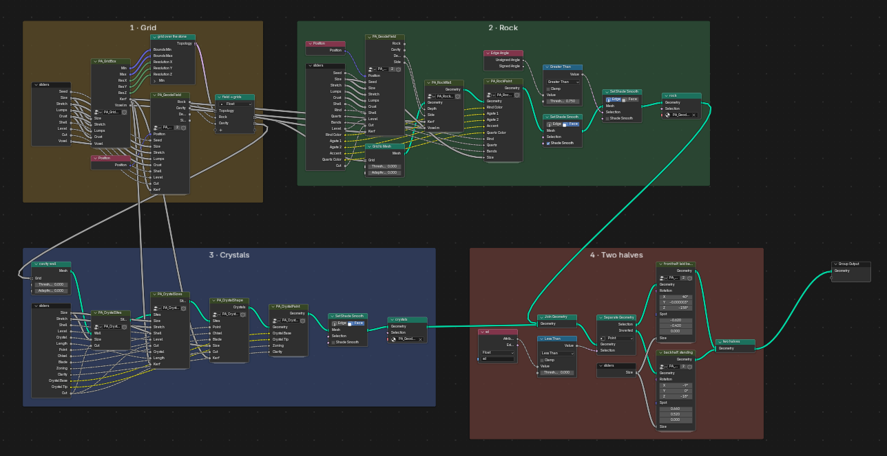

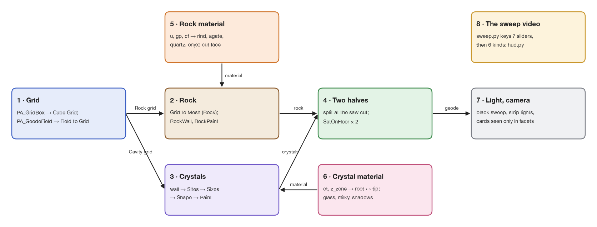

| # | Section | Nodes | Job |
|---|---|---|---|
| 1 | Grid | 5, plus `PA_GridBox` (26) and `PA_GeodeField` (63) | a cube grid around the stone, with the field sampled on it |
| 2 | Rock | 10, plus `PA_RockWall` (12) and `PA_RockPaint` (11) | the rock surface, with depth, side and colours stored for the shader |
| 3 | Crystals | 7, plus `PA_CrystalSites` (38), `PA_CrystalSizes` (89), `PA_CrystalShape` (58), `PA_CrystalPaint` (6) | sites on the cavity wall, then a size and an axis for each, then one prism each |
| 4 | Two halves | 7, plus `PA_SetOnFloor` (11) | split at the saw cut; both halves set on the floor |
| 5 | Rock material | 164 | rind, agate bands, quartz, onyx and druzy glitter, all from the stored depth |
| 6 | Crystal material | 32 | colour from root to tip, clear or milky, tinted shadows |
| 7 | Light, camera, backdrop | `PA_Backdrop_GN` (24) | the black studio |
| 8 | The sweep video | `sweep.py`, `hud.py` | keyframed sliders, and the readout |

The main tree holds 34 nodes: the 29 in the four sections, one `sliders` Group Input per section, and the Group
Output.

---

## 1 · Grid

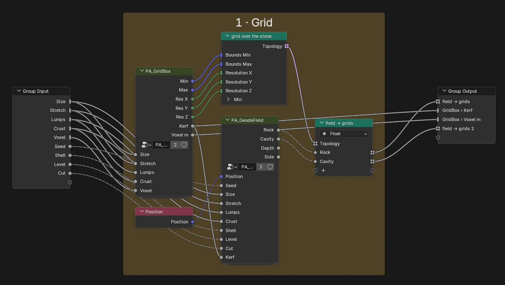

An implicit field becomes a mesh in two steps. First it is sampled on a regular grid of points (**Field to Grid**).
Then the surface where it crosses zero is extracted (**Grid to Mesh**, in the next two sections). Blender 5's grid
nodes (OpenVDB volumes) do both.

| Node | What it does |
|---|---|
| `PA_GridBox` | the grid's bounds and resolution, from Size, Stretch, Lumps, Crust and Voxel; also the saw kerf |
| `grid over the stone` (Cube Grid Topology) | an empty grid: Res X × Res Y × Res Z points between Bounds Min and Bounds Max |
| `PA_GeodeField` | evaluated at the Position of every grid point |
| `field → grids` (Field to Grid) | keeps two of the field's outputs as float grids, Rock and Cavity |

### Inside `PA_GridBox`

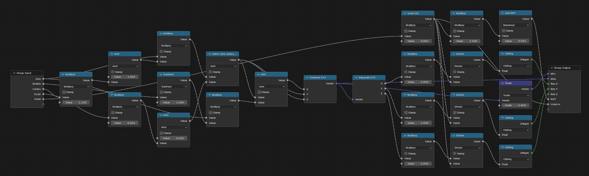

The grid must hold the whole stone, but every extra voxel costs memory and time. `reach: size, lumps, crust` is the
furthest the surface can get from the centre: Size × (1 + 1.1 × Lumps) for the big knobs, plus 3 mm + 4 mm × Crust
for the rind grain. The long axis (x) adds Size × (Stretch − 1). Each resolution is 2 × extent / voxel, rounded up.

For the amethyst (Size 0.075, Stretch 1.25, Lumps 0.30, Crust 0.9, Voxel 1 mm), the reach is 106 mm and the grid has
251 × 213 × 213 points, about 11.4 million.

`saw kerf` is the larger of 2.2 voxels and 1.8 mm, so 2.2 mm here. A diamond saw blade takes about 2 mm. The
2.2-voxel minimum keeps the gap between the halves wide enough for the grid to resolve when Voxel is coarse.

### Inside `PA_GeodeField`

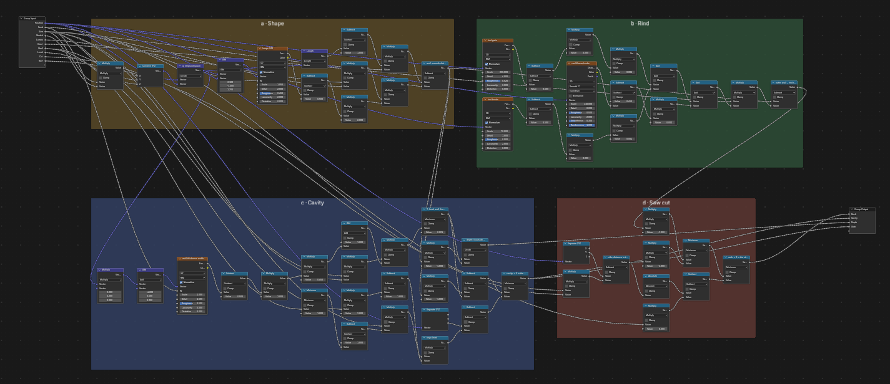

| Output | Meaning |
|---|---|
| Rock | > 0 inside the stone (rind and wall), < 0 in the air, in the hollow and in the saw kerf |
| Cavity | > 0 inside the hollow |
| Depth | 0 at the outer surface, 1 at the cavity wall (above 1: the onyx floor) |
| Side | signed distance to the saw plane, y = Cut × Size |

All four are signed distances, or close to them, in metres. That is what lets the next steps combine them with plain
Minimum and Maximum nodes.

#### a · Shape

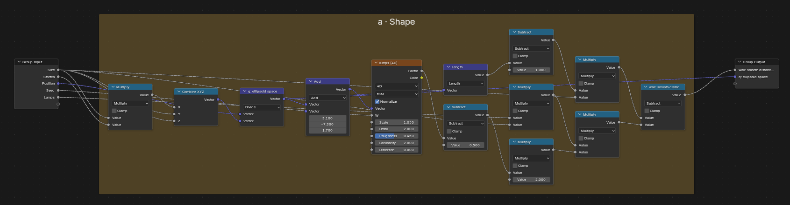

`q: ellipsoid space` is Position ÷ (Size × Stretch, Size, Size). In q the stone is a unit sphere, so (|q| − 1) ×
Size is roughly the distance to an ellipsoid, in metres, negative inside. From that, Lumps × Size × `lumps (4D)` is
subtracted. That node is a Noise Texture in 4D (scale 1.05, detail 2, roughness 0.45), read at q + (3.1, −7.3, 1.7)
with **W = Seed**, and turned into a signed value from −1 to 1. The result is
`wall: smooth distance to the outer surface`, negative inside the stone.

### Trick · Seed is a fourth dimension

A Random Value seed jumps to an unrelated stone at every whole number. Here Seed is the noise's W coordinate, so
changing it slides through a continuous 4D noise and the stone *morphs*. Seed 0.3 is a stone between Seed 0 and Seed
1. The outline changes noticeably over about one unit. In the video Seed never moves faster than 0.1 a frame, because
faster than that the outline seems to boil.

#### b · Rind

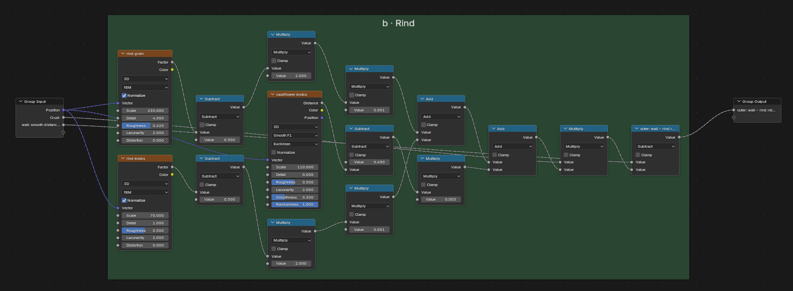

`outer: wall − rind relief` subtracts Crust × (relief) from the wall. The relief has three parts:

| Part | Node | Amplitude |
|---|---|---|
| fine grain | `rind grain`, Noise scale 230, detail 4, roughness 0.62 | ±1.4 mm |
| knobs | `rind knobs`, Noise scale 70, detail 1 | ±1.2 mm |
| cauliflower lumps | `cauliflower knobs`, Voronoi Smooth F1, scale 110, smoothness 0.3 | 2.6 mm × (0.45 − distance) |

Only the outer surface gets this relief. The cavity in the next section is measured from the smooth `wall`, so a
rough skin never wrinkles the hollow. The rind noises read Position, not q, and have no W, so the grain stays put in
space while Seed morphs the stone. The Calcite preset turns Crust up to 1.4 for the knobbly rind of Keokuk geodes.

#### c · Cavity

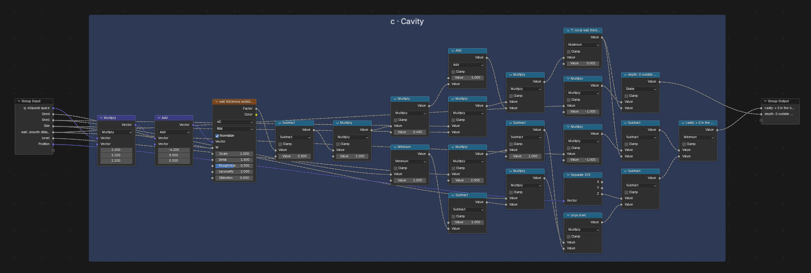

The hollow is a **deeper level set of the same field**. `T: local wall thickness` is Shell × Size × (1 + 0.45 ×
wobble), and never below 0.5 mm. The wobble is `wall thickness wobble (4D)`, a noise read at 2.2 q + (−4.2, 5.5, 0.3)
with W = Seed. Then:

- `depth: 0 outside … 1 cavity wall` = −wall ÷ T;
- the hollow is −wall − T, which is positive once a point is more than T below the outer surface.

So the cavity wall follows the outside's shape, and the wall thickens and thins by up to 45 %, as real agate walls do.
At Shell 1 and above, almost no point is that deep: the stone is a solid nodule (the Agate preset uses Shell 1.1).

`onyx level` is half × (2 × Level − 1), where half = Size × (1 − min(Shell, 1)) is the cavity's half-height. The
hollow is then cut at that height with one Minimum against z − level. At Level 0 the line sits at the cavity's floor
and removes nothing. At Level 1 the cavity is full. None of the six presets uses Level, but the slider stays in the
generator.

> **Try it:** in `c · Cavity`, change the Multiply's 0.450 to 0. The wall then has the same thickness all round, like
> a cast shell, and the agate bands run exactly parallel to the outside.

#### d · Saw cut

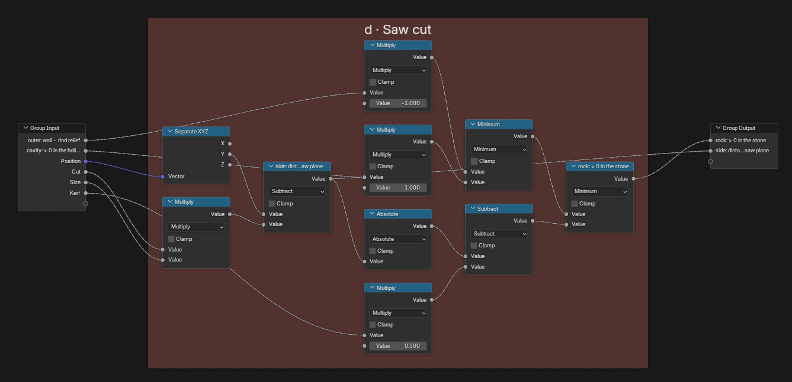

`side: distance to the saw plane` is y − Cut × Size. The solid is min(−outer, −cavity): inside the rind and not in
the hollow. `rock: > 0 in the stone` is min(solid, |side| − Kerf / 2), which takes a slab 2.2 mm thick out of the
stone. The stone falls into two halves, each with a flat face.

### Trick · booleans are Minimum and Maximum

For signed fields, Minimum is an intersection, Maximum is a union and a minus sign is the complement. The rind, the
hollow, the onyx floor and the saw cut are one Minimum each. They cost nothing, they are exact (the cut face is
perfectly flat), and unlike mesh booleans they cannot fail on a bad mesh.

---

## 2 · Rock

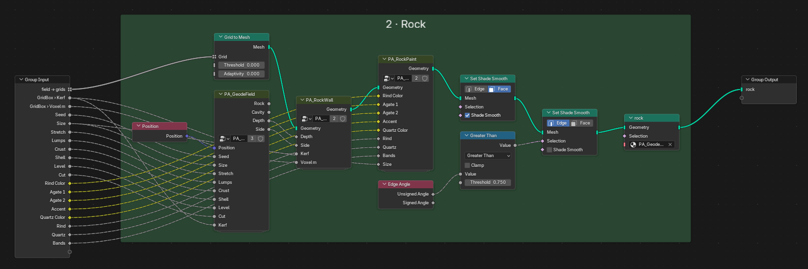

| Node | What it does |
|---|---|
| Grid to Mesh | the Rock grid's zero surface becomes a mesh |
| `PA_GeodeField` | evaluated a second time, now at the mesh's own vertices, for Depth and Side |
| `PA_RockWall` | stores depth, side, rest position and "on the cut face" |
| `PA_RockPaint` | stores the colour sliders as attributes |
| Set Shade Smooth (face), then (edge) with Edge Angle > 0.75 | smooth everywhere, except sharp along edges over 0.75 rad (43°): the rim where the polished face meets the rind |
| `rock` (Set Material) | `PA_GeodeRock` |

### Trick · evaluate the field twice

The grid only gives a surface. To paint bands on it, the shader needs the depth at every point of that surface. The
same group is therefore evaluated again on the mesh vertices, and the result is stored. The first evaluation uses Rock
and Cavity, for the shape. The second uses Depth and Side, for the paint.

### Inside `PA_RockWall`

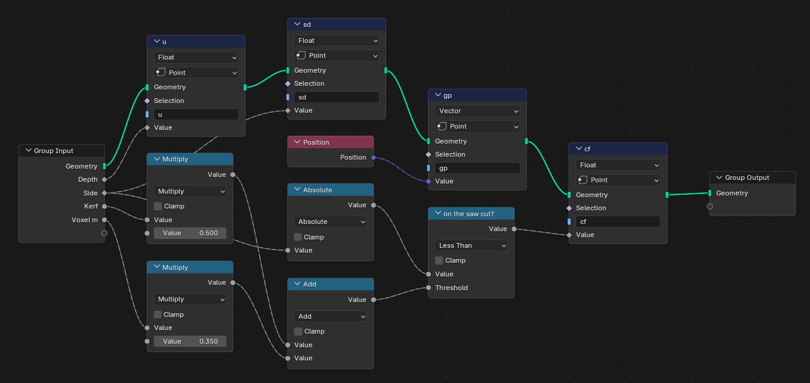

| Attribute | Value |
|---|---|
| `u` | Depth: 0 at the outer surface, 1 at the cavity wall |
| `sd` | Side: below 0 is the front half |
| `gp` | the position before the halves are moved, a fixed 3D coordinate for every texture, so the bands don't swim when a half is turned |
| `cf` | `on the saw cut?`: \|sd\| < Kerf / 2 + 0.35 voxel |

### Inside `PA_RockPaint`

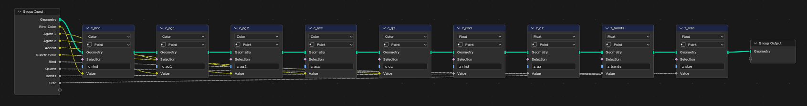

A shader cannot read modifier sliders, but it can read attributes. `PA_RockPaint` stores Rind Color → `c_rind`,
Agate 1 → `c_ag1`, Agate 2 → `c_ag2`, Accent → `c_acc`, Quartz Color → `c_qz`, Rind → `z_rind`, Quartz → `z_qz`,
Bands → `z_bands` and Size → `z_size`. The colours then belong to the modifier: a preset switches them along with the
shape, and they keyframe like any other slider. That is how the finale morphs colour.

---

## 3 · Crystals

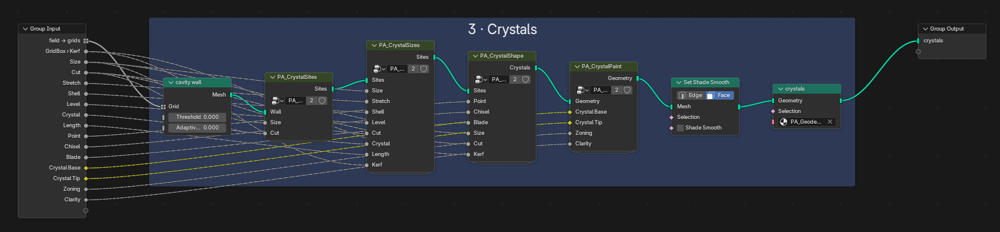

`cavity wall` meshes the Cavity grid: the hollow's surface, whole and uncut, which is never rendered. Four groups
follow:

1. **`PA_CrystalSites`**: where the crystals stand.
2. **`PA_CrystalSizes`**: how big each one is, and which way it points.
3. **`PA_CrystalShape`**: a prism for each.
4. **`PA_CrystalPaint`**: the crystal colour sliders, stored as attributes.

Then shading is set to flat (Shade Smooth off), because crystal faces are planes. The material is `PA_GeodeCrystal`.

### Inside `PA_CrystalSites`

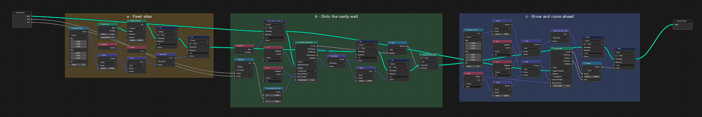

#### a · Fixed sites

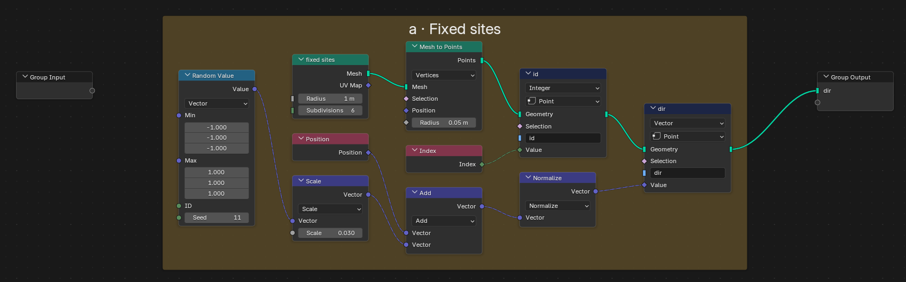

`fixed sites` is an Ico Sphere of radius 1 with 6 subdivisions: 10 242 vertices, almost evenly spread. Blender
counts the bare icosahedron as subdivision 1, so this is 10 × 4⁵ + 2. Mesh to Points makes them points. Each point
stores `id` = its Index and `dir` = its position plus 0.03 × a random vector, normalized: a slightly jittered
direction, so the crystals don't line up in the ico sphere's rows.

#### b · Onto the cavity wall

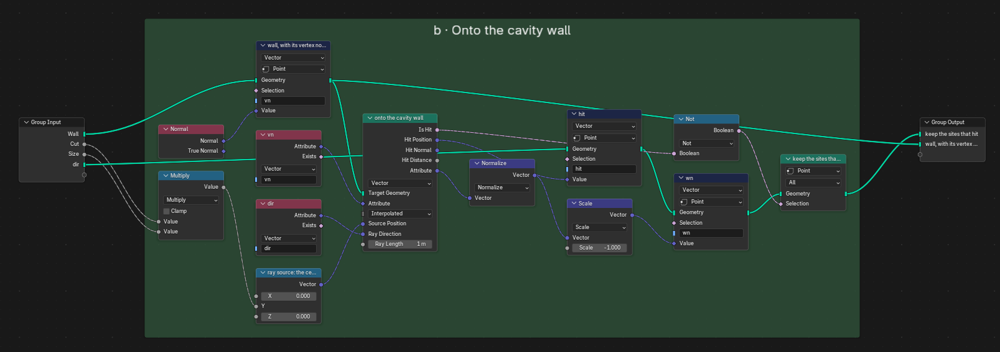

- `wall, with its vertex normals` stores the wall's vertex normal as `vn`.
- `onto the cavity wall` is a Raycast from `ray source: the centre (fixed, so sites never slide)` at (0, Cut × Size, 0),
  along `dir`, up to 1 m. Its Attribute input carries `vn`, with Interpolation set to Interpolated.
- `hit` = Hit Position. `wn` = −normalize(the interpolated `vn`): the wall's normal, turned to point into the hollow.
- `keep the sites that hit` deletes the rest.

### Trick · cast a fixed set, don't scatter

Distribute Points on Faces scatters afresh whenever the surface changes, so one slider nudge and every crystal
jumps. A fixed set of directions cast from a fixed point gives each crystal an identity. When the wall moves, the
crystal's hit point slides along it and the crystal glides with it.

Two details keep that motion smooth:

- **A stable id.** Random Value reads an attribute named `id` when one exists. Here it is stored before any site is
  deleted, so each site keeps its own random numbers while other sites start or stop hitting. Without it, Random
  Value would use the index, and deleting one site would shift the random values of every later site: a reshuffle in
  a single frame.
- **Interpolated normals.** Hit Normal is the flat normal of the triangle that was hit. As the wall moves, the ray
  crosses triangle edges and the crystal's axis snaps. Reading the vertex normals through the Raycast's Attribute
  input, interpolated, turns the axis smoothly instead.

#### c · Grow and room ahead

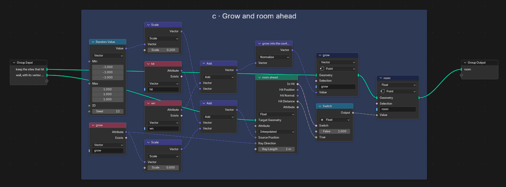

`grow: into the cavity, a little scattered` is normalize(`wn` + 0.2 × a random vector): real crystals lean a little.
`room ahead` casts a second ray from 0.4 mm off the wall, along `grow`, against the same wall. Its Hit Distance is the
space in front of the crystal. When the ray misses, the Switch gives 1 m. `grow` and `room` are both stored.

### Inside `PA_CrystalSizes`

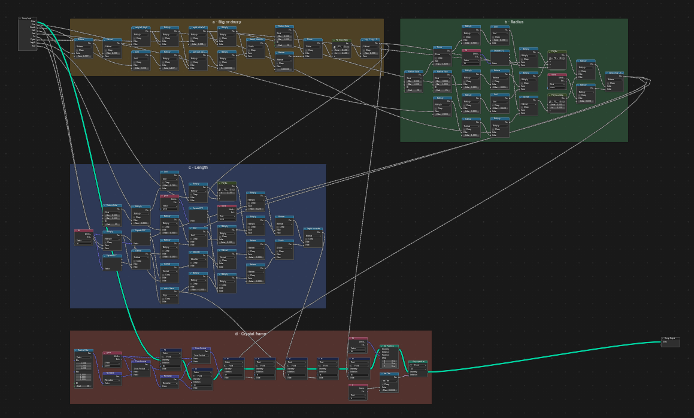

#### a · Big or druzy

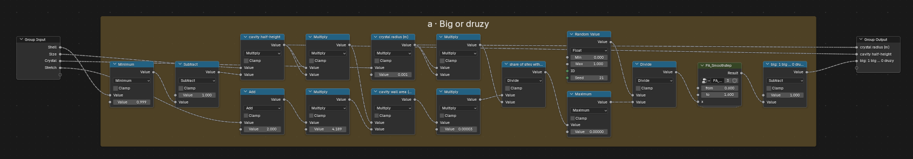

A real geode lining is a few big crystals with fine druzy between them. How many big ones fit?

- `cavity half-height` = Size × (1 − min(Shell, 0.999)); `crystal radius (m)` = Crystal ÷ 1000.
- `cavity wall area (≈ ellipsoid)` = half² × (Stretch + 2) × 4π/3, a rough area for the hollow.
- `share of sites with a big crystal` = area × COVER ÷ (π × 10 242 × r²). That is the number of footprints of radius
  r it takes to cover the wall COVER times, divided by the number of sites. COVER is about 1.125.

For the amethyst: half-height 49.5 mm, area 0.033 m², r 5.5 mm, so keep = 0.039. About 4 % of the sites carry a big
crystal. Each site draws a Random Value h (seed 21), and `big: 1 big … 0 druzy` = 1 − smoothstep(0.6, 1.6, h ÷ keep).
Of the amethyst's 10 242 crystals, 432 are big (more than half way).

### Trick · swell in, don't pop

A hard threshold (h < keep) would make a big crystal appear or vanish in a single frame whenever a slider changes
keep. Here the window runs from 0.6 × keep to 1.6 × keep, a ratio, so it scales with keep. As the Crystal slider
shrinks the crystals, keep grows and each site swells from druzy to full size over several frames.

#### b · Radius

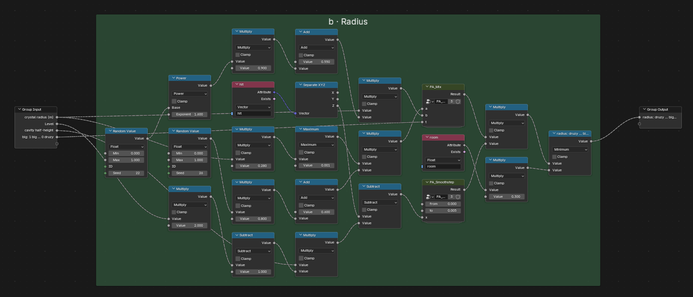

- Big: r × (0.55 + 0.9 × u^1.6), with u a Random Value (seed 22). The power 1.6 makes most crystals smaller and a
  few large: 0.55 r to 1.45 r.
- Druzy: max(0.28 r, 0.7 mm) × (0.6 + 0.8 × a Random Value, seed 26).
- `PA_Mix` blends the two by `big`.
- × smoothstep(0, 5 mm, height above the onyx level): crystals under the onyx floor shrink to nothing.
- At most 0.3 × `room`: in a tight corner of the hollow, crystals stay small.

The result, `radius: druzy … big, buried, squeezed`, is stored as `cr`. In the amethyst, before burying and squeezing, the
big crystals measure 3.0 to 8.0 mm in radius and the druzy 0.9 to 2.2 mm.

#### c · Length

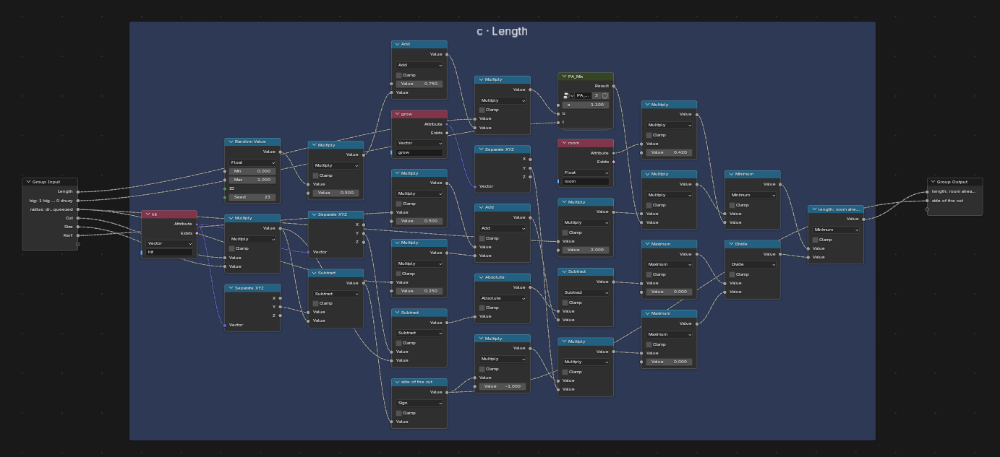

The elongation is `PA_Mix`(1.1, Length × (0.75 + 0.5 × a Random Value, seed 23), big). Druzy grains are stubby, and
big crystals take the Length slider ± 25 %. The length is 2 × radius × elongation, and never more than 0.42 × `room`:
a crystal never grows more than 42 % of the way across the hollow.

Then the saw plane. `side of the cut` is the sign of (y of the hit − Cut × Size). If the crystal grows towards the
plane, its length is cut to the gap ÷ (how directly it points at the plane), where the gap is the distance to the
plane less Kerf / 2 + 0.25 × radius. The result is `length: room ahead, saw plane`. Crystals therefore end just short
of the cut. The few that are still wide enough to cross it are sliced flat in `PA_CrystalShape`.

#### d · Crystal frame

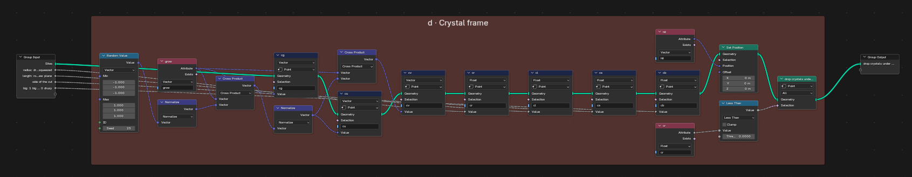

A random unit vector a (seed 25) gives U = normalize(grow × a) and V = grow × U, a random turn about the crystal's axis.
The group stores what the shape needs: `cg` (axis), `cu`, `cv`, `cr` (radius), `cl` (length), `cs` (side of the cut)
and `cb` (big). Set Position moves each point to its `hit`. `drop crystals under 0.05 mm` removes the ones that were
buried or squeezed away.

### Inside `PA_CrystalShape`

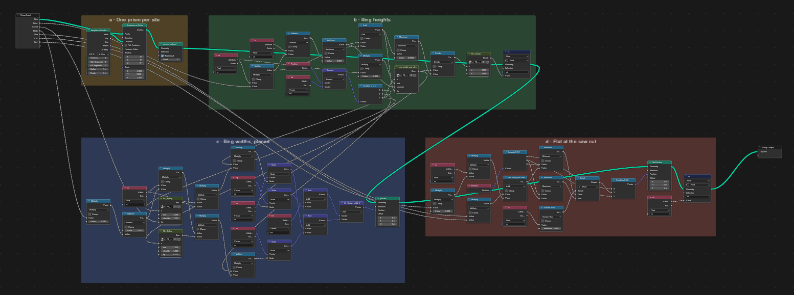

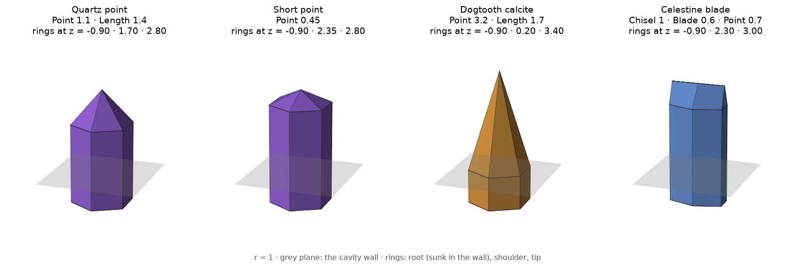

#### a · One prism per site

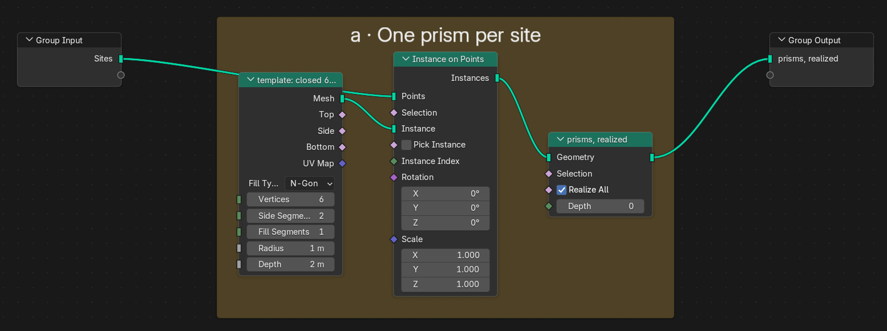

`template: closed 6-sided prism, 3 rings` is a Cylinder with 6 vertices, 2 side segments, radius 1 and depth 2, with
N-gon caps. Its rings sit at z = −1, 0 and +1. It is instanced on every site and realized at once: 10 242 crystals ×
18 vertices = 184 356 vertices in the amethyst.

### Trick · one template, moved ring by ring

The instances are not scaled or rotated. Each realized vertex still knows its template coordinates (its position
minus its site's `hit`), and its final position is computed from those and the crystal's stored numbers. The template
z says which ring a vertex is on, and `PA_ByRing` picks a value per ring. Points, chisels and blades are all the same
18 vertices, moved differently.

#### b · Ring heights

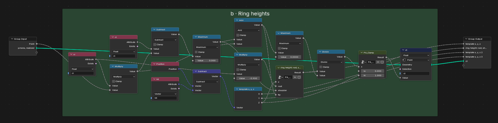

- tip = `cr` × Point; shoulder = max(`cl` − tip, 0); top = shoulder + tip.
- `ring height: root, shoulder, tip` = `PA_ByRing`(z, −0.9 × `cr`, shoulder, top). The root ring is sunk 0.9 radius
  into the wall, so a crystal looks rooted on any slope.
- `ct` = clamp(height ÷ top): 0 at the base, 1 at the tip. It is stored for the shader's colour zoning.

The Point slider is the tip's length in radii: 1.1 is a quartz point, 3.2 a dogtooth calcite needle, 0.45 a short
point.

#### c · Ring widths, placed

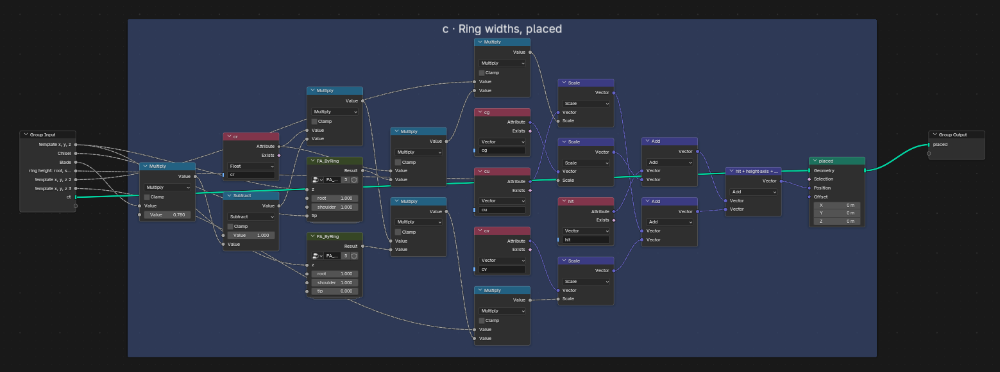

- x width = `cr` × `PA_ByRing`(z, 1, 1, Chisel).
- y width = `cr` × (1 − 0.78 × Blade) × `PA_ByRing`(z, 1, 1, 0).
- `hit + height·axis + x·width·U + y·width·V` gives the vertex's place, and `placed` (Set Position) moves it there.

At the tip ring the y width is always 0. With Chisel 0 the x width is 0 too, so all six tip vertices meet in a point,
a pyramid. With Chisel 1 they spread along x into a ridge 2 r long: the chisel end of a celestine blade. Blade
squeezes the section in y, down to 22 % at Blade 1.

> **Try it:** in `b · Ring heights`, change the Multiply's −0.900 to 0. The crystals then stand on the wall with
> their base ring, and wherever the wall curves away under a crystal you can see a gap beneath it.

#### d · Flat at the saw cut

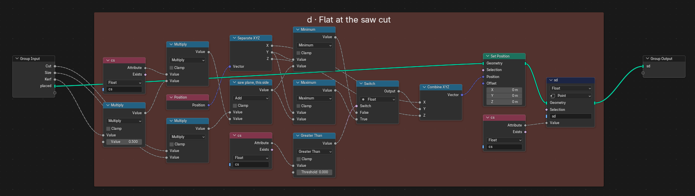

`saw plane, this side` = Cut × Size + `cs` × Kerf / 2. Each vertex's y is clamped to its own half's face, by Maximum
on one side and Minimum on the other. A crystal that reaches the cut is sliced flat with the rock, as if the two had
been sawn and polished together. `sd` = `cs` is stored so that the split in the next section takes each crystal with
its own half of the rock.

### Inside `PA_CrystalPaint`

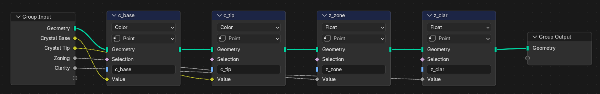

Crystal Base → `c_base`, Crystal Tip → `c_tip`, Zoning → `z_zone`, Clarity → `z_clar`, as in `PA_RockPaint`.

---

## 4 · Two halves

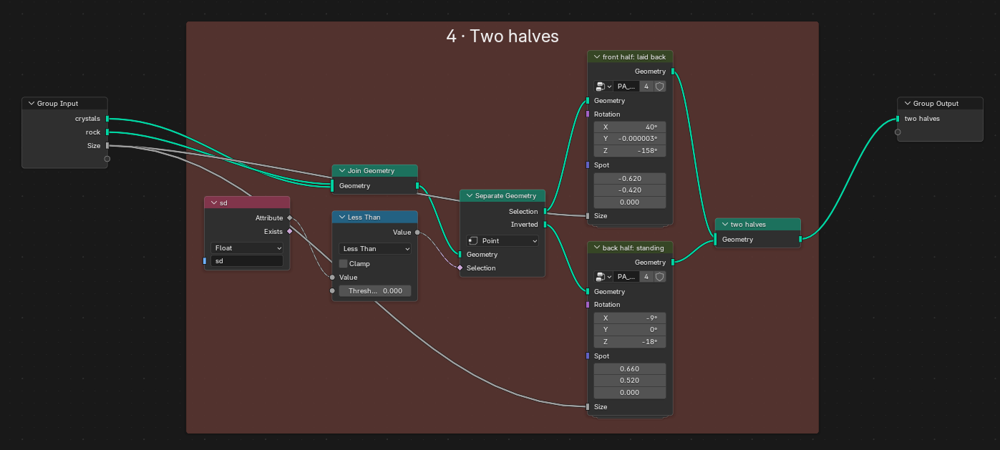

Rock and crystals are joined, then Separate Geometry splits them by `sd` < 0. Selection is the front half (the side
nearer the camera) and Inverted is the back half. Each half goes through `PA_SetOnFloor`:

| Half | Rotation (applied in turn) | Euler in the node | Spot (stone radii) |
|---|---|---|---|
| `front half: laid back` | 180° about z (cut face to the camera), −40° about x (laid back), 22° about z | 40°, 0°, −158° | −0.62, −0.42 |
| `back half: standing` | −9° about x (leaning back), −18° about z | −9°, 0°, −18° | 0.66, 0.52 |

### Inside `PA_SetOnFloor`

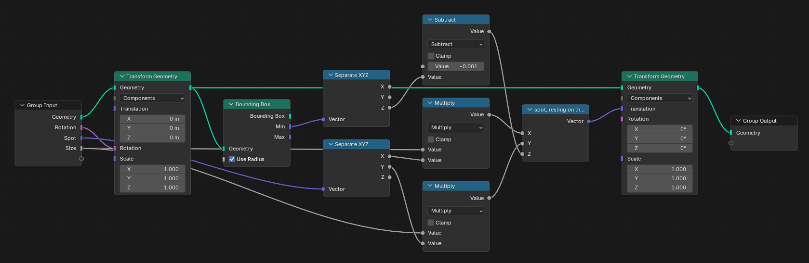

The group rotates the half, measures it with a Bounding Box, and moves it to (Size × spot x, Size × spot y, −0.6 mm −
lowest z). That sets the half on the floor whatever its shape, sunk 0.6 mm so no sliver of light shows under it. The
spot is measured in stone radii, so a bigger or smaller stone keeps the same composition.

---

## 5 · Rock material

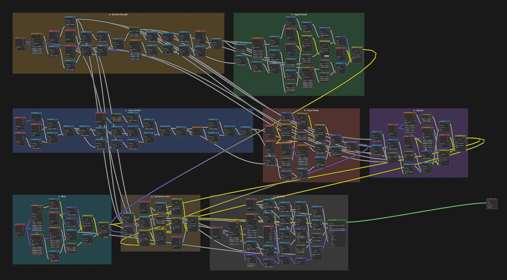

On the polished face the wall is read across, from outside in: rind, agate, quartz, then onyx where there is any.
Everything is a function of `u`, the depth stored by `PA_RockWall`.

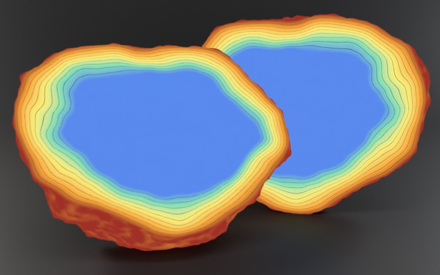

### Trick · the bands follow the wall because u does

The bands of fortification agate follow the shape of the cavity, ring inside ring. A depth coordinate gives exactly
that. No band is drawn anywhere: each band is a range of `u`, so the bands bend wherever the wall bends, thicken where
it thickens, and morph with Seed.

#### a · Across the wall

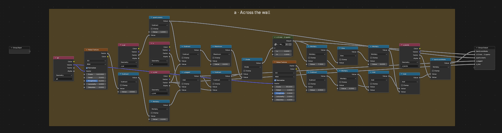

- `u, jagged` = `u` + 0.1 × (Noise(`gp`, scale 160, detail 3) − 0.5). Every boundary wanders a little.
- `quartz starts` = 1 − `z_qz`. The rind ends at `z_rind`.
- `v: 0 rind … 1 quartz` = clamp((u jagged − `z_rind`) ÷ max(quartz start − `z_rind`, 0.02)).
- `band coordinate` = (v + warp + 0.035 × sin(7.3 v)) × `z_bands`. Warp is 0.05 × (Noise(`gp`, 55) − 0.5). The sine
  makes the bands uneven in width. Its slope never exceeds 0.26, so the coordinate keeps rising and no band folds
  back on itself.

#### b · Agate bands

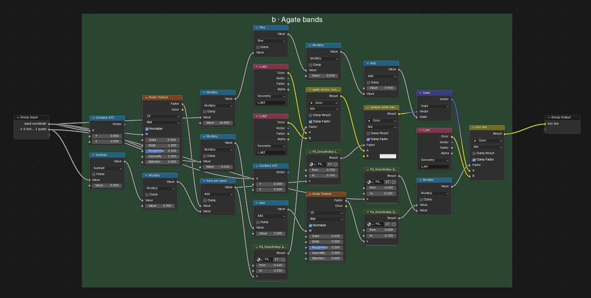

- `tone per band` = a 1D Noise of the band coordinate (scale 0.9) + 0.3 × (v − 0.5). The noise gives each band its own
  tone. The second term makes bands cooler and darker near the rind and warmer and paler towards the quartz, as in the
  reference photo.
- `agate zones: cool ↔ warm` mixes Agate 1 into Agate 2 by smoothstep(0.44, 0.53, tone).
- `opaque white bands` where the tone passes 0.70–0.74.
- Fine laminations: × (0.94 + 0.06 × sin(2π × 3 × band)), three faint lines per band.
- `iron line`: a second 1D Noise picks a few bands (0.68–0.72) to paint in Accent. It fades in between v 0.03 and
  0.12, so it never touches the rind.

#### c · Onyx strata

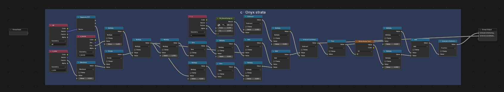

Onyx is water-level banding. It settles flat, in horizontal layers, in the bottom of the cavity.

- The layer coordinate is z ÷ Size × Bands × 1.6, made uneven with two sines (× 1.7 and × 4.1).
- Near the wall it curls up: − 0.45 × (1 − smoothstep(1.0, 1.22, u)), a meniscus.
- Floor gives the stratum number k. `tone per stratum (golden-ratio walk: neighbours differ)` = fract(0.618034 k +
  0.3 × White Noise(k)).

### Trick · the golden-ratio walk

Stepping by 0.618… modulo 1 sends each stratum's tone far from its neighbour's, and never repeats a pattern. A plain
random tone per stratum would sometimes give two neighbours the same tone and merge them into one thick layer.

#### d · Onyx tones

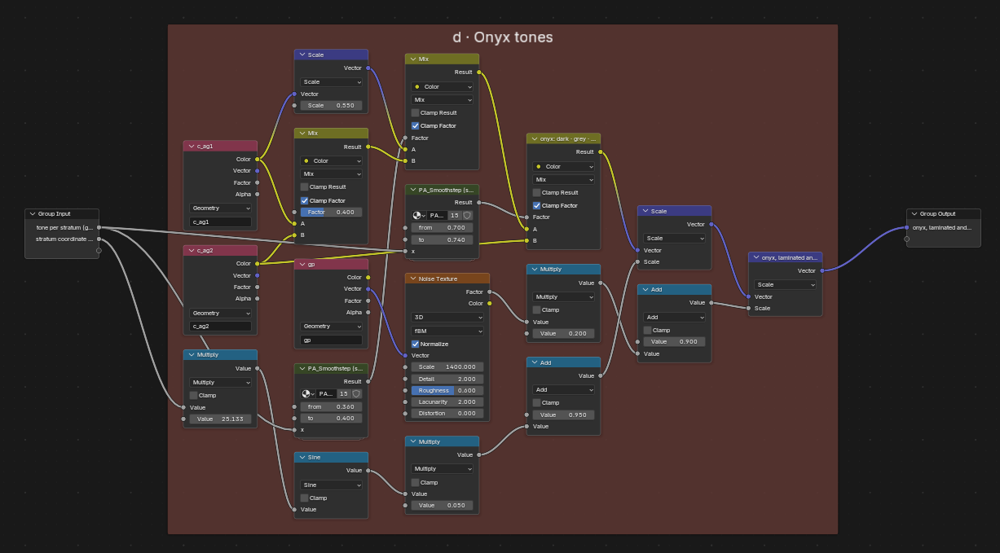

There are three tones: dark (Agate 1 × 0.55), grey (40 % of the way to Agate 2) and white (Agate 2), switched at
0.36–0.40 and 0.70–0.74. Each is laminated, × (0.95 + 0.05 × sin(2π × 4 × layer)), and granular, × (0.9 + 0.2 ×
Noise(`gp`, 1400)). Onyx shows only where `u` > 1.002, inside the hollow and below the Level line.

#### e · Quartz

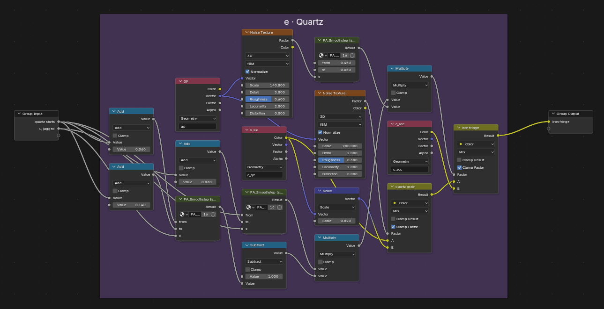

`quartz grain` mixes Quartz Color with 82 % of itself by Noise(`gp`, 900): a granular, crystalline white.
`iron fringe` paints a thin line of Accent just inside the quartz boundary: rising over 0.03 and fading between 0.06
and 0.14 beyond it, broken up where Noise(`gp`, 140) passes 0.45–0.65. It is the orange druzy line in the reference
photo.

#### f · Rind

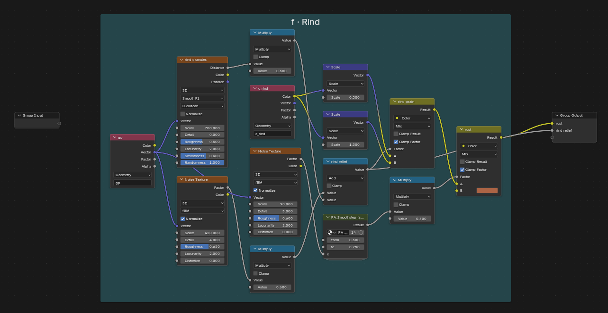

`rind granules` (Voronoi Smooth F1, scale 700) and a Noise (scale 420, detail 4) make `rind relief`. The relief sets
the colour, from 0.5 × to 1.5 × Rind Color (`rind grain`). `rust` adds patches of (0.42, 0.13, 0.06) at 60 %, where
Noise(`gp`, 90) passes 0.6–0.75.

#### g · Cut face or skin

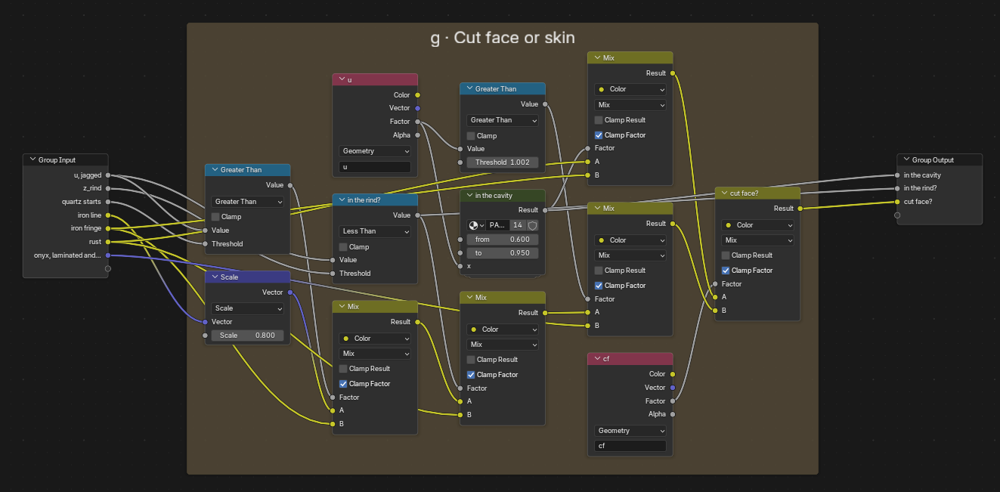

On the cut face, agate (× 0.8) is replaced by quartz past `quartz starts`, by the rind before `z_rind`
(`in the rind?`), and by onyx where `u` > 1.002. Off the cut face, the outer skin is rind and the hollow's skin is
quartz: `in the cavity` = smoothstep(0.6, 0.95, u). `cut face?` chooses between the two.

#### h · Surface

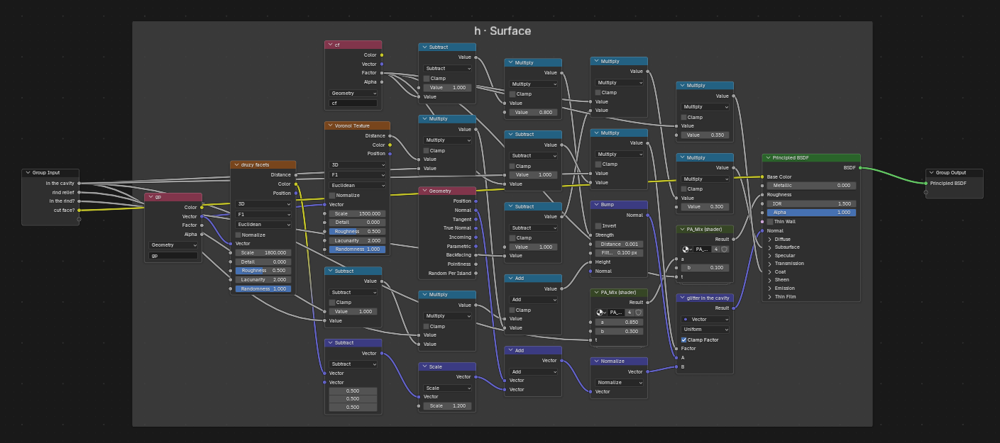

| Where | Roughness | Bump | Other |
|---|---|---|---|
| rind skin | 0.85 | rind relief, strength 0.8 | |
| cavity skin | 0.3 | Voronoi, scale 1500 | `glitter in the cavity` |
| cut face | 0.1 | none (polished) | Subsurface 0.3 (1 mm, radius 1, 0.85, 0.75) except the rind; Coat 0.35 |

`glitter in the cavity` swaps the bump for a normal tilted by a Voronoi cell's colour (scale 1800). Each cell is a
tiny facet that catches the light on its own: druzy sparkle without any geometry.

> **Try it:** in `a · Across the wall`, change the Multiply's 0.100 (after the noise at scale 160) to 0. The rind,
> agate and quartz boundaries become smooth curves parallel to the outside, and the cut face looks drawn rather than
> grown.

---

## 6 · Crystal material

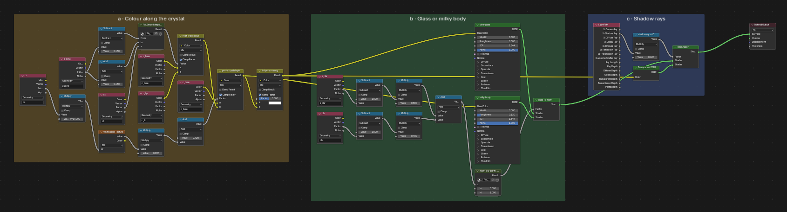

#### a · Colour along the crystal

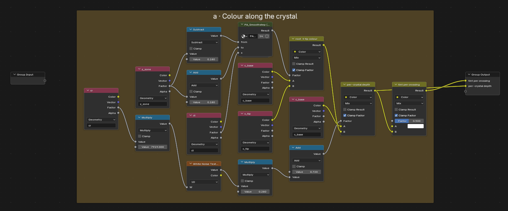

- `root → tip colour` mixes Crystal Base into Crystal Tip by smoothstep(Zoning − 0.18, Zoning + 0.18, `ct`). The
  amethyst (Zoning 0.45) has clear roots and purple tips. Real amethyst points are deepest at the tip, because iron
  rose in the water as the cavity filled.
- `per-crystal depth`: a White Noise of `cr` × 7919 takes each crystal 72–100 % of the way from Crystal Base to
  that colour, so neighbours differ.
- `tint per crossing` sits half-way between white and that colour. Glass tints light at every surface it crosses, so
  the full colour would go nearly black after a few crystals.

#### b · Glass or milky body

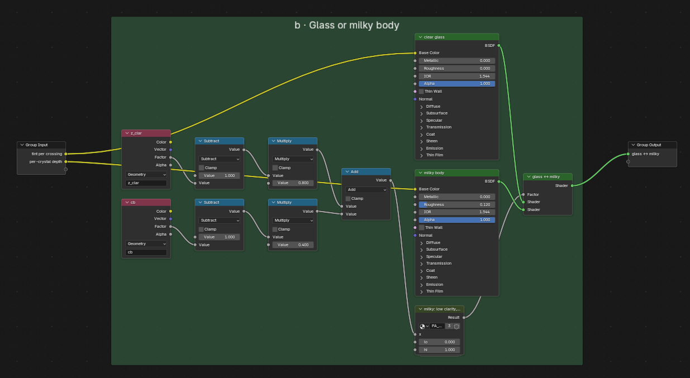

`clear glass` is a Principled BSDF with Transmission 1, Roughness 0 and IOR 1.544, the index of quartz. `milky body`
is an opaque, glossy Principled (Roughness 0.12). `milky: low clarity, and in the druzy` = clamp(0.8 × (1 − Clarity) +
0.4 × (1 − `cb`)). Clarity sets the whole lining, and druzy grains are always a little milky, as fine crystals scatter
light.

#### c · Shadow rays

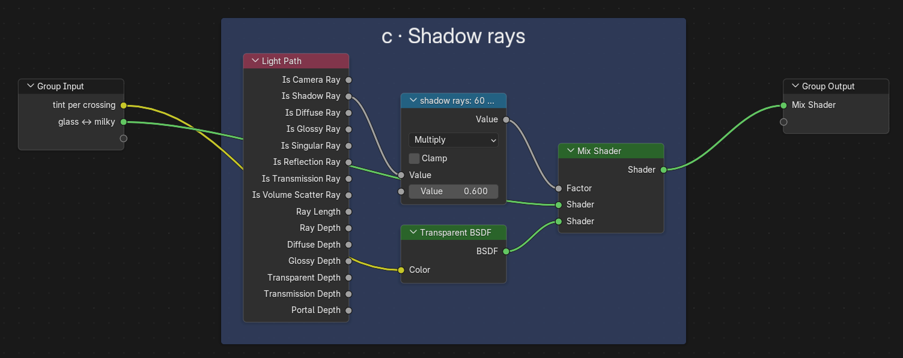

Cycles caustics are off, so without help glass would block direct light like stone, and the bowl behind the front
crystals would go black. For shadow rays only, 60 % of the surface becomes a Transparent BSDF in the tint colour.
Light reaches the crystals behind, tinted, and the cavity glows.

> **Try it:** change the 0.600 in `c · Shadow rays` to 0. The front row of crystals stays bright, but the hollow
> behind it darkens to a purple-black pit.

---

## 7 · Light, camera, backdrop

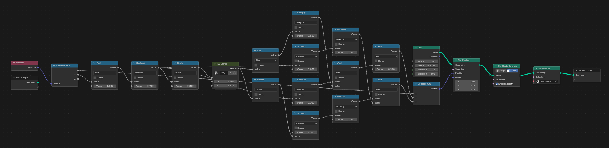

**Backdrop.** `PA_Backdrop_GN` bends a Grid 3 m wide with 400 rows into a seamless sweep: 0.9 m of floor, a quarter
circle of radius 0.30 m, then 1.4 m of wall. The material, `black, with a soft sheen`, is almost black (0.002), with
roughness 0.55 and Specular IOR Level 0.06.

**Camera.** 13° above the floor, 4° to the side, 0.74 m away, 79.37 mm lens, shifted (−0.0125, 0.0438), f/14 focused on
the stone. The framing is fitted to the whole video: every 6th frame of the sweep was projected, and the union fills
92 % of the width, centred.

**Lights.** A gem set on black only shows what it reflects, so most of the light is shaped for the facets:

| Light | Kind | Job |
|---|---|---|
| Key | disk 0.5 m, 9 W, front left | the form |
| StripTop, StripSide, StripLow | thin rectangles, 22 / 12 / 8 W | long highlights across the facets |
| RimL, RimR | disks 0.3 m, 16 W, behind | cut the rough rind out of the dark |
| Spark0–2 | points, 4 mm, 4 / 4 / 2.5 W | small hard glints |
| CardTop, CardL, CardR | rectangles, 35 / 18 / 15 W | seen only in reflections |
| IntoBowl | disk 0.25 m, 22 W, high behind | down into the bowls and through the near crystals |

### Trick · reflection cards

The three cards are invisible to the camera and to diffuse rays, so they light nothing directly. They exist only as
bright shapes reflected in the crystal faces, which is what makes the glass read as glass on a black background.
Light linking limits the cards and IntoBowl to the geode, so their glow never reaches the black floor.

**Render settings.** World black at strength 0. Cycles bounces: 12 in total, 10 transmission, 8 glossy, 3 diffuse.
Filter Glossy 0.3, reflective and refractive caustics off. AgX, look Medium High Contrast, exposure −0.9.

---

## 8 · The sweep video

`sweep.py` imports `build.py`, builds the same scene, and keyframes the modifier's inputs. A Geometry Nodes slider is
not an ID property. It lives at `mod.properties.inputs.<identifier>.value`, and `keyframe_insert('value', frame=f)`
works on it. All keys get Bezier handles of type Auto Clamped: they ease in and out, and never overshoot an end value.

| Part | Frames | Moves |
|---|---|---|
| hold | 1–30 | the amethyst at rest |
| Seed | 30–78 | out to 1.4 and back, one slow trip |
| Shell, Crystal, Point, Blade | 64 each | rest → one end → hold → other end → hold → rest, 18-frame legs |
| Bands, Zoning | 48 each | the same with 13-frame legs |
| six kinds | 430–646 | per kind a 20-frame morph and a 16-frame hold, colours included |

30 + 48 + 64 + 48 + 64 + 64 + 64 + 48 + 6 × 36 = 646 frames.

### Trick · a slider reel that doesn't flicker

Every frame of the video is a fresh evaluation, so anything that jumps between two frames flickers. The rules, and
where the generator keeps them:

- **Seed under 0.1 a frame.** Faster, the 4D noise boils. The presets' seeds form a chain, Amethyst 0 → Citrine −1.2
  → Celestine −2.0 → Calcite −0.8 → Druzy 0.4 → Agate 1.2 → Amethyst 0, so neighbours are at most 1.2 apart, and even
  a 20-frame eased morph stays under 0.1 a frame. Seed's own excursion peaks at 0.095.
- **Slow legs for sliders that reshuffle many crystals.** A dense palisade swaps which faces are hidden and which
  glint. Shell, Crystal, Point and Blade get 18-frame legs; Bands and Zoning, which only recolour, keep 13.
- **A stable `id` per site** (3 · Crystals, a and b).
- **Smooth windows instead of thresholds** (big or druzy; buried under the onyx).

`hud.py` draws the readout. `sweep.py` writes `hud.json` beside the .blend: every readout slider's value on every
frame (read back from its F-curve, so the readout matches the eased motion), the windows in which a slider is the one
moving (it brightens and its dot grows), and the kind names. `hud.py` draws them with Pillow over the PNG frames and
pipes the result to ffmpeg. The clean version is the same frames encoded as they are.

> **Try it:** in `sweep.py`, take `'Seed'` out of `EXCURSION_OF`. It then uses the short `EXCURSION`, going to 1.4
> in 13 frames (up to about 0.16 a frame). Re-render frames 30–78 at low resolution: the hollow's outline starts to
> shimmer.

---

## Helper groups

| Group | Inputs | Result |
|---|---|---|
| `PA_Smoothstep` | from, to, x | t = clamp((x − from) ÷ (to − from)), then t²(3 − 2t): 0 before from, 1 after to, smooth between |
| `PA_Clamp` | x, lo, hi | min(max(x, lo), hi) |
| `PA_Mix` | a, b, t | a + (b − a) × t |
| `PA_ByRing` | z, root, shoulder, tip | root where z < −0.5, tip where z > 0.5, shoulder between: one value per ring of the crystal template |

The shader trees use copies named `PA_Smoothstep (shader)`, `PA_Clamp (shader)` and `PA_Mix (shader)`. Grouping
these formulas changed nothing: the evaluated mesh of all six presets hashes the same as before, vertex for vertex
and attribute for attribute.

---

## How it was rendered

- **Video:** Cycles on a Mac (Apple M4 Pro, Metal), 64 samples + denoise, 1080², 24 fps. All 646 frames took 3 h
  51 min, about 21 s a frame including the geometry. `render_frames.sh` writes a PNG per frame, skips finished frames
  after a crash, and encodes `loop.mp4` (H.264, CRF 16). `sweep.mp4` is the same frames with `hud.py`'s readout.
- **Still:** 2160² (resolution 200 %), 160 samples + denoise, 1 min 14 s.
- **Geometry:** Voxel 1 mm. The amethyst evaluates in about 2 s to 392 744 vertices, 184 356 of them in 10 242
  crystals.

---

## Try it yourself

1. **A preset by hand.** In your own build of the generator, set the sliders to a preset, for example Celestine:
   Seed −2.0, Stretch 1.35, Shell 0.12, Bands 3, Crystal 7.0, Length 1.5, Point 0.7, Chisel 1, Blade 0.6, Zoning 0.2
   and pale blue crystal colours. Pale blue blades with chisel ends fill a thin-walled cavity.
2. **Shell.** Drag it from 0.34 to 0.12 for a thin crust with a big cavity, then to 1.1 for a solid agate nodule.
   The crystals swell in and out instead of popping.
3. **Level.** Set it to 0.5. The lower half of the cavity fills with flat onyx strata (Uruguayan water-level banding),
   and the crystals below the line disappear under it.
4. **Cut.** Set it to 0.3. The saw goes through off-centre: one half shows a smaller cavity, and crystals are sliced
   wherever they reach the new plane.
5. **Voxel.** Set it to 0.5 mm for a finer rind and crisper bands at the edge. The grid has about 8 times as many
   points, so it evaluates much more slowly. 2 mm is quick for trying sliders.

*Made with Blender 5.2 Geometry Nodes for [Nodevember](https://nodevember.com) 2026, Day 10 · Geode.*
