# How one geode generator becomes an endless flooded canal

*A node-by-node walkthrough of Nodevember 2026 · Day 11 · Cavernous*

The video (34 s, 816 frames) follows a small boat with a lantern down a chain of giant flooded geodes: an amethyst
hall, a hall of clear quartz, a citrine dome, and on into pale blue celestine. Between the halls the waterway bores
through the wall, and the passage is lined with crystals too, one kind giving way to the next. Every hall is the
Day 10 geode generator's own field and crystal groups, scaled 150 times. The boat, its hooded passenger, the water
and the V-shaped wake are Geometry Nodes as well. There are no image textures, no simulation and no modelled or
imported meshes (`pb.audit`: strictly procedural, no issues). The keyframes are the boat's drift, the camera and the
lantern, written by Python from one formula per curve.

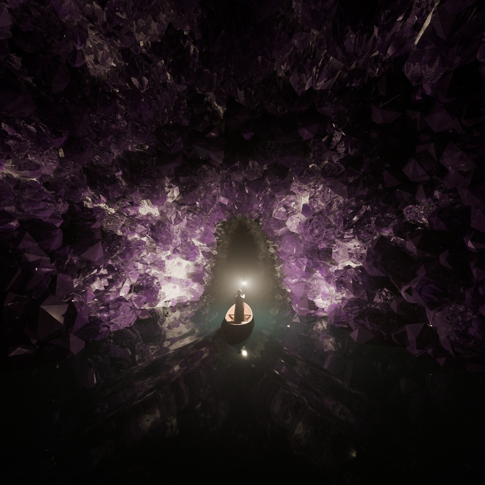

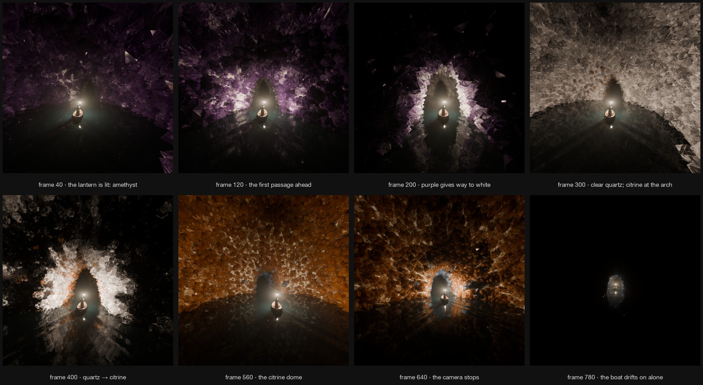

| File | What it is |
|---|---|
| [`../loop.mp4`](../loop.mp4) | the video: 1080², 24 fps, 816 frames (34 s), Cycles 64 samples + denoise |
| [`../render.png`](../render.png) | frame 120 at 2160², 256 samples + denoise |
| [`../render-600.png`](../render-600.png) | frame 600 at 2160², 256 samples + denoise |
| [`../nodes/`](../nodes/) | full screenshots of the main tree, the cave field and six node groups |

The scene lives in a file (`piece.blend`: objects **PA_Canal** with the tree `PA_Canal_GN`, **PA_Water** with
`PA_Water_GN`, **PA_Boat** with `PA_Boat_GN`, the lantern light and the camera) that a Python script builds
(`build.py`, which loads Day 10's `build.py` as a library; `final.py` sets the render). Neither is published. Every
node is in the screenshots below, and the text names those scripts where a value lives in them.

---

## The one idea

> **Chamber n is a function of n alone.** Nothing about a chamber is stored: its kind, its shape seed, its size and
> its place are looked up or drawn at random from the number n. Any point in space only asks the two chambers it lies
> between, n0 = ⌊x / Spacing⌋ and n0 + 1, so the canal costs the same per point however long it is.

Everything else is bookkeeping around that idea:

- **What is chamber n?** `PA_ChamberKind`: the kind is n mod 5 (amethyst, clear quartz, citrine, celestine,
  calcite), and everything Day 10's sliders set comes from that kind's preset (1 · Grid).
- **Where is the rock?** Day 10's `PA_GeodeField`, evaluated twice per point, once for each of the two nearest
  chambers, joined with a meandering waterway (1 · Grid, 2 · Rock).
- **Where do the crystals grow?** On each hall's wall, as in Day 10, and on the passages, where each crystal takes
  one of its two chambers' kinds with odds that slide across the passage (3 · Crystal sites).
- **Then?** Day 10's crystal groups do the rest, unchanged (4 · Crystals). The boat, the water and the camera follow
  the waterway's own formula (7–9).

### How to read the screenshots

- Each coloured frame is one section of a tree. The main tree's sections are numbered
  (`1 · Grid: chambers and waterway`); sections inside a node group are lettered (`a · The two nearest chambers`).
- A **cut-out** shows one section on its own. Wires that come from another section enter through a Group Input socket
  named after what they carry (`n0 = ⌊x / spacing⌋`). Wires that leave exit through a Group Output socket.
- Each section of the main tree that reads sliders has its own Group Input, showing only the sliders it uses. Group Input nodes are only
  views of the group's inputs, so any number of them can exist.
- `PA_GeodeField`, `PA_CrystalSizes`, `PA_CrystalShape`, `PA_CrystalPaint`, `PA_RockPaint` and both materials are
  Day 10's, unchanged. Their sections are explained in the
  [Day 10 tutorial](../../day10-geode-v2-generator/tutorial/README.md), and this one links there instead of repeating
  them.
- Groups pass data to each other and to the shaders as **named attributes** with short names (`u`, `hit`, `ch`).
- **Units.** The canal object is in Day 10's units, where the amethyst stone was 7.5 cm, and its object scale is 150.
  So a Spacing of 0.15 is 22.5 m in the scene, and a Voxel of 2 mm is 30 cm. The water and the boat are in metres.
  Click any screenshot to see it full size.

---

## 0 · The map

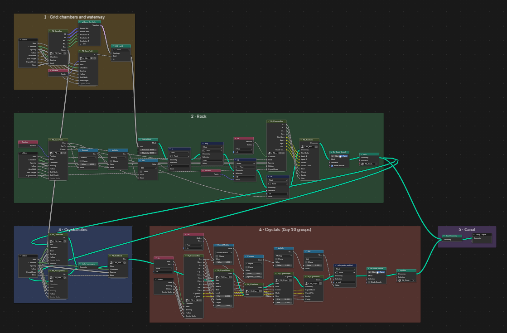

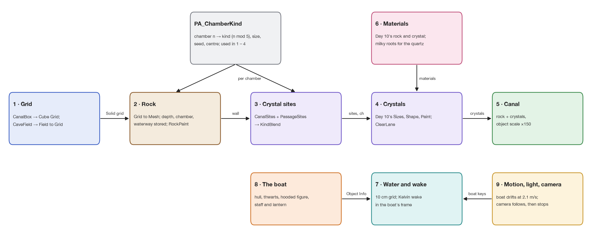

| # | Section | Nodes | Job |
|---|---|---|---|
| 1 | Grid: chambers and waterway | 5, plus `PA_CanalBox` (16), `PA_CaveField` (43), `PA_ChamberKind` (44), `PA_Waterway` (11) and Day 10's `PA_GeodeField` (63) | a voxel grid over the chain, with the open space sampled on it |
| 2 | Rock | 16, plus `PA_RockPaint` (11) | the rock surface, with its depth, chamber and waterway stored for the shader |
| 3 | Crystal sites | 4, plus `PA_CanalSites` (51), `PA_PassageSites` (45), `PA_KindBlend` (23) | sites on every hall's wall and on the passages, each with a chamber whose kind it takes |
| 4 | Crystals (Day 10 groups) | 14, plus `PA_ClearLane` (25) and Day 10's `PA_CrystalSizes` (89), `PA_CrystalShape` (58), `PA_CrystalPaint` (6) | a size, a shape and colours per site; crystals kept out of the boat's way |
| 5 | Canal | 2 | rock + crystals |
| 6 | Materials | `PA_GeodeRock` (164), `PA_GeodeCrystal` (41) | Day 10's, with finer glitter and milky roots for the quartz |
| 7 | Water and the wake | `PA_Water_GN` (55), `PA_Water` (9) | a still surface with a Kelvin wake behind the boat |
| 8 | The boat | `PA_Boat_GN` (80) | hull, thwarts, a hooded figure, a staff and its lantern |
| 9 | Motion, light and camera | `build.py` | the drift, the camera that stops, the lantern that flares up |

The main tree holds 45 nodes: the 41 in the five sections and one Group Input for each of the first four.

The hall changes are where the boat passes a passage's middle. From frame 649 the camera holds still and the boat
drifts on into the passage to celestine.

---

## 1 · Grid: chambers and waterway

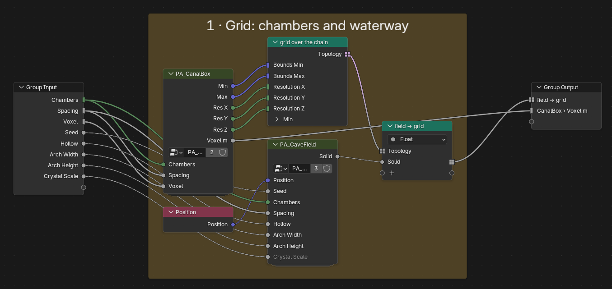

As in Day 10, an implicit field becomes a mesh in two steps: sample it on a grid (**Field to Grid**), then extract
the surface where it crosses zero (**Grid to Mesh**, in 2 · Rock).

| Node | What it does |
|---|---|
| `PA_CanalBox` | the grid's bounds and resolution, from Chambers, Spacing and Voxel |
| `grid over the chain` (Cube Grid Topology) | an empty grid between Min and Max |
| `PA_CaveField` | the open space of the canal, evaluated at the Position of every grid point |
| `field → grid` (Field to Grid) | keeps the field's Solid output as a float grid |

### Inside `PA_CanalBox`

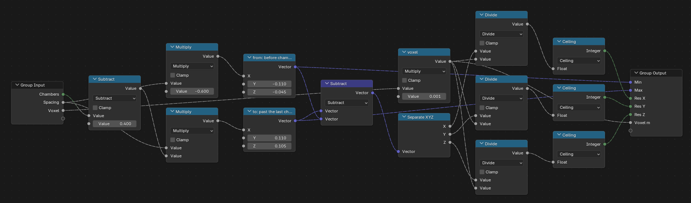

`from: before chamber 0, under the water` is (−0.6 × Spacing, −0.11, −0.045) and `to: past the last chamber` is
((Chambers − 0.4) × Spacing, 0.11, 0.105). With the defaults that is 0.93 × 0.22 × 0.15 units (140 × 33 × 22.5 m),
and at a 2 mm voxel a grid of about 465 × 110 × 75 points, 3.8 million. Chamber n is centred at x = n × Spacing,
so the box leaves 0.6 of a spacing before the first chamber and after the last.

### Inside `PA_ChamberKind`

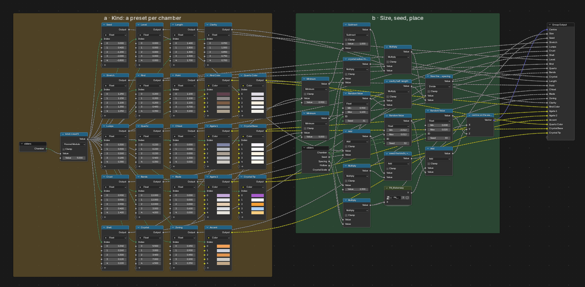

This group answers "what is chamber n?". It takes a chamber number and returns everything Day 10's generator needs
for one stone, plus where that stone sits.

#### a · Kind: a preset per chamber

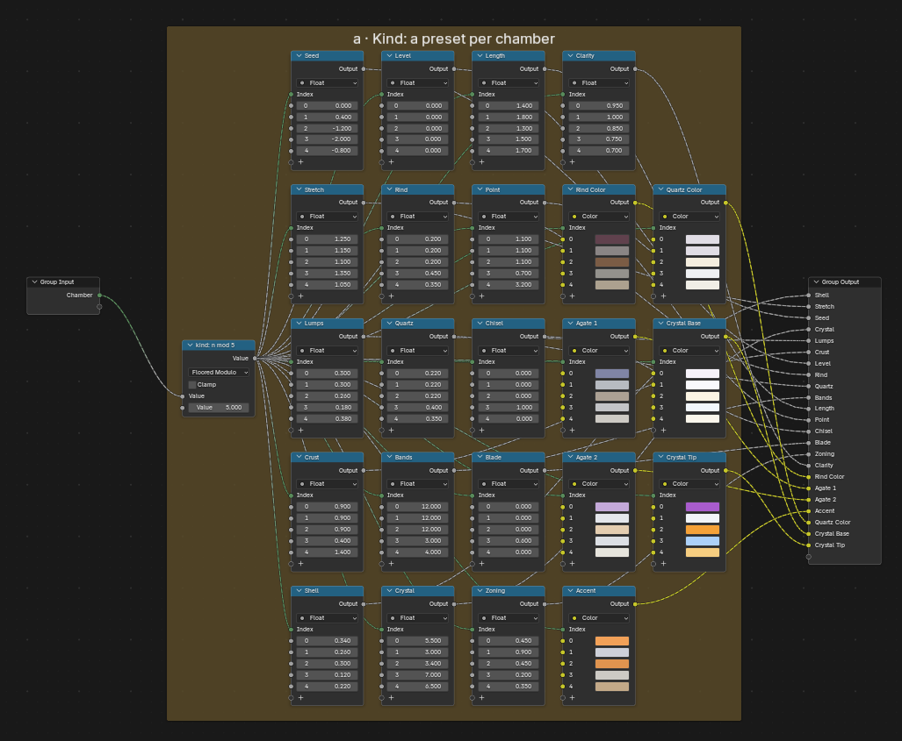

`kind: n mod 5` picks one of five presets, and an **Index Switch** per slider holds the five values: 16 numbers
(Seed, Stretch, Shell, Crystal, Length, Clarity…) and 7 colours. Index 0 is Day 10's amethyst, 2 citrine,
3 celestine and 4 dogtooth calcite, exactly as in Day 10. Index 1 is Day 10's druzy with three changes, so that
it grows water-clear rock crystal instead of a sugar crust:

| Slider | Day 10 druzy | Here |
|---|---|---|
| Crystal | 0.9 mm | 3.0 mm |
| Length | 1.0 | 1.8 |
| Clarity | 0.55 | 1.0 |

### Trick · a table, not a scene

There is no list of chambers anywhere. The kind is a lookup on n mod 5, and the rest of a chamber (b, below) is
Random Value nodes with **ID = n**. A Random Value with a fixed ID and seed always returns the same number, so
chamber 3 is the same celestine whether it is asked for by the grid, by a crystal site or by the shader's paint. Ask
for chamber 40 and you get one too.

#### b · Size, seed, place

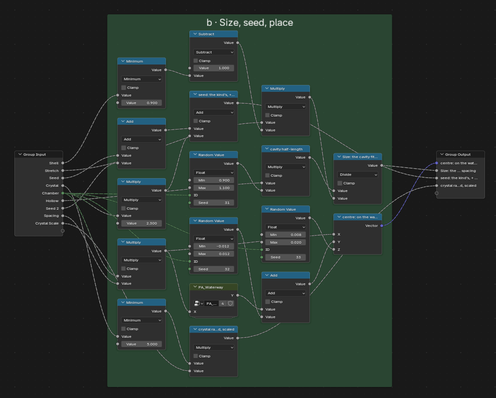

| Output | Formula | With the defaults |
|---|---|---|
| `cavity half-length` | Hollow × random(0.9 … 1.1), ID n, seed 31 | 0.062 → about 9.3 m, so each hall is about 19 m long |
| `Size: the cavity fits the spacing` | half-length ÷ (Stretch × (1 − min(Shell, 0.9))) | every kind's hollow is about as long, whatever its Shell and Stretch |
| `seed: the kind's, + 2.3 per chamber (a new 4D slice)` | kind's Seed + Seed slider + 2.3 n | two amethyst halls (0 and 5) are different stones |
| `centre: on the waterway, nudged; the hollow's middle above the water` | x = n × Spacing; y = waterway(x) + random(±0.012); z = random(0.008 … 0.02) | the hall sits on the canal, up to 1.8 m off its line, its middle 1.2–3 m above the water |
| `crystal radius: the kind's, capped, scaled` | min(kind's Crystal, 5) × Crystal Scale | 5 mm cap (celestine's 7 mm blades crowded the lens), × 0.45 |

Day 10's cavity half-length is Size × Stretch × (1 − Shell). Solving it for Size means the slider says how long the
hall is, and each kind keeps its own wall thickness and proportions.

> **Try it:** in `PA_ChamberKind`, change the Floored Modulo's 5.000 to 1. Every chamber becomes amethyst, each still
> a different stone, because the seed moves on by 2.3 per chamber. (Chamber 1's crystals keep milky roots: the main
> tree decides those from `ch` mod 5, in section 4.)

### Inside `PA_Waterway`

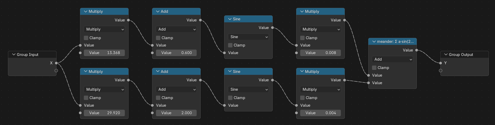

`meander: Σ a·sin(2πx/λ + φ)` is y = 0.008 sin(2πx / 0.47 + 0.6) + 0.004 sin(2πx / 0.21 + 2.0): in the scene, a
1.2 m swing every 70.5 m plus a 0.6 m one every 31.5 m. Two wavelengths that don't divide each other never quite
repeat, so the canal never looks ruled.

### Trick · one formula, three users

`build.py` keeps the same numbers in `WAY` and uses them in Python too (`way_y`). The waterway in the field, the
boat's path and the camera's path are one curve, so the boat never scrapes a wall and the camera stays in the
channel without any constraint.

### Inside `PA_CaveField`

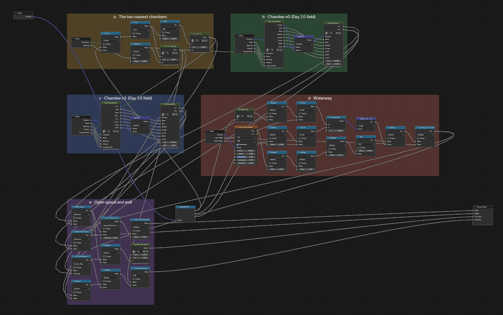

| Output | Meaning |
|---|---|
| Solid | > 0 in the rock, < 0 in the open space (the halls and the waterway) |
| Depth | Day 10's depth into the wall: 0 at a stone's outer surface, 1 at its cavity wall |
| Cut Face | 1 where the open space is the waterway's bore, not a hall |
| Chamber | which of the two chambers this point belongs to |

#### a · The two nearest chambers

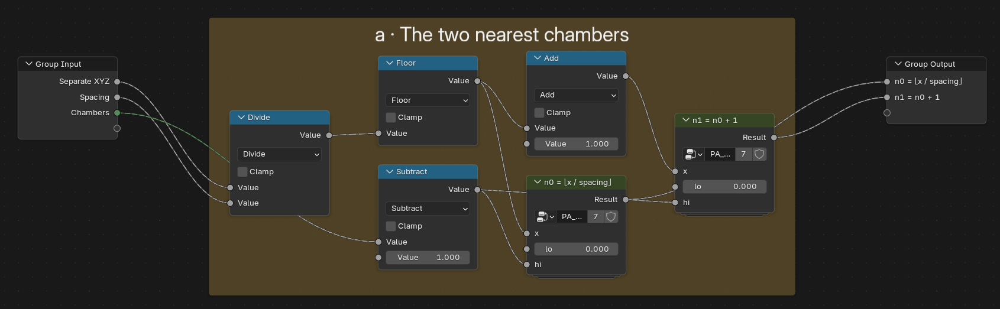

`n0 = ⌊x / spacing⌋` and `n1 = n0 + 1`, both clamped to 0 … Chambers − 1. A point at x = 30 m lies between
chamber 1 (22.5 m) and chamber 2 (45 m).

#### b · Chamber n0 and c · Chamber n1

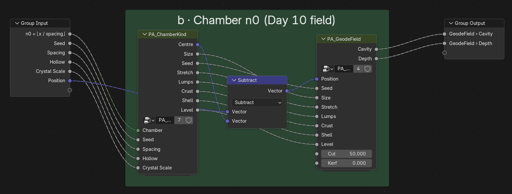

Each is one `PA_ChamberKind` and one Day 10 `PA_GeodeField`. The field is evaluated at Position − Centre, so each
stone sits in its own frame, with its kind's Seed, Size, Stretch, Lumps, Crust, Shell and Level. Day 10's saw cut is
switched off: Cut 50 puts the saw plane 50 stone sizes away, and Kerf is 0.
[How the Day 10 field works →](../../day10-geode-v2-generator/tutorial/README.md#inside-pa_geodefield)

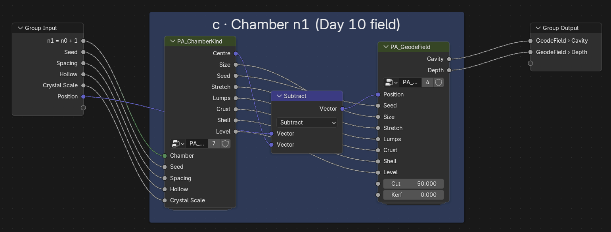

### Trick · ask only the two nearest

A point never needs a third chamber. A point between chambers n0 and n0 + 1 is at least 22.5 m (one Spacing) from
every other chamber's centre, and a hollow reaches at most about 10 m from its own. No third hollow can open there,
so the field costs two Day 10 evaluations per point, for 6 chambers or for 600.

#### d · Waterway

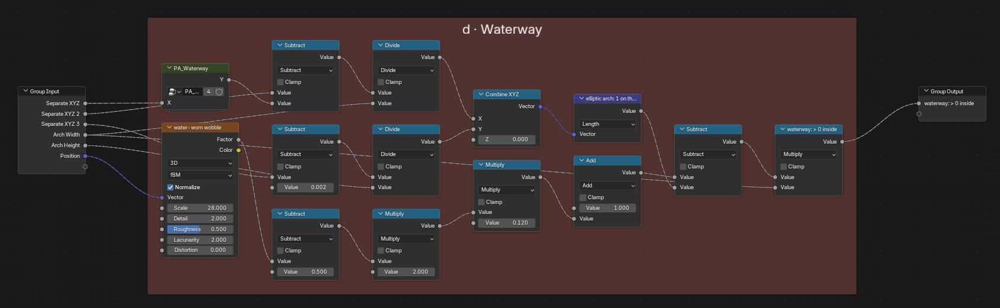

`elliptic arch: 1 on the wall` is the length of ((y − meander) ÷ Arch Width, (z − 0.002) ÷ Arch Height): an
ellipse 2.7 m to each side and 4.8 m up, centred 0.3 m over the water. `water-worn wobble` is a noise of scale 28
(about one bump per 5 m) that moves the wall in and out by up to 12 %. `waterway: > 0 inside` = (1 + 0.12 ×
wobble − ellipse) × Arch Width, a distance in units, positive inside the bore.

#### e · Open space and wall

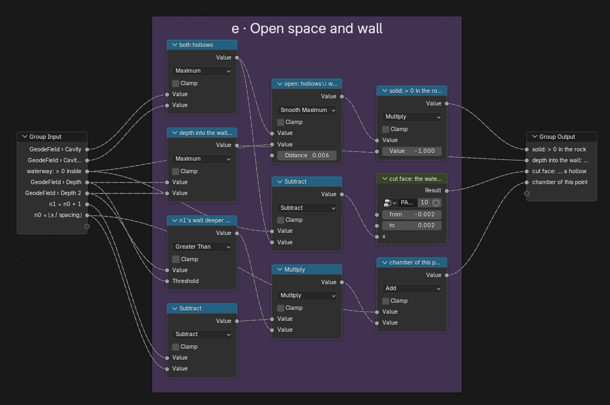

| Node | What it does |
|---|---|
| `both hollows` | Maximum of the two cavities: the union of two hollows |
| `open: hollows ∪ waterway (smooth)` | Smooth Maximum with the waterway, Distance 0.006 (0.9 m) |
| `solid: > 0 in the rock` | −open |
| `depth into the wall: the nearer geode's` | the larger of the two depths |
| `cut face: the waterway, not a hollow` | smoothstep(−0.002, 0.002, waterway − hollows) |
| `chamber of this point` | n1 where `n1's wall deeper here?`, n0 otherwise |

For signed fields, Maximum is a union, so the open space is "either hollow, or the bore". A plain Maximum would leave
a sharp crease where the bore meets a hall. The Smooth Maximum blends the two surfaces over 0.9 m, so the arch flares
into the hall like rock worn by water.

> **Try it:** in `e · Open space and wall`, set the Smooth Maximum's Distance to 0. Every arch now meets its hall in
> a sharp crease instead of flaring into it.

---

## 2 · Rock

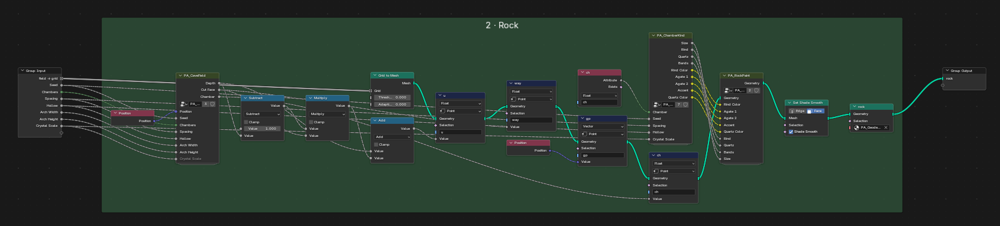

As in Day 10, the field is evaluated twice: once on the grid for the shape, and again at the mesh's own vertices,
for what the shader needs.

| Node | What it does |
|---|---|
| Grid to Mesh | the Solid grid's zero surface becomes the rock mesh |
| `PA_CaveField` | evaluated again at every vertex |
| `u` | Depth + (1 − Depth) × Cut Face: Day 10's depth, and 1 on the bore |
| `way` | Cut Face: is this vertex on the bore? (used in 3 · Crystal sites) |
| `gp` | the position, a fixed coordinate for the rock textures |
| `ch` | the vertex's chamber |
| `PA_ChamberKind` → `PA_RockPaint` | stores that chamber's rock colours on the vertex ([Day 10](../../day10-geode-v2-generator/tutorial/README.md#inside-pa_rockpaint)) |
| `rock` (Set Material) | `PA_GeodeRock` |

Day 10's shader paints u = 1 as the cavity wall's crystal skin and lower u as agate bands. Setting u to 1 on the bore
makes the passage read as a crystal wall, like the halls, instead of a sawn slab of bands. The crystals of section 3
then cover it.

Because `PA_ChamberKind` runs per vertex, every hall carries its own colours: the rock round the citrine is the
citrine preset's, the rock round the celestine is the celestine's.

---

## 3 · Crystal sites

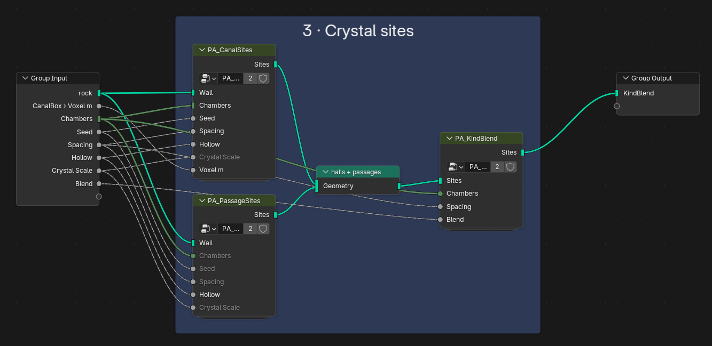

A site is a point on the rock where a crystal will stand, with its direction of growth and the room in front of it.
The halls get their sites as in Day 10 (`PA_CanalSites`), the passages get scattered ones (`PA_PassageSites`), and
`PA_KindBlend` then decides, per site, whose kind it is.

### Inside `PA_CanalSites`

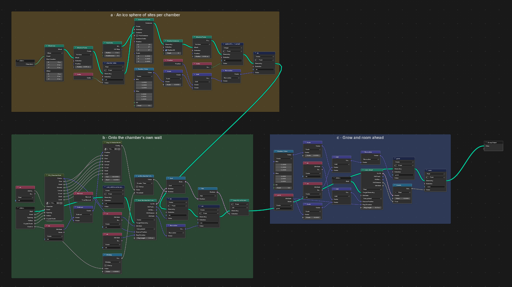

#### a · An ico sphere of sites per chamber

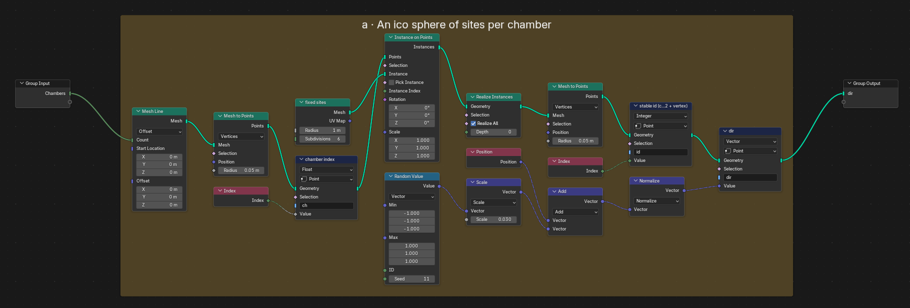

A Mesh Line gives one point per chamber, and `chamber index` stores its number as `ch`. On each, `fixed sites`
(Ico Sphere, subdivision 6: 10 242 vertices) is instanced and realised: 61 452 sites for six chambers.
`stable id (chamber · 10 242 + vertex)` is their index, and `dir` is each vertex's direction, jittered by 3 %.

#### b · Onto the chamber's own wall

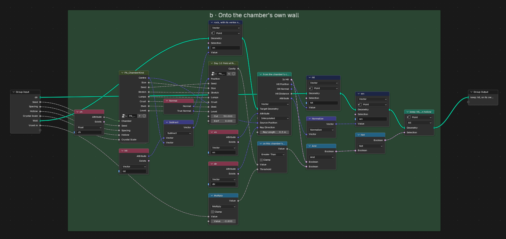

`from the chamber's centre` (Raycast) shoots each site's direction from its chamber's centre onto the rock, up to
0.3 units (45 m), and reads the rock's vertex normal at the hit. Then `Day 10 field at the hit` asks: is this hit on
this chamber's own hollow? A ray that left down the waterway hits the next hall or the bore instead.
`on this chamber's hollow?` keeps a hit when its Cavity is above −0.8 voxel, and `keep: hit, on its own hollow`
deletes the rest.

[Why cast a fixed set instead of scattering →](../../day10-geode-v2-generator/tutorial/README.md#trick--cast-a-fixed-set-dont-scatter)

#### c · Grow and room ahead

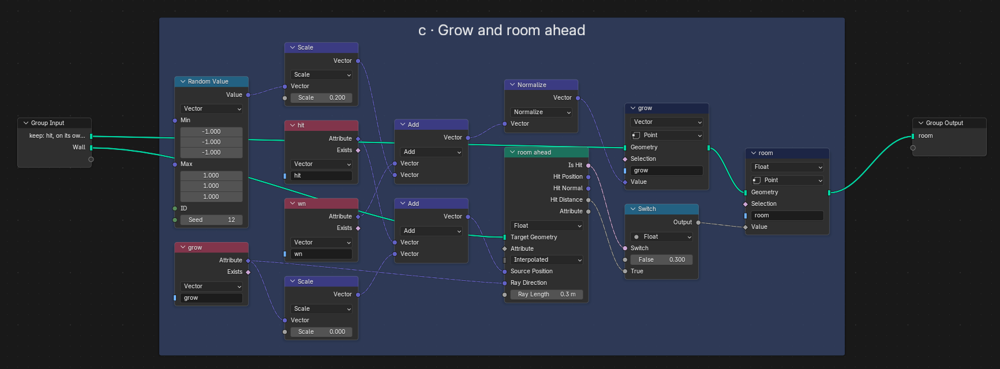

`grow` is the wall normal tilted by up to 20 % at random. `room ahead` (Raycast) shoots from just off the wall along
that direction: the distance to the next rock, or 0.3 if there is none. Day 10's `PA_CrystalSizes` uses it so that no
crystal grows through the opposite wall.

### Inside `PA_PassageSites`

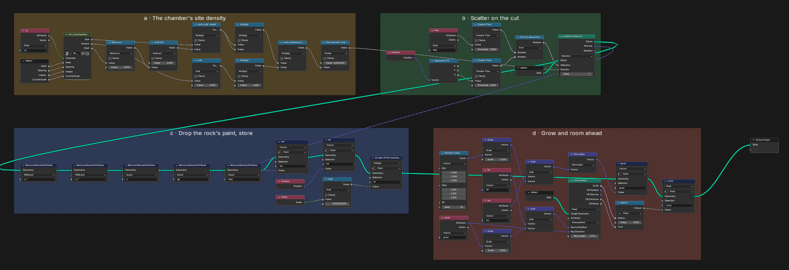

The rays of `PA_CanalSites` start at a hall's centre, so they never land in the passages: those hits are on the
bore, not on the hall's own hollow, and are dropped. Left at that, every passage would be bare rock between two
crystal halls. This group scatters sites over the bore instead.

#### a · The chamber's site density

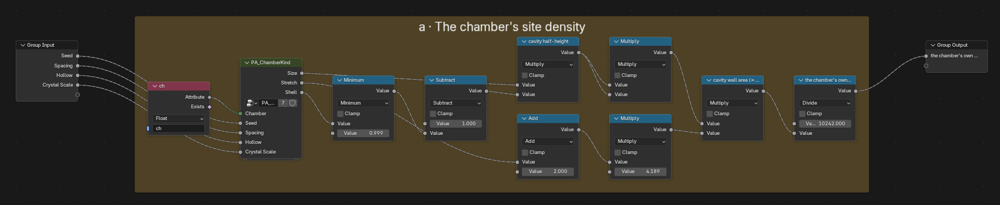

Day 10's `PA_CrystalSizes` decides how many sites get a big crystal from the cavity's wall area and the 10 242 sites
spread over it. Sites scattered at any other density would come out too crowded or too sparse. So the density is the
chamber's own: `the chamber's own site density (CrystalSizes counts on it)` = 10 242 ÷
`cavity wall area (≈ ellipsoid)`, with half = `cavity half-height` and area = half² × (Stretch + 2) × 4π / 3.

#### b · Scatter on the cut

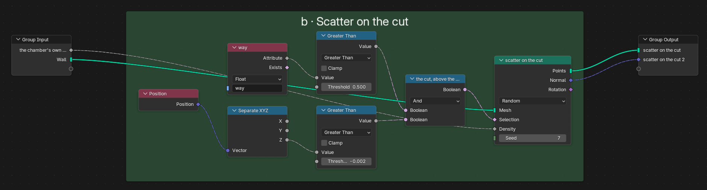

`the cut, above the water` selects faces where `way` > 0.5 and z > −0.002 (no deeper than 0.3 m under the water).
`scatter on the cut` (Distribute Points on Faces, Random, seed 7) scatters points there at that density.

#### c · Drop the rock's paint, store

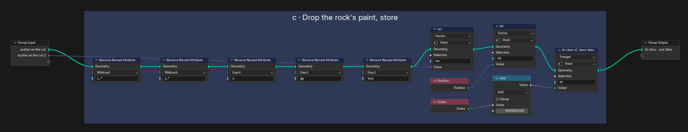

Distribute Points on Faces copies every attribute of the mesh onto the points, including the rock's colours. The
crystals would then carry the rock's paint, so five **Remove Named Attribute** nodes drop `c_*` and `z_*`
(wildcards), `u`, `gp` and `way`. The points keep `ch`. Then `wn` = the face normal, `hit` = the point and
`id: clear of the chambers' sites` = index + 9 000 000, so no passage site shares an id (and random numbers) with a
hall's.

#### d · Grow and room ahead

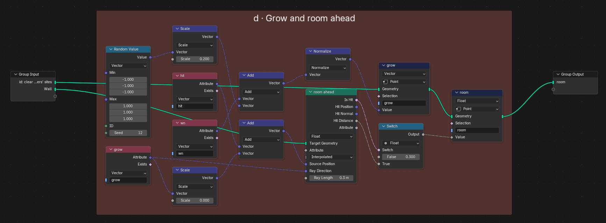

The same as `c · Grow and room ahead` in `PA_CanalSites`, so both kinds of site leave with the same attributes.

### Inside `PA_KindBlend`

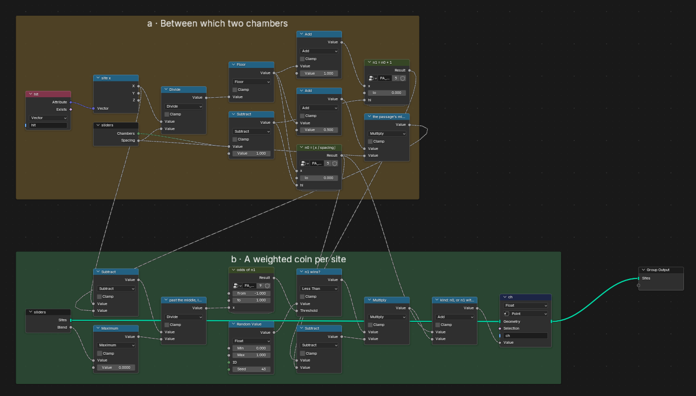

Every site, in a hall or a passage, now gets the chamber whose kind it will take, stored as `ch`.

#### a · Between which two chambers

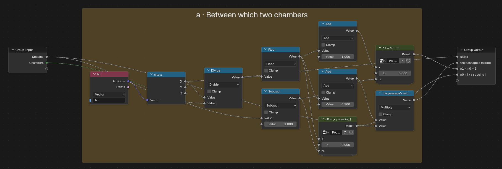

The same n0 and n1 as in the field, from `site x`. `the passage's middle` is (⌊x / spacing⌋ + 0.5) × Spacing:
half-way between the two centres, inside the bore.

#### b · A weighted coin per site

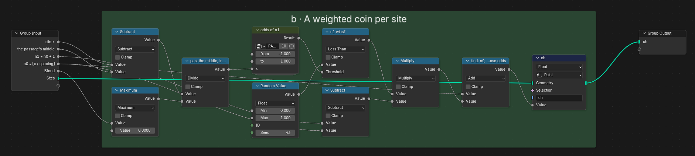

`past the middle, in Blends` is u = (x − middle) ÷ Blend, and `odds of n1` = smoothstep(−1, 1, u). A random number
per site (Random Value, seed 43) below those odds means `n1 wins?`, and `kind: n0, or n1 with those odds` is stored as
`ch`.

### Trick · a weighted coin, not a colour blend

A crystal can't be half amethyst and half quartz. Blending the colours would give lilac crystals in every passage.
Instead each crystal flips a coin whose odds slide from 0 to 1 across the passage. A real contact between two
minerals looks like this: purple points thin out, white ones come in, and every crystal stays whole. At Blend 0.03
the mix spans ±4.5 m round the passage's middle. The rest of each hall keeps its own kind, since a hall's centre is
11.25 m from the middle.

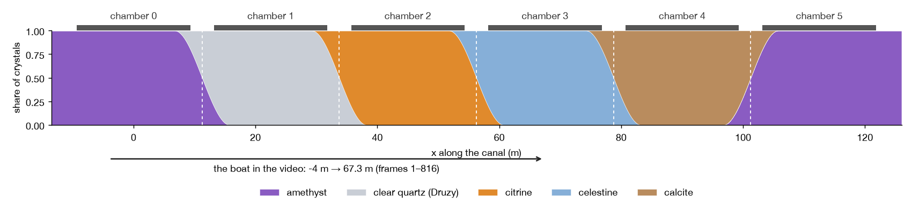

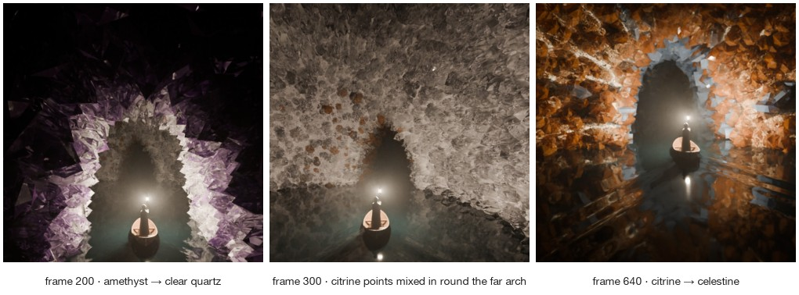

The new `ch` also decides each crystal's size and shape in section 4, so a quartz point in the amethyst's passage has
the quartz preset's size and length, not just its colour.

> **Try it:** set the modifier's Blend slider to 0. Each passage switches kind in a straight line across the bore.
> At 0.08 the mix reaches ±12 m, nearly to the middle of both halls.

---

## 4 · Crystals (Day 10 groups)

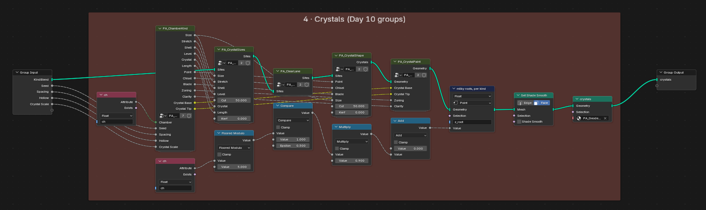

This is Day 10's crystal chain, fed per site. `PA_ChamberKind` of the site's `ch` gives the sliders that chamber's
preset would set, and the Day 10 groups take them as they are:

| Group | What it does (Day 10) |
|---|---|
| `PA_CrystalSizes` | big crystal or druzy grain, radius, length, a frame per crystal ([Day 10](../../day10-geode-v2-generator/tutorial/README.md#inside-pa_crystalsizes)) |
| `PA_ClearLane` | new: crystals that would reach into the boat's path shrink (below) |
| `PA_CrystalShape` | one prism per site, with the kind's tip ([Day 10](../../day10-geode-v2-generator/tutorial/README.md#inside-pa_crystalshape)) |
| `PA_CrystalPaint` | the kind's crystal colours as attributes ([Day 10](../../day10-geode-v2-generator/tutorial/README.md#inside-pa_crystalpaint)) |
| `milky roots, per kind` | stores `z_root` = 0.9 on the clear quartz's crystals (kind 1), 0 elsewhere, for the shader |
| `crystals` (Set Material) | `PA_GeodeCrystal`, flat shaded so the facets glint |

One number changes in Day 10's sizes: `COVER`, how many times over the big crystals' footprints cover the wall. Day 10
covers it about 1.1 times, which leaves a third of the wall to druzy grain. That is fine texture on a 7.5 cm stone,
but at 150 times the bare patches read as a camouflage pattern. `build.py` sets it to 2.6 (`CANAL_COVER`), which
covers about 93 %.

### Inside `PA_ClearLane`

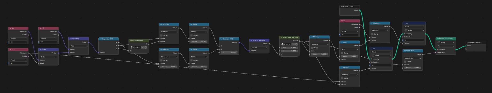

The lantern hangs 1.2 m over the water and the camera rides 2.8 m up, and the walls close in at every arch. A
crystal growing into the channel would hit one or the other. `crystal tip` = hit + direction × length, and `lane: < 1 inside` is the length of
((tip y − meander) ÷ 1.5 m, max(tip z, 0) ÷ 2.9 m): an elliptic tube along the waterway, above the water.
`shrink near the lane` = smoothstep(0.85, 1.25, that): the length is multiplied by it, the radius by 0.35 + 0.65 × it,
and a crystal shrunk below 0.08 is deleted. Crystals near the lane get shorter instead of vanishing, so the arch keeps
its lining.

---

## 5 · Canal

The section is one **Join Geometry**: rock and crystals, one mesh of 1 186 068 vertices. The object's scale of 150
turns Day 10's units into the scene's metres.

---

## 6 · Materials

Both materials are Day 10's (`PA_GeodeRock` and `PA_GeodeCrystal`,
[Day 10: rock](../../day10-geode-v2-generator/tutorial/README.md#5--rock-material),
[crystal](../../day10-geode-v2-generator/tutorial/README.md#6--crystal-material)), with two changes.

**Finer glitter.** The rock's druzy skin glitters through a Voronoi texture, `druzy facets`, at 1800 cells per unit.
On Day 10's stone that is a 0.6 mm grain. Here 1 / 1800 of a unit is 8 cm, a mosaic of tiles, so `build.py` sets
3600 (4 cm).

**Milky roots.** Clear quartz in a dark cave is hard to see: the light passes through it, and only the tips glint.
Real rock crystal clusters are often milky at the base, clouded by tiny fluid inclusions, and clear towards the tip.
The crystal material gets one more section for that.

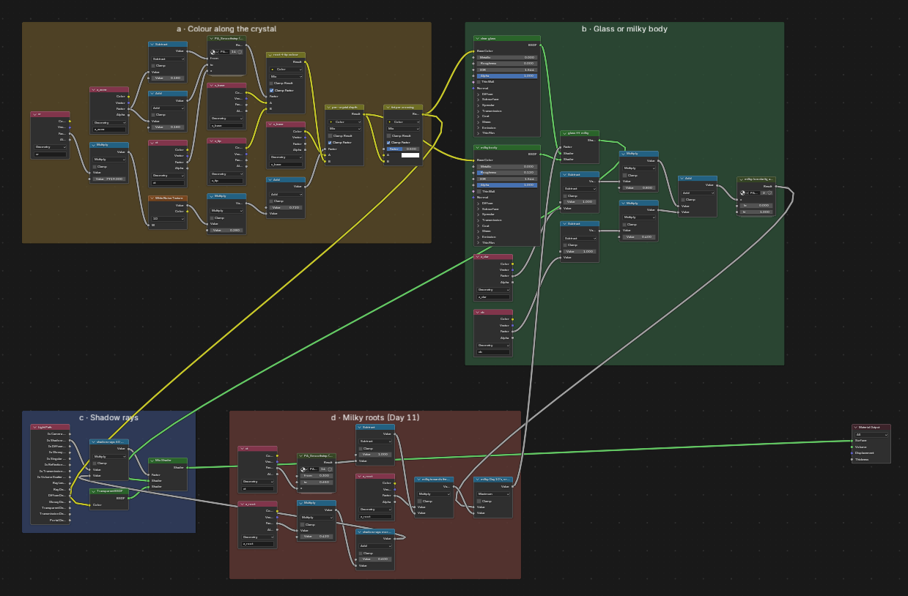

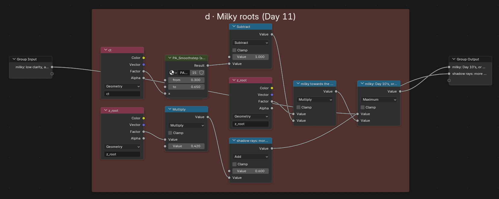

- `milky towards the root` = `z_root` × (1 − smoothstep(0.3, 0.65, `ct`)), where `ct` runs 0 at a crystal's root to
  1 at its tip. With `z_root` = 0.9, the bottom 30 % of each quartz point is milky, clearing by 65 % of its length.
- `milky: Day 10's, or a milky root` takes the larger of that and Day 10's milky mix, and feeds `glass ↔ milky`.
- `shadow rays: more through where roots are milky` replaces Day 10's 0.6: 0.6 + `z_root` × 0.42, so 98 % for the
  quartz. Day 10 lets 60 % of shadow rays through crystal glass, to fake the light that caustics would carry. The
  quartz hall lets almost all of it through, so the lantern reaches the white roots and the wall behind the points,
  and the whole hall glows.

`z_root` is 0 on every other kind, so the amethyst, citrine, celestine and calcite render exactly as on Day 10.

> **Try it:** set `MILKY_ROOTS = {'Druzy': 0.0}` in `build.py` and rebuild. The quartz points turn water-clear from
> root to tip and let 60 % of the light through instead of 98 %. The hall loses its white glow: you see the rock
> through the glass, and the glints on the tips.

---

## 7 · Water and the wake

The water is a separate object, `PA_Water` in metres, with its own tree.

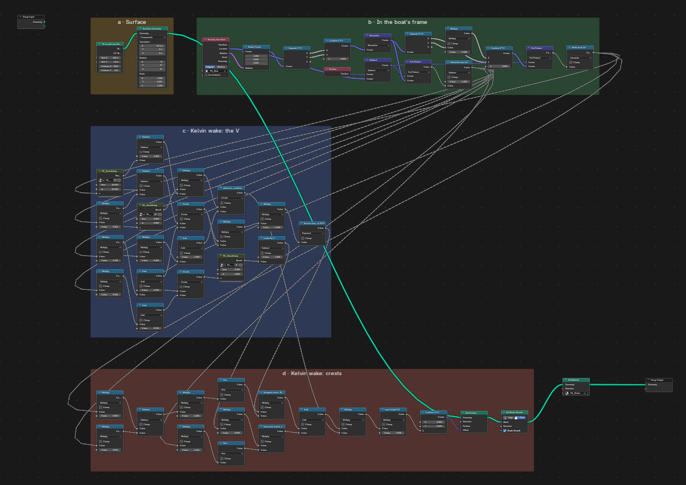

#### a · Surface

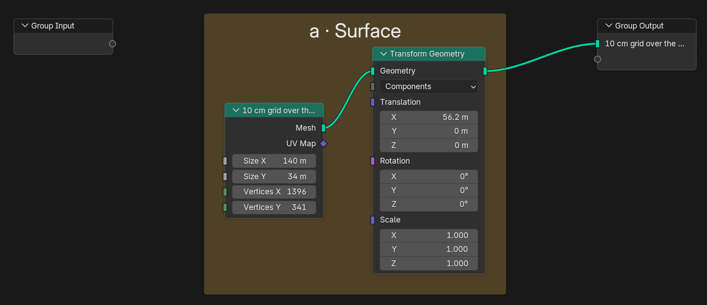

`10 cm grid over the chain`: 139.5 × 34 m with a vertex every 10 cm, 476 036 vertices. It is flat. Only the wake moves
it.

#### b · In the boat's frame

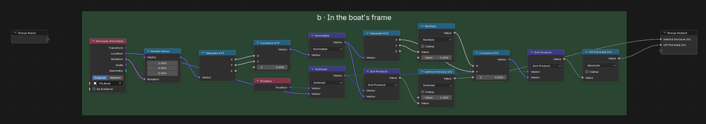

`the boat, this frame` (Object Info) reads the boat's location and rotation, each frame. Its heading is (1, 0, 0)
rotated by the boat's rotation, flattened to the water and normalised. For every vertex:

- `behind the bow (m)` = 1.2 − (vertex − boat) · heading. The bow is 1.2 m ahead of the boat's origin.
- `off the track (m)` = |(vertex − boat) · side|, where side is the heading turned 90°.

### Trick · a wake in the boat's frame

A real wake is a train of waves that the hull leaves behind it. Simulating that needs a solver, and caching it. But
seen from the boat, a boat at steady speed in deep water drags a pattern that doesn't change. So the wake is a
formula of two numbers, distance behind the bow and distance off the track, evaluated afresh each frame wherever the
boat is. It costs nothing, and it never drifts away from the hull.

#### c · Kelvin wake: the V

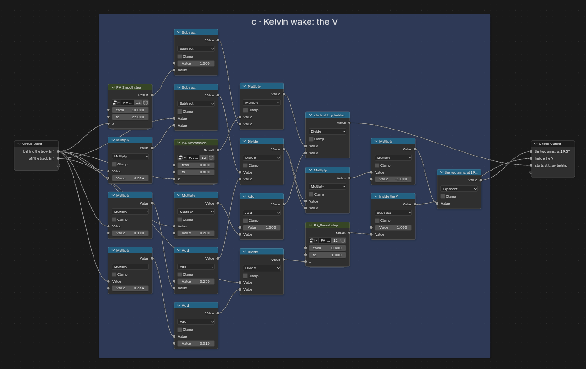

Any boat on deep water makes the same V, opening at ±19.47° (Kelvin's angle), whatever its speed.

- `starts at the bow, dies away behind`: smoothstep(0, 0.8, behind) × (1 − smoothstep(10, 22, behind)), divided by
  (1 + 0.2 × behind), so the waves grow over the first 0.8 m and are gone 22 m back.
- `the two arms, at 19.5°`: exp(−w²), with w = (off − behind × tan 19.47°) ÷ (0.25 + 0.1 × behind). A ridge along
  each arm that widens as it gets older.
- `inside the V`: 1 inside the arms, 0 outside, by smoothstep(0.6, 1.0, off ÷ (behind × tan 19.47° + 0.01)).

#### d · Kelvin wake: crests

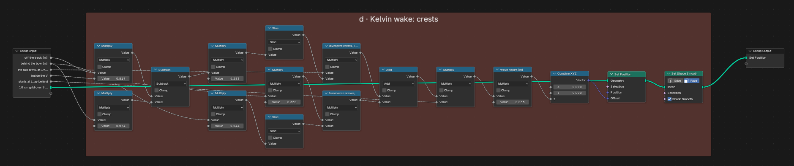

- `divergent crests, 35° to the track`: arms × sin(2π (off × cos 35° − behind × sin 35°) ÷ 1 m): short crests
  slanting out along each arm, as behind a real boat.
- `transverse waves, inside the V`: inside × 0.35 × sin(2π × behind ÷ 2.8 m), weaker crests across the track.
- `wave height (m)` = (divergent + transverse) × fade × 0.035, then **Set Position** lifts each vertex by it.

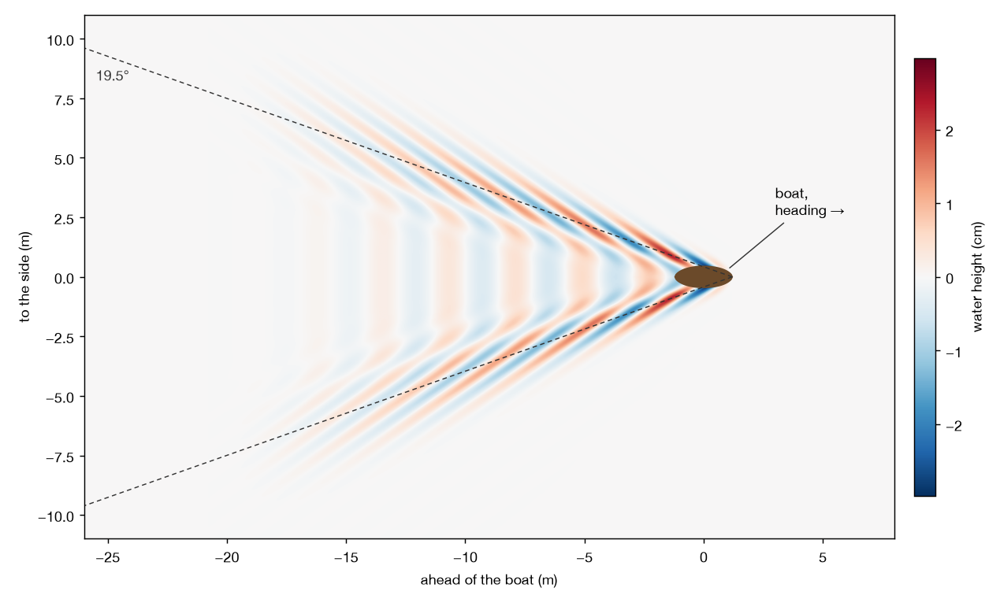

The peak is about 3 cm. That is enough: the water is a near mirror (roughness 0.03), and a 3 cm slope breaks every
reflection behind the boat into ribbons.

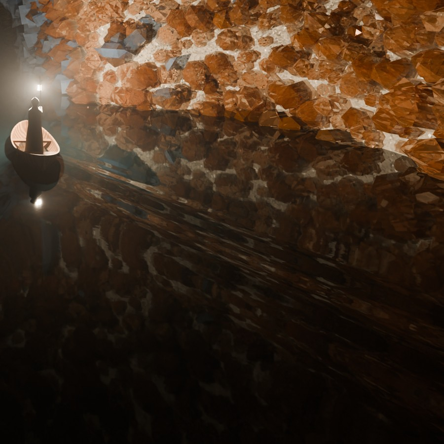

**The water material** (`PA_Water`): a dark, glossy Principled (Base Color (0.004, 0.010, 0.012), Roughness 0.03, IOR
1.333), bumped by `slow ripples`, a 4D noise whose W is driven by frame / 300, so the surface drifts slowly even far
from the boat. For shadow rays only, 85 % of it is a tinted Transparent BSDF, so the lantern still lights the rock
under the water.

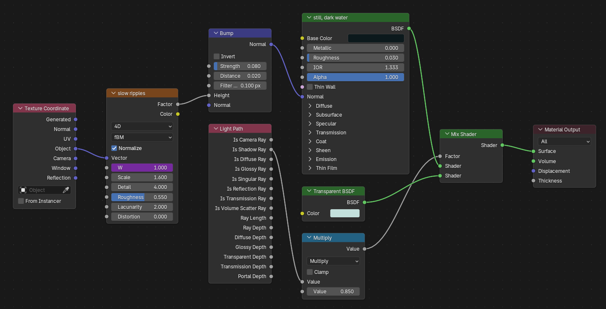

> **Try it:** in `d · Kelvin wake: crests`, change the 0.035 to 0.1. The wake shows as white streaks in the
> reflections, a speedboat's wake behind a rowing boat.

---

## 8 · The boat

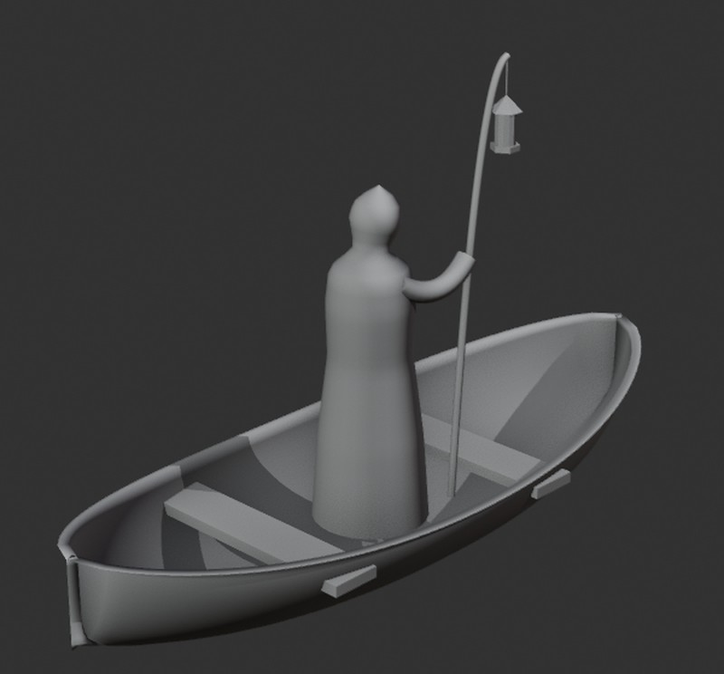

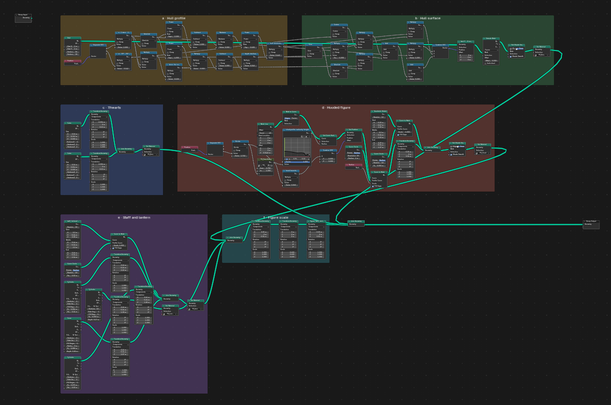

#### a · Hull profile and b · Hull surface

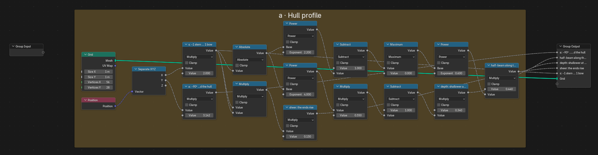

A **Grid** of 56 × 28 vertices is bent into the hull. Along it, `s: −1 stern … 1 bow` = 2x; across it,
`a: −90° … 90° round the hull` = πy. Three curves of s shape the boat (length 2.4 m, beam 0.88 m, depth 0.34 m):

- `half-beam along the boat` = 0.44 × (1 − |s|^2.2)^0.6: full amidships, closing to a point at each end;
- `depth: shallower at the ends` = 0.34 × (1 − 0.55 s⁴);
- `sheer: the ends rise` = 0.13 s².

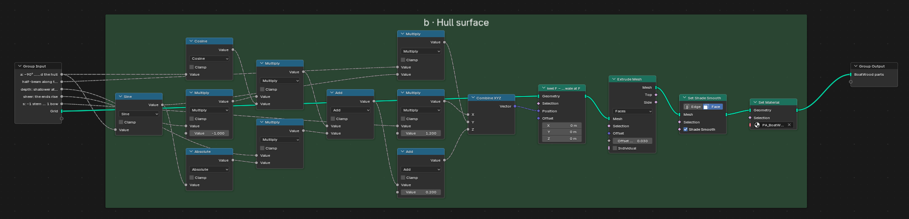

Each vertex goes to x = s × 1.2, y = half × sin a, z = −depth × cos a + sheer × |sin a| + 0.2: a half-ellipse
section that changes along the boat. `keel F − D under the water line, gunwale at F` puts the gunwale 0.2 m above the
water. **Extrude Mesh** (3 cm, not individual) gives the planks their thickness.

#### c · Thwarts

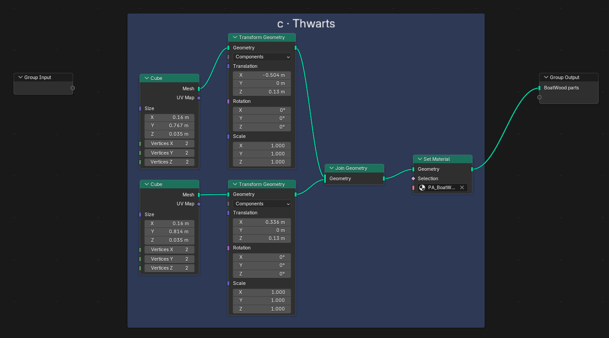

Two seats, at s = −0.42 and 0.28, each as long as the half-beam formula gives at that point (× 0.96).

#### d · Hooded figure

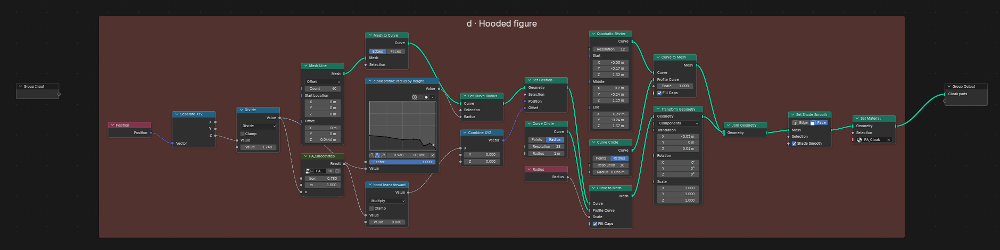

The figure is turned on a lathe. A vertical line of 40 points, 1.74 m tall, becomes a curve, and `cloak profile: radius
by height` (Float Curve) sets its radius at each height: wide at the hem, a waist, shoulders, a narrow neck, the hood.
`hood leans forward` pushes the top 22 % forward by up to 6 cm. **Curve to Mesh** with a circle of 28 points, with
the Radius fed into its Scale, makes the cloak. An arm is a Quadratic Bézier tube from the shoulder to the staff.

#### e · Staff and lantern

`staff, its head hooked forward` is a Quadratic Bézier from the floor of the boat, bending forward at the top into a
hook. The lantern hangs from it: a thin hanger, a cone cap, a base disc (`PA_Iron`) and a glowing cylinder
(`PA_LanternGlow`).

#### f · Figure scale

`figure, staff, lantern × scale` scales the figure with its staff and lantern by 0.6 about its feet, leaving the boat
as it is. At 0.6 the figure is 1.04 m tall: small against the halls, and the lantern hangs 1.2 m over the water,
where it lights the boat and the water round it.

**The lantern glass.** The light sits inside the glowing cylinder. An emissive mesh blocks shadow rays like any
other surface, so the light inside it would light nothing. `PA_LanternGlow` therefore turns into a Transparent BSDF for
shadow rays (Light Path · Is Shadow Ray), and emits otherwise.

---

## 9 · Motion, light and camera

The keyframes come from Python, one key per frame, each from a formula (`build_motion` in `build.py`):

| What | Formula |
|---|---|
| the boat | x = −4 + 2.1 t m, y on the meander; heading along the meander 0.5 m ahead; bobbing 1.2 cm, rolling 0.02 rad |
| the camera | 8 m behind the boat and 2.8 m up, on the meander; aimed 12 m ahead of the boat at 2.4 m height; 18 mm lens |
| the camera's stop | after 23 s it slows evenly to a halt over 4 s (frames 553–649), while the boat drifts on |
| the lantern | a 2000 W point light with radius 5 cm, warm (1, 0.78, 0.56), on the boat; it flares up over 1.6 s (a smoothstep), then flickers by ±6 % and ±3 % (sines of 13.1, 5.3 and 29.7 rad/s) |
| the lantern glass | its emission Strength is keyed to 40 × the light's power ÷ 2000, so the glass and its light rise together |

**The only light is the lantern.** The world's background strength is 0. A world volume (Principled Volume, density
0.004, anisotropy 0.55) fills the caves with a thin haze. It puts a halo round the lantern, backlights the figure and
makes the far halls fade.

**Colour.** AgX with the Medium High Contrast look, exposure 0. Glass needs bounces: 12 in all, 10 transmission,
6 glossy, 3 diffuse. Caustics are off; the crystals' shadow-ray trick (section 6) stands in for them.

---

## Helper groups

| Group | Inputs | Result |
|---|---|---|
| `PA_Smoothstep` | from, to, x | t = clamp((x − from) ÷ (to − from)), then t²(3 − 2t) |
| `PA_Clamp` | x, lo, hi | min(max(x, lo), hi) |
| `PA_Mix` | a, b, t | a + (b − a) × t |
| `PA_ByRing` | z, root, shoulder, tip | one value per ring of Day 10's crystal template |

All four are Day 10's ([Helper groups](../../day10-geode-v2-generator/tutorial/README.md#helper-groups)); the shader
trees use copies named "(shader)".

---

## How it was rendered

- **Video:** Cycles, 64 samples + denoise (OpenImageDenoise), 1080², 24 fps, persistent data on. Frames 1–360 on a
  Mac (Apple M4 Pro, Metal, about 36 s a frame), frames 361–816 on a second PC with an RTX 4060 (OptiX, about 26 s a
  frame). The two GPUs agree on brightness but not on every crystal facet: a single facet can come out up to twice as
  bright on one of them. A cut between the two at one frame would flicker. So both rendered frames 345–360, and the
  video blends from one to the other over those 16 frames.
- **Stills:** 2160² (resolution 200 %), 256 samples + denoise.
- **Geometry:** Voxel 2 mm (30 cm). The canal is 1 186 068 vertices, rock and crystals; the water 476 036; the boat
  3 383.

---

## Try it yourself

1. **More chambers.** In your own build, select **PA_Canal** and set Chambers to 12. The chain runs on past the last amethyst with
   clear quartz, citrine, celestine and so on, each hall a new stone. The water plane and the camera are built for six chambers in
   `build.py`, so the new halls stand dry.
2. **Another canal.** Set Seed to 7. Every hall changes shape, because each chamber's seed is its kind's + Seed +
   2.3 n, but every hall keeps its kind, size and place: those come from n alone.
3. **Blend.** Drag it from 0.03 to 0 and to 0.08. At 0 every passage switches kind at its middle; at 0.08 the kinds
   mix through most of both halls.
4. **Crystal Scale.** Set it to 0.8. Every crystal's radius grows by 78 %, and fewer sites get a big crystal, since
   Day 10's sizes keep the wall covered about as much as before. Near the waterway, `PA_ClearLane` shortens the ones
   that would reach into the boat's way, so the arches stay open.
5. **The order of the halls.** In `build.py`, change `KINDS` to `['Amethyst', 'Celestine', 'Citrine', 'Druzy',
   'Calcite']` and rebuild. The clear quartz moves to the fourth hall and keeps its clear points and milky roots,
   because `KIND_TWEAKS` and `MILKY_ROOTS` go by the kind's name.

*Made with Blender 5.2 Geometry Nodes for [Nodevember](https://nodevember.com) 2026, Day 11 · Cavernous.*
