# How a sugar cube dissolves under nine drops of tea

*A node-by-node walkthrough of Nodevember 2026 · Day 12 · Erosion*

The video (8 s, 192 frames) holds on a fresh sugar cube on a white saucer, lit from behind. Then drops of tea fall
on it one by one. The first ones soak in and stain the top brown, the next ones drill a funnel down through the cube,
tea pools around the base and creeps up the sides, the corners round off, the cube slumps, a wall gives way, and the
video holds on a ragged ring of brown crystals in a puddle of tea. One slider, **Age**, drives all of it. There is no
simulation, no image texture and no modelled or imported mesh (`pb.audit`: strictly procedural, no issues). The only
keyframes are three on Age, on the sugar and on the tea.

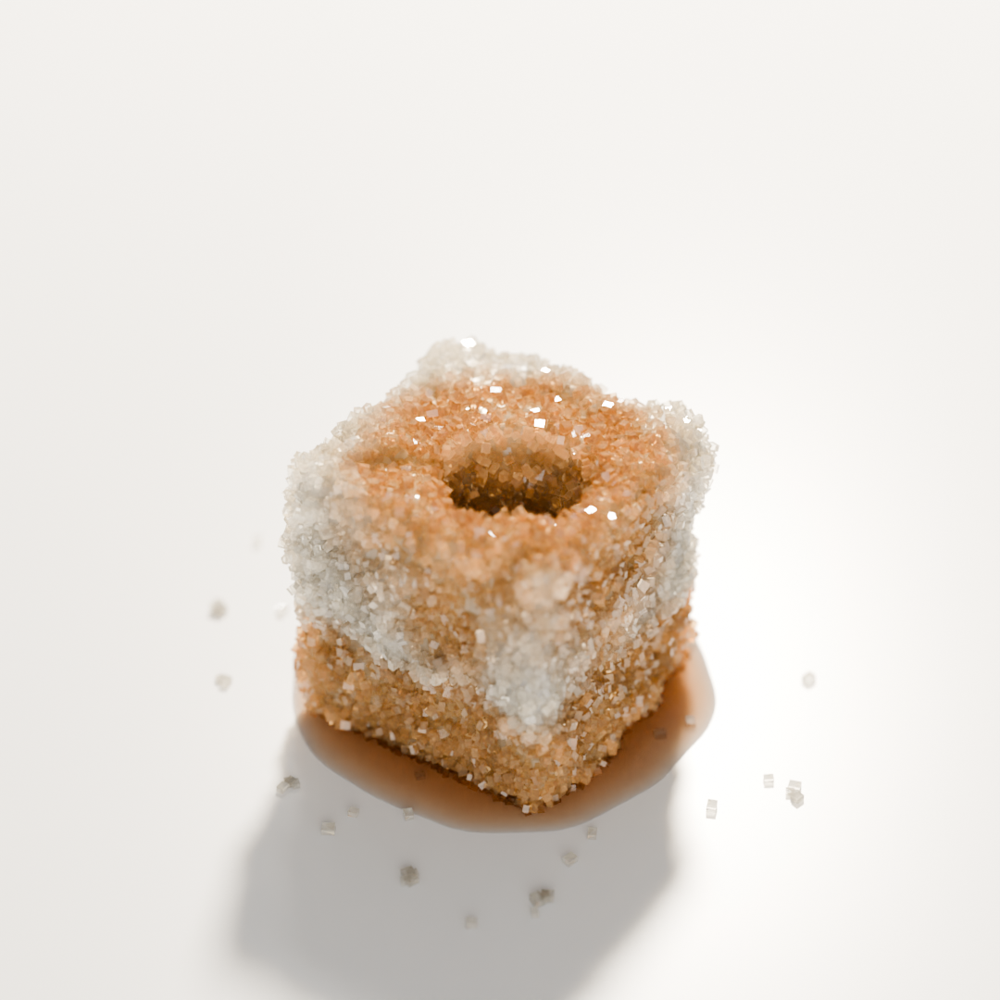

| File | What it is |
|---|---|
| [`../loop.mp4`](../loop.mp4) | the video: 1080², 24 fps, 192 frames (8 s), Cycles 128 samples + denoise |
| [`../render.png`](../render.png) | frame 100, the hero still |
| [`../render-end.png`](../render-end.png) | frame 192, the held last frame |
| [`../nodes/`](../nodes/) | full screenshots of the main tree, the sugar field and the light-through group |

The scene lives in a file (`piece.blend`: objects **PA_Sugar** with the tree `PA_Sugar_GN`, **PA_Tea** with
`PA_Tea_GN`, **PA_Saucer**, three lights and the camera) that a Python script builds (`build.py`: every tree,
material and light, and the Age keys). Neither is published. Every node is in the screenshots below, and the text
names that script where a value lives in it.

---

## The one idea

> **The cube is a field, and its crystals are a fixed lattice shown only near the field's surface.** Nothing is
> moved and nothing is simulated. A formula says, for any point and any moment, how far inside the sugar that point
> is. The crystals sit still on a 3D grid that fills the whole cube; at each frame only the ones in a thin shell under
> the current surface are drawn. As the surface recedes, deeper crystals are uncovered and the outer ones are lost,
> exactly as in a real cube, and without any flicker.

Everything else is bookkeeping around that idea:

- **When?** `PA_Clock` turns Age into Wear, a staircase that climbs one step after each drop lands, and into the
  height of the falling drop (1 · Time).
- **What shape?** `PA_Sugar field` gives Sugar, in millimetres, > 0 inside: a rounded box whose corners grow round,
  minus a funnel under the drip, plus lumps. It also gives Wet, how far the tea has soaked (2 · The cube as a field).
- **Which crystals?** A 40 × 40 × 40 jittered lattice; keep the points where Sugar is between −0.05 and 1.1 mm
  (4 · A lattice of crystals).
- **Why do the edges glow?** `PA_Light through` walks from each point into the sugar towards the light and measures
  how much sugar is in the way: thin edges and corners let the backlight through (3 and 5).
- **The tea?** A second small tree on the same clock: one drop in the air, and a flattened bead of tea that spreads
  once the cube has soaked through (The tea).

### How to read the screenshots

- Each coloured frame is one section of a tree. The main tree's sections are numbered
  (`2 · The cube as a field`); sections inside a node group are lettered (`b · a box whose corners dissolve first`).
- A **cut-out** shows one section on its own. Wires that come from another section enter through a Group Input socket
  named after what they carry (`distance² from the drip line`). Wires that leave exit through a Group Output socket.
- Each section of the two main trees has its own Group Input, showing only the sliders it uses. Group Input nodes are
  only views of the group's inputs, so any number of them can exist.
- Small formulas used many times are node groups: `PA_Smoothstep` (t²(3 − 2t) of a clamped ramp) shows up as one
  titled node wherever an edge is softened.
- Geometry passes data to the shaders as **named attributes**: `wet` (0 dry … 1 soaked) and `glow` (light through
  thin sugar).
- **Units.** The scene is in metres and the cube is 16 mm. Every formula inside `PA_Sugar field` works in millimetres
  (Position × 1000), so its numbers read as sizes: a 0.6 mm fillet, a 1.1 mm shell.

Click any screenshot to see it full size.

---

## 0 · The map

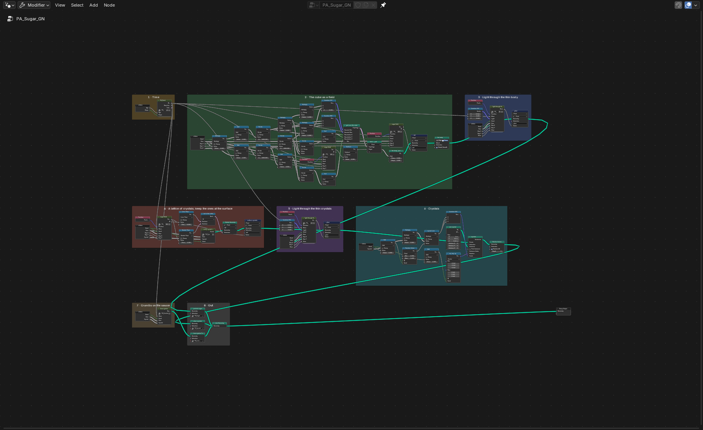

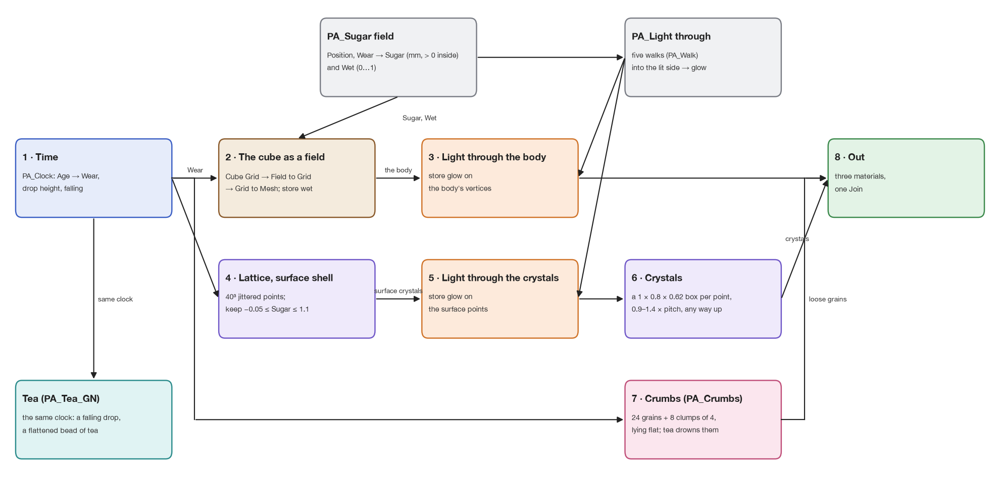

| # | Section | Nodes | Job |
|---|---|---|---|
| 1 | Time | 1, plus `PA_Clock` (22) | Age → Wear and the falling drop |
| 2 | The cube as a field | 26, plus `PA_Sugar field` (85) with `PA_Rounded box` (18) | the body: the field on a 0.25 mm grid, meshed just under the crystals |
| 3 | Light through the thin body | 4, plus `PA_Light through` (35) with `PA_Walk` (36) | how much backlight reaches each vertex of the body |
| 4 | A lattice of crystals; keep the ones at the surface | 8, plus `PA_Crystal lattice` (29) | 64 000 fixed points; the 7 000–20 000 in the surface shell |
| 5 | Light through the thin crystals | 4 | the same glow, on the crystal points |
| 6 | Crystals | 10 | a small box on each point, any way up |
| 7 | Crumbs on the saucer | 1, plus `PA_Crumbs` (60) | 56 loose grains lying flat; the tea drowns the ones it reaches |
| 8 | Out | 4 | three materials, one Join |
| – | The tea | `PA_Tea_GN` (55) | the falling drop and the pool, on the same clock |
| – | Materials, light, camera | `build.py` | clear crystals over a scattering body; tea coloured by its depth |

The main tree holds 66 nodes: the 58 in the eight sections, one Group Input for each section that reads sliders, and
the Group Output.

Frames 1–10 and 170–192 hold still. In between, Age climbs at a constant rate, and everything that looks like
acceleration or pauses (the drops, the bites, the spreading pool) comes from the clock and from smoothsteps on Wear.

---

## 1 · Time

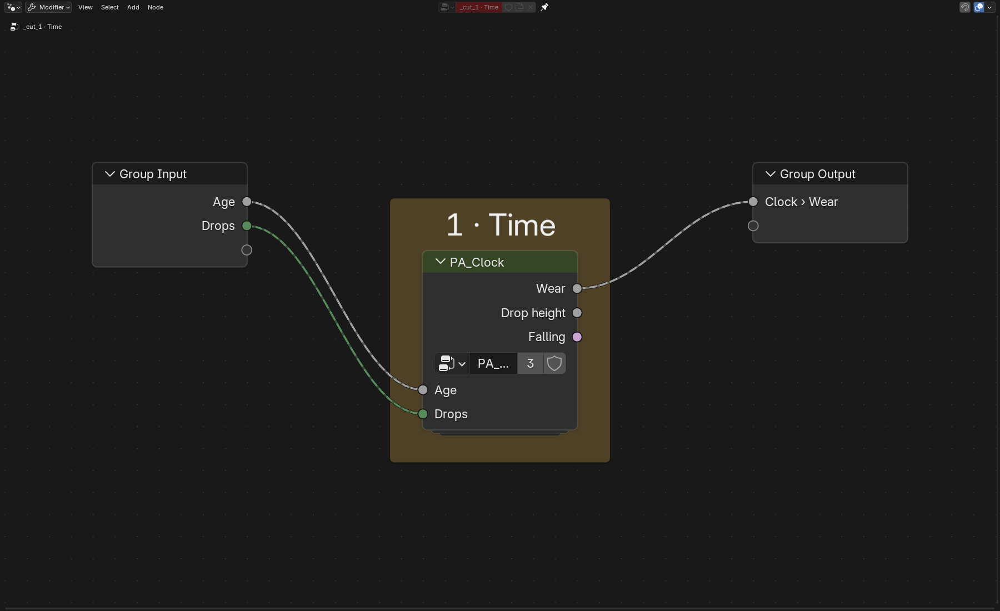

Erosion by drops is not smooth: nothing happens while a drop is in the air, then the cube loses a bite. `PA_Clock`
makes that rhythm out of a linear Age.

| Node | What it does |
|---|---|
| `T = Age × Drops` | with Drops = 10, T runs 0 → 10: one unit per drip cycle (16 frames) |
| `drops landed` | ⌊T⌋: drop k lands at T = k |
| `phase of this drop` | T − ⌊T⌋, 0 → 1 within a cycle |
| `the bite after a landing` | `PA_Smoothstep` from 0 to 0.75 of the phase: the bite eases in and out over the first three quarters of the cycle (12 frames) |
| `Wear` | (drops landed − 1 + bite) / (Drops − 1), clamped to 0…1: one step of 1/9 per landing |
| `free fall: 70·(1 − u²) mm` | u = (phase − 0.4) / 0.6, clamped: the drop appears 70 mm up at phase 0.4 and falls faster and faster until it lands at the end of the cycle |
| `a drop is in the air` | phase > 0.4 **and** T < Drops − 1 |

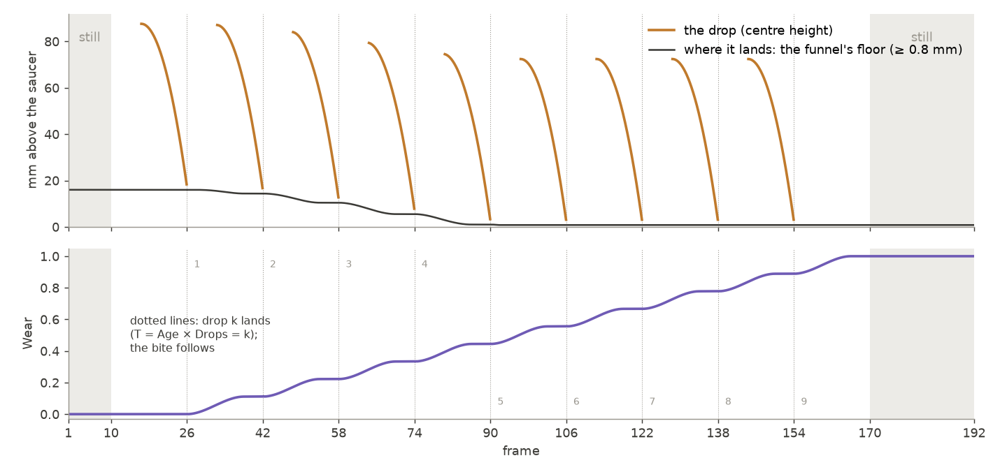

### Trick · a staircase clock

A drop that lands at T = k bites with drops landed = k, so the bite is (k − 1 + step)/9: at the moment of landing the
cube is exactly as worn as before, and it loses its next ninth over the following 12 frames. The tea pool, the wet
stain and the funnel all read Wear, so all of them move in the same steps, and the motion has a pulse without a
single keyframe beyond Age.

The last cycle (T from 9 to 10) has no drop (T < Drops − 1 fails), so the ninth bite can finish. **With Drops = 10,
nine drops fall**, landing at frames 26, 42, … 154. The fall is in slow motion: a real 70 mm fall takes 0.12 s, here
it takes 9.6 frames (0.4 s), so the drop can be seen.

The tea tree calls the same `PA_Clock` group (it is built once and shared), so the drop always lands on the frame the
bite starts.

> **Try it:** set Drops to 5 on both objects (**PA_Sugar** and **PA_Tea**). Four drops fall, each one a cycle of 32
> frames, and each bite takes a quarter of the cube instead of a ninth.

---

## 2 · The cube as a field

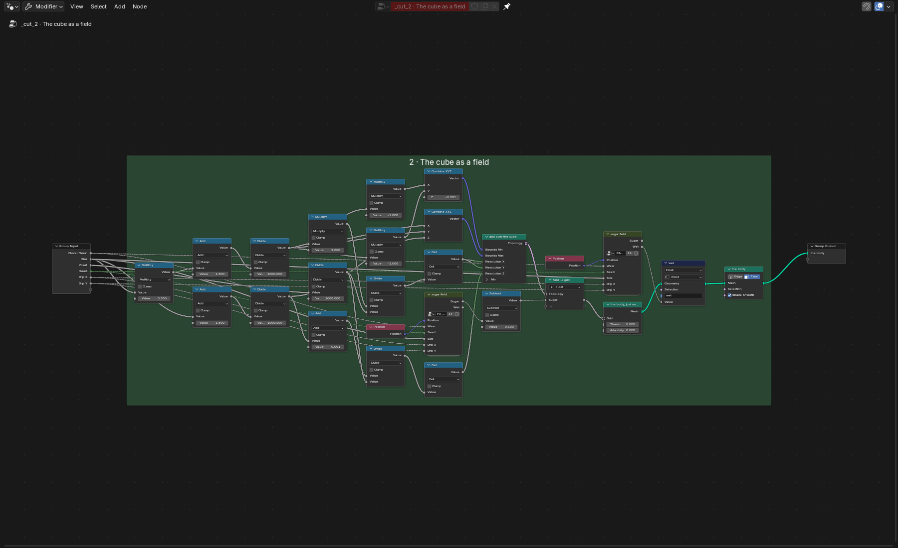

The cube is never modelled. `PA_Sugar field` answers one question for any point: how far inside the sugar is it, in
millimetres (> 0 inside, < 0 outside)? Section 2 turns that answer into a mesh in two steps.

| Node | What it does |
|---|---|
| `grid over the cube` | Cube Grid Topology from (−9.5, −9.5, −0.5) mm to (9.5, 9.5, 17.5) mm: the half edge plus 1.5 mm each side, and 0.5 mm under the saucer. Resolution = ⌈span / Voxel⌉: a 76 × 76 × 72 grid at Voxel 0.25 mm |
| `sugar field` | `PA_Sugar field` evaluated at each grid point |
| `field → grid` | Field to Grid stores Sugar − 0.3 |
| `the body, just under the crystals` | Grid to Mesh at threshold 0: the surface where Sugar = 0.3 mm |
| `wet` | the field again, now at the mesh's vertices; its Wet output is stored for the shader |
| `the body` | Set Shade Smooth |

### Trick · sink the body under the crystals

Why mesh the field at 0.3 mm instead of at 0? The crystals of section 4 fill a shell from 0.05 mm outside the zero
surface to 1.1 mm inside it. A body meshed at 0 would sit in the middle of that shell, and its smooth skin would show
between the grains. At 0.3 mm it lies under the outer one or two layers of crystals: it is seen only through gaps, as
the dense, milky inside of the cube. The grid starts 0.5 mm under the saucer, so the bottom of the body is cut flat
there, out of sight.

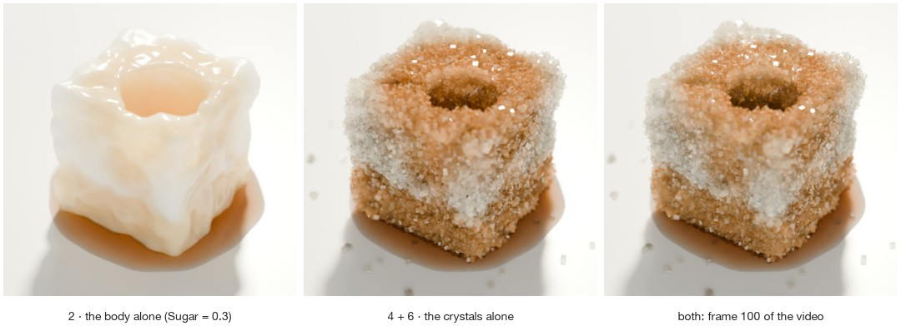

### Inside `PA_Sugar field`

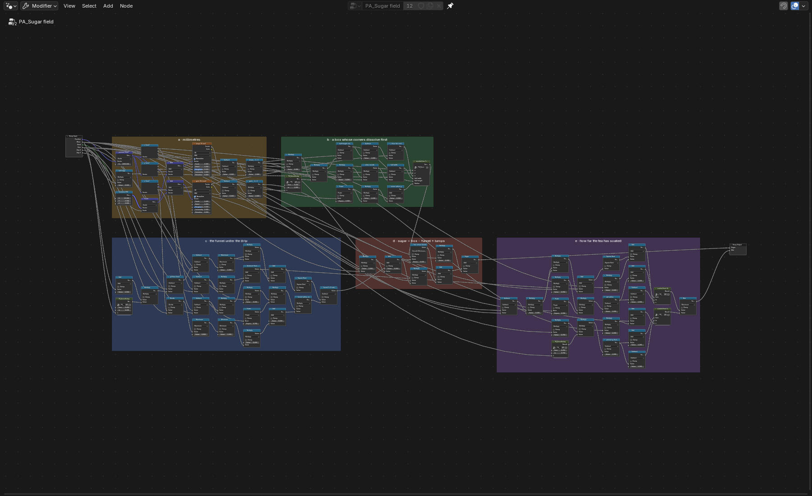

The field has two outputs, **Sugar** and **Wet**, and takes Position (metres), Wear and four sliders (Seed, Size,
Drip X, Drip Y). The cross-sections below are the real field, sampled in Blender on a vertical slice through the drip: the solid line is where the body is meshed, the squares are the crystals that are
drawn, and the grey dots are lattice points buried too deep to be drawn.

#### a · millimetres

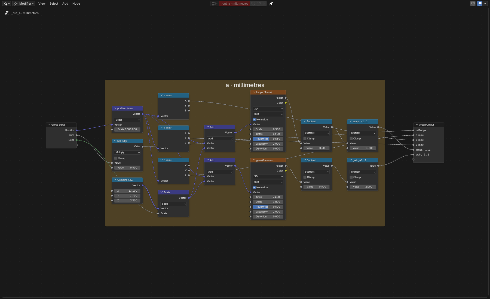

| Node | What it does |
|---|---|
| `position (mm)` | Position × 1000 |
| `x (mm)`, `y (mm)`, `z (mm)` | its three coordinates (z = 0 is the saucer) |
| `half edge` | Size / 2 = 8 mm |
| `lumps (3 mm)` | Noise Texture, scale 0.30 per mm (blobs about 3 mm across), detail 1.5, roughness 0.55, at position + (13.1, 7.7, 3.3) × Seed |
| `grain (0.4 mm)` | the same at scale 2.4 per mm, detail 1: crystal-sized roughness |
| `lumps, −1…1`, `grain, −1…1` | 2 × (noise − 0.5) |

Both noises are fixed in space. Like the lattice, they don't move with time: Wear only changes how much they count.

#### b · a box whose corners dissolve first

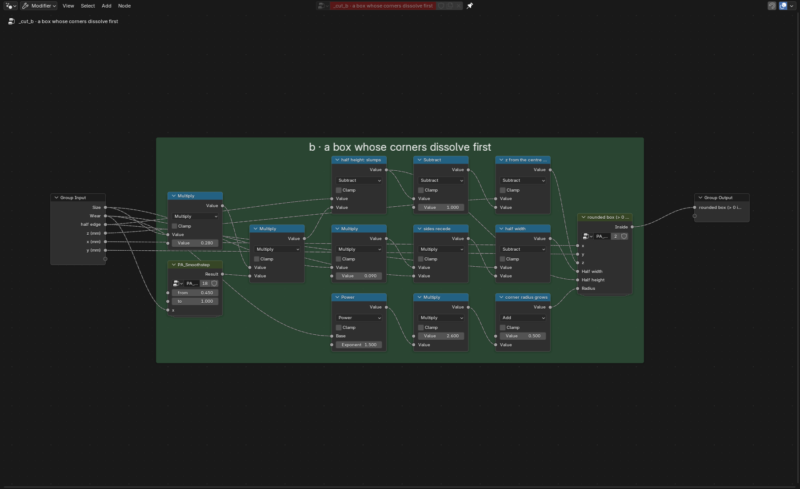

A sugar cube dissolves fastest at its corners and edges, where the tea reaches it from two or three sides. A rounded
box whose corner radius grows does the same thing.

| Node | Formula (mm) | Wear 0 → 1 |
|---|---|---|
| `half height: slumps` | half edge − 0.28 × Size × smoothstep(0.45, 1, Wear) | 8 → 3.52: the cube settles to 7 mm tall, starting at Wear 0.45 |
| `sides recede` | 0.09 × Size × Wear | 0 → 1.44 |
| `half width` | half edge − sides recede | 8 → 6.56 |
| `corner radius grows` | 0.5 + 2.6 × Wear^1.5 | 0.5 → 3.1: slow at first, then fast |
| `z from the centre (sunk 1 mm)` | z − (half height − 1) | the box's centre; its bottom is 1 mm under the saucer, so it stands on a flat face |

#### Inside `PA_Rounded box`

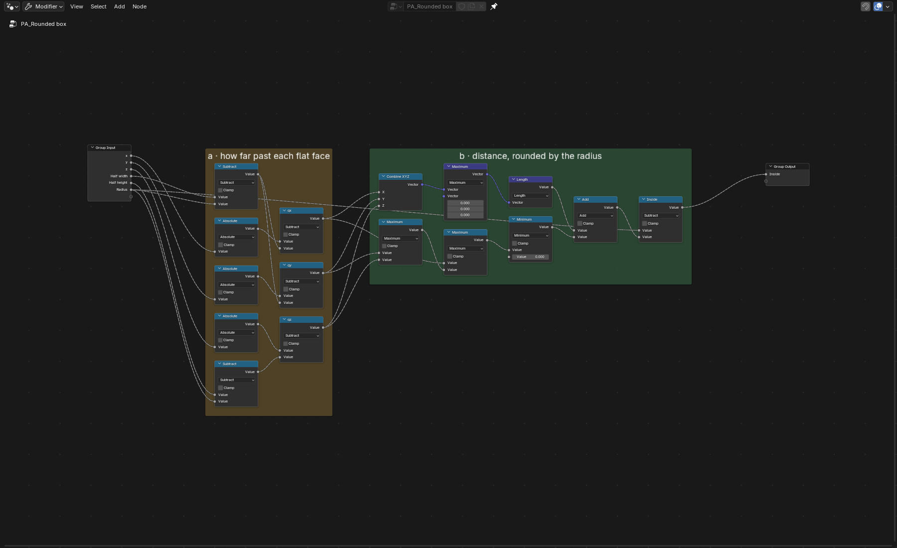

The standard rounded-box distance, signed so that it is positive inside:

- `qx`, `qy`, `qz`: how far the point is past each pair of faces of a box shrunk by the radius: |x| − (half width −
  radius), and the same for y and z.
- `Inside` = radius − (length of max(q, 0) + min(max(qx, qy, qz), 0)). Outside the shrunk box this is the radius minus
  the distance to it, which rounds every edge and corner; inside it is the radius plus the distance to the nearest face.

Its two cut-outs are [`nodes-box-1-how-far-past-each-flat-face.png`](images/nodes-box-1-how-far-past-each-flat-face.png)
and [`nodes-box-2-distance-rounded-by-the-radius.png`](images/nodes-box-2-distance-rounded-by-the-radius.png).

#### c · the funnel under the drip

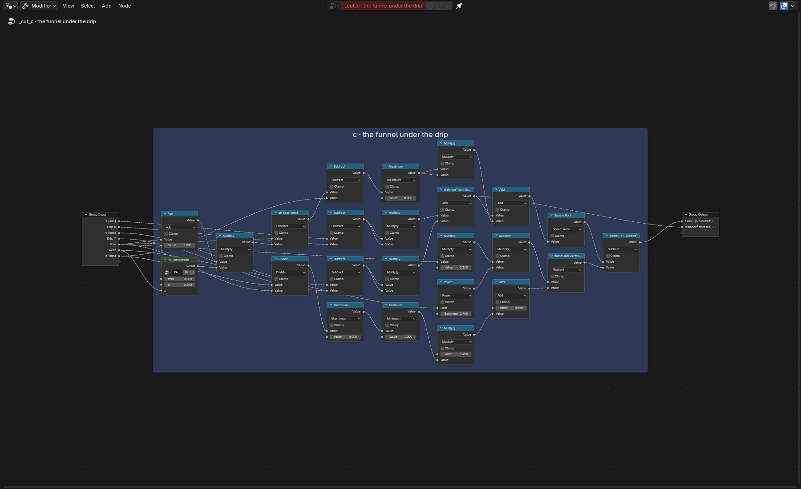

The drops all land on one spot (Drip X = 1.8 mm, Drip Y = −1.4 mm, off-centre, so the funnel breaks through one wall
before the other). Below that spot the field subtracts a vertical hole with a rounded bottom.

| Node | Formula (mm) | What it means |
|---|---|---|
| `distance² from the drip line` | (x − Drip X)² + (y − Drip Y)² | squared distance from the vertical line under the drip |
| `pit floor (mm)` | Size − (Size + 2) × smoothstep(0, 0.6, Wear) | 16 → −2: the funnel is drilled all the way through by Wear 0.6 (frame 112) |
| `funnel radius: wider at the top` | 0.36 × Size × Wear^0.7 × (0.55 + 0.45 × clamp(z / Size)) | up to 5.8 mm at the top and 3.2 mm at the saucer |
| `funnel (> 0 outside)` | √(distance² + dz²) − radius, with dz = max(floor − z, 0) | a cylinder above the floor, a half-sphere below it |

Wear^0.7 opens the funnel quickly with the first drops, then slows down, as a hole does once the tea runs straight
through it.

#### d · sugar = box − funnel + lumps

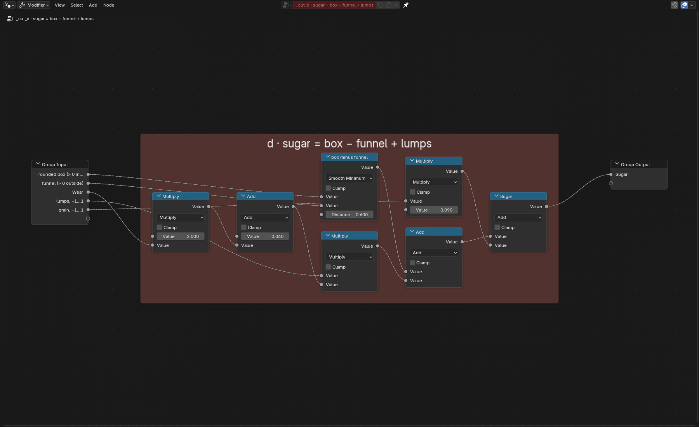

- `box minus funnel`: Smooth Minimum of the two, distance 0.6 mm. Both are positive where sugar may be (inside the
  box, outside the funnel), so their minimum is the box with the funnel cut out, and the smooth version rounds the rim
  of the hole by about 0.6 mm.
- \+ lumps × (0.06 + 2 × Wear): a fresh cube is nearly flat (0.06 mm of lumps); a worn one is ragged (2.06 mm). The
  lumps are what break the walls into islands at the end.
- `Sugar` adds grain × 0.09: a little roughness at the scale of a crystal.

> **Try it:** in `PA_Sugar field`, change the Smooth Minimum distance from 0.6 to 3. The funnel's rim turns into a wide,
> soft dish.

#### e · how far the tea has soaked

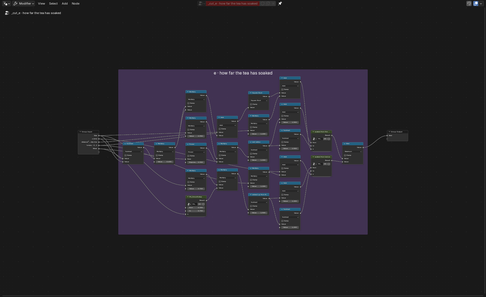

Tea reaches the sugar two ways, and the field gives a Wet value (0 dry, 1 soaked) for both:

- **From the drip.** The distance from the top of the drip line, with height counted at 0.6 (√(distance² + (0.6 ×
  (Size − z))²) + 1.6 × lumps), so the stain runs deeper than it spreads, as liquid does in a porous solid. `wet radius`
  = 0.95 × Size × Wear^0.9 − 1 grows from nothing to 14.2 mm; `soaked from the drip` is a smoothstep 3 mm wide around it.
- **From the pool.** Real sugar wicks liquid up from below. `wicked up from the pool (mm)` = 0.7 × Size ×
  smoothstep(0.25, 0.75, Wear) − 1.5 climbs from below the saucer to 9.7 mm (frames 62–131); `soaked from below` is
  1 below that line and 0 above it, over 2.4 mm, with the lumps (× 1.2) making the line ragged.
- `Wet` is the larger of the two.

In the cross-sections, Wear 0.4 shows both: a brown band rising from the saucer and a stain spreading from the funnel,
with a dry white wedge between them.

---

## 3 · Light through the thin body

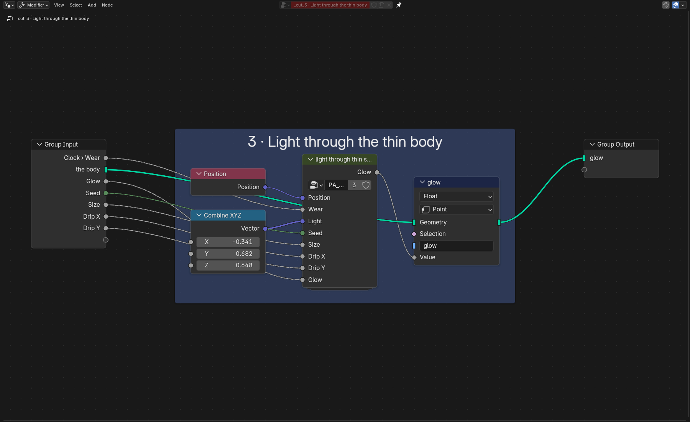

A real sugar cube lit from behind glows along its edges: light enters the lit faces, scatters through the thin sugar
near an edge or a corner and comes out on the faces that are turned away. Cycles' subsurface scattering can't do this
here: what you see are clear glass grains, and the scattering body is mostly hidden under them. So the geometry
works out how much light gets through and stores it as `glow`; the shaders turn it into a faint warm emission.

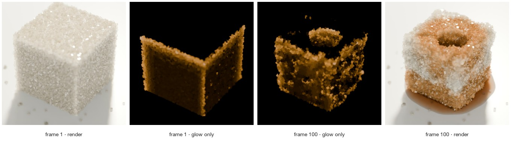

### Inside `PA_Light through`

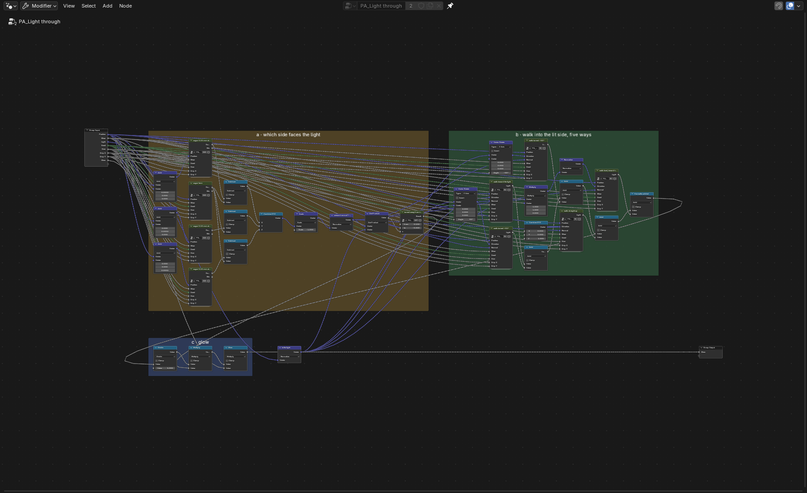

#### a · which side faces the light

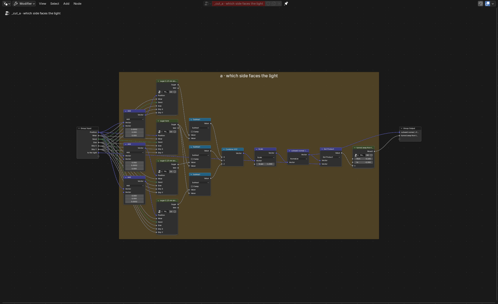

- `sugar here` and `sugar 0.15 mm along x` / `y` / `z`: four samples of the field. Their differences are its
  gradient, which points inward (Sugar grows inward), so `outward normal (−∇ field)` is its negative, normalised. The
  same group serves the body's vertices and the crystal points, and the points have no mesh normal, so it takes the
  normal from the field.
- `to the light` is the Light input, normalised. `build.py` sets it to the direction from the cube to the rim light.
- `turned away from the light` = smoothstep(0.1, −0.3, normal · light): 0 on faces that see the light (normal · light
  above 0.1), 1 once a face is turned 17° or more past side-on to it (below −0.3). A lit face is already bright; the
  glow is for the dark side.

#### b · walk into the lit side, five ways

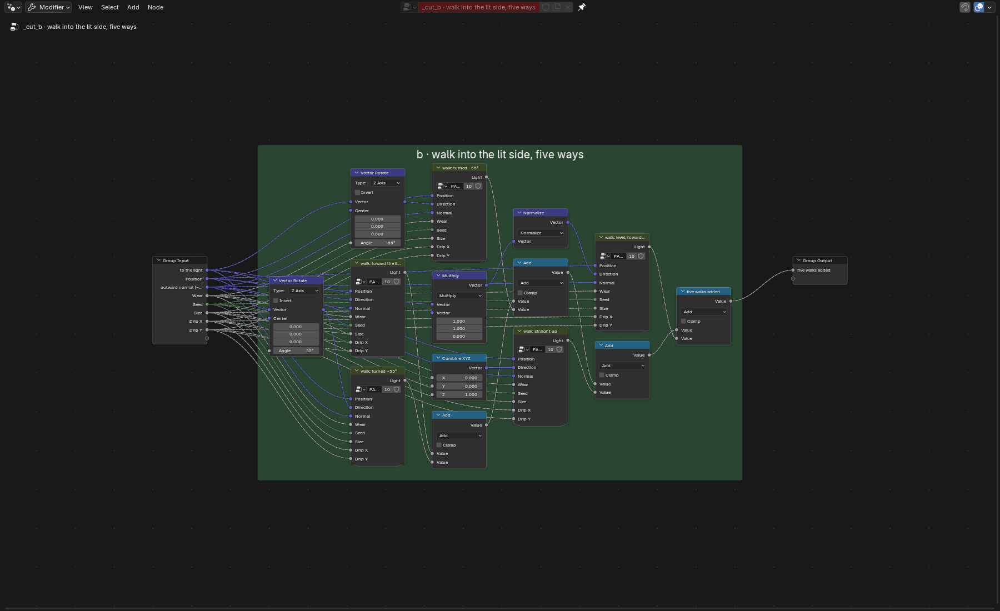

Light reaches a point on the dark side from all over the lit side, not only straight from the lamp. So the group
walks five ways: `walk: toward the light`, `walk: turned +55°` and `walk: turned −55°` (the light direction turned
about the vertical), `walk: straight up` and `walk: level, toward the light`. Each walk returns how much light comes
back along it; `five walks added` is their sum.

#### Inside `PA_Walk`

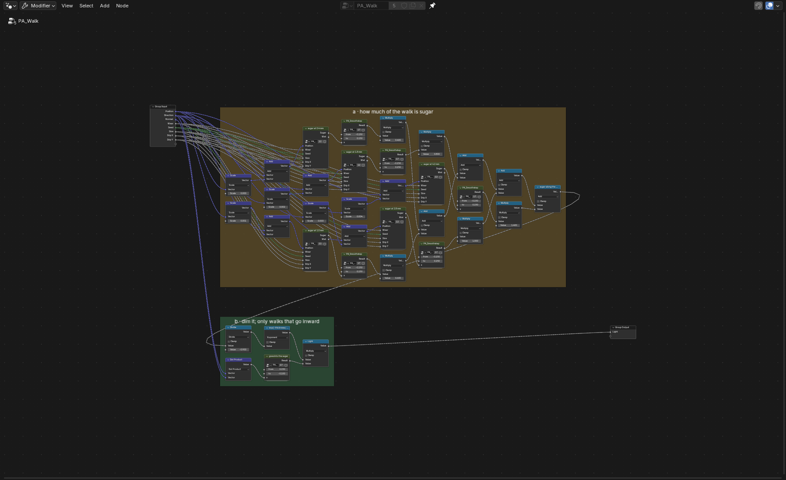

- **a · how much of the walk is sugar.** The field is sampled at 0.4, 1.0, 1.8, 2.8 and 4.2 mm along the walk
  (`sugar at 0.4 mm` … `sugar at 4.2 mm`). Each sample counts as sugar through a smoothstep from −0.15 to 0.15 mm,
  weighted by the length of its step (0.4, 0.6, 0.8, 1.0, 1.4 mm). `sugar along the walk (mm)` is the sum: 0 if the
  walk is in the air at once, 4.2 if it stays in sugar all the way.
- **b · dim it; only walks that go inward.** `exp(−thickness / 0.9 mm)`: light that crossed 0.9 mm of sugar keeps
  37 % of its strength, after 4.2 mm almost nothing. Then `goes into the sugar` = smoothstep(0.15, −0.1, direction ·
  normal) keeps only walks that enter the sugar. A walk that leaves the face outward crosses no sugar, so it would
  count as fully lit, but it is looking into the dark air in front of the face, not through the sugar towards the
  light. `Light` is the product.

Its cut-outs are [`nodes-walk-1-how-much-of-the-walk-is-sugar.png`](images/nodes-walk-1-how-much-of-the-walk-is-sugar.png)
and [`nodes-walk-2-dim-it-only-walks-that-go-inward.png`](images/nodes-walk-2-dim-it-only-walks-that-go-inward.png).

#### c · glow

`Glow` = (five walks added / 5) × turned away from the light × the Glow slider.

### Trick · thickness by walking the field

A point near an edge on the dark face walks inward, crosses about a millimetre of sugar and comes out through the lit
top face: that walk keeps exp(−1 / 0.9) ≈ 33 % of the light. A point in the middle of the same face walks 4.2 mm and
is still inside: exp(−4.2 / 0.9) ≈ 1 %. So the edges and corners light up and the middles of the faces stay dark, with no ray tracing in the
geometry: only 29 evaluations of the same field per point (4 for the normal, 25 on the walks). The five directions
matter: with one walk straight at the light, only the top ridge would glow; with the walks fanned out, the whole edge
band of both dark faces does.

> **Try it:** set Glow to 3 on **PA_Sugar**. The two dark faces of the fresh cube turn amber along their edges. At 0
> the edges lose their warm translucency.

---

## 4 · A lattice of crystals; keep the ones at the surface

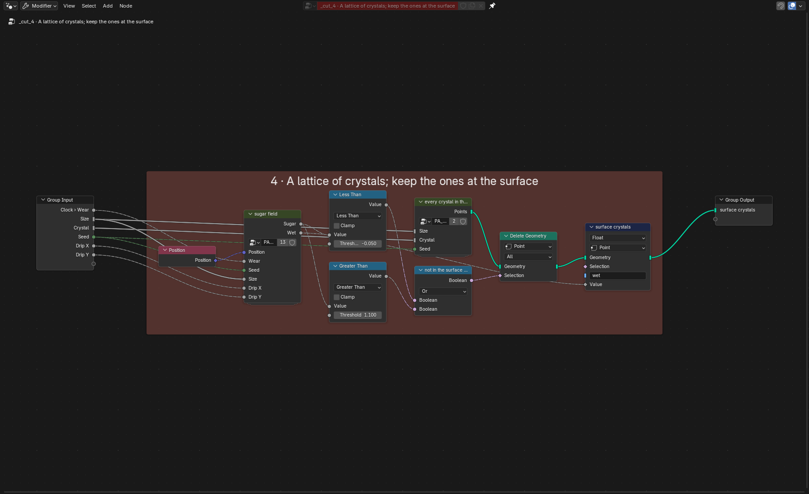

| Node | What it does |
|---|---|
| `every crystal in the cube` | `PA_Crystal lattice`: one jittered point per 0.4 mm cell, 40³ = 64 000 points |
| `sugar field` | the field at each point |
| `not in the surface shell` | Sugar < −0.05 **or** Sugar > 1.1 mm, so Delete Geometry keeps a shell 1.15 mm thick: about three crystals deep |
| `surface crystals` | Wet stored on the kept points |

About 19 400 crystals are kept on the fresh cube, 20 100 at frame 100 (the funnel adds surface), and 6 800 on the
final island.

### Trick · a fixed lattice is why nothing flickers

The obvious way to cover a surface with grains is to scatter points on the mesh. But the mesh changes every frame, so
the scattered points would all jump every frame, and the cube would boil. Here the points never move: each one is a
crystal at a fixed place inside the cube, and the frame only decides whether it is drawn. A crystal appears when the
surface comes down to it (Sugar falls below 1.1 mm) and disappears when the surface has passed it (Sugar < −0.05).
That is what erosion is, and it keeps every crystal still from frame to frame.

### Inside `PA_Crystal lattice`

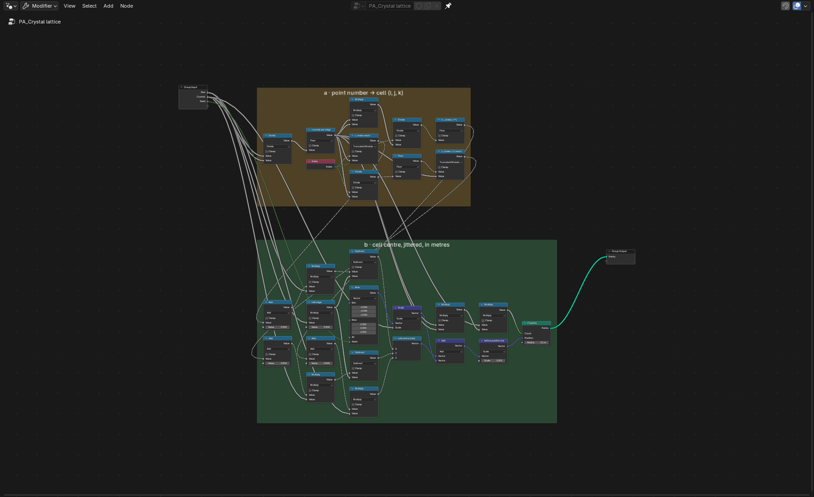

- **a · point number → cell (i, j, k).** `crystals per edge` n = ⌊Size / Crystal⌋ = 40. For point number index:
  `i = index mod n`, `j = ⌊index / n⌋ mod n`, `k = ⌊index / n²⌋`.
- **b · cell centre, jittered, in metres.** `cell centre (mm)` = ((i + ½) × pitch − half edge, (j + ½) × pitch − half
  edge, (k + ½) × pitch): the cube from −8 to 8 mm across and 0 to 16 mm up. `jitter` adds up to ±0.35 pitch on each
  axis, so the crystals don't line up in rows. `n³ points` makes them all at once: a Points node whose Position is a
  field of the index.

Its cut-outs are [`nodes-lattice-1-point-number-cell-i-j-k.png`](images/nodes-lattice-1-point-number-cell-i-j-k.png)
and [`nodes-lattice-2-cell-centre-jittered-in-metres.png`](images/nodes-lattice-2-cell-centre-jittered-in-metres.png).

---

## 5 · Light through the thin crystals

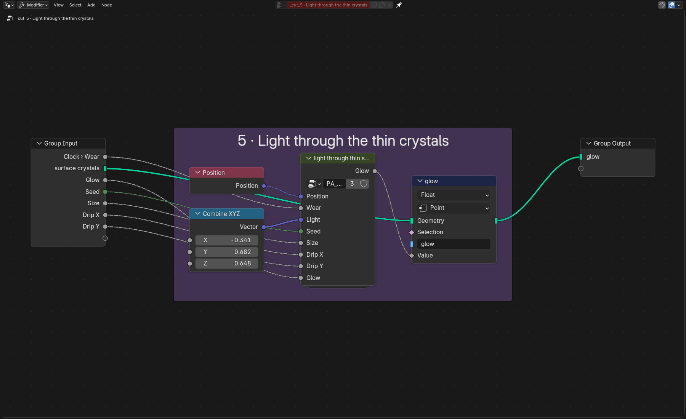

The same `PA_Light through` call as section 3, now on the crystal points. Instance on Points copies a point's
attributes to its instance, so each crystal carries the `glow` and `wet` of its point to the shader.

---

## 6 · Crystals

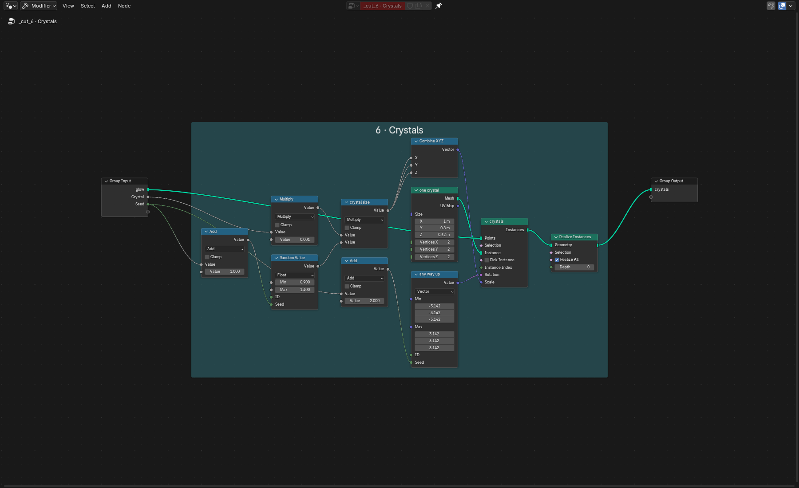

| Node | What it does |
|---|---|
| `one crystal` | a Cube mesh 1 × 0.8 × 0.62: a granulated-sugar crystal is a slightly flattened, blocky prism |
| `crystal size` | pitch × random 0.9–1.4 (Seed + 1): 0.36–0.56 mm, so neighbours overlap and no gap opens between them |
| `any way up` | a random rotation of ±180° on every axis (Seed + 2) |
| `crystals` | Instance on Points, then Realize Instances |

---

## 7 · Crumbs on the saucer

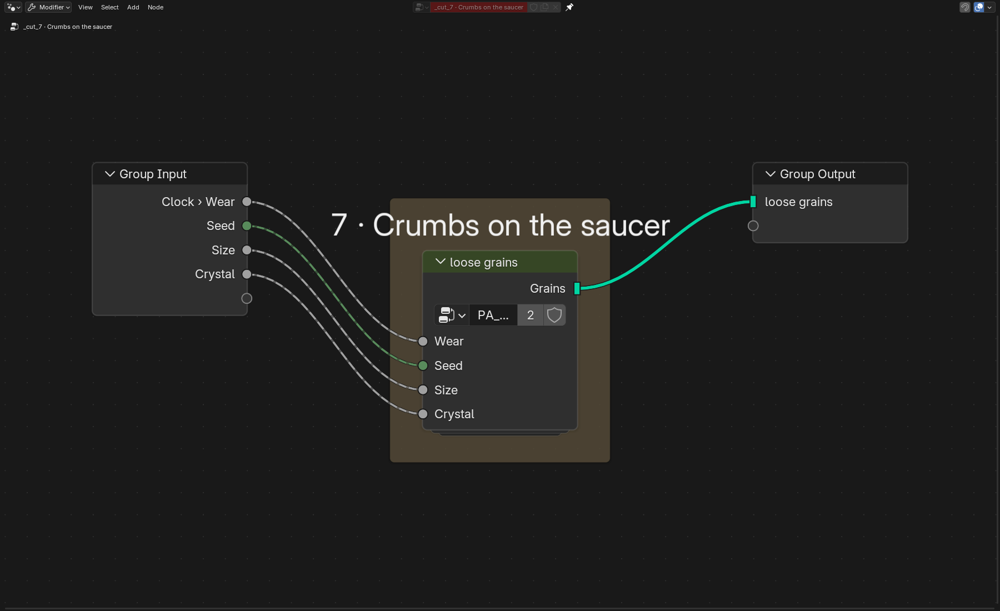

A sugar cube from a box always comes with a few loose grains around it. They also tell the eye how big the cube is.

### Inside `PA_Crumbs`

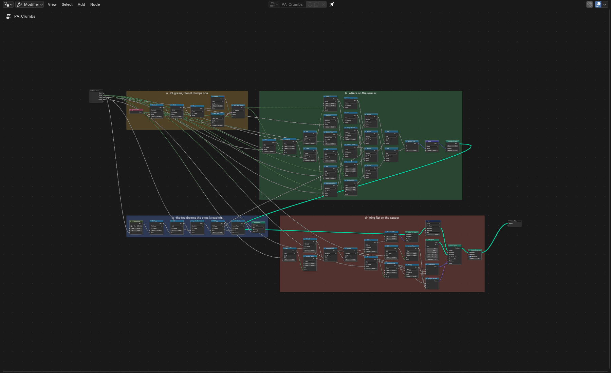

#### a · 24 grains, then 8 clumps of 4

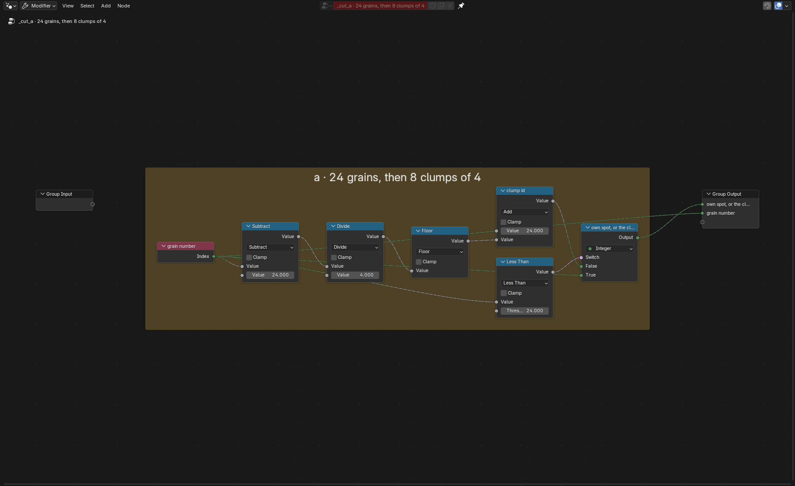

There are 56 points. The first 24 are single grains. The other 32 come in fours: `clump id` gives the four grains of a
clump the same number, and `own spot, or the clump's` uses it as the ID of the random values that place them, so the
four land on the same spot.

#### b · where on the saucer

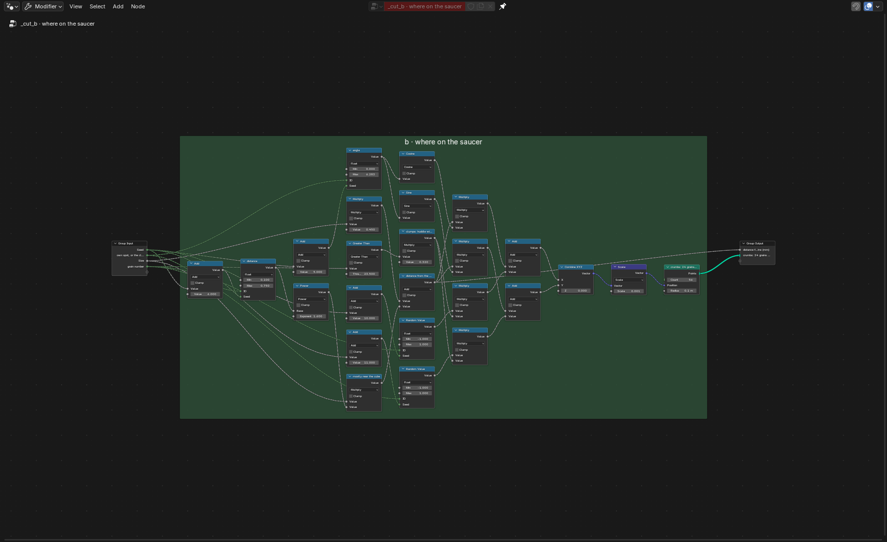

- `angle`: random 0–2π per spot (Seed + 5).
- `distance`: random 0.1–0.75 (Seed + 6); `mostly near the cube` raises it to the power 1.6, which bunches the values
  towards the small end, so most grains lie close to the cube. `distance from the centre (mm)` = 0.45 × Size + Size ×
  distance^1.6: from 7.6 to 17.3 mm (the cube's faces are 8 mm out).
- `clumps: huddle within 0.32 mm`: grains 24 and up get their own small random offset (by grain number, Seed + 10 and
  + 11), up to 0.32 mm, so a clump's four grains touch but don't coincide.
- `crumbs: 24 grains + 8 clumps of 4`: a Points node, Count 56.

#### c · the tea drowns the ones it reaches

`under the tea`: distance from the centre < 0.92 × `pool radius (mm)` (the same formula the tea's pool uses), and
Delete Geometry removes those: `dry crumbs`. As the pool spreads, the grains it reaches go: 56 on the fresh cube, 16 at
frame 150, 7 at the end.

#### d · lying flat on the saucer

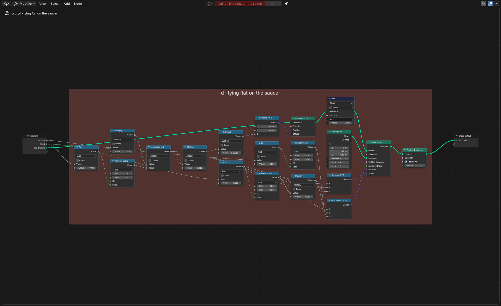

A grain on a table rests on its broadest face. `grain size (m)` is pitch × random 0.9–1.5 (Seed + 7). `rest on the
saucer: lift by half the flat height` lifts it by 0.31 × size (half the crystal's 0.62 height) minus 5 µm, so it
touches the saucer. `lying on its broad face, any heading` is a rotation of up to ±0.06 rad of tilt and any heading
(Seed + 8, + 9). The crystal mesh is the same as in section 6; the material is not (see Appendix A).

---

## 8 · Out

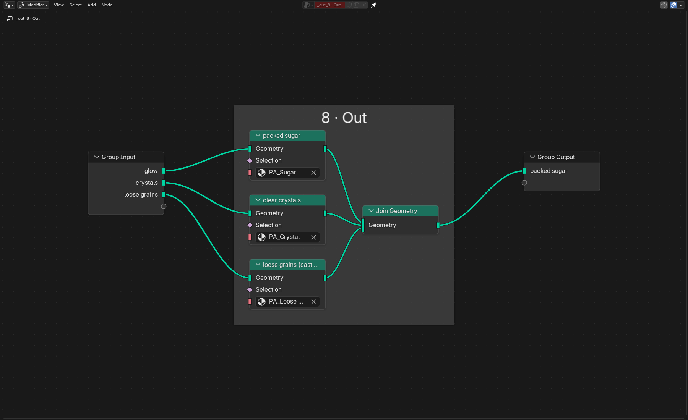

`packed sugar` (material **PA_Sugar**) on the body, `clear crystals` (**PA_Crystal**) on the crystals, `loose grains
(cast shadows)` (**PA_Loose grain**) on the crumbs, then one Join Geometry.

---

## The tea

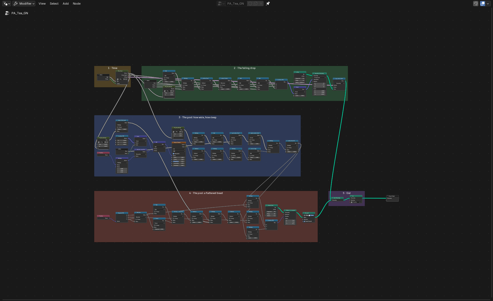

**PA_Tea** has its own small tree on the same sliders (Age, Size, Drops, Drip X, Drip Y, Seed) and the same
`PA_Clock`, so its drops and pool keep step with the cube's bites.

#### 2 · The falling drop

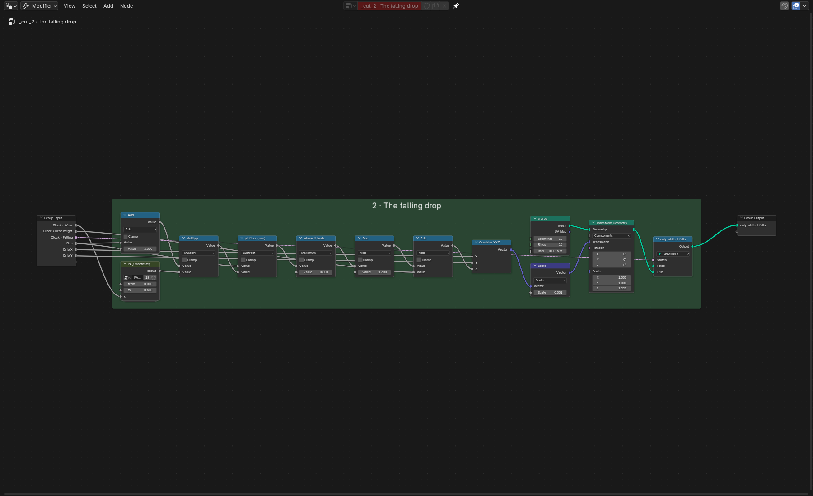

- `where it lands`: the funnel's floor (`pit floor (mm)`, the same formula as the field), but at least 0.8 mm.
- `a drop`: a UV Sphere, radius 1.5 mm, stretched 1.22 times in z (a falling drop is a little elongated), moved to
  (Drip X, Drip Y, where it lands + 1.6 + drop height).
- `only while it falls`: a Switch on `a drop is in the air`, empty otherwise.

#### 3 · The pool: how wide, how deep

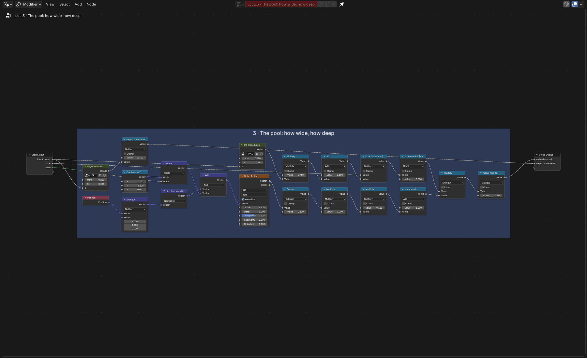

- `pool radius (mm)` = Size × (0.30 + 0.75 × smoothstep(0.28, 1, Wear)): 4.8 mm, hidden under the cube, until Wear
  0.28 (frame 65), when the tea has soaked through; then it spreads to 16.8 mm. `sphere radius (mm)` is that divided by
  0.8.
- `depth of the bead` = 2.3 × smoothstep(0.22, 0.5, Wear) mm.
- `uneven edge` = 1 + 0.11 × a signed noise of `direction round the edge` (the vertex's direction from the centre,
  scale 1.3, offset by the seed): the rim wanders ±11 %, so the puddle isn't a circle.

#### 4 · The pool: a flattened bead

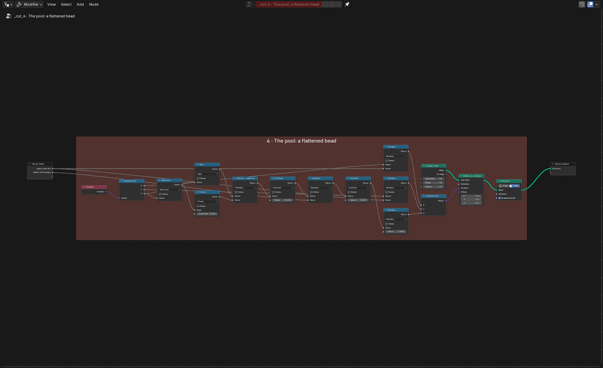

Spilled tea is a flat sheet with a rounded rim (the meniscus). Start from a unit sphere (`a bead of tea`, 96 × 48),
then:

- `flat top, round edge (meniscus)`: z' = sign(z) × |z|^0.35. The power below 1 pushes almost every vertex towards
  z' = ±1, so the top becomes flat and only a narrow band near the equator stays curved.
- `flatten; sink 60 % below the saucer`: x and y × `radius here (m)`; z = ((z' − 0.6) × depth − 0.1) mm. 60 % of the
  bead is under the saucer, where nobody sees it, so its rim meets the saucer at a steep, rounded edge. Before Wear 0.22
  the depth is 0 and the whole bead lies 0.1 mm under the saucer: invisible.

`5 · Out` sets the material `tea` and joins the drop and the pool.

---

## Appendix A · Materials

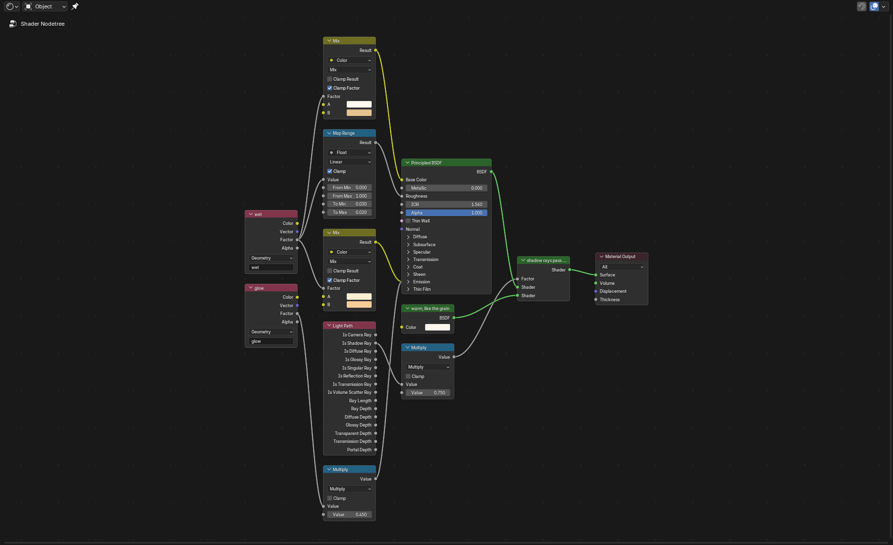

**PA_Crystal** (the crystals), a Principled BSDF:

- Transmission 0.85, IOR 1.56 (sucrose), roughness 0.03 (0.02 when wet): a clear grain that catches glints.
- Base colour: warm white (0.985, 0.95, 0.87) mixed by `wet` to tea brown (0.80, 0.55, 0.28).
- Emission: `glow` × 0.45, coloured (1.0, 0.86, 0.66) when dry and (0.95, 0.62, 0.32) when wet.
- `shadow rays pass through the clear grains`: Light Path's Is Shadow Ray × 0.75 mixes in `warm, like the grain`, a
  Transparent BSDF in the grain's colour. Cycles treats glass as opaque to shadow rays, so without this every grain
  would shade the grains under it and the whole cube would look grey, like cement. Letting 3/4 of the shadow rays
  through lights the lower layers, as in a real pack of clear crystals. The Transparent BSDF carries the tint too:
  most of what you see of a sugar cube is light that came through several grains.

**PA_Loose grain** is the same material with only 0.3 of the shadow rays passing, so a grain alone on the saucer casts
a shadow.

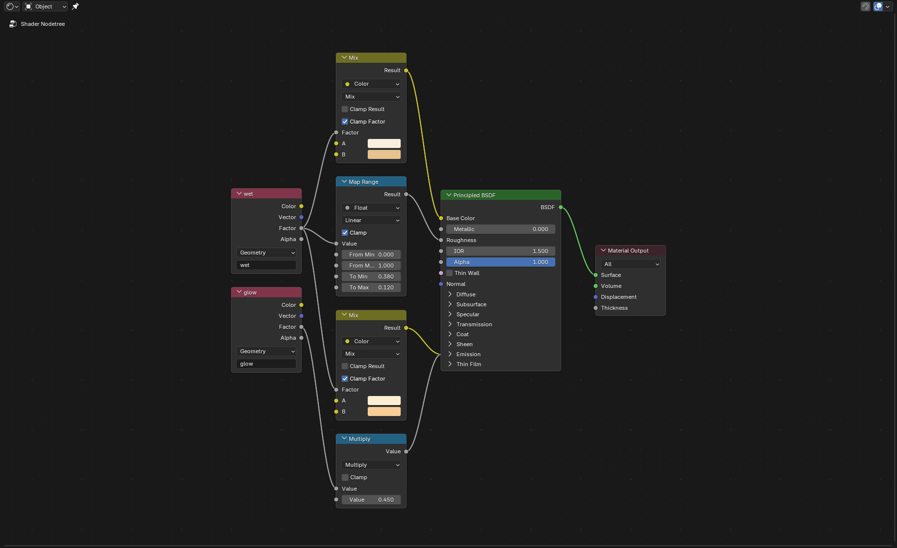

**PA_Sugar** (the body): subsurface weight 0.7, radius (1.2, 1.0, 0.7) mm, roughness 0.38 → 0.12 when wet, base colour
(0.95, 0.87, 0.74) → tea brown. It scatters light like packed snow and fills the gaps between the crystals with a
milky glow. The subsurface is on the body only: a 0.4 mm grain is smaller than a 1 mm scattering radius, and light
would leak out of it grey.

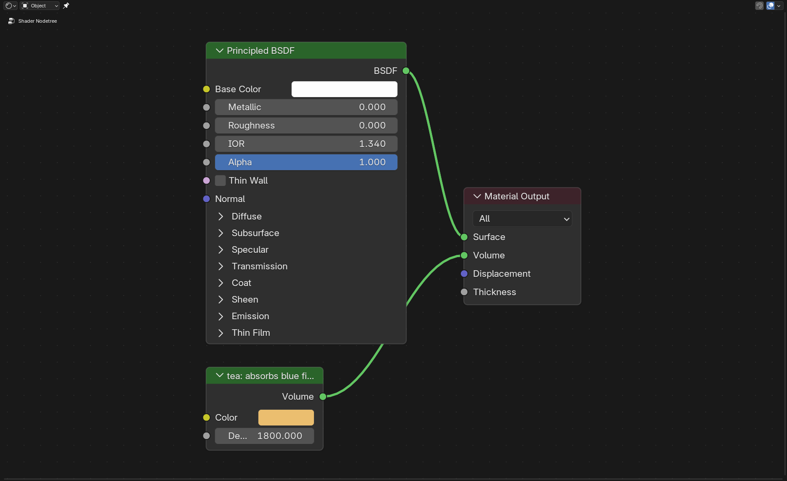

**PA_Tea**: a clear surface (white, roughness 0, transmission 1, IOR 1.34) with `tea: absorbs blue first`, a Volume
Absorption of colour (0.84, 0.52, 0.16) and density 1800 per metre. The colour comes from depth: 1 mm of tea keeps 75 %
of the red and 22 % of the blue, so the thin rim is pale amber and the middle of the pool, where light crosses the tea
twice (down to the saucer and back), is dark.

**PA_Saucer**: a 3 m plane, base (0.86, 0.86, 0.85), roughness 0.3, a white glaze.

## Appendix B · Light and camera

Lighting preset **E** in `build.py` (`LIGHTS['E']`):

| Light | Where | Why |
|---|---|---|
| **Rim**, disk 3 cm, 2.2 W, warm (1.0, 0.90, 0.76) | (−0.08, 0.16, 0.16) m: high behind the cube, a little to the right | the backlight: glints on every crystal, a shadow towards the camera, and the direction `PA_Light through` uses |
| **Kick**, disk 25 cm, 0.65 W | (0.16, −0.18, 0.06) m: low, front right | lifts the faces turned away from the rim |
| **Strip**, rectangle 5 cm × 3 mm, 0.08 W | placed so the pool mirrors it at (6, −9, 1) mm; diffuse and volume rays can't see it | one bright line in the tea: the cue that says liquid |
| World | grey 0.93, strength 0.35 | soft fill for the white set |

Camera: 100 mm lens, 0.128 m from (0, 0, 11) mm, 37° above the saucer, 34° round from the front; f/22, focused 4 mm
in front of the cube's centre towards its front corner, so the front edges are sharp and the back of the saucer goes
soft. Colour: AgX, Medium High Contrast. Light bounces: 24 in total, 20 transmission, 24 transparent, because the light
seen through the cube crosses many grains.

## Helper groups

| Group | Inputs → output | Used in |
|---|---|---|
| `PA_Smoothstep` | from, to, x → t²(3 − 2t), t = clamp((x − from) / (to − from)) | everywhere a change eases in and out: the bite, the slump, the wet edges, the glow masks; with from > to it runs backwards (1 → 0) |
| `PA_Clock` | Age, Drops → Wear, Drop height, Falling | 1 · Time of both trees |
| `PA_Sugar field` | Position, Wear, Seed, Size, Drip X, Drip Y → Sugar, Wet | 2, 3, 4, 5, and inside `PA_Walk` |
| `PA_Rounded box` | x, y, z, Half width, Half height, Radius → Inside | `PA_Sugar field` b |
| `PA_Walk` | Position, Direction, Normal, Wear, the field's sliders → Light | `PA_Light through` b, five times |

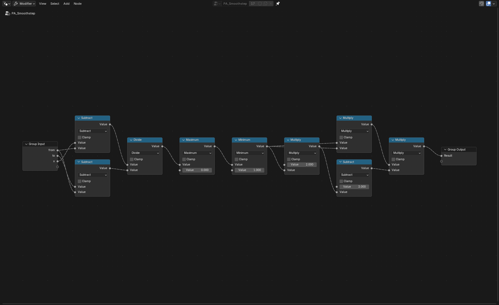

---

## How it was rendered

- **Video:** Cycles, 128 samples + denoise, 1080², 24 fps, on a Mac (Apple M4 Pro, Metal), about 23 s a frame: 192
  frames in 72 minutes. `render_frames.sh` renders a PNG sequence (kernel optimisation off: Metal's background kernel
  compile can crash Blender mid-render) and encodes it with libx264 at CRF 16.
- **Geometry per frame:** about 20 000 crystals (19 400 at frame 1, 6 800 at the end), the body (22 900 vertices at
  frame 1), up to 56 loose grains. The field is evaluated on 415 872 grid cells for the body, at 64 000 lattice points,
  and 29 more times at every body vertex and kept crystal for the glow.
- **Still:** `render.png` is frame 100 of the video.

---

## Try it yourself

1. **Coarse sugar.** In your own build, set Crystal to 0.8 on **PA_Sugar**. The lattice drops to 20³ = 8 000 points and each crystal is
   twice the size (and so are the loose grains): the cube turns into coarse crystal sugar, with big clear facets
   catching the rim light. The shell stays 1.15 mm thick, under two crystals deep now, but crystals of 0.9–1.4 × pitch
   still overlap enough to hide the body.
2. **Drip in the middle.** Set Drip X and Drip Y to 0 on both objects. The funnel opens in the centre, and the cube
   wears down evenly into a ring instead of breaking through one wall first.
3. **More drops.** Set Drops to 20 on both objects. Nineteen drops fall, twice as fast; each bite is 1/19 of the cube,
   so the stepped rhythm turns almost into a smooth melt.
4. **Another cube.** Set Seed to 7 on both. The lumps, the crystals' jitter and turn, the crumbs and the pool's edge all
   change; the funnel, the timing and the size stay.
5. **Move the light.** Move **PA_Rim** to the right. The glints and the shadow follow, but the glow doesn't: the
   direction it uses is a constant set by `build.py` from the rim's position. To match, edit the Combine XYZ that feeds the
   Light input of both `light through thin sugar` nodes in `PA_Sugar_GN`.

*Made with Blender 5.2 Geometry Nodes for [Nodevember](https://nodevember.com) 2026, Day 12 · Erosion.*
