# How a sandworm rides a track it never leaves

*A node-by-node walkthrough of Nodevember 2026 · Day 13 · Dune*

The video (6 s, 144 frames, a seamless loop) looks up at a giant sandworm standing out of a dune, its open maw turned
to the camera. Its armoured rings and rocky crust lean as the neck sways and nods, the ring muscle round the mouth
draws the opening in and lets it go, sand pours off the ring ledges in thin streams, and dust breathes out of the hole
it came from. One Geometry Nodes group, `PA_Sandworm_GN`, builds the body, the maw lined with 13 800 baleen needles,
the falling sand and the dust. A second small tree builds the dune and the berm of sand thrown up round the body.
There is no simulation, no image texture and no modelled or imported mesh (`pb.audit`: strictly procedural, no
issues). The motion is five sliders keyed on every frame, all with a whole number of periods in the 6 s loop.

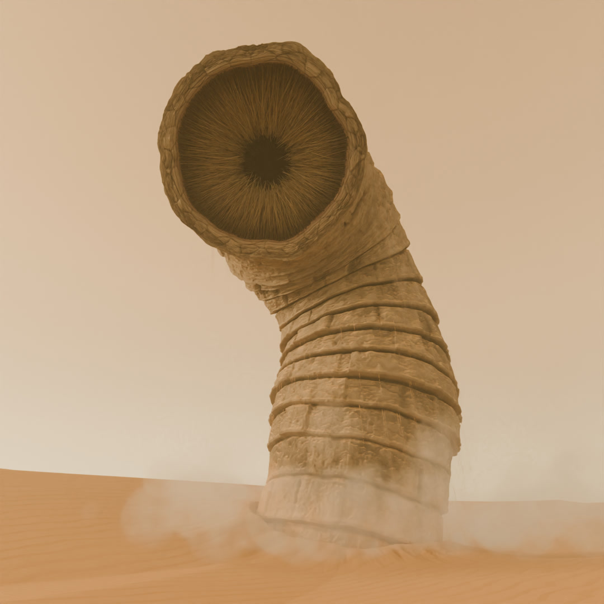

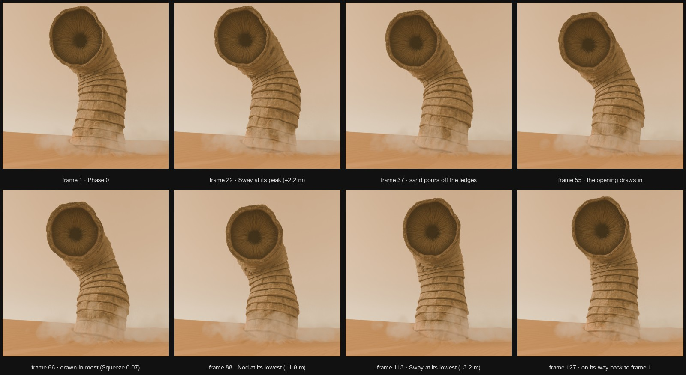

| File | What it is |
|---|---|
| [`../loop.mp4`](../loop.mp4) | the video: 1080², 24 fps, 144 frames (6 s), Cycles 64 samples + OpenImageDenoise |
| [`../loop_720.mp4`](../loop_720.mp4) | the same at 720², H.264 CRF 14 |
| [`../render.png`](../render.png) | frame 66, the hero still: the mouth drawn in most |
| [`../render-113.png`](../render-113.png) | frame 113, the neck swung furthest the other way |
| [`../nodes/`](../nodes/) | full screenshots of the main tree, `PA_Skin`, `PA_Head` and `PA_Hide` |

The scene lives in a file (`piece.blend`: **PA_Sandworm** with the tree `PA_Sandworm_GN`, **PA_Dune** with
`PA_Dune_GN`, **PA_Haze**, the sun and the camera) that a Python script builds (`build.py`: every tree, material and
light, the camera and the per-frame keys, written with a small expression layer that turns Python maths into Math
nodes). Neither is published. Every node is in the screenshots below, and the text names that script where a value
lives in it.

---

## The one idea

> **Everything is measured along the worm.** The track is a curve whose pitch and heading are functions of arc
> length u. The body is the stretch of that track behind the head, u = `Advance` − σ, where σ is how far back
> from the head you are. The skin's rows are σ and its columns the angle φ round the body. So moving the worm means
> sliding one number, `Advance`, and the body follows its own path through the sand like a train on rails. Because
> the track is pinned where it crosses the sand, the hole stays put while the body slides out of it.

Everything else is bookkeeping around that idea:

- **Where does it go?** `PA_Track`: under the sand, a turn up, a rise, a bend over the top and a straight strike,
  aimed through the camera (1 · Track).
- **Which part shows?** `PA_Spine`: 900 points from the head back to just under the sand, each with its own frame
  (forward, up, side), width and ring number; the neck sways and nods on top (2 · Spine).
- **What shape?** `PA_Skin` bends one tube along the spine. Its first rows are the head (`PA_Head`: a thick lip that
  curls over the face when shut, a rim and a funnel throat when open); the rest is hide (`PA_Hide`: telescoping rings,
  slabs and a rocky crust) (3 · Skin).
- **The maw?** `PA_Baleen` roots 46 rows of 300 needles on the throat wall (4 · Baleen).
- **The sand and dust?** `PA_Sand` asks where each grain left the body and how long ago; `PA_Puffs` breathes dust out
  of the hole; both become one volume (5, 6).
- **The ground?** A separate object, `PA_Dune`, reads a proxy of the spine and raises a berm round the body (Appendix A).

### How to read the screenshots

- Each coloured frame is one section of a tree. The main tree's sections are numbered (`2 · Spine`); sections inside
  a node group are lettered (`b · Telescoping: rise to a rim, step down`).
- A **cut-out** shows one section on its own. Wires that come from another section enter through a Group Input socket
  named after what they carry (`σ: metres behind the head`, `x on the face`). Wires that leave exit through a Group
  Output socket. `Head › r` means the output `r` of the `PA_Head` group; `grain › Z` the Z of the labelled Separate XYZ.
- Each section of the main tree has its own Group Input (titled `sliders`), showing only the sliders that section uses.
- Small formulas used in several places are node groups: `PA_Spine At` (the spine's frame at a given σ),
  `PA_Outline` (the lumpy head outline), `PA_Lip Arc` and `PA_Smooth Min`.
- Geometry hands data to the shaders as **named attributes**: `relief`, `crev` (cracks), `capc` (head row),
  `inside` (lip lining and throat), `skinco` (ring coordinate and face position), `sand_h` (height above the sand),
  `deep` and `along` on the needles.
- **Units.** 1 = 1 m. The body radius is 18 m and the head is about 63 m above the sand. Most shape numbers in `PA_Head`
  and `PA_Hide` are fractions of the radius ("× radius"), so they read the same at any size.
- `Smooth Step` in a Map Range node is the smoothstep t²(3 − 2t) of the clamped ramp between From Min and From Max:
  0 below, 1 above, an S between.

Click any screenshot to see it full size.

---

## 0 · The map

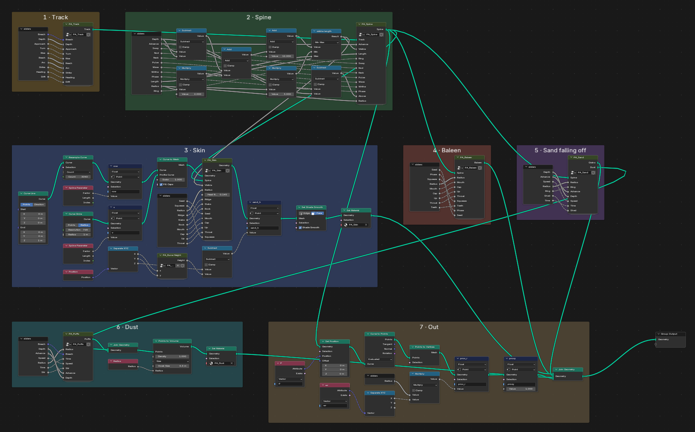


| # | Section | Nodes | Job |
|---|---|---|---|
| 1 | Track | 1, plus `PA_Track` (60) | the path: pitch and heading by arc length, walked into points and pinned to the sand |
| 2 | Spine | 8, plus `PA_Spine` (85) | the visible body: 900 points sampled behind the head, with frame, width and ring number |
| 3 | Skin | 16, plus `PA_Skin` (249) with `PA_Head` (152), `PA_Hide` (136), `PA_Spine At` (13), `PA_Outline` (18) | one tube of 3 040 rows × 768: head rows and hide rows |
| 4 | Baleen | 1, plus `PA_Baleen` (139) | 13 800 needles on the throat wall |
| 5 | Sand falling off | 1, plus `PA_Sand` (135) | 700 sites × 320 grains, each where it is τ seconds after leaving the hide; a dust point per grain |
| 6 | Dust | 5, plus `PA_Puffs` (59) | puffs out of the hole; grain dust + puffs → one volume |
| 7 | Out | 10 | a spine proxy for the dune, and one Join |
| – | The dune | `PA_Dune_GN` (96) with `PA_Dune Height` (73) | a camera-space grid of dunes with a berm round the body |
| – | Materials, sky, fog | `build.py` | rock and flesh, rippled sand, needles, sunlit dust, a dusty orange sky, ground fog |

The main tree holds 50 nodes: the 42 in the seven sections, one Group Input per section and the Group Output.

### The loop

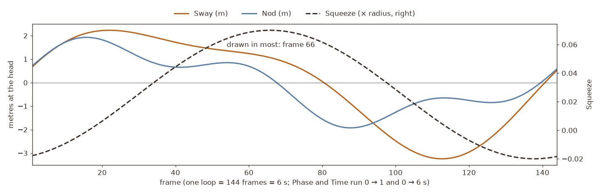

Nothing in the tree knows about frames. `build.py` computes the sliders for each frame in `state(f)` and keys them,
with ph = (f − 1) / 144 running 0 → 1 over the loop:

| Slider | Value | Effect |
|---|---|---|
| `Advance` | 253.8 m, constant | the head is held 103.8 m along the track past the breach (`Depth` = 150 m) |
| `Sway` | 2.5 sin 2πph + 0.8 sin(4πph + 1) | the neck swings sideways (m at the head) |
| `Nod` | 1.5 sin(2πph + 0.5) + 0.6 sin 6πph | the neck rises and dips |
| `Squeeze` | 0.09 k − 0.02, k = ½ + ½ cos 2π(ph − 0.45) | the mouth draws in once a loop, most at frame 66 |
| `Phase` | ph | drives the writhe, the peristalsis and the needles' quiver |
| `Time` | 6 ph seconds | drives the falling sand and the dust |

Every periodic thing has a whole number of periods in 6 s (sines in ph, sand periods of 3 or 2 s, puff periods of 6
or 3 s), so frame 145 would equal frame 1: the loop has no seam. `Speed` stays 0, `Mouth` stays 1.

---

## 1 · Track

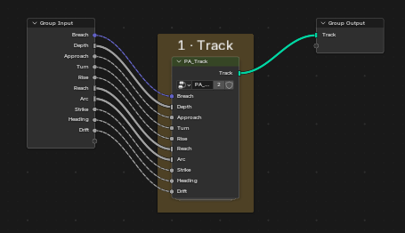


The worm never leaves its path, so the path is built first, as a curve 1 600 points long. Its shape is given by two
angles that change with arc length u: pitch θ (0 = level, 90° = straight up) and heading ψ (compass direction).
Angles are easy to design (an "approach at 20°, rise at 100°, strike at −41°" reads like a choreography) and a curve
built from them can never kink.

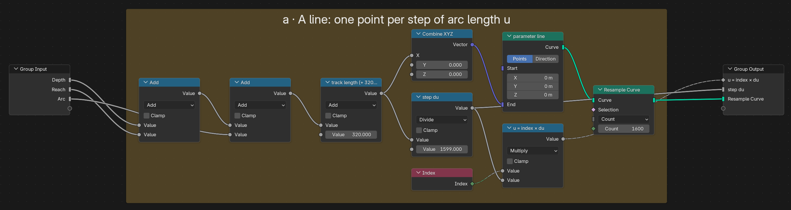

**a · A line: one point per step of arc length u.** A straight Curve Line as long as the whole track
(`Depth` + `Reach` + `Arc` + 320 m of run after the bend = 586 m), resampled to 1 600 points. Its points are only
slots: `u = index × du` gives each one its arc length (`step du` = 0.37 m).

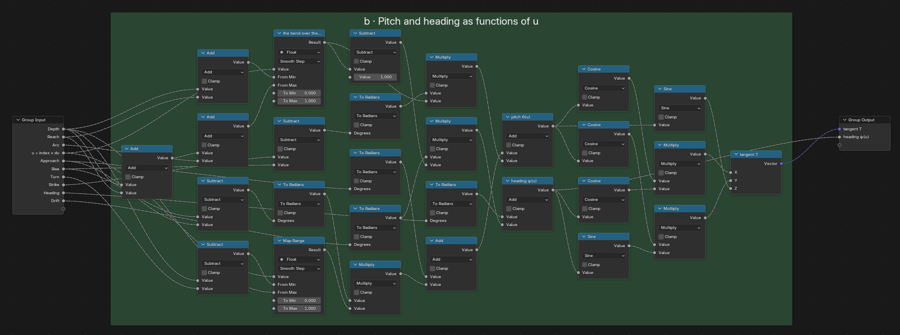

**b · Pitch and heading as functions of u.**

| Node | What it does |
|---|---|
| `pitch θ(u)` | `Approach` (20°), then a smoothstep to `Rise` (100°, leaning back past vertical) over the last `Turn` (40 m) before the sand, then a smoothstep to `Strike` over the bend |
| `the bend over the top` | smoothstep from u = `Depth` + `Reach` (176 m) to `Depth` + `Reach` + `Arc` (266 m) |
| `heading ψ(u)` | `Heading` + `Drift` × (bend − 1): it rises 55° off to one side; the bend turns it onto `Heading` |
| `tangent T` | (cos θ cos ψ, cos θ sin ψ, sin θ), a unit vector |

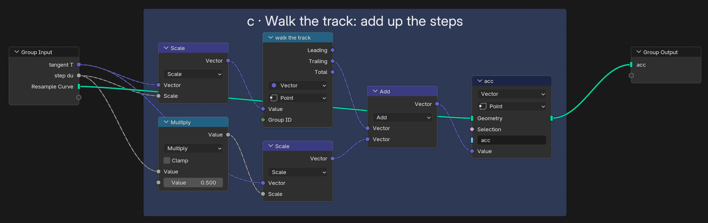

**c · Walk the track: add up the steps.** `walk the track` is an Accumulate Field of T × du over the points: point
i's position is the sum of all steps before it (the Trailing output) plus half its own step, the midpoint rule.

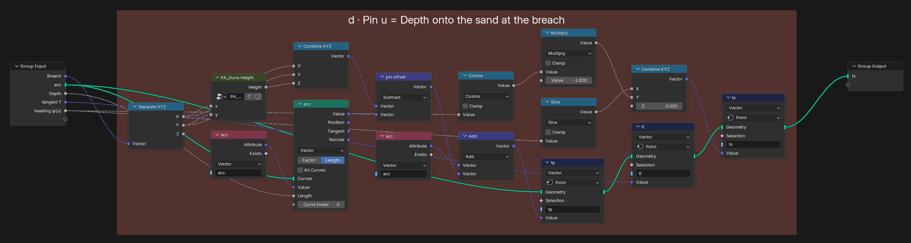

**d · Pin u = Depth onto the sand at the breach.** The walk starts at the origin, wherever that puts the track.
`pin offset` is the sand point at `Breach` (its height from `PA_Dune Height`) minus the walked position at
u = `Depth`, sampled with a Sample Curve by length. Adding it to every point moves the whole track so that it crosses
the sand exactly at the breach. The group stores three attributes: `tp` (position), `tt` (tangent) and `ts`, a level
side vector (sin ψ, −cos ψ, 0).

### Trick · aim the strike at the camera, outside the nodes

The final heading and the strike pitch are not hand-set: `solve_strike()` in `build.py` mirrors the track in Python,
turns `Heading` toward the camera (−111.6°) and bisects `Strike` until the straight run after the bend passes through
the lens (−41.2°). That is why the maw faces the camera: the head sits on a line that would run into it.

> **Try it:** set `Drift` to 0. The rise and the bend now lie in one vertical plane that points at the camera, so the
> bend is seen end-on and the S of the body flattens into a column. (The strike was solved for Drift 55, so the run
> no longer passes exactly through the lens.)

---

## 2 · Spine

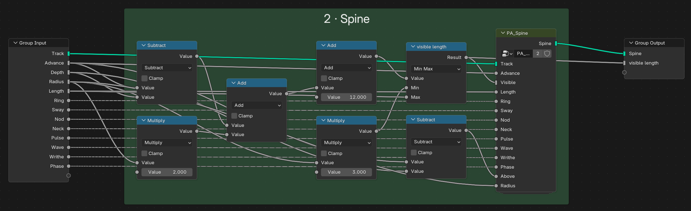

Only the body above the sand, plus a margin, is ever built: `visible length` = `Advance` − `Depth` + 2 × `Radius`
+ 12 m (151.8 m in the loop), clamped between 3 radii and `Length` (420 m). The rest of the worm is "in the sand"
and costs nothing.

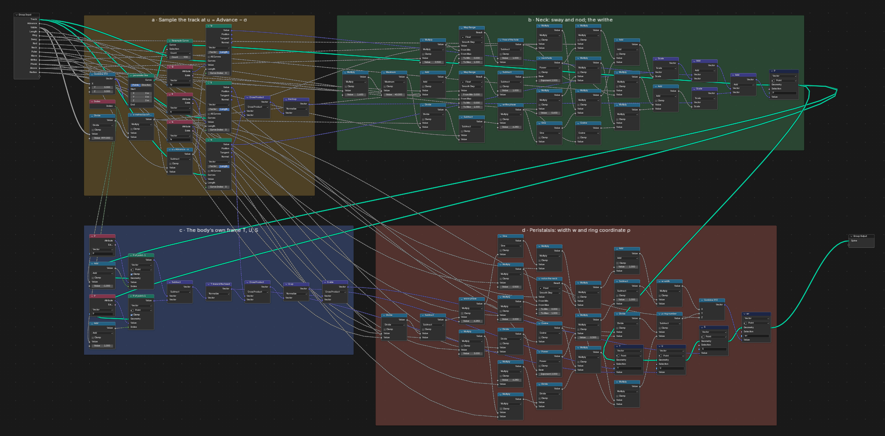

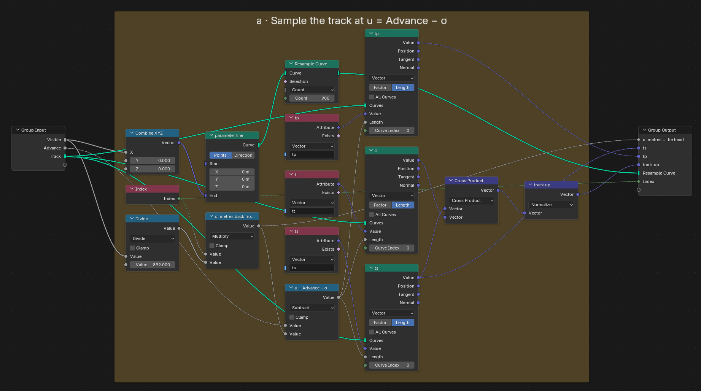

**a · Sample the track at u = Advance − σ.** 900 points, `σ: metres back from the head` from 0 to 151.8 m (one every
17 cm). Each reads the track's position, tangent and side at `u = Advance − σ`. This is the whole trick of the piece:
the head is at u = `Advance`, and every point behind it is where the head was σ metres ago.

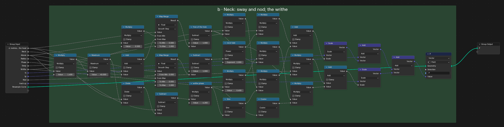

**b · Neck: sway and nod; the writhe.** On top of the track, two motions:

| Node | What it does |
|---|---|
| `neck fade` | (1 − smoothstep(0, `Neck`, σ))²: 1 at the head, 0 by 70 m back. `Sway` (sideways) and `Nod` (up) are scaled by it, so only the neck moves |
| `free of the hole` | 1 near the head, 0 near the sand (smoothstep from half the length above the sand to the sand + one radius): the hole holds the body still |
| `writhe phase` | (`Phase` − σ / max(1.6 × above, 40)) × 2π: one wave per loop, running from the head down toward the sand |
| P | track point + side × (sway·fade + `Writhe`·env·sin) + up × (nod·fade + 0.6·`Writhe`·env·cos), `Writhe` = 3 m |

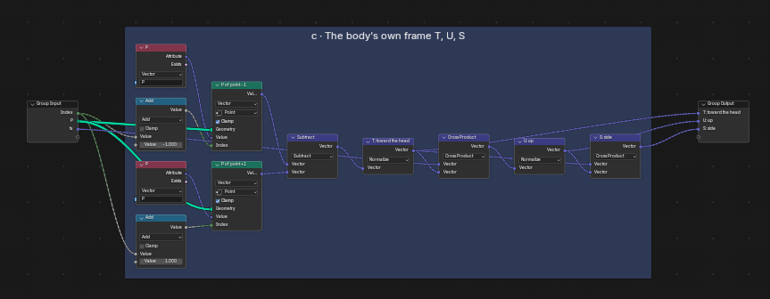

**c · The body's own frame T, U, S.** The sway moved the points off the track, so the track's tangent is no longer
the body's. `T: toward the head` is the difference of the neighbours' positions (Sample Index at index − 1 and
+ 1, clamped at the ends), `U: up` = ts × T, `S: side` = T × U. Using the track's level side vector ts as the
reference keeps the frame from twisting along the body.

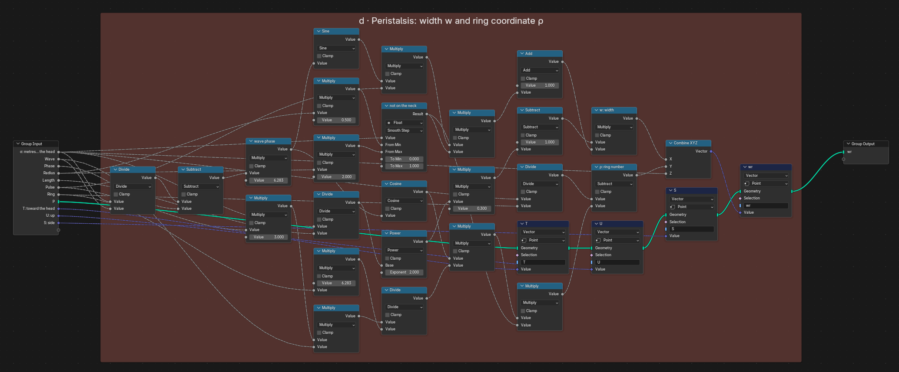

**d · Peristalsis: width w and ring coordinate ρ.**

- `w: width` = (1 − 0.3 (σ / `Length`)²) × (1 + sin θw × `Pulse` × not-on-the-neck): a 30 % taper over the full
  length, plus swellings of `Pulse` = 5 % that run back from the neck one `Wave` (45 m) apart.
- `ρ: ring number` = σ / `Ring` − cos θw × 3 `Pulse` `Wave` / (2π `Ring`) × not-on-the-neck. Its slope along σ is
  (1 + 3 `Pulse` sin θw) / `Ring`: where the body swells, the rings bunch up, as they do on a real earthworm.

The spine stores `P`, `T`, `U`, `S` and `wr` = (w, ρ, σ) on its points. `PA_Spine At` reads all of them back at any σ:

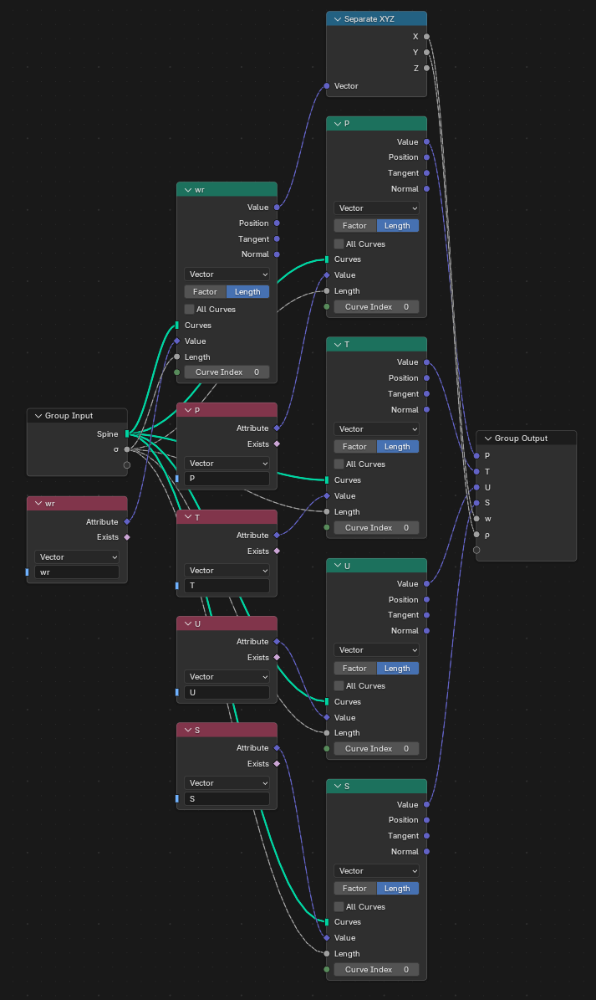

> **Try it:** set `Pulse` to 0.15. The swellings triple and the rings visibly crowd together on each one; with Phase
> keyed 0 → 1 they roll down the body one wavelength per loop, still seamless.

---

## 3 · Skin

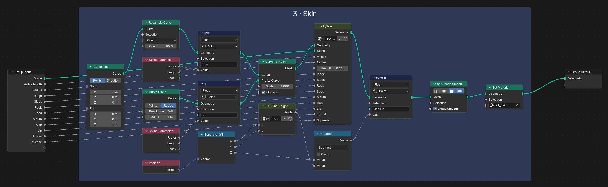

The whole worm, head and body, is **one closed mesh**: Curve to Mesh of a straight line (3 040 points: 440 head rows,
2 600 body rows) swept by a circle of 768 points, caps filled. Each vertex keeps two numbers, `row` (0 at the head
end → 1 at the tail) and `v` (0 → 1 round the circle). `PA_Skin` then moves every vertex to where it belongs.
After it, the section stores `sand_h`, the vertex's height above the dune, for the shader's sand coat.

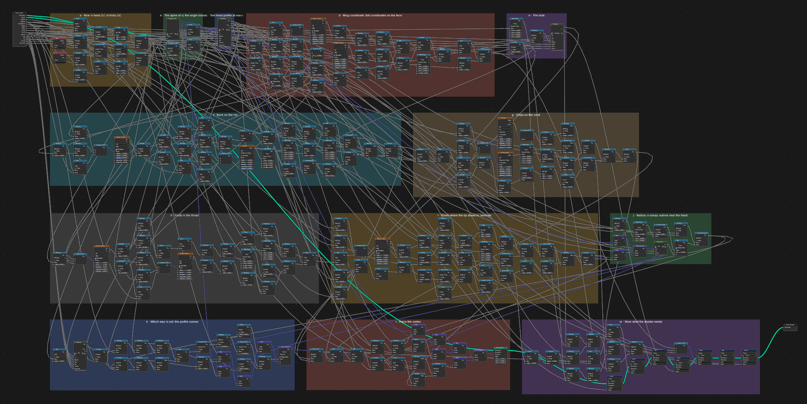

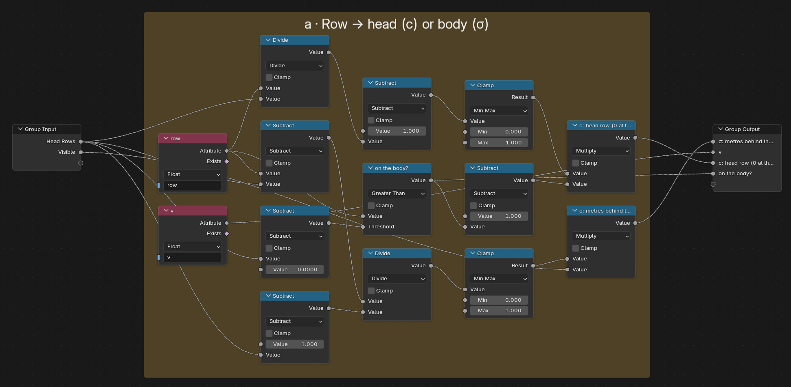

**a · Row → head (c) or body (σ).** The first 440 / 3 039 of the rows (`Head Rows` = 0.145) are the head. On them
`c: head row (0 at the neck)` runs from 1 on the first row (the bottom of the throat, closed by the cap) to 0 where
the head meets the body; `σ` is 0 there, so the whole head is placed around the spine's front point. On the body rows c = 0 and σ runs 0 → the visible length.

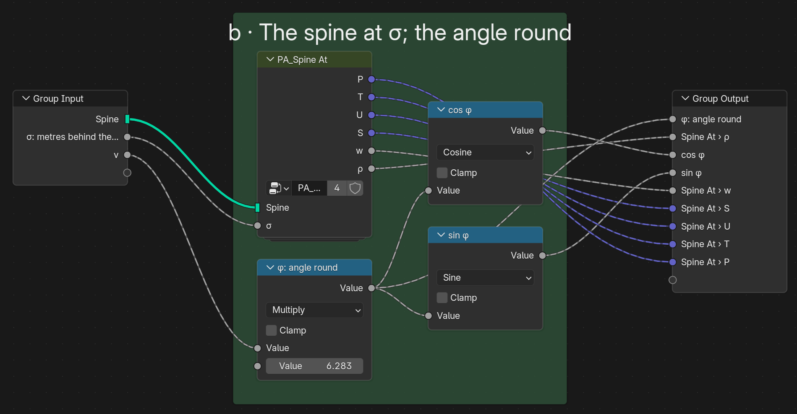

**b · The spine at σ; the angle round.** `PA_Spine At` gives P, T, U, S, w, ρ; `φ: angle round` = v × 2π.

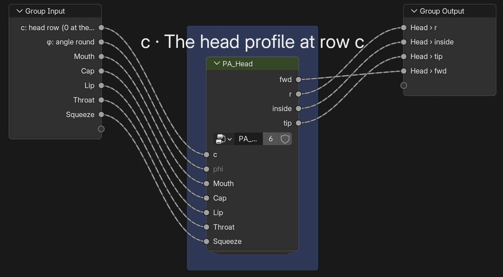

**c · The head profile at row c.** `PA_Head` turns c into `fwd` (how far forward of the spine's front point, × radius),
`r` (radius scale), `inside` (on the lip's lining or in the throat) and `tip` (across the lip's rounded edge).
See [Inside `PA_Head`](#inside-pa_head).

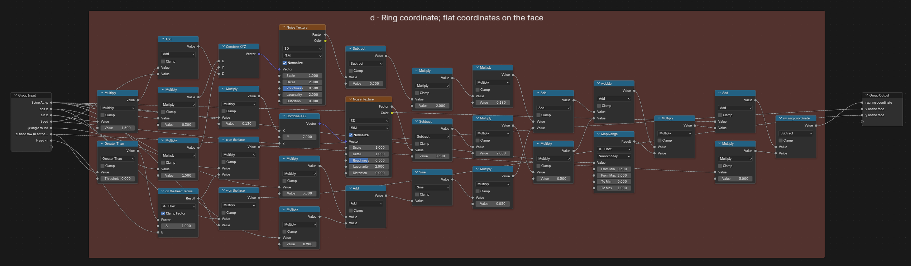

**d · Ring coordinate; flat coordinates on the face.** Real rings are not machined: `wobble` bends each ring edge
round the body and makes rings uneven in length, faded in over the first ring or two. `rw: ring coordinate` =
ρ + wobble − 5c continues the ring count forward over the head, so the rim's crust lines up with the rings behind it.
`x on the face`, `y on the face` are (cos φ, sin φ) × `on the head: radius, not angle`: on the body that is the unit
circle, on the face it is the true position across the face, so noise on the face does not pinch at the centre.

**e · The hide.** One `PA_Hide` call with rw and the face position; `Ridge` is faded in by smoothstep(0.4, 1.6, ρ),
so the first ring and a half behind the head stay smooth. `outside` = 1 − `inside`: the hide stops at the lip's
lining. See [Inside `PA_Hide`](#inside-pa_hide).

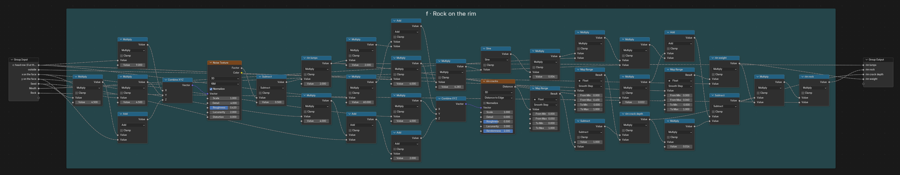

**f · Rock on the rim.** On the head rows (`rim weight`, faded in over c 0 → 0.06), coarse `rim lumps`, cracks
from a Voronoi Distance to Edge (`rim cracks`) where the lumps are high, and fine layers along the open rim
(sin of 60c, only when `Mouth` is near 1). `rim rock` = (0.022 lumps + layers − 0.014 cracks) × weight × `Rock`.

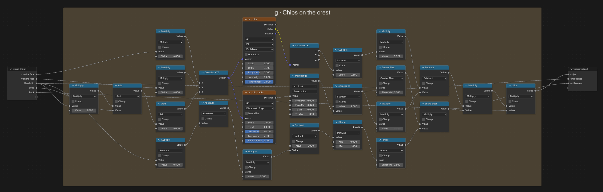

**g · Chips on the crest.** The rounded edge of the lip is laminated crust broken into chips: one Voronoi on
(face x × 6, face y × 6, tip × 2) gives each cell a random height (`rim chips`, Color output) and a crack between
cells (`chip edges`). `on the crest` limits them to the middle of the edge (tip near 0.5).

**h · Folds in the throat.** Inside, soft flesh in 60 long folds (|sin(30φ + noise)|) down the throat, and lumpy
lining on the inner face of the lip.

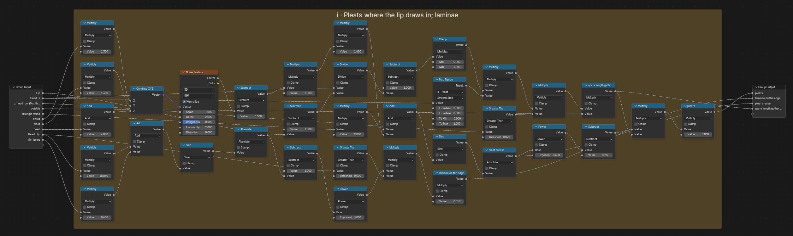

**i · Pleats where the lip draws in; laminae.** When the mouth is shut or squeezed, the lip is pulled toward the
centre but keeps its length, like a sea anemone closing. `spare length gathered` = clamp(1 − r / (1 − `Lip`)): zero
on the open rim, growing toward the pore. That spare length becomes `pleats`, 18 uneven radial folds (sin of 9φ
warped by noise). `laminae on the edge` cut thin layers across the rounded edge, at any opening.

**j · Radius: a lumpy outline near the head.** `body radius here` = `Radius` × w × mix(1, `PA_Outline`, near the
head). `PA_Outline` makes the head not quite round: a dozen flat-ish facets from a Voronoi distance, like split rock,
plus a little noise, at a scale near 1. It fades out over the first 1.2 radii of body.

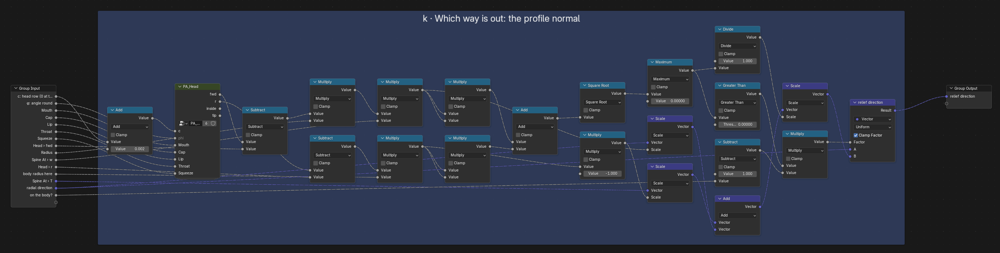

**k · Which way is out: the profile normal.** On the body, relief goes straight out from the axis. On the head it
must go out of the *surface*: on the flat front of the shut dome that is forward, on the lip's inner face it is
inward. The section calls `PA_Head` a second time one step further along (c + 0.002) and takes the difference
(df, dr) in metres: the profile's tangent. Rotated a quarter turn, (−dr along T, +df along the radial direction),
it is the normal: `relief direction`.

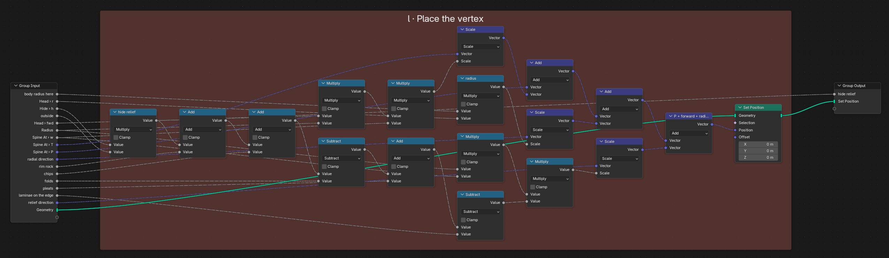

**l · Place the vertex.**

```
position = P + T · fwd·R·w + radial · r·(body radius) + relief direction · R·w · (hide + rim rock + chips − folds + pleats − laminae)
```

**m · Store what the shader needs.** `inside`, `relief`, `crev` (the largest of slab cracks, rim cracks, pleat
creases and chip edges), `ring_f`, `skinco` = (rw, face x, face y), `capc` = c and `mouth`.

### Trick · one tube, not a head glued on a body

Building the head as rows of the same tube means there is no seam to hide: the body wall runs straight on into the lip,
round its edge, back down its lining and into the throat. Shut, the lip's edge meets itself at a pore in the centre;
open, the same rows are the rim and the throat. The mouth opening is only a change in where those rows go.

---

## Inside `PA_Head`

`PA_Head` is the head's profile in its meridian plane: for a row c and the five head sliders it returns how far
forward (× radius) and how far out (× radius) that row sits. Four parts follow each other along c:

| c | Part |
|---|---|
| 0 → 0.04 | the run: the body wall carries on to the lip's root |
| 0.04 → 0.22 | the lip's outer face, from its root to its rounded edge |
| 0.22 → 0.40 | the lip's inner face, back from the edge to its root |
| 0.40 → 1 | the throat lining, down the funnel |

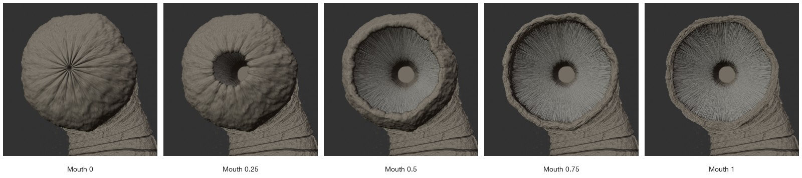

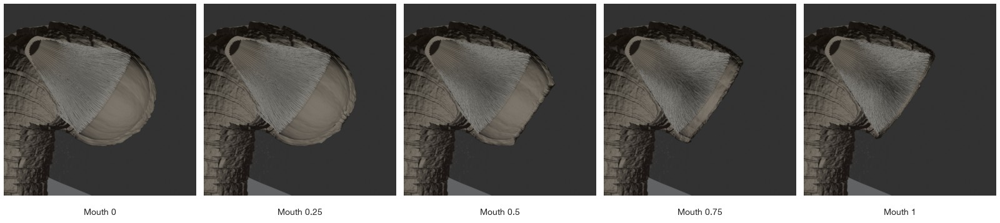

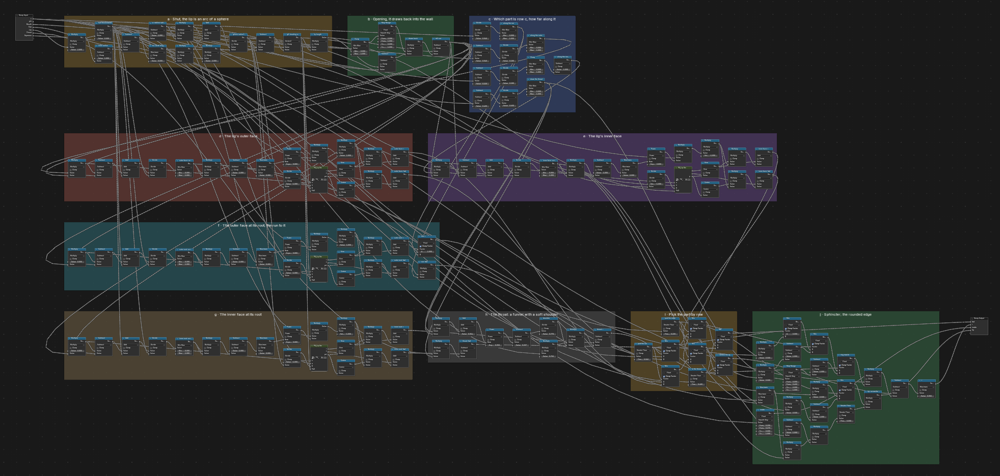

**a · Shut, the lip is an arc of a sphere.** The lip is 2 × `Lip` = 0.12 radii thick (`half thickness h0` = 0.06).
Its midline starts at radius `a: midline radius at the root` = 0.94 and, when shut, domes forward by
`hc: dome height of the midline` = `Cap` − h0 = 0.89. A dome through those two points is an arc of a sphere of radius
`sphere radius (a² + hc²) / 2hc` = 0.94, starting at heading `ψ0: heading at the root` = 87° (almost straight
forward) and curling until it points at the axis. `lip length` = radius × ψ0 = 1.43.

**b · Opening, it draws back into the wall.** `drawn back` = smoothstep(Mouth) × (length − h0); `still out` = what
is left. At `Mouth` = 1 only the rounded edge (h0) remains outside the wall: that is the rim.

**c · Which part is row c, how far along it.** Four clamped ramps of c: `along the run`, `along the outer face`,
`along the inner face` (backwards: 1 at the edge), `down the throat`.

**d, e · The lip's outer and inner face.** For a position s along the part of the lip still out, `PA_Lip Arc` gives
the midline (r, f) and its heading ψ; the face is the midline pushed ± half the thickness along the normal
(sin ψ, cos ψ). Across the last h0 of the lip the half-thickness shrinks as (1 − t²)^0.8 (`across the edge`), which
rounds the edge into a crest rather than a bead.

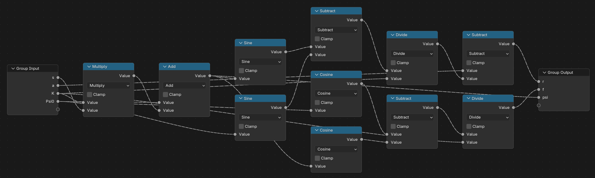

**f, g · The roots; the run.** The same face formula at s = 0 gives where each face meets the wall; the run mixes
from radius 1 to the outer root.

**h · The throat: a funnel with a soft shoulder.** From the inner root it runs `Throat` = 1.7 radii deep and narrows
by 0.75 × the inner radius, along `shoulder` = t^0.7 with its tip rounded off, so the wall leaves the lip straight down
and only then bends in.

**i · Pick the part by row.** Three Greater Than tests (`past the run`, `past the edge`, `in the throat`) choose
between the four (fwd, r) pairs with nested Mix nodes.

**j · Sphincter; the rounded edge.** `ring muscle` is 0 on the run, rises across the edge to 1 on the inner face and
fades over the top 45 % of the throat. `r` = r − `Squeeze` × ring muscle: the opening draws in while the outside
of the rim stays (see the strip below). `tip` runs 0 → 1 across the edge for the chips and laminae; `inside` turns on
just behind the edge, where the lining starts.

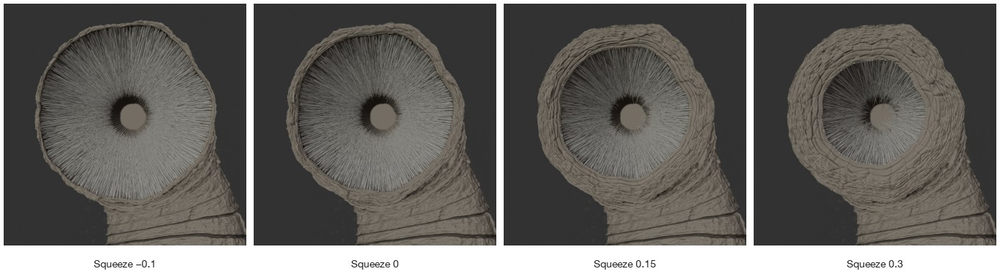

> **Try it:** set `Cap` to 0.4 and `Mouth` to 0. The shut head becomes a low, wide dome instead of a round nose: the
> sphere radius grows to 1.47, the lip starts at 40° instead of 87° and is 1.02 radii long instead of 1.43. At
> `Mouth` = 1 the difference almost vanishes, since only the lip's rounded edge is left out of the wall; it now
> leans further in.

---

## Inside `PA_Hide`

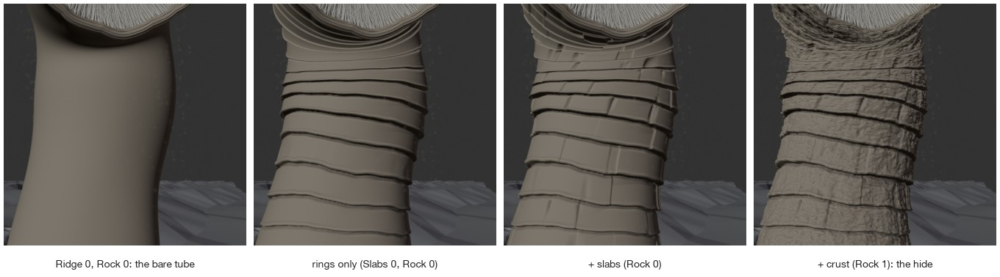

`PA_Hide` returns a height h (× radius) for a ring coordinate rw and a position round the body. It is the sum of
four layers, each a function of `f: along the ring (0…1)` and `k: ring number` = ⌊rw⌋.

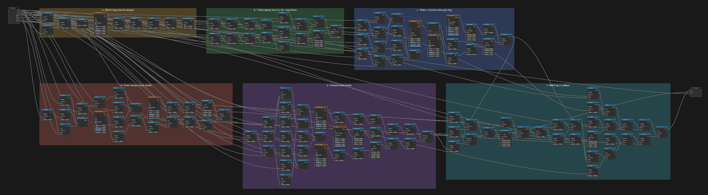

**a · Which ring, how far along it.** f = fract(rw), k = ⌊rw⌋, and `step height per ring`, a noise of k
(0.25 … 2): no two rings step the same.

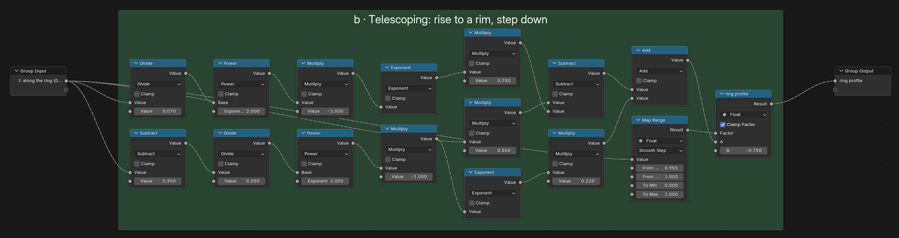

**b · Telescoping: rise to a rim, step down.** `ring profile` = 0.55 f − 0.75 e^−(f/0.07)² + 0.22 e^−((f−0.9)/0.05)²,
then blended to −0.75 over f 0.955 → 1. Read along the ring from its front: low, just behind the overhanging edge
of the ring ahead, a slow rise, a rounded rim at 0.9, then a sharp step down. Like segments of a telescope.

**c · Slabs: a Voronoi slice per ring.** A Voronoi on (k × 7.31 + Seed, cos φ × `Slabs`/2π, sin φ × `Slabs`/2π):
the first coordinate is constant over a ring, so every ring gets its own 2-D slice, and round the circle there are
about `Slabs` = 9 cells. `slab height` (the cell's random colour − 0.5) lifts or sinks each block; `slab edge`
(Distance to Edge) is a vertical crack, which a noise lets come and go.

**d · Crust: lumps, crust, strata.** `lumps` (coarse noise), `crust` (finer, detail 3.5) and `strata`, thin layers
along the ring (sin 12π(f + 0.35 crust)) where the lumps are high.

**e · Creases and cracks.** `creases`: ridged noise (1 − |n|)⁵ stretched round the body, warped by the crust.
`cracks`: Voronoi edges at a finer scale where a noise allows. `fine cuts` = the larger.

**f · Add it up (× radius).**

| Node | Formula |
|---|---|
| `rings` | (ring profile × step height + 0.8 slab height − 0.6 slab edge) × `Ridge` (0.06) |
| `terraces` | the lumps quantised into five soft ledges: (⌊5 lumps + 1.5 crust⌋ + smoothstep of the fraction) / 5 |
| `crust relief` | (0.03 lumps + 0.022 terraces + 0.022 crust + 0.002 strata − 0.014 fine cuts) × `Rock` |
| `h` | rings + crust relief |

With R = 18 m, `Ridge` 0.06 gives ring steps of about a metre and a half; the crust adds a few tens of centimetres.
Finer detail than the mesh can hold (768 round, rows every 6 cm or so) lives in the shader's bump instead: noise finer
than the vertex spacing would alias into streaks.

> **Try it:** set `Slabs` to 24 and `Rock` to 2. The rings break into small bricks and the crust doubles into deep
> terraces. `Rock` 0 gives the clean machined rings of the third clay picture.

---

## 4 · Baleen

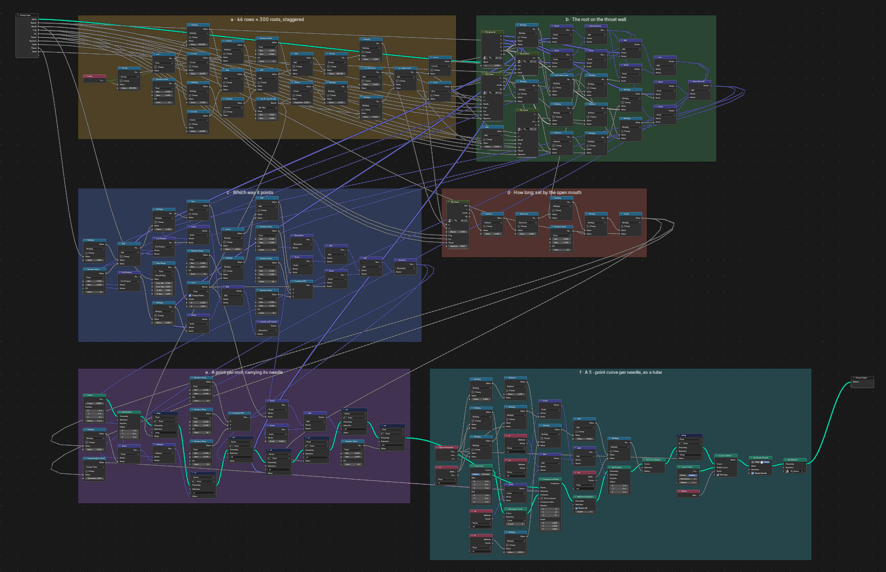

The maw is lined with fine needles, like a baleen whale's, rooted on the throat wall in staggered rows.

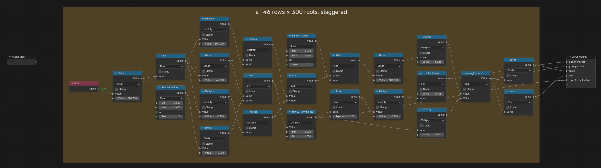

**a · 46 rows × 300 roots, staggered.** 13 800 points. `row (0 = by the lip)` is jittered by up to ±0.6 of a row so
the rows don't read as rings. `c on the throat` = 0.405 + row^1.2 × 0.45: the roots cover the upper part of the
throat. `φ: angle round` steps half a column every other row (staggered), jitters by half a column and twists 0.6 rad
from the first row to the last.

**b · The root on the throat wall.** `PA_Head` at c and at c + 0.004 gives the root and `down the wall`, the
direction of the wall at the root. `head radius here` uses the same `PA_Outline` as the skin, so the roots follow
the lumpy outline exactly.

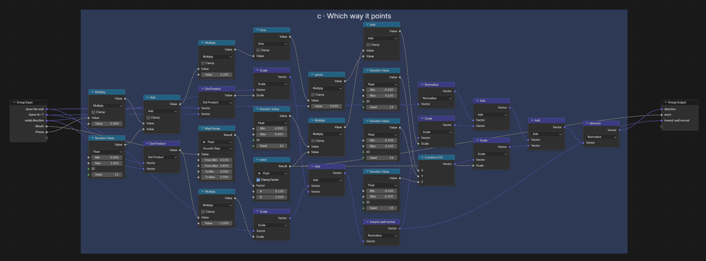

**c · Which way it points.** `inward: wall normal` (the wall direction turned a quarter toward the axis). The needle
leans from "down the wall" toward the axis by a random 0.3 … 0.8 × `erect`; `erect` = mix(0.12, 1, smoothstep
(0.15, 0.85, `Mouth`)), so a shut mouth folds them flat against the wall. `quiver` = 0.05 sin 2π(2 Phase + random): each
needle trembles twice a loop.

**d · How long: set by the open mouth.** `length` = max(r_open − 0.3, 0.04) × head radius × random(0.6 … 1.25)
× `Teeth`, where r_open is the throat radius at that row *with the mouth fully open*. Needles near the lip are long
(the throat is wide there), deep ones short. Because the length uses the open profile, needles don't grow or shrink
as the mouth opens: they are only uncovered.

**e · A point per root, carrying its needle.** Each root point stores what its needle needs: `nr` root, `nd`
direction, `nl` length, `nb` a bend (random + 0.04 inward), `nw` a width factor (0.6 … 1.5), `deep` its row.

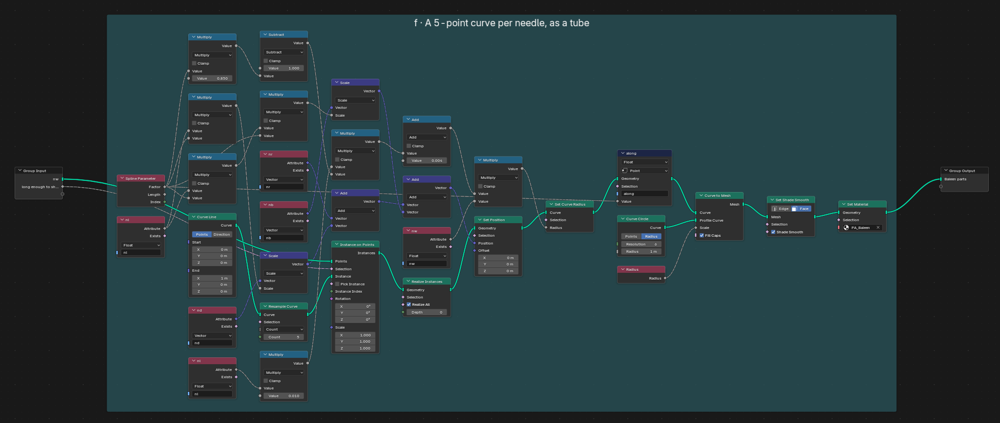

**f · A 5-point curve per needle, as a tube.** Instance a 5-point line on each root, realise, and read the stored
numbers back per point with the Spline Parameter t: position = root + d·L·t + bend·L·t², a gentle curve; radius =
(0.010 L (1 − 0.85 t) + 0.004) × width, tapering to a point. Curve to Mesh with a 6-sided profile. Needles shorter than
5 cm are not instanced. `along` = t goes to the shader: near-black at the root, brown at the tip.

---

## 5 · Sand falling off

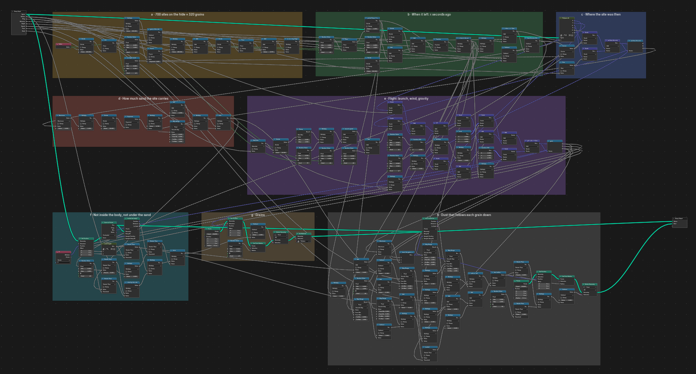

The worm has just come up through the sand, so sand keeps pouring off it. Simulating that would be a particle system;
here every grain is a formula of time.

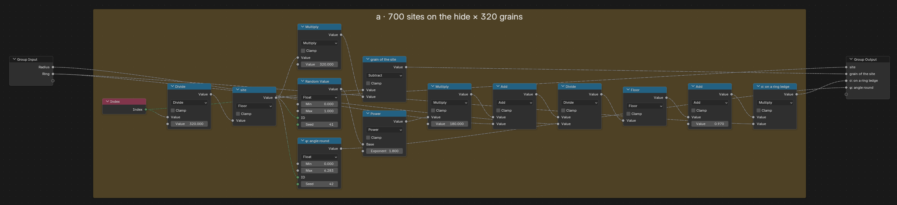

**a · 700 sites on the hide × 320 grains.** 224 000 points: `site` = ⌊index / 320⌋, `grain of the site` the rest.
A site's random values use the site as their ID, so its 320 grains share them. `σ: on a ring ledge` is a random
distance behind the head (biased toward the head, from one radius to 198 m), snapped to 97 % of the way along a ring:
the sand pours off the ledges where each ring steps down.

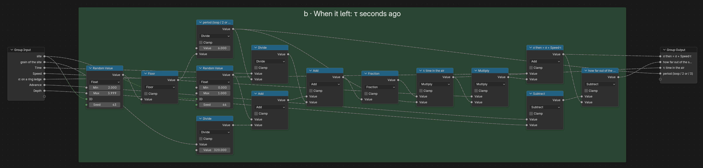

**b · When it left: τ seconds ago.** Each site pours in a cycle of `period (loop / 2 or / 3)`, 3 s or 2 s.
`τ: time in the air` = fract(random + grain / 320 + `Time` / period) × period: the 320 grains are spread evenly over
the cycle, so at any moment there is a grain that left just now, one that left 0.01 s ago, and so on: a continuous
stream. As `Time` grows every τ grows, and a grain that reaches the end of the period starts again at the ledge.

### Trick · where the site was τ seconds ago

The body moves along its own track at `Speed` m/s. A grain that left τ seconds ago left from the point of the body
that was then at the site's place on the hide, and since the body follows its track, that point is now `Speed` × τ
further back along the spine: `σ then = σ + Speed·τ`. So the stream can start where the hide *was*, using only the
current spine. (In the loop `Speed` is 0 and the body holds still.)

**c · Where the site was then.** `PA_Spine At` at σ then; `out from the axis` = S cos φ + U sin φ.

**d · How much sand the site carries.** `load` = (0.3 + 0.7 e^−above/30) × smoothstep(−0.6, 0.3, up) × `Shed`:
fresh sand near the hole, little high up, and only on faces that look upward. A site sheds if its load beats a
random number.

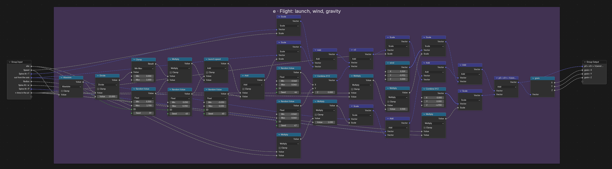

**e · Flight: launch, wind, gravity.** `launch speed` is 0.05 … 0.35 m/s (a slide off the ledge), more if the body
is fast. `v0` = T × `Speed` + out × launch + a little sideways jitter. Then plain ballistics from the hide's surface
(radius × w × 1.03):

```
p0 + v0·τ + ½·wind·τ² + (0, 0, −4.9)·τ²
```

with the wind a 1 m/s² push along the dune wind (−72°).

**f · Not inside the body, not under the sand.** A grain is `alive` if it is above the sand (`PA_Dune Height` at its
x, y), its site sheds, and it is more than 1.02 radii from the nearest spine point (Geometry Proximity), so streams
never fall through the body.

**g · Grains.** Points with a radius of 1.5 … 4.5 cm; the rest deleted.

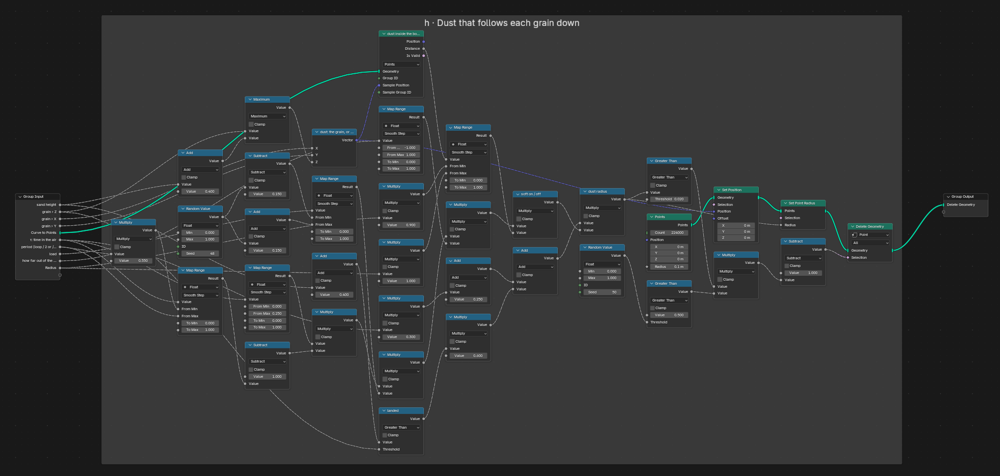

**h · Dust that follows each grain down.** A second point set from the same 224 000 indices: each grain trails dust,
which stays on the sand once the grain lands. Its radius (0.3 τ + 0.25, + 0.6 once landed) × `soft on / off` grows
as it falls. Every on/off is a soft ramp, never a cut: it swells in over the first 0.25 s, thins over the last 45 % of
the period, fades with load and height, and fades near the body. Half the points are kept.

### Trick · read fields before Delete

The dust is built from the full set of 224 000 points and only then thinned. Random Value and Index are read on the
geometry being evaluated: after a Delete Geometry, the survivors are renumbered, and a field read there would give
each point another grain's random numbers. Build first, delete last.

> **Try it:** set `Shed` to 0.3. Only the sites low on the body with the highest load still pour; the upper streams
> stop, and the dust round the base thins with them.

---

## 6 · Dust

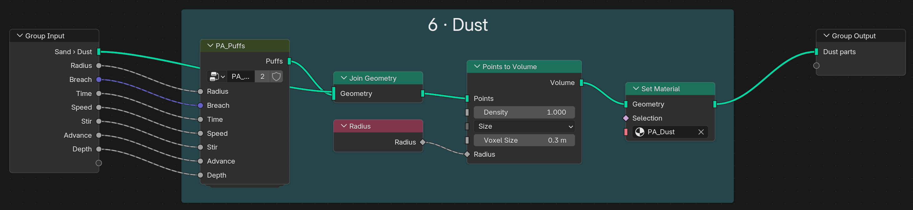

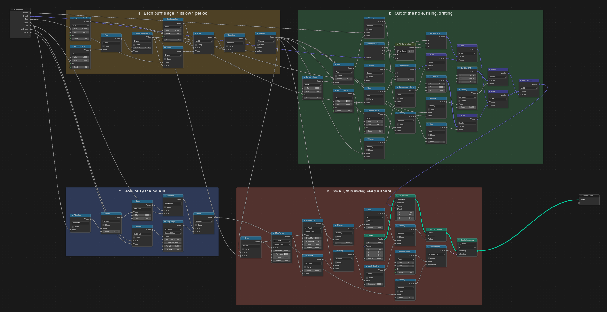

`PA_Puffs` breathes dust out of the hole: 900 puffs, each on its own cycle of 6 s or 3 s.

| Section | What it does |
|---|---|
| a · Each puff's age in its own period | a random angle round the hole; `age (s)` = fract(random + `Time` / period) × period |
| b · Out of the hole, rising, drifting | distance from the axis = radius × (1.1 … 1.6) + age × (1.5 … 4 m/s); height 1 m + age × (0.8 … 2.6 m/s); drift 0.4 age² along the wind |
| c · How busy the hole is | `busy` = max(\|Speed\| / 12, `Stir`) × smoothstep(−2, 6, Advance − Depth): in the loop, `Stir` = 0.4 |
| d · Swell, thin away; keep a share | radius (0.9 age + 1.6 m) × √(swell in over 15 % of the cycle × thin out over the second half); keep a puff if a random number ≤ 1.4 × busy (56 %) |

Points to Volume turns grain dust and puffs into one density grid with a 0.3 m voxel, each point a sphere of its own
radius. The dust shader thins it further with a noise (`torn edges`) and makes it glow a little, as sunlit dust does.

> **Try it:** set `Stir` to 1. All 900 puffs show and the base disappears in a thick ring of dust.

---

## 7 · Out

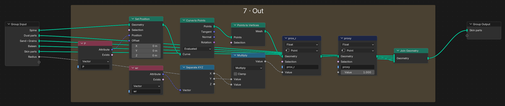

The section turns the spine into 900 loose vertices that carry `prox_r` (the body radius there) and `proxy` = 1.
Loose vertices do not render. They are there for the dune, the next appendix, which reads them to raise a berm
where the body meets the sand. Then one Join.

---

## Appendix A · The dune (`PA_Dune_GN`)

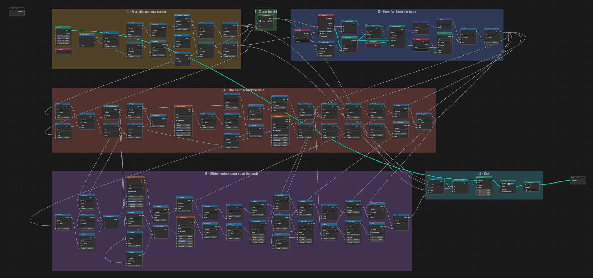

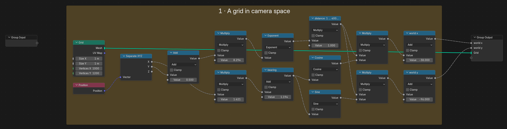

**1 · A grid in camera space.** The ground runs from the camera's feet to the horizon. A plain grid would waste most
vertices far away and still be too coarse up close. Instead a 1 000 × 1 200 grid is bent into a fan from the
camera: `distance` = e^((y + 0.5) ln 4000), from 1 m to 4 km, so the row spacing grows in step with the distance and
every row is about the same height on screen; `bearing` spans ±46° about the view direction (1.5 × the lens's
half-angle).

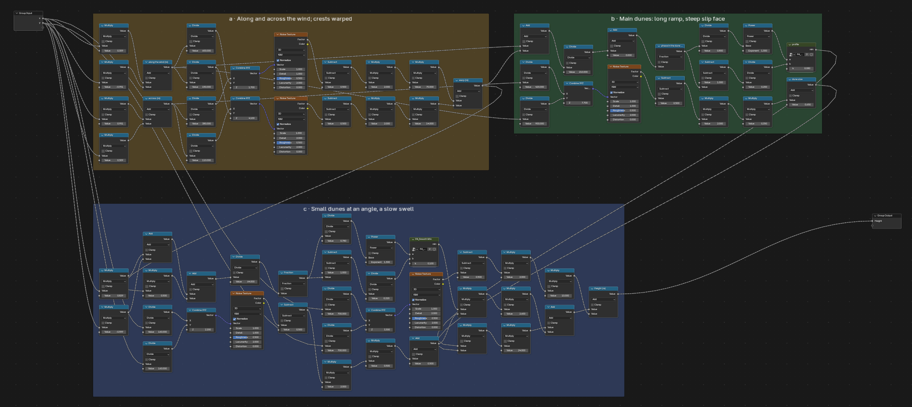

**2 · Dune height.** `PA_Dune Height` gives transverse dunes:

- **a** · coordinates `along the wind (m)` and `across (m)` for a wind along the −72° direction, with the crests warped by ±70 m
  and ±14 m noise so they wander;
- **b** · the main dunes, 210 m apart and 24 m high: `phase in the dune` p = fract((along + warp) / 210), and the
  profile `PA_Smooth Min`((p / 0.8)^1.3, (1 − p) / 0.2) — a long windward ramp over 80 % of the wavelength meeting a
  steep slip face, the crest rounded by the smooth minimum; `dune size` scales each dune's height between 30 and 100 %;
- **c** · small dunes 64 m apart at 38° to the main ones (2.6 m), and a slow ±10 m swell over 700 m.


**3 · How far from the body.** Object Info reads `PA_Sandworm`; Separate Geometry keeps the proxy vertices;
Sample Nearest + Sample Index give the nearest spine point and its radius. `distance to the hide` = |here − point| −
radius, clamped at 0.

**4 · The berm round the hole.** `bell: exp(−(d / width)²) × height`: 9 m wide and 3.4 m high, each varied ±45 % and
±50 % by noise round the hole, so the berm is uneven.

**5 · Slide marks; sagging at the body.** `slide marks`: ridged noise round the hole (grooves where sand slid
down), coming and going; the berm also sags to 55 % right against the body, where it falls into the hole.

**6 · Out.** Set Position to (x, y, height + berm), smooth shading, the Sand material.

The grid's x, y never move, so the dune itself is the same on every frame; only the berm follows the body.

---

## Appendix B · Materials, sky and fog


**Skin.** 1 · rock between dark brown (0.15, 0.13, 0.11) and pale (0.40, 0.34, 0.27) by two noises on `skinco`,
darker in deep steps and cracks (`relief`, `crev`). 2 · `sand on ledges` on faces that look up, and a coat that
climbs from the sand line in tongues (`sand_h` < 1 … 14 m). 3 · `colour with flesh`: crust → dark red-brown flesh from
the lip's edge in, to near black down the throat (`capc`). 4 · a micro bump of fine noise and ridged noise that the
mesh can't hold, roughness 0.9 on the rock, 0.45 on wet flesh, 1 and no specular `far down the throat`.


**Sand.** Bump only: `ripples (24 cm)` across the wind with a steep downwind side, `megaripples (2.4 m)`, both made
with the same smooth minimum as the dunes, off on slip faces (`not a slip face`). Colour between (0.42, 0.25, 0.12)
and (0.72, 0.50, 0.30) by a 140 m noise, 18 % darker on slip faces. Roughness 0.93.

**Baleen.** Near-black root → brown tip by `along`, darker in deeper rows (`deep`), a touch of subsurface and coat.

**Dust.** Principled Volume: density = point density × torn-edge noise × 0.07, colour (0.92, 0.72, 0.50), emission
(1.0, 0.76, 0.50) at 0.4 × density.

**Sky and light.** A sun 14° above the horizon, 95° round to the left of the view direction (seen from above), strength 8, colour (1, 0.62, 0.34),
0.6° wide. The world is Blender's Sky texture (multiple scattering, no sun disc) recoloured: its brightness times a
blend from a pale horizon (1, 0.80, 0.50) to a deeper zenith (0.98, 0.58, 0.28). AgX view transform.

**Fog.** `PA_Haze` is a 4 × 4 × 0.9 km box with a Principled Volume: 0.0006 haze plus ground fog of 0.001 at the sand
that thins by e every 35 m up, pale yellow (1, 0.86, 0.52), with a little emission in step with the fog (sunlit fog
glows from light scattered many times, which one bounce of volume scattering misses).

### Trick · fog in a box, not in the world

A world volume would swallow the sun: Cycles' shadow rays toward a sun lamp never leave an infinite volume, and the
scene goes dark. A finite box round the scene gives the same fog and lets the sunlight in.

---

## How it was rendered

Cycles on a Mac's GPU (Metal), 1080², 64 samples, OpenImageDenoise, fixed seed, persistent data: about 21 s a
frame, 51 minutes for the 144 frames. The scene is heavy for geometry: 2.75 million vertices for the worm
(2 334 720 in the skin, 414 000 in the needles), 1.2 million in the dune, and a dust volume rebuilt every frame.
Before the final render the motion was checked as a white-clay Workbench preview.

## Try it yourself

1. **Close the mouth.** In your own build, key `Mouth` from 1 to 0 over the loop. The lip slides out of the wall and curls over the face,
   the needles fold flat (`erect` → 0.12) and pleats gather round the pore.
2. **Let it surface.** Animate `Advance` from 140 to 254 over the 6 s and set `Speed` to match (114 m in 6 s is
   19 m/s): the body slides up out of the fixed hole along its own track, the streams start from where the hide was
   when each grain left, and `busy` reaches 1, so every puff shows.
3. **A different worm.** `Radius` 8, `Ring` 3, `Slabs` 5: a thinner worm with more, smaller rings. Everything in the
   head and hide is × radius, so the maw and crust scale with it.
4. **More sand.** `Shed` stays at most 1, but `N_SAND` in `build.py` sets 700 sites × 320 grains: double the sites
   for twice as many streams (and twice the dust).
5. **Another desert.** Change `DUNE` in `build.py` (`lam` 210 → 90, `height` 24 → 10) for small, close dunes; the
   berm and the sand line on the hide follow, since both read `PA_Dune Height`.

*Made with Blender 5.2 Geometry Nodes for [Nodevember](https://nodevember.com) 2026, Day 13 · Dune.*
