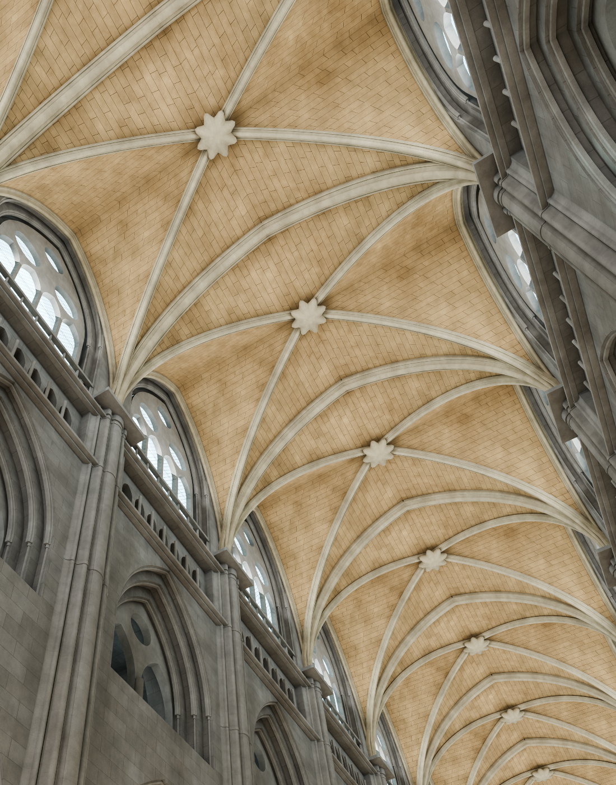

# Nodevember

My entries for [Nodevember](https://nodevember.com), the November challenge for node-based art. One prompt a day.

Every piece is procedural, built with Blender 5.2 Geometry Nodes and shader nodes, with no image textures and no
hand modelling. Each `.blend` file is generated by a Python build script, so you can read exactly how it is made and
build it again yourself.

## 2026

| Day | Prompt | Piece | |
|---|---|---|---|
| 01 | Origami | **Paper plane.** A sheet of washi paper folds itself into a paper plane and glides off the stack. The sheet underneath is already waiting, so the 8-second loop is seamless. | [files](2026/day01-origami) · [loop](2026/day01-origami/loop.mp4) · [**node-by-node tutorial**](2026/day01-origami/tutorial/README.md) |
| 02 | Furniture | **A day in the corner.** A reading corner lit by one window, out of frame. In 10 seconds the sun crosses the room from raking morning light to a golden window on the wall, the lamp clicks on at blue hour, the moon comes through, and morning returns. Bouclé, walnut, travertine, pleated linen, knit, wool and glaze are all shader nodes. | [files](2026/day02-furniture-v3-corner) · [loop](2026/day02-furniture-v3-corner/loop.mp4) · [**node-by-node tutorial**](2026/day02-furniture-v3-corner/tutorial/README.md) |
| 03 | Stitch | **Kintsugi.** An old cream tea bowl breaks along its gold seams. The shards are glued back one by one with black urushi lacquer, which squeezes out of each seam, and then gold flows down every crack from the rim until the bowl is whole again. | [files](2026/day03-stitch-v3-kintsugi) · [loop](2026/day03-stitch-v3-kintsugi/loop.mp4) · [**node-by-node tutorial**](2026/day03-stitch-v3-kintsugi/tutorial/README.md) |
| 04 | Brass | **Chladni.** Sand on a brass plate finds the nodal lines of four rising tones: an X of arcs, a rounded square round a ring, a ring of loops, then lace. At each new tone the grains leap off the parts that shake and settle on the lines that stand still. One standing-wave formula, with Newton steps in a Repeat Zone. | [files](2026/day04-brass-v2-chladni) · [loop](2026/day04-brass-v2-chladni/loop.mp4) · [**node-by-node tutorial**](2026/day04-brass-v2-chladni/tutorial/README.md) |
| 05 | Clockwork | **Four-season music box.** A wind-up music box whose stage makes one turn per loop, and that turn is one year. The tree on it goes from snow through blossom, leaf and fruit to leaf-fall and back, and behind a wall of translucent enamel a pinned cylinder plucks a steel comb, one bar of the tune per season. The sound is synthesised from the same score as the pins, so picture and tune loop together. | [files](2026/day05-clockwork-v3-musicbox) · [loop with sound](2026/day05-clockwork-v3-musicbox/loop_sound.mp4) · [**node-by-node tutorial**](2026/day05-clockwork-v3-musicbox/tutorial/README.md) |
| 06 | Vault | **Rouen nave.** You lie on the floor of the nave of Rouen Cathedral and look up as you walk towards the rose window: four storeys of stone, pointed arches and a quadripartite rib vault, with every ochre stone of the cells laid course by course. The nave slides back one bay per loop, so the 10-second walk never ends. Rendered in Cycles, and again in EEVEE. | [files](2026/day06-vault-v5-rouen) · [loop](2026/day06-vault-v5-rouen/color/loop.mp4) · [EEVEE loop](2026/day06-vault-v5-rouen/eevee/loop.mp4) · [**node-by-node tutorial**](2026/day06-vault-v5-rouen/tutorial/README.md) |

<p>
  
  
</p>

<p>
  
  
</p>

<p>
  
  
</p>

<p>
  
  
</p>

<p>
  
  
</p>

<p>
  
  
</p>

## What is in a day folder

| File | |
|---|---|
| `build.py` | builds the whole scene: node trees, materials, lights, camera, render settings |
| `*.blend` | the result of `build.py`; open it to explore the node trees |
| `loop.mp4` | the render, 1080 × 1080 (`loop_sound.mp4` adds the sound, where there is one) |
| `_still_*.png` | full-quality stills |
| `nodes*.png` | node-tree screenshots |
| `nodes_layout.json` | node positions and frames, tidied by hand; `build.py` restores them |
| `post.md` | idea, build log, captions and alt text |
| `tutorial/` | a walkthrough of the node tree, where there is one |
| `color/`, `eevee/`, `clay/` | a render copy and its loop per engine, where a piece was rendered more than one way |

## Rebuild a piece

You need Blender 5.2 and, for the video, ffmpeg.

```sh
cd 2026/day01-origami
blender -b --factory-startup --python build.py     # writes origami.blend
../../lib/render_frames.sh origami.blend 30         # PNG frames → loop.mp4
```

`lib/proc_blender.py` is a small helper library that every build script uses. It is a builder for node graphs, plus
layout, a seamless loop clock, a studio setup and render helpers. `lib/render_frames.sh` renders a frame sequence and
retries if Blender crashes, then encodes the MP4.

## License

All rights reserved. This is a private project, shared for learning and study only. You may view, download and run
the pieces to learn how they are made, but not redistribute them, use them commercially, present them as your own or
use them to train models. See [LICENSE](LICENSE).
